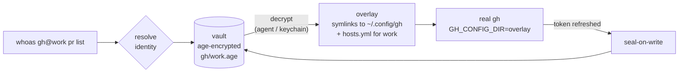

<h1 align="center">whoas</h1>

<p align="center">
  <b>Run any CLI as the account you meant to use.</b><br>
  Capture every OAuth login once. Switch per command, per project, or per AI agent —<br>
  without logging out, and without ever touching the CLI's own session.
</p>

<p align="center">
  <a href="https://github.com/S-kkipie/whoas/actions/workflows/ci.yml"></a>
  <a href="https://github.com/S-kkipie/whoas/releases/latest"></a>
  <a href="https://pkg.go.dev/github.com/S-kkipie/whoas"></a>
  
  <a href="LICENSE"></a>
  
</p>

```console
$ whoas add gh work               # log in once, through gh's own browser flow
$ whoas add gh personal

$ whoas gh@work repo list         # the real gh, as "work"
$ whoas gh@personal repo list     # at the same time, in another terminal, as "personal"

$ cd ~/code/client && whoas gh pr create   # picks "work" from the project's .whoas.yaml
```

---

## Why

You have two GitHub accounts, three Vercel teams, a personal and a company GCP
login, a couple of Neon orgs. Every one of those CLIs keeps **one global session**.
Switching means `logout` → browser → `login`, every single time — and the day
you forget, you deploy to the wrong account.

AI agents make it worse: Claude Code, Codex & co. run `gh`, `gcloud` or `vercel`
unattended and inherit **whatever session happens to be active**.

whoas keeps each login as a named, encrypted **identity** and runs the real CLI
against it — one process at a time, side by side, never mutating the CLI's own
config.

## Features

- 🔐 **Encrypted, local, open source.** Sessions are sealed with [age](https://age-encryption.org);
  the master key lives in your OS keychain (or Windows Credential Manager from WSL).
- 🌐 **Real OAuth sessions, not just API tokens.** whoas captures what the CLI's
  own login writes, so browser logins, refresh tokens and SSO keep working.
- 🔁 **Refreshed tokens are kept.** When the CLI rotates a token, whoas re-seals
  it within ~200 ms — even if the process later crashes.
- 🧭 **Context-aware.** Explicit `gh@work`, a profile (`-p work`), a session
  variable, or a trusted per-project `.whoas.yaml`.
- 🤖 **Built for agents.** Shims make `gh`, `gcloud`, … resolve the identity
  themselves, so an agent that has never heard of whoas still uses the right account.
- 🧠 **Claude Code and MCP servers.** Several Claude subscriptions side by side,
  and per-project API keys for remote MCP servers (PostHog, Linear, yours) in any agent.
- 🧱 **Global session untouched.** Your `~/.config/gh/hosts.yml` (and friends)
  is never written. Non-auth state — history, settings — stays shared.
- ⚡ **Concurrent and crash-safe.** Same identity in many terminals shares one
  workspace; different identities never collide; crashed runs are recovered.
- 🧩 **Declarative adapters.** Add a CLI with a small TOML file — no code.

## Supported CLIs

| CLI | Isolation | Session files captured | Env vars removed (they'd override the identity) |
|---|---|---|---|
| `gh` | `GH_CONFIG_DIR` | `hosts.yml` | `GH_TOKEN`, `GITHUB_TOKEN`, `GH_ENTERPRISE_TOKEN`, `GITHUB_ENTERPRISE_TOKEN` |
| `gcloud` | `CLOUDSDK_CONFIG` | `credentials.db`, `access_tokens.db`, `legacy_credentials/`, `configurations/`, `active_config`, `application_default_credentials.json` | `CLOUDSDK_CORE_ACCOUNT`, `CLOUDSDK_AUTH_ACCESS_TOKEN_FILE`, `CLOUDSDK_AUTH_CREDENTIAL_FILE_OVERRIDE` |
| `codex` | `CODEX_HOME` | `auth.json` | — |
| `neonctl` | `--config-dir` flag | `credentials.json` | `NEON_API_KEY` |
| `vercel` | `--global-config` flag | `auth.json`, `config.json` (keeps the selected team per identity) | `VERCEL_TOKEN` |
| `wrangler` | `XDG_CONFIG_HOME` (overlay of `~/.config`) | `.wrangler/config/` (every wrangler auth profile) | `CLOUDFLARE_API_TOKEN`, `CLOUDFLARE_API_KEY` |
| `railway` ⚗️ | `HOME` (overlay of `~`) | `.railway/config.json` | `RAILWAY_TOKEN`, `RAILWAY_API_TOKEN` |
| `docker` | `DOCKER_CONFIG` | `config.json` (inline `auths`; see [docker](#docker)) | — |

⚗️ **experimental:** works, with a known gap — commands started by `railway run`
also see the overlay `HOME`. The banner and `whoas providers` mark it.

**Root overlays** (`railway`: all of `~`; `wrangler`: all of `~/.config`): tools
that save a dotfile by writing a new file and renaming it (`git config --global`,
some shells' history) replace the mirrored symlink inside the overlay. whoas copies
such an edit back to the real file when that file did not change during the run; it
warns, and keeps the global copy, only when both changed
(`whoas: warning: railway@work: .gitconfig was replaced during the run, but <path> changed too (or is not a plain file); kept the global copy`).

**wrangler:** a legacy `~/.wrangler` directory wins over `$XDG_CONFIG_HOME` in
wrangler and would bypass the overlay, so whoas refuses to add or run wrangler
identities while it exists. Move it once: `mv ~/.wrangler ~/.config/.wrangler`.
On macOS wrangler keeps its session under `~/Library/Preferences/.wrangler`, so
`whoas import wrangler` may find nothing there (`add` and runs still isolate).

### API-token CLIs

CLIs that authenticate with an API token instead of a login get an
**`env-token`** adapter: whoas stores the token in the vault and injects it as an
env var for that one process. Built in: `supabase`, `terraform` (HCP Terraform),
`stripe`, `openai`, `netlify`, `fly`/`flyctl`, `glab`, `doppler`, `snyk`,
`sentry-cli`, `pulumi`, `hcloud`, `vultr-cli`, `linode-cli`, `twilio`,
`upstash`, `vault`, `gemini`, `cargo`, `brew`, [`claude`](#claude-code-accounts)
and 40 more (62 in all) — `whoas providers --all` lists them all.

```console
$ whoas add stripe work            # asks for the key; typing is not echoed
hint: Create one at https://dashboard.stripe.com/apikeys
Stripe Secret Key (STRIPE_API_KEY):
saved stripe@work
$ export STRIPE_API_KEY=sk_test_…  # or take the one already in your shell
$ whoas import stripe personal
$ printf '%s\n' "$TOKEN" | whoas add supabase ci --stdin    # scripts / CI
```

Isolation holds when the CLI prefers that env var over its own stored login (and
over other variables it reads). Check each CLI once with a command that prints
the account (`whoas <cli>@work <whoami-like command>`) before relying on it.

Remote MCP servers get an **`mcp`** adapter instead: built in are PostHog and
Linear, used from any agent through [`whoas mcp proxy`](#mcp-servers-any-agent).

You can [add your own](#adding-a-cli) adapter for any CLI or MCP server.

| Platform | Status |
|---|---|
| Linux | ✅ Secret Service keychain, or passphrase fallback |
| WSL | ✅ master key in Windows Credential Manager via `whoas.exe` |
| macOS | ✅ Keychain |
| Native Windows | ❌ not yet — the Windows build only ships the keystore helper WSL uses |

> **Status:** early (M3). The core is complete and heavily tested; expect
> rough edges and breaking changes before 1.0.

## Install

**Linux, macOS and WSL** — the install script downloads the latest
[release](https://github.com/S-kkipie/whoas/releases), checks it against the
release's `checksums.txt` and puts `whoas` in `~/.local/bin`:

```sh
curl -fsSL https://raw.githubusercontent.com/S-kkipie/whoas/main/install.sh | sh
```

`WHOAS_VERSION=v0.3.0` pins a release and `WHOAS_INSTALL_DIR=/somewhere/bin`
changes the target (pass them to `sh`: `… | WHOAS_VERSION=v0.3.0 sh`). Prefer to
do it by hand? Every release has `whoas_<version>_<os>_<arch>.tar.gz` archives
(`.zip` for Windows) and a `checksums.txt` on the
[Releases](https://github.com/S-kkipie/whoas/releases) page.

<details>
<summary><b>With Go</b> (≥ 1.25)</summary>

```sh
go install github.com/S-kkipie/whoas/cmd/whoas@latest
```

Make sure `$(go env GOPATH)/bin` is on your `PATH`.
</details>

<details>
<summary><b>From source</b></summary>

```sh
git clone https://github.com/S-kkipie/whoas && cd whoas
go build -o ~/.local/bin/whoas ./cmd/whoas
```
</details>

<details>
<summary><b>WSL: keep the master key in Windows Credential Manager</b></summary>

On WSL whoas keeps its master key in Windows Credential Manager through the
Windows build, `whoas.exe`, which must sit next to the Linux binary **before your
first `whoas add`**. The install script already puts it there. With any other
method, unzip `whoas.exe` from the release's `whoas_<version>_windows_amd64.zip`
next to `whoas`, or build it:

```sh
git clone https://github.com/S-kkipie/whoas && cd whoas
GOOS=windows go build -o "$(dirname "$(command -v whoas)")/whoas.exe" ./cmd/whoas
```

whoas remembers the keystore it picks the first time (in
`~/.local/share/whoas/keystore`). `WHOAS_KEYSTORE=os|wsl|passphrase` overrides it
for a single run.
</details>

Then check your setup:

```sh
whoas doctor
whoas providers     # which supported CLIs are installed
```

## Quick start

**1. Capture your accounts.** `add` runs the CLI's own login in a sandbox and
seals the result; `import` takes the session you're already logged into.

```console
$ whoas import gh personal        # the account gh is logged into right now
saved gh@personal (octocat)
$ whoas add gh work               # opens gh's login; pick the other account
hint: If your browser is signed in to another GitHub account, switch accounts there first.
...
saved gh@work (octo-corp)
$ whoas ls
IDENTITY     ACCOUNT    ACTIVE
gh@personal  octocat    -
gh@work      octo-corp  -
```

**2. Run as an identity.** Everything after `provider@alias` goes to the CLI untouched.

```sh
whoas gh@work pr list --state open
whoas gh@personal api user --jq .login
```

**3. Group identities into profiles.**

```sh
whoas profile set work gh@work gcloud@acme neonctl@acme
whoas profile set personal gh@personal gcloud@me
whoas profile default personal          # used when nothing else applies

whoas -p work gcloud projects list       # -p goes before the provider
```

**4. Pin a profile to a project.**

```sh
cd ~/code/client
echo 'profile: work' > .whoas.yaml
whoas trust                              # project files must be approved first
whoas gh repo view                       # → gh@work
whoas which gh
# gh@work  via project /home/you/code/client/.whoas.yaml (profile work)
```

**5. Make it transparent with shims** (optional, but this is where it shines):

```sh
whoas shims install
# add to your shell rc:
#   export PATH="$HOME/.local/share/whoas/shims:$PATH"

cd ~/code/client && gh repo view         # plain `gh`, still gh@work
```

## Choosing the identity

For each run, the **first source that is present decides** — there is no
fallthrough, so a present-but-incomplete context never silently picks
something else:

| # | Source | Example |
|---|---|---|
| 1 | Explicit alias | `whoas gh@work …` |
| 2 | `-p` flag | `whoas -p work gh …`, `whoas run -p work -- …` |
| 3 | `WHOAS_PROFILE` | `export WHOAS_PROFILE=work` |
| 4 | Nearest trusted `.whoas.yaml` (walking up from the cwd) | `profile: work` — a `gh: other` line overrides it for `gh` |
| 5 | Default profile | `whoas profile default personal` |

If the chosen source has no identity for that CLI, an explicit `whoas gh …`
fails with a clear error, while a **shim passes through** to the CLI's normal
global session (whoas never breaks a CLI you call directly).

`whoas which <provider>` shows what would be used and why. When stderr is a
terminal, each run prints a one-line banner such as `whoas: gh@work (octo-corp)`
(`WHOAS_BANNER=always|never` to force it).

### Project files

```yaml
# .whoas.yaml — commit it, it holds no secrets
profile: work
gcloud: acme-staging     # per-CLI override
```

A cloned repo is untrusted input, so `.whoas.yaml` is **ignored until you run
`whoas trust`** — approval is recorded by content hash, and any edit revokes it.
The format is a strict whitelist: only `profile` and `provider: alias` strings,
at most 64 KiB, no YAML anchors or aliases. It can never declare commands,
paths, env vars or adapters.

## AI agents

Start the agent through `whoas run`. Every CLI it launches — however deeply
nested — goes through the shims and resolves to that profile:

```sh
whoas run -p work -- claude
whoas run -p personal -- codex
```

`run` puts the shims dir first on `PATH`, sets `WHOAS_PROFILE`, and `exec`s the
command. The agent doesn't need any whoas-specific instructions.

Working across several repos? Leave out `-p` (`whoas run -- claude`, or just
keep the shims on your `PATH`). Each repository's trusted `.whoas.yaml` then
picks the account as the agent moves between them.

Every process whoas starts gets `WHOAS_CONTEXT_DIR`, the directory it resolved
from, so the [MCP servers](#mcp-servers-any-agent) an agent spawns use the
identities of the project the agent was started in. A shim sets it again for
each agent, but a long-lived `whoas run -- <shell>` sets it once: an agent
started from that shell without a shim keeps the directory the shell started in.

### Agent skill: set up a project

[`skills/whoas-setup/SKILL.md`](skills/whoas-setup/SKILL.md) teaches an agent
to set up whoas for a project: which identities to `add` vs `import`, the
profile and trusted `.whoas.yaml`, shims, and MCP proxy entries that don't
clobber your existing servers. Install it for Claude Code with:

```sh
mkdir -p ~/.claude/skills && cp -r skills/whoas-setup ~/.claude/skills/
```

(Codex, Gemini CLI and Copilot CLI also read `~/.agents/skills/`.) Then ask
"set up whoas for this repo with the acme Vercel account…".

## Claude Code accounts

Several Claude subscriptions (Pro, Max, Team), chosen per project like any
other CLI. whoas stores the one-year token that `claude setup-token` prints and
hands it to Claude Code as `CLAUDE_CODE_OAUTH_TOKEN`:

```console
$ whoas add claude max             # runs `claude setup-token`, then asks for the token
hint: Pick the account in your browser, then paste the token claude prints.
...
Claude subscription token (CLAUDE_CODE_OAUTH_TOKEN):
saved claude@max
$ whoas add claude team
$ whoas claude@max                 # one terminal
$ whoas claude@team                # another, at the same time
$ printf '%s\n' "$TOKEN" | whoas add claude ci --stdin   # scripts: no setup-token
```

whoas rejects a token that is not `sk-ant-oat01-...` (paste it on one line).

With shims (or `whoas run`), a plain `claude` in a repo whose `.whoas.yaml` says
`claude: team` runs as `claude@team`; where no identity applies it passes
through to your normal `/login`, which whoas never touches.

- whoas removes `ANTHROPIC_API_KEY`, `ANTHROPIC_AUTH_TOKEN` and the provider
  switches `CLAUDE_CODE_USE_BEDROCK`, `CLAUDE_CODE_USE_VERTEX`,
  `CLAUDE_CODE_USE_FOUNDRY`, `CLAUDE_CODE_USE_ANTHROPIC_AWS` and
  `CLAUDE_CODE_USE_MANTLE` from Claude's environment: they outrank the token or
  send requests to another provider. Claude Code applies the `env` block of a
  `settings.json` over its environment, so an entry there brings them back (or
  replaces `CLAUDE_CODE_OAUTH_TOKEN`), and an `apiKeyHelper` there outranks the
  token without any variable. `whoas doctor` warns about both in the user-level
  settings files (`~/.claude/settings.json` and `$CLAUDE_CONFIG_DIR/settings.json`),
  naming the variables, never their values.
- A token session can only make model requests: no Remote Control and no
  claude.ai connectors (locally configured MCP servers work). Running `/login`
  inside it switches that session to the login.
- No whoami: Claude has none that doesn't spend quota, so `whoas ls` shows no
  account for these identities.
- The token is in Claude's environment, so commands Claude runs can read it.

## MCP servers (any agent)

`whoas mcp proxy` is a stdio MCP server that forwards to a remote MCP server
with the API key of the identity chosen for the project. Every agent supports
stdio servers, so the same entry works in Claude Code, Codex, Cursor, Gemini
CLI, opencode and any agent that accepts a stdio MCP entry (the generic
`--print` entry). Built in: PostHog (`mcp-posthog`, server `posthog`)
and Linear (`mcp-linear`, server `linear`).

```console
$ whoas add mcp-posthog acme       # a personal API key with the "MCP Server" preset
$ whoas add mcp-posthog side
$ whoas mcp setup posthog --agent claude     # once, for every project
claude mcp add-json --scope user posthog '{"type":"stdio","command":"/home/you/go/bin/whoas","args":["mcp","proxy","posthog"]}'
$ echo 'mcp-posthog: acme' >> ~/code/client/.whoas.yaml   # then: whoas trust
```

The proxy resolves the identity when the agent starts it, with the usual rules
and the adapter's name (`mcp-posthog: acme` in a profile or `.whoas.yaml`):
a `provider@alias` argument, then `WHOAS_PROFILE`, then the nearest trusted
`.whoas.yaml` walking up from `WHOAS_CONTEXT_DIR` (or from the proxy's working
directory when the agent wasn't started through whoas), then the default
profile. `whoas which mcp-posthog` explains the choice.

Trust is keyed by the file's path as whoas sees it. A project trusted through a
symlinked path can count as untrusted for an agent that starts the proxy
without `PWD`, since whoas then sees the real path; trust it from the real path
too (`cd -P . && whoas trust`).

The key never enters an environment, an argument list or a file: only the proxy
process holds it, and sends it only to the adapter's URL. When something is
wrong the proxy writes the reason to stderr (agents log it) and exits **2** (no
identity here), **3** (the vault is locked and needs a terminal: run
`whoas unlock`) or **1** (the server refused the key or failed).

**Registering the proxy**

| Agent | How |
|---|---|
| Claude Code | `whoas mcp setup posthog --agent claude [--scope user\|local\|project]` (default `user`) |
| Codex | `whoas mcp setup posthog --agent codex` |
| Cursor | the `--print` entry in `~/.cursor/mcp.json` (or a project's `.cursor/mcp.json`) |
| Gemini CLI | the `--print` entry in `~/.gemini/settings.json` |
| opencode | a `local` entry in `opencode.json`, below |

`setup` runs the agent's own CLI and prints the command it ran; it refuses to
overwrite an existing server of the same name unless you pass `--replace`.
`--alias acme` pins `mcp-posthog@acme` wherever the agent runs. `--scope project`
writes the entry, with the absolute path of your whoas binary, into the
repository's `.mcp.json`, a file usually shared with the team.

Agents that start servers from a global config (Cursor and others) may not
start them in the project's directory, so the proxy can't find its
`.whoas.yaml`. There, put the entry in the project's own config (such as
`.cursor/mcp.json`) with the identity pinned: `--alias acme`, or
`mcp-posthog@acme` as the proxy's argument.

For other agents, `whoas mcp setup posthog --print` prints the generic entry:

```json
{
  "mcpServers": {
    "posthog": {
      "command": "/home/you/go/bin/whoas",
      "args": ["mcp", "proxy", "posthog"]
    }
  }
}
```

```json
{
  "$schema": "https://opencode.ai/config.json",
  "mcp": {
    "posthog": {
      "type": "local",
      "command": ["/home/you/go/bin/whoas", "mcp", "proxy", "posthog"]
    }
  }
}
```

**Codex** starts MCP servers with only a fixed set of environment variables, so
`WHOAS_PROFILE` and `WHOAS_CONTEXT_DIR` don't reach the proxy unless you list
them in its entry in `~/.codex/config.toml` (`codex mcp add` cannot set this);
without them the proxy resolves from the directory Codex starts it in:

```toml
[mcp_servers.posthog]
command  = "/home/you/go/bin/whoas"
args     = ["mcp", "proxy", "posthog"]
env_vars = ["WHOAS_CONTEXT_DIR", "WHOAS_PROFILE"]
```

Add any `WHOAS_CONFIG_DIR`, `WHOAS_DATA_DIR`, `WHOAS_RUNTIME_DIR` or `XDG_*`
variable you set to a non-default value as well (`XDG_RUNTIME_DIR` locates the
`whoas agent` socket), or the proxy looks for its config, vault and agent in
the default places.

**PostHog EU** (or another region): EU Cloud keys are created at
`https://eu.posthog.com/settings/user-api-keys` (the built-in's hint shows the US
page). To use the EU endpoint `https://mcp-eu.posthog.com/mcp`, replace the
built-in with a user adapter of the same name (see PostHog's MCP docs):

```toml
# ~/.config/whoas/adapters/mcp-posthog.toml
name = "mcp-posthog"
kind = "mcp"

[mcp]
server  = "posthog"
url     = "https://mcp-eu.posthog.com/mcp"
headers = { Authorization = "Bearer {POSTHOG_API_KEY}" }

[[secret]]
env   = "POSTHOG_API_KEY"
label = "PostHog personal API key (MCP Server preset)"

[login]
hint = "Create one at https://eu.posthog.com/settings/user-api-keys with the MCP Server preset"
```

An agent with a shell can use any identity its profile grants, by starting
`whoas mcp proxy` itself (as it can run `whoas <cli>@alias`). A repository's
`.mcp.json` can only name an alias, never a key, and agents ask before
trusting it. MCP servers that only support OAuth (Notion, Figma, Slack…) are out
of scope: keep using the agent's own OAuth login for them (one account per
server). CLIs that log in with OAuth (`gh`, `gcloud`, `vercel`, `wrangler`,
`codex`…) are fully supported.

## How it works



1. **Overlay.** whoas mirrors the CLI's config dir into a private runtime dir
   (`$XDG_RUNTIME_DIR/whoas`, tmpfs on Linux; `$TMPDIR/whoas` on macOS): every
   entry is a symlink to your real one, **except the auth files**, which are
   decrypted from the vault. History, settings and caches stay shared.
2. **Run.** The real binary starts with its config pointed at the overlay
   (env var or flag, per adapter) and with identity-overriding env vars such as
   `GH_TOKEN` removed. Arguments, stdin/stdout/stderr and the TTY pass through.
3. **Seal-on-write.** An fsnotify watcher re-encrypts the auth files shortly
   after the CLI rewrites them, so refreshed tokens survive crashes.
4. **Share and clean up.** Processes using the same identity share one overlay,
   coordinated with a file lock and a holder list. When the last one exits, the
   final state is sealed and the overlay is deleted. Overlays left by a crash
   are recovered by the next run or by `whoas doctor`.

Sealing only needs the vault's **public** key, so saving a refreshed token
never requires unlocking anything.

### The master key

The vault's private key (an age X25519 identity) is read from, in order:

1. `WHOAS_MASTER_KEY` — for CI and containers.
2. `WHOAS_KEYSTORE=os|wsl|passphrase` — force a backend.
3. The backend remembered when the vault was created.
4. Auto-detect: WSL bridge (`whoas.exe` → Windows Credential Manager), then the
   OS keychain (macOS Keychain / Linux Secret Service), then a passphrase-encrypted
   file (`WHOAS_PASSPHRASE` or a `/dev/tty` prompt).

When reading the key is slow or interactive (WSL bridge, passphrase), whoas
starts **`whoas agent`**, which caches it in locked memory (memguard) behind a
0600 unix socket. Clients send ciphertext and get plaintext back — the key never
leaves the agent. The passphrase cache expires after 8 h idle; `whoas lock`
drops it, `whoas unlock` loads it.

## Commands

| Command | What it does |
|---|---|
| `whoas <provider>[@alias] [args…]` | Run the CLI as an identity (args passed verbatim) |
| `whoas add <provider> <alias> [--stdin]` | Log in through the CLI (or enter its API token) and save it |
| `whoas import <provider> <alias>` | Save the CLI's current session, or the API token in your environment |
| `whoas ls [provider]` | List identities, their account and live processes |
| `whoas rm <provider>@<alias>` | Delete an identity (refused while in use) |
| `whoas which <provider> [-p profile]` | Show which identity would be used, and why |
| `whoas profile set\|ls\|show\|default` | Manage profiles |
| `whoas trust [file]` / `untrust [file]` | Approve or revoke a `.whoas.yaml` |
| `whoas run [-p profile] -- <cmd…>` | Run any command with shims and a profile for nested CLIs |
| `whoas shims install\|uninstall\|ls` | Manage shims (only ever touches whoas's own links) |
| `whoas agent` / `unlock` / `lock` | Key agent control |
| `whoas doctor` | Check setup; recover overlays and captures left by crashed runs |
| `whoas providers [--all]` | List the adapters of installed CLIs and MCP servers (`--all`: every adapter) |
| `whoas mcp proxy <server \| provider[@alias]>` | Stdio MCP server that forwards with the identity's API key (started by agents) |
| `whoas mcp setup <server> --agent claude\|codex` | Register the proxy in an agent (`--scope`, `--replace`, `--alias`; `--print` for others) |
| `whoas completion <shell>` | Shell completion script |

### Exit codes and signals

| Code | Meaning |
|---|---|
| CLI's own | passed through unchanged |
| `125` | whoas itself failed (unknown identity, untrusted project file, locked vault, …) |
| `126` | the CLI was found but could not be executed |
| `127` | the CLI is not on `PATH` |
| `2` | usage error (e.g. a dangling `-p`) |
| `128+n` | the CLI died from signal *n* (HUP/INT/TERM are re-raised as real signals) |

`whoas mcp proxy` has its own: `1` the remote failed, `2` no identity (or a usage
error), `3` the vault needs a terminal.

SIGTERM and SIGHUP are always forwarded to the CLI. SIGINT and SIGQUIT are
forwarded only when whoas is not in the terminal's foreground process group
(agents, CI) — in a terminal, Ctrl-C already reaches the CLI. Signals ignored by
whoas's parent (e.g. under `nohup`) stay ignored.

## Adding a CLI

Drop a TOML file in `~/.config/whoas/adapters/`:

```toml
# ~/.config/whoas/adapters/mycli.toml
name      = "mycli"
bin       = "mycli"
kind      = "dir-overlay"
unset_env = ["MYCLI_TOKEN"]          # env vars that would override the identity

[dir]
global     = "{xdg_config}/mycli"    # the CLI's real config dir: {home} {xdg_config} {xdg_data}
inject     = { env = { MYCLI_CONFIG_DIR = "{dir}" } }   # or: flag = ["--config-dir", "{dir}"]
auth_files = ["credentials.json"]    # files or dirs that hold the session

[login]
cmd  = ["mycli", "login"]
hint = "Pick the right account in the browser."   # optional

[whoami]                             # optional: shows the account in `whoas ls`
cmd  = ["mycli", "whoami", "--json"]
json = "email"                       # optional gjson path into stdout
```

Optional `[dir]` keys: `helper_keys = ["credsStore"]` lists top-level JSON keys of an
auth file that delegate credentials to external helpers (whoas warns about them);
`conflicts = ["{home}/.mycli"]` lists paths that make the CLI ignore the injected
dir (whoas refuses to add or run while one exists).
`experimental = true` (top level) marks an adapter with known gaps.

**A whole root as the overlay.** If the CLI only honours `$HOME` or `$XDG_*`, set
`global` to exactly `{home}`, `{xdg_config}` or `{xdg_data}` and inject the
matching variable — `HOME`, `XDG_CONFIG_HOME` or `XDG_DATA_HOME` — as `"{dir}"`.
Changes made by renaming a new file over an existing entry stay in the overlay
and are lost (whoas warns), so prefer a sub-directory overlay when the CLI allows it.

**API-token CLIs** use `kind = "env-token"` and declare their env vars instead of a `[dir]`:

```toml
name = "mycli"
bin  = "mycli"
kind = "env-token"

[[secret]]
env   = "MYCLI_TOKEN"
label = "MyCLI API Token"            # shown in the hidden prompt
pattern = "^mycli_[A-Za-z0-9]+$"     # optional Go regexp: add/import reject a non-empty value that does not match

[[secret]]
env      = "MYCLI_HOST"
label    = "MyCLI Host"
plain    = true                      # not secret: prompt with echo
optional = true

[login]
hint = "Create one at https://example.com/tokens"   # optional
# cmd = ["mycli", "token", "create"]   # optional: runs before the prompts (not with --stdin)
```

**Remote MCP servers** use `kind = "mcp"`: no `bin`, and the secrets fill the
headers of every request `whoas mcp proxy` sends (they are never exported):

```toml
name = "mcp-acme"
kind = "mcp"

[mcp]
server  = "acme"                     # the name agents know it by
url     = "https://mcp.acme.example/mcp"   # https (http only for localhost)
headers = { Authorization = "Bearer {ACME_API_KEY}" }

[[secret]]
env   = "ACME_API_KEY"               # a template variable, not an env var
label = "Acme API key"

[login]
hint = "Create one at https://acme.example/settings/keys"
```

Rules, enforced on load: unknown keys are errors; `bin` is a bare command name;
every `inject.env` value contains `{dir}`; `global` starts with `{home}/`,
`{xdg_config}/` or `{xdg_data}/` (or is exactly one of those roots, with its
variable injected); `auth_files` are clean relative paths; an `env-token` adapter
has at least one non-optional `[[secret]]` (never `HOME` or `XDG_*_HOME`), no
`[dir]`, and a `login.cmd` (if any) that starts with its `bin`; an `mcp` adapter
has no `bin`, `[dir]`, `unset_env`, `[whoami]` or `login.cmd`, at least one
header, only `{NAME}` placeholders of declared secrets, and uses every secret; no
two adapters share a `bin` or an `mcp.server`. A user adapter with the same
`name`, `bin` or `mcp.server` replaces that built-in.

> Adapters are data, not scripts — but an adapter decides which binary runs, so
> only install adapters you trust. Project files can never declare one.

### docker

whoas isolates the credentials docker keeps **inline** in `config.json`
(`auths`). Registries listed under `credsStore` / `credHelpers` delegate to an
external helper (a keychain, `gcloud`, `ecr-login`…) whose store is global;
whoas warns when an identity contains them. Anything docker writes during a run
is captured, so you can add a registry to an identity with
`whoas docker@work login ghcr.io`. Because `config.json` is per identity, it also
carries docker's `currentContext`, proxies and plugin settings per identity (like
vercel's selected team).

## Security

**whoas protects against**

- Running against the wrong account — explicit resolution, banner, `which`, and
  the trust gate for project files.
- Sessions leaking at rest through backups, dotfile repos, cloud sync or a lost
  disk — the vault is encrypted; plaintext exists only in the runtime dir while
  a CLI is using it.
- whoas leaking secrets — `ls`, `doctor` and errors never print them; tokens are
  injected through files and env, never argv. MCP keys never even reach an
  environment: only the proxy process holds them, and agent configs written by
  `whoas mcp setup` contain just the whoas path and arguments.
- Malicious repositories — `.whoas.yaml` needs `whoas trust` (by hash) and is a
  strict whitelist; a hostile file (directory, FIFO, huge, YAML bomb) is ignored
  with a warning by shims.
- Other local users — 0700/0600 permissions, plus a peer-uid check on the agent
  socket on Linux and macOS.

**whoas does not protect against**

- Malware running as your own user. It can read live overlays,
  `/proc/<pid>/environ`, or ask the agent to decrypt — the same boundary as
  aws-vault and the 1Password CLI.
- The CLI's own child processes — they inherit the identity by design (for
  Claude Code, `CLAUDE_CODE_OAUTH_TOKEN` is readable by the commands it runs).
- An agent with a shell using another identity its profile grants, by running
  `whoas <cli>@alias` or `whoas mcp proxy` itself.
- `WHOAS_MASTER_KEY` / `WHOAS_PASSPHRASE` set in the environment (CI,
  containers): every process whoas starts inherits them. On workstations, prefer
  the OS keychain or the agent.
- A compromised CLI binary.

Found a vulnerability? Please open a [private security advisory](https://github.com/S-kkipie/whoas/security/advisories/new)
instead of a public issue.

## Configuration reference

<details>
<summary><b>Environment variables</b></summary>

| Variable | Purpose |
|---|---|
| `WHOAS_PROFILE` | Profile for this session (resolution step 3); set by `whoas run -p` |
| `WHOAS_CONTEXT_DIR` | Set by whoas on every process it starts: the directory it resolved from. `whoas mcp proxy` looks for `.whoas.yaml` there |
| `WHOAS_KEYSTORE` | Force the key backend: `os`, `wsl`, `passphrase` |
| `WHOAS_MASTER_KEY` | The age identity itself (CI/containers; read-only backend) |
| `WHOAS_PASSPHRASE` | Passphrase for the passphrase backend (non-interactive) |
| `WHOAS_WIN_EXE` | Path to `whoas.exe` for the WSL bridge |
| `WHOAS_BANNER` | `always` / `never` show the identity banner |
| `WHOAS_CONFIG_DIR` | Override `~/.config/whoas` |
| `WHOAS_DATA_DIR` | Override `~/.local/share/whoas` |
| `WHOAS_RUNTIME_DIR` | Override the runtime dir |
</details>

<details>
<summary><b>Files</b></summary>

| Path | Contents |
|---|---|
| `~/.config/whoas/config.yaml` | Profiles and default profile (0600, no secrets) |
| `~/.config/whoas/adapters/*.toml` | Your adapters |
| `~/.local/share/whoas/vault/<provider>/<alias>.age` | Sealed sessions (0600) |
| `~/.local/share/whoas/vault/<provider>/<alias>.meta.json` | Account label and dates (no secrets) |
| `~/.local/share/whoas/recipient` | Vault public key |
| `~/.local/share/whoas/keystore` | Remembered key backend |
| `~/.local/share/whoas/master.age` | Master key, passphrase-encrypted (passphrase backend only) |
| `~/.local/share/whoas/trust.json` | Approved project files (path → hash) |
| `~/.local/share/whoas/shims/` | Shims |
| `$XDG_RUNTIME_DIR/whoas/` | Live overlays, locks, agent socket (0700; falls back to `~/.cache/whoas/run`) |
</details>

## How it compares

| | whoas | 1Password Shell Plugins | aws-vault | `gh auth switch` | direnv |
|---|---|---|---|---|---|
| Many CLIs | ✅ adapters | ✅ | AWS only | gh only | any (env only) |
| Browser/OAuth sessions | ✅ | API tokens | AWS SSO | ✅ | ❌ |
| Concurrent identities | ✅ | ✅ | ✅ | ❌ global switch | ✅ |
| Per-project identity | ✅ trusted file | ✅ per directory | ❌ | ❌ | ✅ |
| Works for unattended agents | ✅ | desktop app unlock or a service account | ✅ | — | ✅ |
| Secrets encrypted at rest | ✅ age + keychain | ✅ | ✅ | keyring / file | ❌ plaintext |
| Free, open source, local | ✅ | requires subscription | ✅ | ✅ | ✅ |

## FAQ

<details>
<summary><b><code>whoas add</code> saved the same account twice</b></summary>

The browser reused the account it was already signed in to. whoas warns when
two identities report the same account. Remove it (`whoas rm gh@work`), switch
accounts in the browser (or use a private window), and `add` again.
</details>

<details>
<summary><b>"master key not found"</b></summary>

whoas is looking in a different keystore than the one that holds the key. Run
`whoas doctor` to see which backend is in use. Point it at the right one with
`WHOAS_KEYSTORE=os|wsl|passphrase`. To change it permanently, edit
`~/.local/share/whoas/keystore`.
</details>

<details>
<summary><b>"identity busy" / an identity looks stuck</b></summary>

Another process held the identity's lock for more than 10 s. If a run was
killed, `whoas doctor` recovers its overlay. `whoas ls` shows how many
processes are using each identity.
</details>

<details>
<summary><b>Does whoas send my tokens anywhere?</b></summary>

Only an MCP key, only to its own server: `whoas mcp proxy` connects to the
adapter's `mcp.url` and sends the key in the declared headers (never to another
host, even on a redirect). Everything else is local: whoas reads and writes
local files and runs the CLIs you ask it to run.
</details>

<details>
<summary><b>What happens if I run the CLI directly, without whoas?</b></summary>

Exactly what happened before installing whoas: the CLI uses its own global
session, which whoas never modifies. With shims installed, a direct call picks
an identity only when a profile, `WHOAS_PROFILE` or a trusted `.whoas.yaml`
applies. Otherwise it passes straight through.
</details>

## Roadmap

- ✅ **M2:** `vercel`, `wrangler`, `railway`, `docker`, and `env-token` adapters for
  API-token CLIs.
- ✅ **M3:** Claude Code accounts (`claude setup-token`) and per-project API keys
  for remote MCP servers in any agent (`whoas mcp proxy`; PostHog and Linear built in).
- **Later:** Claude accounts with Remote Control and claude.ai connectors, native
  Windows, git identities (SSH keys, commit email), a local audit log.

Design docs: [`whoas`](docs/superpowers/specs/2026-11-05-whoas-design.md),
[M2](docs/superpowers/specs/2026-11-06-whoas-m2-design.md) and
[M3](docs/superpowers/specs/2026-11-06-whoas-m3-design.md).

## Development

```sh
go test ./...              # unit + end-to-end
go test -race ./...        # what CI runs
```

End-to-end tests ([`tests/`](tests)) build the real `whoas` binary and drive it
with [testscript](https://pkg.go.dev/github.com/rogpeppe/go-internal/testscript)
against a fake CLI that behaves like an OAuth CLI: it logs in, rotates tokens,
traps signals and fails on demand. They cover concurrency, crash recovery,
signals, exit codes, trust, shims and the guarantee that the global session is
never touched. MCP tests run a fake Streamable HTTP server and an MCP client
built with the official Go SDK; fake `claude` and `codex` record what
`whoas mcp setup` runs. No test touches the network or your real agents. Real-keyring round trips run in CI on Linux, macOS and Windows.

Contributions are welcome — especially adapters for new CLIs. Please open an
issue first for anything larger than an adapter.

## Credits

Built on [age](https://github.com/FiloSottile/age), [cobra](https://github.com/spf13/cobra),
the [MCP Go SDK](https://github.com/modelcontextprotocol/go-sdk),
[go-keyring](https://github.com/zalando/go-keyring), [flock](https://github.com/gofrs/flock),
[fsnotify](https://github.com/fsnotify/fsnotify), [memguard](https://github.com/awnumar/memguard)
and [testscript](https://github.com/rogpeppe/go-internal). The ideas come from
[direnv](https://direnv.net) (trust), [mise](https://mise.jdx.dev) (shims),
[aws-vault](https://github.com/99designs/aws-vault) (exec + keyring) and
[1Password Shell Plugins](https://github.com/1Password/shell-plugins), whose
catalogue was the reference for the env-var names of the API-token adapters.

## License

[MIT](LICENSE) © Adrian Issac
