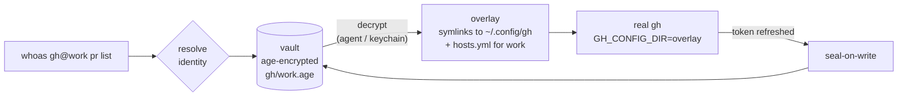

# whoas M2 Implementation Plan

> **For agentic workers:** REQUIRED SUB-SKILL: Use superpowers:subagent-driven-development (recommended) or superpowers:executing-plans to implement this plan task-by-task. Steps use checkbox (`- [ ]`) syntax for tracking.

**Goal:** Add vercel, wrangler, railway (experimental) and docker, root overlays, the `env-token` adapter kind with 65 API-token CLIs, and an installed-first `whoas providers`.

**Architecture:** Adapters stay declarative TOML. `dir-overlay` gains root overlays (`global` = `{home}`/`{xdg_config}`/`{xdg_data}` with the matching variable injected) and `helper_keys`; the new `env-token` kind stores API tokens in the vault and injects them as env vars through `supervisor.RunEnv`, which shares the M1 signal/exit contract via an extracted `spawnCmd`. Installed-ness is resolved through a PATH index that lists each directory once.

**Tech Stack:** Go 1.25+, existing deps only (cobra, age, gjson, x/term, testscript). No new modules.

**Spec:** `docs/superpowers/specs/2026-11-06-whoas-m2-design.md` (extends `2026-11-05-whoas-design.md`).

## Global Constraints

- No new Go modules; `go.mod`/`go.sum` stay unchanged.
- Every M1 constraint still holds: unit tests next to code, e2e in `tests/` (never `__tests__/`); never print a secret; tokens via env, never argv; 125/126/127 exit codes; global auth files never written.
- Env-token secrets live only in the vault (`env/<NAME>` envelope files) and in the child's environment.
- Root overlays: `global` exactly `{home}` → inject `HOME = "{dir}"`; `{xdg_config}` → `XDG_CONFIG_HOME`; `{xdg_data}` → `XDG_DATA_HOME`. Those variables may not be injected by any other adapter.
- Env-var names match `^[A-Za-z_][A-Za-z0-9_]*$`.
- Unix-only tests carry `//go:build unix`; `GOOS=windows go vet ./...` must stay clean.
- Every commit ends with the trailer `Co-Authored-By: Claude Opus 5.5 <noreply@anthropic.com>`.

## Prerequisites

- [ ] Go ≥ 1.25 on PATH (`go version`).
- [ ] Run every command from the repository root on a branch off `main`.

---

### Task 1: Adapter schema: root overlays, experimental, env-token, helper_keys

**Files:**
- Modify (full replacement): `internal/adapter/adapter.go`
- Test (full replacement): `internal/adapter/adapter_test.go`

**Interfaces:**
- Consumes: M1 `internal/adapter` API (unchanged signatures).
- Produces: `adapter.KindEnvToken`; `Adapter.Experimental bool` (toml `experimental`); `Adapter.Secrets []adapter.Secret` (toml `secret`); `adapter.Secret{Env, Label string; Plain, Optional bool}` with `PromptLabel() string`; `DirSpec.HelperKeys []string` (toml `helper_keys`); `(*Adapter).SecretEnv(base []string, values map[string]string) []string`; `(*Registry).Source(name string) string` (`builtin`|`user`). `global` may be exactly `{home}`/`{xdg_config}`/`{xdg_data}` with the matching `HOME`/`XDG_CONFIG_HOME`/`XDG_DATA_HOME = "{dir}"`. Env-var names may contain lowercase.

- [ ] **Step 1: Write the tests**

**`internal/adapter/adapter_test.go`**

```go
//go:build unix

package adapter

import (
	"os"
	"path/filepath"
	"strings"
	"testing"

	"github.com/stretchr/testify/require"
)

const valid = `name = "fake"
bin  = "fake"
kind = "dir-overlay"
[dir]
global     = "{home}/.fake"
inject     = { env = { FAKE_DIR = "{dir}" } }
auth_files = ["auth.json", "nested/dir"]
[login]
cmd = ["fake", "login"]
[whoami]
cmd  = ["fake", "whoami"]
json = "user.email"
`

func TestBuiltinsLoad(t *testing.T) {
	r, err := LoadRegistry(filepath.Join(t.TempDir(), "none"))
	require.NoError(t, err)
	require.Equal(t, []string{"codex", "gcloud", "gh", "neonctl"}, r.Names())
	gh, ok := r.ByBin("gh")
	require.True(t, ok)
	require.Equal(t, []string{"GH_CONFIG_DIR=/o"}, gh.InjectEnv("/o"))
	neon, _ := r.Get("neonctl")
	require.Equal(t, []string{"--config-dir", "/o"}, neon.InjectArgs("/o"))
}

func TestUserAdapterOverridesAndExpands(t *testing.T) {
	dir := t.TempDir()
	require.NoError(t, os.WriteFile(filepath.Join(dir, "fake.toml"), []byte(valid), 0o600))
	r, err := LoadRegistry(dir)
	require.NoError(t, err)
	a, ok := r.Get("fake")
	require.True(t, ok)
	require.Equal(t, "/h/.fake", a.GlobalDir(Vars{Home: "/h"}))
	require.Equal(t, []string{"FAKE_DIR=/run/x"}, a.InjectEnv("/run/x"))
	require.Empty(t, a.InjectArgs("/run/x"))
	require.Equal(t, "user.email", a.Whoami.JSON)
}

func TestParseRejects(t *testing.T) {
	_, err := Parse([]byte(valid), "valid")
	require.NoError(t, err)

	cases := map[string]struct {
		body      string
		errSubstr string
	}{
		"unknown key":   {valid + "colour = \"blue\"\n", "unknown keys"},
		"bad kind":      {replace(valid, `kind = "dir-overlay"`, `kind = "magic"`), "not supported"},
		"abs auth":      {replace(valid, `"auth.json", "nested/dir"`, `"/etc/passwd"`), "clean relative slash path"},
		"dotdot auth":   {replace(valid, `"auth.json", "nested/dir"`, `"../x"`), "clean relative slash path"},
		"no dir ref":    {replace(valid, `FAKE_DIR = "{dir}"`, `FAKE_DIR = "/tmp"`), "must reference {dir}"},
		"both injects":  {replace(valid, `inject     = { env = { FAKE_DIR = "{dir}" } }`, `inject     = { env = { FAKE_DIR = "{dir}" }, flag = ["--d", "{dir}"] }`), "exactly one"},
		"login bin":     {replace(valid, `cmd = ["fake", "login"]`, `cmd = ["sh", "-c", "evil"]`), "must start with"},
		"bin with path": {replace(valid, `bin  = "fake"`, `bin  = "/usr/bin/fake"`), "bare command name"},
		"reserved name": {replace(valid, `name = "fake"`, `name = "run"`), "reserved"},
		"bin -x":        {replace(valid, `bin  = "fake"`, `bin  = "-x"`), "bare command name"},
		"bin ..":        {replace(valid, `bin  = "fake"`, `bin  = ".."`), "bare command name"},
		"env not {dir}": {replace(valid, `inject     = { env = { FAKE_DIR = "{dir}" } }`, `inject     = { env = { FAKE_DIR = "{dir}", LD_PRELOAD = "/tmp/x.so" } }`), "must reference {dir}"},
		"global /etc":   {replace(valid, `global     = "{home}/.fake"`, `global     = "/etc/fake"`), "must start with"},
		"global rel":    {replace(valid, `global     = "{home}/.fake"`, `global     = "relative/x"`), "must start with"},
	}
	for name, tc := range cases {
		_, err := Parse([]byte(tc.body), name)
		require.ErrorContains(t, err, tc.errSubstr, name)
	}
}

func replace(s, old, new string) string { return strings.Replace(s, old, new, 1) }

func TestUserOverridesBuiltinByName(t *testing.T) {
	dir := t.TempDir()
	userGH := `name = "gh"
bin  = "gh"
kind = "dir-overlay"
[dir]
global     = "{xdg_config}/my-gh"
inject     = { env = { GH_CONFIG_DIR = "{dir}" } }
auth_files = ["hosts.yml"]
[login]
cmd = ["gh", "auth", "login", "--insecure-storage"]
[whoami]
cmd  = ["gh", "api", "user"]
json = "login"
`
	require.NoError(t, os.WriteFile(filepath.Join(dir, "gh.toml"), []byte(userGH), 0o600))
	r, err := LoadRegistry(dir)
	require.NoError(t, err)
	a, ok := r.Get("gh")
	require.True(t, ok)
	require.Equal(t, "{xdg_config}/my-gh", a.Dir.Global)
}

func TestDuplicateBinRejected(t *testing.T) {
	dir := t.TempDir()
	aaa := `name = "aaa"
bin  = "gh"
kind = "dir-overlay"
[dir]
global     = "{xdg_config}/aaa"
inject     = { env = { AAA_CONFIG = "{dir}" } }
auth_files = ["config.json"]
[login]
cmd = ["gh", "auth", "login"]
`
	require.NoError(t, os.WriteFile(filepath.Join(dir, "aaa.toml"), []byte(aaa), 0o600))
	_, err := LoadRegistry(dir)
	require.ErrorContains(t, err, "both use bin")
}

func TestChildEnv(t *testing.T) {
	a, err := Parse([]byte(strings.Replace(valid, `kind = "dir-overlay"`, "kind = \"dir-overlay\"\nunset_env = [\"FAKE_TOKEN\"]", 1)), "t")
	require.NoError(t, err)
	got := a.ChildEnv([]string{"PATH=/bin", "FAKE_TOKEN=leak", "FAKE_DIR=/global", "FAKE_TOKENX=keep"}, "/ov")
	require.Equal(t, []string{"PATH=/bin", "FAKE_DIR=/global", "FAKE_TOKENX=keep", "FAKE_DIR=/ov"}, got)

	_, err = Parse([]byte(strings.Replace(valid, `kind = "dir-overlay"`, "kind = \"dir-overlay\"\nunset_env = [\"bad-name\"]", 1)), "t")
	require.ErrorContains(t, err, "unset_env name")
}

func TestBuiltinUnsetEnv(t *testing.T) {
	r, err := LoadRegistry(filepath.Join(t.TempDir(), "none"))
	require.NoError(t, err)
	gh, _ := r.Get("gh")
	require.Contains(t, gh.UnsetEnv, "GH_TOKEN")
	neon, _ := r.Get("neonctl")
	require.Equal(t, []string{"NEON_API_KEY"}, neon.UnsetEnv)
}

const rootHome = `name = "rh"
bin  = "rh"
kind = "dir-overlay"
experimental = true
[dir]
global      = "{home}"
inject      = { env = { HOME = "{dir}" } }
auth_files  = [".rh/config.json"]
helper_keys = ["credsStore", "credHelpers"]
[login]
cmd = ["rh", "login"]
`

const token = `name = "tok"
bin  = "tok"
kind = "env-token"
unset_env = ["TOK_LEGACY"]

[[secret]]
env   = "TOK_KEY"
label = "Tok API Key"

[[secret]]
env      = "TOK_HOST"
label    = "Tok Host"
plain    = true
optional = true

[login]
hint = "Create one at https://example.com/tokens"
`

func TestRootOverlays(t *testing.T) {
	a, err := Parse([]byte(rootHome), "rh")
	require.NoError(t, err)
	require.True(t, a.Experimental)
	require.Equal(t, []string{"credsStore", "credHelpers"}, a.Dir.HelperKeys)
	require.Equal(t, "/h", a.GlobalDir(Vars{Home: "/h"}))

	xdg := replace(replace(rootHome, `global      = "{home}"`, `global      = "{xdg_config}"`), `HOME = "{dir}"`, `XDG_CONFIG_HOME = "{dir}"`)
	_, err = Parse([]byte(xdg), "xdg")
	require.NoError(t, err)

	for name, c := range map[string]struct{ body, errSubstr string }{
		"root without its var":  {replace(rootHome, `HOME = "{dir}"`, `RH_DIR = "{dir}"`), `requires inject env HOME`},
		"root with wrong var":   {replace(rootHome, `HOME = "{dir}"`, `XDG_CONFIG_HOME = "{dir}"`), `requires inject env HOME`},
		"root var on subdir":    {replace(rootHome, `global      = "{home}"`, `global      = "{home}/.rh"`), `only allowed with dir.global = {home}`},
		"root var not plain":    {replace(rootHome, `HOME = "{dir}"`, `HOME = "{dir}/x"`), `requires inject env HOME`},
		"bad helper key":        {replace(rootHome, `"credsStore", "credHelpers"`, `"creds.Store"`), `plain top-level JSON key`},
		"secret on dir-overlay": {rootHome + "[[secret]]\nenv = \"X\"\n", `only valid for env-token`},
	} {
		_, err := Parse([]byte(c.body), name)
		require.ErrorContains(t, err, c.errSubstr, name)
	}
}

func TestEnvTokenAdapter(t *testing.T) {
	a, err := Parse([]byte(token), "tok")
	require.NoError(t, err)
	require.Equal(t, KindEnvToken, a.Kind)
	require.Equal(t, []Secret{
		{Env: "TOK_KEY", Label: "Tok API Key"},
		{Env: "TOK_HOST", Label: "Tok Host", Plain: true, Optional: true},
	}, a.Secrets)
	require.Equal(t, "Tok API Key (TOK_KEY)", a.Secrets[0].PromptLabel())
	require.Equal(t, "X", Secret{Env: "X"}.PromptLabel())

	lower := replace(token, `env   = "TOK_KEY"`, `env   = "TF_TOKEN_app_terraform_io"`)
	_, err = Parse([]byte(lower), "lowercase env")
	require.NoError(t, err, "env var names may contain lowercase")

	for name, c := range map[string]struct{ body, errSubstr string }{
		"dir section":     {token + "[dir]\nglobal = \"{home}/.t\"\n", "[dir] is not valid"},
		"login cmd":       {replace(token, `hint = "Create one at https://example.com/tokens"`, `cmd = ["tok", "login"]`), "login.cmd is not valid"},
		"no secrets":      {"name = \"tok\"\nbin = \"tok\"\nkind = \"env-token\"\n", "at least one [[secret]]"},
		"duplicate env":   {replace(token, `env      = "TOK_HOST"`, `env      = "TOK_KEY"`), "declared twice"},
		"bad env":         {replace(token, `env   = "TOK_KEY"`, `env   = "tok-key"`), "secret env name"},
		"secret in unset": {replace(token, `unset_env = ["TOK_LEGACY"]`, `unset_env = ["TOK_KEY"]`), "cannot also be in unset_env"},
	} {
		_, err := Parse([]byte(c.body), name)
		require.ErrorContains(t, err, c.errSubstr, name)
	}
}

func TestSecretEnv(t *testing.T) {
	a, err := Parse([]byte(token), "tok")
	require.NoError(t, err)
	base := []string{"PATH=/bin", "TOK_LEGACY=old", "TOK_KEY=inherited", "TOK_KEYX=keep"}
	got := a.SecretEnv(base, map[string]string{"TOK_KEY": "k1", "TOK_HOST": ""})
	require.Equal(t, []string{"PATH=/bin", "TOK_KEYX=keep", "TOK_KEY=k1"}, got)
}

func TestRegistrySource(t *testing.T) {
	dir := t.TempDir()
	require.NoError(t, os.WriteFile(filepath.Join(dir, "tok.toml"), []byte(token), 0o600))
	r, err := LoadRegistry(dir)
	require.NoError(t, err)
	require.Equal(t, "user", r.Source("tok"))
	require.Equal(t, "builtin", r.Source("gh"))
	require.Equal(t, "", r.Source("nope"))
}
```

- [ ] **Step 2: Run the tests to verify they fail**

```bash
go test ./internal/adapter/
```

Expected: FAIL — build errors in adapter_test.go: `undefined: KindEnvToken`, `undefined: Secret`, `a.Experimental undefined`, `r.Source undefined`.

- [ ] **Step 3: Write the implementation**

**`internal/adapter/adapter.go`**

```go
// Package adapter loads declarative TOML adapters that tell whoas where a
// CLI keeps its session and how to point the CLI at it (dir-overlay), or
// which env vars carry its API token (env-token).
// Adapters are data, not scripts, but they choose which binary runs with which arguments: only install adapters you trust, like any script in your config dir. Project files (.whoas.yaml) can never declare adapters.
package adapter

import (
	"embed"
	"errors"
	"fmt"
	"io/fs"
	"os"
	"path"
	"path/filepath"
	"regexp"
	"slices"
	"sort"
	"strings"

	"github.com/BurntSushi/toml"

	"github.com/S-kkipie/whoas/internal/ref"
)

// Kind is the isolation mechanism.
type Kind string

const (
	// KindDirOverlay points the CLI at an overlay of its config dir.
	KindDirOverlay Kind = "dir-overlay"
	// KindEnvToken injects API tokens as env vars; no overlay.
	KindEnvToken Kind = "env-token"
)

// Adapter describes one CLI.
type Adapter struct {
	Name   string  `toml:"name"`
	Bin    string  `toml:"bin"`
	Kind   Kind    `toml:"kind"`
	Dir    DirSpec `toml:"dir"`
	Login  Login   `toml:"login"`
	Whoami Whoami  `toml:"whoami"`
	// UnsetEnv lists env vars removed from the CLI's environment because they
	// would override the identity (e.g. GH_TOKEN for gh).
	UnsetEnv []string `toml:"unset_env"`
	// Experimental marks adapters whose isolation has known gaps.
	Experimental bool `toml:"experimental"`
	// Secrets are the env vars an env-token adapter injects.
	Secrets []Secret `toml:"secret"`
}

// Secret is one env var of an env-token adapter.
type Secret struct {
	Env      string `toml:"env"`
	Label    string `toml:"label"`
	Plain    bool   `toml:"plain"`    // not secret: prompt with echo (e.g. a host name)
	Optional bool   `toml:"optional"` // may be left empty
}

// DirSpec says where the session lives and how to redirect the CLI.
type DirSpec struct {
	Global    string   `toml:"global"`     // template, e.g. "{xdg_config}/gh"
	Inject    Inject   `toml:"inject"`     // exactly one of env or flag
	AuthFiles []string `toml:"auth_files"` // slash paths relative to the dir; may be dirs
	// HelperKeys are top-level JSON keys of an auth file that delegate
	// credentials to stores outside whoas (docker: credsStore, credHelpers).
	HelperKeys []string `toml:"helper_keys"`
}

// Inject points the CLI at {dir} through env vars or leading flags.
type Inject struct {
	Env  map[string]string `toml:"env"`
	Flag []string          `toml:"flag"`
}

// Login is the command that runs the CLI's own login flow.
type Login struct {
	Cmd  []string `toml:"cmd"`
	Hint string   `toml:"hint"`
}

// Whoami prints the account; JSON is an optional gjson path into stdout.
type Whoami struct {
	Cmd  []string `toml:"cmd"`
	JSON string   `toml:"json"`
}

// Vars are the values templates expand.
type Vars struct {
	Home      string
	XDGConfig string
	XDGData   string
}

// envNameRe allows lowercase: some CLIs use host-specific names (TF_TOKEN_app_terraform_io).
var envNameRe = regexp.MustCompile(`^[A-Za-z_][A-Za-z0-9_]*$`)
var binNameRe = regexp.MustCompile(`^[A-Za-z0-9][A-Za-z0-9._-]*$`)

// Parse decodes one adapter strictly (unknown keys are errors) and validates it.
func Parse(data []byte, source string) (*Adapter, error) {
	var a Adapter
	md, err := toml.Decode(string(data), &a)
	if err != nil {
		return nil, fmt.Errorf("%s: %w", source, err)
	}
	if und := md.Undecoded(); len(und) > 0 {
		keys := make([]string, len(und))
		for i, k := range und {
			keys[i] = k.String()
		}
		return nil, fmt.Errorf("%s: unknown keys: %s", source, strings.Join(keys, ", "))
	}
	if err := a.Validate(); err != nil {
		return nil, fmt.Errorf("%s: %w", source, err)
	}
	return &a, nil
}

// rootVars maps a root global to the env var that must point at the overlay.
var rootVars = map[string]string{"{home}": "HOME", "{xdg_config}": "XDG_CONFIG_HOME", "{xdg_data}": "XDG_DATA_HOME"}

// Validate checks every invariant the rest of whoas relies on.
func (a *Adapter) Validate() error {
	if err := ref.ValidProvider(a.Name); err != nil {
		return err
	}
	if !binNameRe.MatchString(a.Bin) {
		return fmt.Errorf("bin %q must be a bare command name", a.Bin)
	}
	if len(a.Whoami.Cmd) > 0 && a.Whoami.Cmd[0] != a.Bin {
		return fmt.Errorf("whoami.cmd must start with %q", a.Bin)
	}
	for _, k := range a.UnsetEnv {
		if !envNameRe.MatchString(k) {
			return fmt.Errorf("unset_env name %q invalid", k)
		}
	}
	switch a.Kind {
	case KindDirOverlay:
		return a.validateDirOverlay()
	case KindEnvToken:
		return a.validateEnvToken()
	}
	return fmt.Errorf("kind %q not supported (supported: %s, %s)", a.Kind, KindDirOverlay, KindEnvToken)
}

func (a *Adapter) validateDirOverlay() error {
	if len(a.Secrets) > 0 {
		return errors.New("[[secret]] is only valid for env-token adapters")
	}
	g := a.Dir.Global
	if g == "" {
		return errors.New("dir.global is required")
	}
	rootVar, isRoot := rootVars[g]
	if !isRoot && !strings.HasPrefix(g, "{home}/") && !strings.HasPrefix(g, "{xdg_config}/") && !strings.HasPrefix(g, "{xdg_data}/") {
		return errors.New("dir.global must start with {home}/, {xdg_config}/ or {xdg_data}/ (or be exactly {home}, {xdg_config} or {xdg_data})")
	}
	if len(a.Dir.AuthFiles) == 0 {
		return errors.New("dir.auth_files is required")
	}
	for _, p := range a.Dir.AuthFiles {
		c := path.Clean(p)
		if c != p || path.IsAbs(p) || c == "." || strings.HasPrefix(c, "../") || c == ".." || strings.Contains(p, `\`) {
			return fmt.Errorf("auth file %q must be a clean relative slash path", p)
		}
	}
	env, flag := len(a.Dir.Inject.Env) > 0, len(a.Dir.Inject.Flag) > 0
	if env == flag {
		return errors.New("dir.inject needs exactly one of env or flag")
	}
	if env {
		for k, v := range a.Dir.Inject.Env {
			if !envNameRe.MatchString(k) {
				return fmt.Errorf("inject env name %q invalid", k)
			}
			if !strings.Contains(v, "{dir}") {
				return fmt.Errorf("inject env %s must reference {dir}", k)
			}
		}
	} else {
		hasDir := false
		for _, f := range a.Dir.Inject.Flag {
			hasDir = hasDir || strings.Contains(f, "{dir}")
		}
		if !hasDir {
			return errors.New("dir.inject must reference {dir}")
		}
	}
	// A root overlay redirects exactly its own root variable; a root variable
	// may only be injected by the matching root overlay.
	if isRoot && a.Dir.Inject.Env[rootVar] != "{dir}" {
		return fmt.Errorf("dir.global %s requires inject env %s = \"{dir}\"", g, rootVar)
	}
	for root, v := range rootVars {
		if _, ok := a.Dir.Inject.Env[v]; ok && g != root {
			return fmt.Errorf("inject env %s is only allowed with dir.global = %s", v, root)
		}
	}
	for _, k := range a.Dir.HelperKeys {
		if k == "" || strings.ContainsAny(k, ".*?|#@\\") {
			return fmt.Errorf("helper key %q must be a plain top-level JSON key", k)
		}
	}
	if len(a.Login.Cmd) == 0 || a.Login.Cmd[0] != a.Bin {
		return fmt.Errorf("login.cmd must start with %q", a.Bin)
	}
	return nil
}

func (a *Adapter) validateEnvToken() error {
	if a.Dir.Global != "" || len(a.Dir.AuthFiles) > 0 || len(a.Dir.Inject.Env) > 0 || len(a.Dir.Inject.Flag) > 0 || len(a.Dir.HelperKeys) > 0 {
		return errors.New("[dir] is not valid for env-token adapters")
	}
	if len(a.Login.Cmd) > 0 {
		return errors.New("login.cmd is not valid for env-token adapters (use login.hint)")
	}
	if len(a.Secrets) == 0 {
		return errors.New("env-token adapters need at least one [[secret]]")
	}
	seen := map[string]bool{}
	for _, s := range a.Secrets {
		if !envNameRe.MatchString(s.Env) {
			return fmt.Errorf("secret env name %q invalid", s.Env)
		}
		if seen[s.Env] {
			return fmt.Errorf("secret env %s declared twice", s.Env)
		}
		seen[s.Env] = true
		if slices.Contains(a.UnsetEnv, s.Env) {
			return fmt.Errorf("secret env %s cannot also be in unset_env", s.Env)
		}
	}
	return nil
}

// Expand replaces {home}, {xdg_config}, {xdg_data} and {dir}.
func Expand(s string, v Vars, dir string) string {
	return strings.NewReplacer("{home}", v.Home, "{xdg_config}", v.XDGConfig, "{xdg_data}", v.XDGData, "{dir}", dir).Replace(s)
}

// GlobalDir is the CLI's real config dir.
func (a *Adapter) GlobalDir(v Vars) string { return filepath.Clean(Expand(a.Dir.Global, v, "")) }

// InjectArgs are the flags to place right after the binary name.
func (a *Adapter) InjectArgs(dir string) []string {
	out := make([]string, len(a.Dir.Inject.Flag))
	for i, f := range a.Dir.Inject.Flag {
		out[i] = Expand(f, Vars{}, dir)
	}
	return out
}

// InjectEnv returns KEY=VALUE pairs, sorted by key.
func (a *Adapter) InjectEnv(dir string) []string {
	keys := make([]string, 0, len(a.Dir.Inject.Env))
	for k := range a.Dir.Inject.Env {
		keys = append(keys, k)
	}
	sort.Strings(keys)
	out := make([]string, len(keys))
	for i, k := range keys {
		out[i] = k + "=" + Expand(a.Dir.Inject.Env[k], Vars{}, dir)
	}
	return out
}

// ChildEnv is base without the adapter's UnsetEnv vars, plus InjectEnv(dir)
// (injected values win over inherited ones).
func (a *Adapter) ChildEnv(base []string, dir string) []string {
	out := make([]string, 0, len(base)+len(a.Dir.Inject.Env))
	for _, kv := range base {
		k, _, _ := strings.Cut(kv, "=")
		if !slices.Contains(a.UnsetEnv, k) {
			out = append(out, kv)
		}
	}
	return append(out, a.InjectEnv(dir)...)
}

// SecretEnv is base without the adapter's UnsetEnv vars and secret vars, plus
// each secret from values (ENV -> value) that is set.
func (a *Adapter) SecretEnv(base []string, values map[string]string) []string {
	drop := func(k string) bool {
		if slices.Contains(a.UnsetEnv, k) {
			return true
		}
		for _, s := range a.Secrets {
			if s.Env == k {
				return true
			}
		}
		return false
	}
	out := make([]string, 0, len(base)+len(a.Secrets))
	for _, kv := range base {
		k, _, _ := strings.Cut(kv, "=")
		if !drop(k) {
			out = append(out, kv)
		}
	}
	for _, s := range a.Secrets {
		if v, ok := values[s.Env]; ok && v != "" {
			out = append(out, s.Env+"="+v)
		}
	}
	return out
}

// PromptLabel is the label shown when asking for s.
func (s Secret) PromptLabel() string {
	if s.Label == "" {
		return s.Env
	}
	return s.Label + " (" + s.Env + ")"
}

//go:embed builtin/*.toml
var builtinFS embed.FS

// Registry holds every known adapter by name.
type Registry struct {
	byName map[string]*Adapter
	source map[string]string // name -> "builtin" | "user"
}

// LoadRegistry loads built-in adapters, then userDir/*.toml (user wins on name clash).
func LoadRegistry(userDir string) (*Registry, error) {
	r := &Registry{byName: map[string]*Adapter{}, source: map[string]string{}}
	builtins, err := fs.Glob(builtinFS, "builtin/*.toml")
	if err != nil {
		return nil, err
	}
	for _, p := range builtins {
		data, err := builtinFS.ReadFile(p)
		if err != nil {
			return nil, err
		}
		a, err := Parse(data, "builtin "+path.Base(p))
		if err != nil {
			return nil, err
		}
		r.byName[a.Name] = a
		r.source[a.Name] = "builtin"
	}
	user, err := filepath.Glob(filepath.Join(userDir, "*.toml"))
	if err != nil {
		return nil, err
	}
	for _, p := range user {
		data, err := os.ReadFile(p)
		if err != nil {
			return nil, err
		}
		a, err := Parse(data, p)
		if err != nil {
			return nil, err
		}
		r.byName[a.Name] = a
		r.source[a.Name] = "user"
	}
	// Check for duplicate bins
	binToName := make(map[string][]string)
	for name, adapter := range r.byName {
		binToName[adapter.Bin] = append(binToName[adapter.Bin], name)
	}
	for bin, names := range binToName {
		if len(names) > 1 {
			sort.Strings(names)
			return nil, fmt.Errorf("adapters %q and %q both use bin %q", names[0], names[1], bin)
		}
	}
	return r, nil
}

// Get returns the adapter named name.
func (r *Registry) Get(name string) (*Adapter, bool) {
	a, ok := r.byName[name]
	return a, ok
}

// Source says where the adapter named name came from: "builtin" or "user".
func (r *Registry) Source(name string) string { return r.source[name] }

// ByBin returns the adapter whose binary is bin.
func (r *Registry) ByBin(bin string) (*Adapter, bool) {
	for _, n := range r.Names() {
		if a := r.byName[n]; a.Bin == bin {
			return a, true
		}
	}
	return nil, false
}

// Names returns adapter names sorted.
func (r *Registry) Names() []string {
	names := make([]string, 0, len(r.byName))
	for n := range r.byName {
		names = append(names, n)
	}
	sort.Strings(names)
	return names
}
```

- [ ] **Step 4: Run the tests to verify they pass**

```bash
test -z "$(gofmt -l .)"
go vet ./...
GOOS=windows go vet ./...
go test -count=1 ./internal/adapter/
```

Expected: no gofmt output, vet silent, every listed package `ok`.

- [ ] **Step 5: Commit**

```bash
git add internal/adapter/adapter.go internal/adapter/adapter_test.go
git commit -m "feat: root overlays, env-token adapters and helper keys in the adapter schema" -m "Co-Authored-By: Claude Opus 5.5 <noreply@anthropic.com>"
```

---

### Task 2: Envelope secrets, shared spawn, supervisor.RunEnv

**Files:**
- Modify (full replacement): `internal/envelope/envelope.go`
- Create: `internal/supervisor/runenv.go`
- Modify (full replacement): `internal/supervisor/spawn_unix.go`
- Modify (full replacement): `internal/supervisor/spawn_windows.go`
- Test (full replacement): `internal/envelope/envelope_test.go`
- Test (create): `internal/supervisor/runenv_test.go`

**Interfaces:**
- Consumes: `adapter.Adapter.SecretEnv`, `adapter.KindEnvToken`, `adapter.Secret` (Task 1).
- Produces: `envelope.FromSecrets(provider string, values map[string]string) *envelope.Envelope` (files `env/<NAME>`, empty values skipped); `(*envelope.Envelope).Secrets() map[string]string`; supervisor-internal `spawnCmd(bin string, argv, env []string, stdin io.Reader, stdout, stderr io.Writer) (Result, error)` (signal contract unchanged); `supervisor.EnvPlan{Ref ref.Ref; Adapter *adapter.Adapter; Bin string; Args []string; Vault *vault.Vault; Decrypter vault.Decrypter; Env []string; Stdin io.Reader; Stdout, Stderr io.Writer}`; `supervisor.RunEnv(ctx context.Context, p supervisor.EnvPlan) (supervisor.Result, error)`.

- [ ] **Step 1: Write the tests**

**`internal/envelope/envelope_test.go`**

```go
package envelope

import (
	"testing"

	"github.com/stretchr/testify/require"
)

func TestHash(t *testing.T) {
	a := map[string]File{"a.json": {Mode: 0o600, Data: []byte("1")}, "dir/b": {Mode: 0o600, Data: []byte("2")}}
	b := map[string]File{"dir/b": {Mode: 0o600, Data: []byte("2")}, "a.json": {Mode: 0o600, Data: []byte("1")}}
	require.Equal(t, Hash(a), Hash(b), "order independent")

	c := map[string]File{"a.json": {Mode: 0o600, Data: []byte("1")}, "dir/b": {Mode: 0o600, Data: []byte("3")}}
	require.NotEqual(t, Hash(a), Hash(c), "content sensitive")

	d := map[string]File{"a.json": {Mode: 0o644, Data: []byte("1")}, "dir/b": {Mode: 0o600, Data: []byte("2")}}
	require.NotEqual(t, Hash(a), Hash(d), "mode sensitive")
}

func TestSecretsRoundTrip(t *testing.T) {
	e := FromSecrets("tok", map[string]string{"TOK_KEY": "k1", "TOK_HOST": ""})
	require.Equal(t, map[string]File{"env/TOK_KEY": {Mode: 0o600, Data: []byte("k1")}}, e.Files)
	require.Equal(t, map[string]string{"TOK_KEY": "k1"}, e.Secrets())

	other := New("gh", map[string]File{"hosts.yml": {Data: []byte("x")}})
	require.Empty(t, other.Secrets())
}
```

**`internal/supervisor/runenv_test.go`**

```go
//go:build unix

package supervisor

import (
	"bytes"
	"context"
	"os"
	"path/filepath"
	"testing"

	"filippo.io/age"
	"github.com/stretchr/testify/require"

	"github.com/S-kkipie/whoas/internal/adapter"
	"github.com/S-kkipie/whoas/internal/envelope"
	"github.com/S-kkipie/whoas/internal/ref"
	"github.com/S-kkipie/whoas/internal/vault"
)

func TestRunEnvInjectsSecrets(t *testing.T) {
	root := t.TempDir()
	id, err := age.GenerateX25519Identity()
	require.NoError(t, err)
	recipient := filepath.Join(root, "recipient")
	require.NoError(t, os.WriteFile(recipient, []byte(id.Recipient().String()), 0o644))
	v, err := vault.Open(recipient, filepath.Join(root, "vault"))
	require.NoError(t, err)
	dec, err := vault.NewIdentityDecrypter(id.String())
	require.NoError(t, err)

	a := &adapter.Adapter{
		Name: "tok", Bin: "sh", Kind: adapter.KindEnvToken,
		UnsetEnv: []string{"TOK_LEGACY"},
		Secrets:  []adapter.Secret{{Env: "TOK_KEY"}},
	}
	r := ref.Ref{Provider: "tok", Alias: "work"}
	require.NoError(t, v.Seal(r, envelope.FromSecrets("tok", map[string]string{"TOK_KEY": "k-work"})))

	var out bytes.Buffer
	res, err := RunEnv(context.Background(), EnvPlan{
		Ref: r, Adapter: a, Bin: "/bin/sh",
		Args:  []string{"-c", `echo "key=$TOK_KEY legacy=${TOK_LEGACY:-unset}"; exit 4`},
		Vault: v, Decrypter: dec,
		Env:    append(os.Environ(), "TOK_KEY=inherited", "TOK_LEGACY=old"),
		Stdout: &out,
	})
	require.NoError(t, err)
	require.Equal(t, 4, res.Code)
	require.Equal(t, "key=k-work legacy=unset\n", out.String())
}

func TestRunEnvMissingIdentity(t *testing.T) {
	root := t.TempDir()
	id, err := age.GenerateX25519Identity()
	require.NoError(t, err)
	recipient := filepath.Join(root, "recipient")
	require.NoError(t, os.WriteFile(recipient, []byte(id.Recipient().String()), 0o644))
	v, err := vault.Open(recipient, filepath.Join(root, "vault"))
	require.NoError(t, err)
	dec, err := vault.NewIdentityDecrypter(id.String())
	require.NoError(t, err)

	_, err = RunEnv(context.Background(), EnvPlan{
		Ref: ref.Ref{Provider: "tok", Alias: "nope"}, Adapter: &adapter.Adapter{Kind: adapter.KindEnvToken},
		Bin: "/bin/true", Vault: v, Decrypter: dec,
	})
	require.ErrorIs(t, err, vault.ErrNotFound)
}
```

- [ ] **Step 2: Run the tests to verify they fail**

```bash
go test ./internal/envelope/ ./internal/supervisor/
```

Expected: FAIL — `undefined: FromSecrets`, `undefined: RunEnv`, `undefined: EnvPlan`.

- [ ] **Step 3: Write the implementation**

**`internal/envelope/envelope.go`**

```go
// Package envelope is the plaintext form of one sealed identity: the auth
// files a CLI wrote, keyed by slash-separated path relative to its config dir.
package envelope

import (
	"crypto/sha256"
	"encoding/binary"
	"encoding/hex"
	"sort"
	"strings"
)

// Version of the envelope format.
const Version = 1

// File is one auth file. Data is base64 in JSON.
type File struct {
	Mode uint32 `json:"mode"`
	Data []byte `json:"data"`
}

// Envelope is what gets age-encrypted into the vault.
type Envelope struct {
	V        int             `json:"v"`
	Provider string          `json:"provider"`
	Files    map[string]File `json:"files"`
}

// New builds a current-version envelope.
func New(provider string, files map[string]File) *Envelope {
	return &Envelope{V: Version, Provider: provider, Files: files}
}

// secretPrefix marks env-token secrets inside an envelope's files.
const secretPrefix = "env/"

// FromSecrets builds an env-token envelope: each non-empty value becomes the
// file "env/<NAME>".
func FromSecrets(provider string, values map[string]string) *Envelope {
	files := map[string]File{}
	for k, v := range values {
		if v != "" {
			files[secretPrefix+k] = File{Mode: 0o600, Data: []byte(v)}
		}
	}
	return New(provider, files)
}

// Secrets returns the env-token secrets stored in e (NAME -> value).
func (e *Envelope) Secrets() map[string]string {
	out := map[string]string{}
	for p, f := range e.Files {
		if name, ok := strings.CutPrefix(p, secretPrefix); ok {
			out[name] = string(f.Data)
		}
	}
	return out
}

// Hash is a stable sha256 over sorted paths, modes and contents.
func Hash(files map[string]File) string {
	paths := make([]string, 0, len(files))
	for p := range files {
		paths = append(paths, p)
	}
	sort.Strings(paths)
	h := sha256.New()
	var n [8]byte
	for _, p := range paths {
		f := files[p]
		binary.BigEndian.PutUint64(n[:], uint64(len(p)))
		h.Write(n[:])
		h.Write([]byte(p))
		binary.BigEndian.PutUint64(n[:], uint64(f.Mode))
		h.Write(n[:])
		binary.BigEndian.PutUint64(n[:], uint64(len(f.Data)))
		h.Write(n[:])
		h.Write(f.Data)
	}
	return hex.EncodeToString(h.Sum(nil))
}
```

**`internal/supervisor/runenv.go`**

```go
package supervisor

import (
	"context"
	"io"

	"github.com/S-kkipie/whoas/internal/adapter"
	"github.com/S-kkipie/whoas/internal/ref"
	"github.com/S-kkipie/whoas/internal/vault"
)

// EnvPlan is one env-token run: no overlay, no lock, no seal-on-write; the
// identity's secrets exist only in the child's environment.
type EnvPlan struct {
	Ref       ref.Ref
	Adapter   *adapter.Adapter
	Bin       string   // absolute path of the real CLI
	Args      []string // user args, passed verbatim
	Vault     *vault.Vault
	Decrypter vault.Decrypter
	Env       []string // base environment for the child
	Stdin     io.Reader
	Stdout    io.Writer
	Stderr    io.Writer
}

// RunEnv decrypts the identity's secrets and runs the CLI with them injected.
func RunEnv(ctx context.Context, p EnvPlan) (Result, error) {
	if err := ctx.Err(); err != nil {
		return Result{}, err
	}
	env, err := p.Vault.Load(p.Ref, p.Decrypter)
	if err != nil {
		return Result{}, err
	}
	return spawnCmd(p.Bin, p.Args, p.Adapter.SecretEnv(p.Env, env.Secrets()), p.Stdin, p.Stdout, p.Stderr)
}
```

**`internal/supervisor/spawn_unix.go`**

```go
//go:build unix

package supervisor

import (
	"errors"
	"fmt"
	"io"
	"os"
	"os/exec"
	"os/signal"
	"syscall"
	"time"

	"golang.org/x/sys/unix"
)

// spawn runs the real CLI pointed at the overlay.
func (p *Plan) spawn() (Result, error) {
	argv := append(p.Adapter.InjectArgs(p.RunBase), p.Args...)
	return spawnCmd(p.Bin, argv, p.Adapter.ChildEnv(p.Env, p.RunBase), p.Stdin, p.Stdout, p.Stderr)
}

// spawnCmd runs bin and waits. SIGTERM/SIGHUP are always forwarded.
// SIGINT/SIGQUIT are forwarded only when whoas is not in a terminal's
// foreground process group; otherwise the terminal already delivered them
// to the child and forwarding would double them.
func spawnCmd(bin string, argv, env []string, stdin io.Reader, stdout, stderr io.Writer) (Result, error) {
	forwardAll := !terminalDelivers()
	cmd := exec.Command(bin, argv...)
	cmd.Env = env
	cmd.Stdin, cmd.Stdout, cmd.Stderr = stdin, stdout, stderr

	sigs := make(chan os.Signal, 4)
	var watch []os.Signal
	for _, s := range []os.Signal{syscall.SIGINT, syscall.SIGQUIT, syscall.SIGTERM, syscall.SIGHUP} {
		if !signal.Ignored(s) {
			watch = append(watch, s)
		}
	}
	if len(watch) > 0 {
		signal.Notify(sigs, watch...)
	}
	defer signal.Stop(sigs)

	if err := cmd.Start(); err != nil {
		return Result{}, fmt.Errorf("%w: %s: %w", ErrStart, bin, err)
	}
	waited := make(chan struct{})
	go func() {
		for {
			select {
			case s := <-sigs:
				if forwardAll || s == syscall.SIGTERM || s == syscall.SIGHUP {
					_ = cmd.Process.Signal(s)
				}
			case <-waited:
				return
			}
		}
	}()
	err := cmd.Wait()
	close(waited)
	return resultOf(err)
}

// terminalDelivers reports whether the controlling terminal's foreground
// process group is ours, so Ctrl-C already reaches the child.
func terminalDelivers() bool {
	tty, err := os.Open("/dev/tty")
	if err != nil {
		return false
	}
	defer tty.Close()
	pgrp, err := unix.IoctlGetInt(int(tty.Fd()), unix.TIOCGPGRP)
	return err == nil && pgrp == syscall.Getpgrp()
}

func resultOf(err error) (Result, error) {
	if err == nil {
		return Result{}, nil
	}
	var ee *exec.ExitError
	if !errors.As(err, &ee) {
		return Result{}, err
	}
	if ws, ok := ee.Sys().(syscall.WaitStatus); ok && ws.Signaled() {
		return Result{Code: 128 + int(ws.Signal()), Signal: ws.Signal()}, nil
	}
	return Result{Code: ee.ExitCode()}, nil
}

// Reraise makes this process die from sig so its parent sees the same status.
// For SIGHUP, SIGINT or SIGTERM: it resets the signal, kills the process, and waits.
// For other signals (e.g. QUIT, ABRT, PIPE) it returns at once and the caller exits 128+n,
// because Go's runtime would turn them into a stack dump.
func Reraise(sig os.Signal) {
	s, ok := sig.(syscall.Signal)
	if !ok {
		return
	}
	switch s {
	case syscall.SIGHUP, syscall.SIGINT, syscall.SIGTERM:
		signal.Reset(s)
		_ = syscall.Kill(os.Getpid(), s)
		time.Sleep(100 * time.Millisecond)
	}
}
```

**`internal/supervisor/spawn_windows.go`**

```go
//go:build windows

package supervisor

import (
	"errors"
	"fmt"
	"io"
	"os"
)

func (p *Plan) spawn() (Result, error) {
	return spawnCmd(p.Bin, p.Args, p.Env, p.Stdin, p.Stdout, p.Stderr)
}

func spawnCmd(string, []string, []string, io.Reader, io.Writer, io.Writer) (Result, error) {
	return Result{}, fmt.Errorf("%w: %w", ErrStart, errors.New("running CLIs is not supported on native Windows yet; use WSL"))
}

// Reraise is a no-op on Windows.
func Reraise(os.Signal) {}
```

- [ ] **Step 4: Run the tests to verify they pass**

```bash
test -z "$(gofmt -l .)"
go vet ./...
GOOS=windows go vet ./...
go test -count=1 ./internal/envelope/ ./internal/supervisor/
```

Expected: no gofmt output, vet silent, every listed package `ok`.

- [ ] **Step 5: Commit**

```bash
git add internal/envelope/envelope.go internal/envelope/envelope_test.go internal/supervisor/runenv.go internal/supervisor/runenv_test.go internal/supervisor/spawn_unix.go internal/supervisor/spawn_windows.go
git commit -m "feat: run env-token identities through the supervisor" -m "Co-Authored-By: Claude Opus 5.5 <noreply@anthropic.com>"
```

---

### Task 3: App: env-token add/import/run, helper warning, experimental banner

**Files:**
- Modify (full replacement): `internal/app/add.go`
- Modify (full replacement): `internal/app/exec.go`
- Modify (full replacement): `internal/app/import.go`
- Create: `internal/app/secrets.go`
- Test (create): `internal/app/secrets_test.go`

**Interfaces:**
- Consumes: Tasks 1–2; M1 app helpers (`env.saveLocked`, `parseAccount`, `realBin`).
- Produces: In package app: `readSecrets(a *adapter.Adapter, fromStdin bool, in io.Reader, ask askFunc) (map[string]string, error)`; `secretsFromEnv(a *adapter.Adapter, getenv func(string) string) (map[string]string, error)`; `ttyAsk(label string, hidden bool) (string, error)`; `whoamiWithSecrets(a, bin string, values map[string]string) string`; `warnHelperKeys(w io.Writer, r ref.Ref, a *adapter.Adapter, files map[string]envelope.File)`; `banner(r ref.Ref, account string, experimental bool)`. `whoas add` gains `--stdin`; `add`/`import`/run branch on `adapter.KindEnvToken`.

- [ ] **Step 1: Write the tests**

**`internal/app/secrets_test.go`**

```go
package app

import (
	"bytes"
	"errors"
	"strings"
	"testing"

	"github.com/stretchr/testify/require"

	"github.com/S-kkipie/whoas/internal/adapter"
	"github.com/S-kkipie/whoas/internal/envelope"
	"github.com/S-kkipie/whoas/internal/ref"
)

func tokAdapter() *adapter.Adapter {
	return &adapter.Adapter{Name: "tok", Bin: "tok", Kind: adapter.KindEnvToken, Secrets: []adapter.Secret{
		{Env: "TOK_KEY", Label: "Tok API Key"},
		{Env: "TOK_HOST", Label: "Tok Host", Plain: true, Optional: true},
	}}
}

func TestReadSecretsFromStdin(t *testing.T) {
	got, err := readSecrets(tokAdapter(), true, strings.NewReader("k1\n\n"), nil)
	require.NoError(t, err)
	require.Equal(t, map[string]string{"TOK_KEY": "k1", "TOK_HOST": ""}, got)

	_, err = readSecrets(tokAdapter(), true, strings.NewReader(""), nil)
	require.ErrorContains(t, err, "TOK_KEY is required")
}

func TestReadSecretsAsks(t *testing.T) {
	var asked []string
	ask := func(label string, hidden bool) (string, error) {
		asked = append(asked, label+map[bool]string{true: "[hidden]", false: "[echo]"}[hidden])
		if strings.Contains(label, "TOK_KEY") {
			return " k2 ", nil
		}
		return "h.example.com", nil
	}
	got, err := readSecrets(tokAdapter(), false, nil, ask)
	require.NoError(t, err)
	require.Equal(t, map[string]string{"TOK_KEY": "k2", "TOK_HOST": "h.example.com"}, got)
	require.Equal(t, []string{"Tok API Key (TOK_KEY): [hidden]", "Tok Host (TOK_HOST): [echo]"}, asked)

	_, err = readSecrets(tokAdapter(), false, nil, func(string, bool) (string, error) { return "", errors.New("no tty") })
	require.ErrorContains(t, err, "no tty")
}

func TestSecretsFromEnv(t *testing.T) {
	env := map[string]string{"TOK_KEY": "k3"}
	got, err := secretsFromEnv(tokAdapter(), func(k string) string { return env[k] })
	require.NoError(t, err)
	require.Equal(t, map[string]string{"TOK_KEY": "k3", "TOK_HOST": ""}, got)

	_, err = secretsFromEnv(tokAdapter(), func(string) string { return "" })
	require.ErrorContains(t, err, "not set in the environment: $TOK_KEY")
}

func TestWarnHelperKeys(t *testing.T) {
	a := &adapter.Adapter{Dir: adapter.DirSpec{HelperKeys: []string{"credsStore", "credHelpers"}}}
	r := ref.Ref{Provider: "docker", Alias: "work"}
	var out bytes.Buffer
	warnHelperKeys(&out, r, a, map[string]envelope.File{
		"config.json": {Data: []byte(`{"auths":{"ghcr.io":{}},"credHelpers":{"registry.example.com":"gcloud"},"credsStore":"desktop"}`)},
	})
	require.Equal(t, "warning: docker@work: config.json delegates credentials to helpers (credsStore: desktop; credHelpers: registry.example.com); those stay in the helper's own store and are not isolated by whoas\n", out.String())

	out.Reset()
	warnHelperKeys(&out, r, a, map[string]envelope.File{"config.json": {Data: []byte(`{"auths":{"ghcr.io":{"auth":"x"}}}`)}})
	require.Empty(t, out.String())
}
```

- [ ] **Step 2: Run the tests to verify they fail**

```bash
go test ./internal/app/ ./tests/
```

Expected: FAIL — `undefined: readSecrets`, `undefined: secretsFromEnv`, `undefined: warnHelperKeys`.

- [ ] **Step 3: Write the implementation**

**`internal/app/add.go`**

```go
package app

import (
	"errors"
	"fmt"
	"os"
	"os/signal"
	"syscall"

	"github.com/spf13/cobra"

	"github.com/S-kkipie/whoas/internal/adapter"
	"github.com/S-kkipie/whoas/internal/envelope"
	"github.com/S-kkipie/whoas/internal/overlay"
	"github.com/S-kkipie/whoas/internal/ref"
)

func init() { register(newAddCmd) }

func newAddCmd() *cobra.Command {
	var fromStdin bool
	cmd := &cobra.Command{
		Use:   "add <provider> <alias>",
		Short: "Log in through the CLI (or enter its API token) and save it as provider@alias",
		Args:  cobra.ExactArgs(2),
		RunE: func(cmd *cobra.Command, args []string) error {
			e, err := loadEnv()
			if err != nil {
				return err
			}
			r, err := ref.Parse(args[0] + "@" + args[1])
			if err != nil {
				return err
			}
			a, err := e.adapter(r.Provider)
			if err != nil {
				return err
			}
			v, err := e.initVault()
			if err != nil {
				return err
			}
			if v.Exists(r) {
				return fmt.Errorf("%s already exists (whoas rm %s first)", r, r)
			}
			if a.Kind == adapter.KindEnvToken {
				if a.Login.Hint != "" {
					fmt.Fprintln(cmd.ErrOrStderr(), "hint:", a.Login.Hint)
				}
				values, err := readSecrets(a, fromStdin, cmd.InOrStdin(), ttyAsk)
				if err != nil {
					return err
				}
				account := ""
				if bin, err := e.realBin(a.Bin); err == nil {
					account = whoamiWithSecrets(a, bin, values)
				}
				return e.saveLocked(cmd.OutOrStdout(), cmd.ErrOrStderr(), v, r, envelope.FromSecrets(r.Provider, values).Files, account)
			}
			if fromStdin {
				return errors.New("--stdin is only for env-token adapters")
			}
			bin, err := e.realBin(a.Bin)
			if err != nil {
				return err
			}
			if err := e.dirs.EnsureRuntime(); err != nil {
				return err
			}
			dir := e.dirs.CaptureDir(r.Provider, r.Alias)
			defer overlay.Remove(dir)
			if err := overlay.Build(dir, a.GlobalDir(e.vars()), a.Dir.AuthFiles, nil); err != nil {
				return err
			}
			if a.Login.Hint != "" {
				fmt.Fprintln(cmd.ErrOrStderr(), "hint:", a.Login.Hint)
			}
			// whoas stays alive while the CLI's interactive login runs so the capture dir is
			// always removed; the terminal still delivers Ctrl-C to the CLI itself.
			sigs := make(chan os.Signal, 4)
			signal.Notify(sigs, os.Interrupt, syscall.SIGTERM, syscall.SIGHUP, syscall.SIGQUIT)
			err = runIn(a, bin, dir, a.Login.Cmd[1:], cmd.InOrStdin(), cmd.OutOrStdout(), cmd.ErrOrStderr())
			signal.Stop(sigs)
			if err != nil {
				return fmt.Errorf("login failed: %w", err)
			}
			files, err := overlay.Collect(dir, a.Dir.AuthFiles)
			if err != nil {
				return err
			}
			if len(files) == 0 {
				return fmt.Errorf("login produced none of %v; nothing saved", a.Dir.AuthFiles)
			}
			if err := e.saveLocked(cmd.OutOrStdout(), cmd.ErrOrStderr(), v, r, files, whoami(a, bin, dir)); err != nil {
				return err
			}
			warnHelperKeys(cmd.ErrOrStderr(), r, a, files)
			return nil
		},
	}
	cmd.Flags().BoolVar(&fromStdin, "stdin", false, "env-token adapters: read one secret per line from stdin")
	return cmd
}
```

**`internal/app/exec.go`**

```go
package app

import (
	"context"
	"errors"
	"fmt"
	"os"
	"strconv"

	"golang.org/x/term"

	"github.com/S-kkipie/whoas/internal/adapter"
	"github.com/S-kkipie/whoas/internal/project"
	"github.com/S-kkipie/whoas/internal/ref"
	"github.com/S-kkipie/whoas/internal/resolve"
	"github.com/S-kkipie/whoas/internal/supervisor"
	"github.com/S-kkipie/whoas/internal/trust"
	"github.com/S-kkipie/whoas/internal/vault"
)

// Exit codes for failures of whoas itself on the run path (env/docker style).
const (
	exitWhoasError = 125 // whoas failed before or around the CLI
	exitExecFailed = 126 // exec of the real binary failed
	exitNotFound   = 127 // real binary not on PATH
)

const maxDepth = 8

// errPassthrough means no identity applies; a shim should exec the global CLI.
var errPassthrough = errors.New("passthrough")

// errCLINotFound means the CLI binary was not found on PATH.
var errCLINotFound = errors.New("CLI not found")

type runRequest struct {
	provider    string
	alias       string
	profileFlag string
	args        []string
	explicit    bool // false when invoked through a shim
}

// execMain handles `whoas [-p P] provider[@alias] args...`.
func execMain(profileFlag, token string, args []string) int {
	provider, alias, _ := ref.Split(token)
	e, err := loadEnv()
	if err == nil {
		var code int
		code, err = runProvider(e, runRequest{provider: provider, alias: alias, profileFlag: profileFlag, args: args, explicit: true})
		if err == nil {
			return code
		}
	}
	fmt.Fprintln(os.Stderr, "whoas:", err)
	return exitCodeFor(err)
}

// runProvider resolves the identity and runs the CLI under the supervisor.
func runProvider(e *env, req runRequest) (int, error) {
	a, err := e.adapter(req.provider)
	if err != nil {
		return 0, err
	}
	res, err := e.resolveIdentity(req)
	if err != nil {
		return 0, err
	}
	depth, _ := strconv.Atoi(os.Getenv("WHOAS_DEPTH"))
	if depth >= maxDepth {
		return 0, errors.New("WHOAS_DEPTH limit reached (shim loop?)")
	}
	bin, err := e.realBin(a.Bin)
	if err != nil {
		return 0, fmt.Errorf("%w: %w", errCLINotFound, err)
	}
	v, err := e.openVault()
	if errors.Is(err, vault.ErrNotInitialized) {
		return 0, fmt.Errorf("identity %s not found (see: whoas ls)", res.Ref)
	}
	if err != nil {
		return 0, err
	}
	if !v.Exists(res.Ref) {
		return 0, fmt.Errorf("identity %s not found (see: whoas ls)", res.Ref)
	}
	d, err := e.decrypter()
	if err != nil {
		return 0, err
	}
	meta, _ := v.ReadMeta(res.Ref)
	banner(res.Ref, meta.Account, a.Experimental)
	childEnv := append(os.Environ(), "WHOAS_DEPTH="+strconv.Itoa(depth+1))
	var result supervisor.Result
	if a.Kind == adapter.KindEnvToken {
		result, err = supervisor.RunEnv(context.Background(), supervisor.EnvPlan{
			Ref:       res.Ref,
			Adapter:   a,
			Bin:       bin,
			Args:      req.args,
			Vault:     v,
			Decrypter: d,
			Env:       childEnv,
			Stdin:     os.Stdin,
			Stdout:    os.Stdout,
			Stderr:    os.Stderr,
		})
	} else {
		if err := e.dirs.EnsureRuntime(); err != nil {
			return 0, err
		}
		result, err = supervisor.Run(context.Background(), supervisor.Plan{
			Ref:       res.Ref,
			Adapter:   a,
			Bin:       bin,
			Args:      req.args,
			Global:    a.GlobalDir(e.vars()),
			RunBase:   e.dirs.RunBase(res.Ref.Provider, res.Ref.Alias),
			Vault:     v,
			Decrypter: d,
			Env:       childEnv,
			Stdin:     os.Stdin,
			Stdout:    os.Stdout,
			Stderr:    os.Stderr,
		})
	}
	if err != nil {
		return 0, err
	}
	if result.Signal != nil {
		supervisor.Reraise(result.Signal)
	}
	return result.Code, nil
}

// resolveIdentity applies the resolution rules, reading .whoas.yaml only
// when no explicit context is given.
func (e *env) resolveIdentity(req runRequest) (resolve.Result, error) {
	in := resolve.Input{
		Provider:    req.provider,
		Alias:       req.alias,
		ProfileFlag: req.profileFlag,
		EnvProfile:  os.Getenv("WHOAS_PROFILE"),
		Config:      e.cfg,
	}
	if in.Alias == "" && in.ProfileFlag == "" && in.EnvProfile == "" {
		pf, err := e.trustedProject(!req.explicit)
		if err != nil {
			return resolve.Result{}, err
		}
		in.Project = pf
	}
	res, err := resolve.Resolve(in)
	if err != nil && !req.explicit && errors.Is(err, resolve.ErrUnresolved) {
		return res, errPassthrough
	}
	return res, err
}

// trustedProject returns the nearest trusted .whoas.yaml. A file that cannot
// be read, is untrusted or does not parse is an error, or a warning (and the
// file is ignored) when warnOnly is set: a shim must never break on it.
func (e *env) trustedProject(warnOnly bool) (*project.File, error) {
	pf, err := e.findTrustedProject()
	if err != nil && warnOnly {
		fmt.Fprintln(os.Stderr, "whoas: warning:", err)
		return nil, nil
	}
	return pf, err
}

func (e *env) findTrustedProject() (*project.File, error) {
	wd, err := os.Getwd()
	if err != nil {
		return nil, err
	}
	path, err := project.Find(wd)
	if err != nil || path == "" {
		return nil, err
	}
	data, err := project.Read(path)
	if err != nil {
		return nil, err
	}
	ts, err := trust.Load(e.dirs.TrustFile())
	if err != nil {
		return nil, err
	}
	if !ts.IsTrusted(path, data) {
		return nil, fmt.Errorf("%s is not trusted (review it, then run: whoas trust)", path)
	}
	return project.Parse(path, data)
}

// exitCodeFor maps an error to its exit code: CLI not found → 127, exec start
// failed → 126, anything else → 125.
func exitCodeFor(err error) int {
	if errors.Is(err, errCLINotFound) {
		return exitNotFound
	}
	if errors.Is(err, supervisor.ErrStart) {
		return exitExecFailed
	}
	return exitWhoasError
}

// banner prints the identity on stderr when it is a terminal, or always /
// never per WHOAS_BANNER.
func banner(r ref.Ref, account string, experimental bool) {
	mode := os.Getenv("WHOAS_BANNER")
	if mode == "never" || (mode != "always" && !term.IsTerminal(int(os.Stderr.Fd()))) {
		return
	}
	tag := ""
	if experimental {
		tag = " [experimental]"
	}
	fmt.Fprintf(os.Stderr, "whoas: %s%s%s\n", r, accountSuffix(account), tag)
}
```

**`internal/app/import.go`**

```go
package app

import (
	"fmt"
	"os"

	"github.com/spf13/cobra"

	"github.com/S-kkipie/whoas/internal/adapter"
	"github.com/S-kkipie/whoas/internal/envelope"
	"github.com/S-kkipie/whoas/internal/overlay"
	"github.com/S-kkipie/whoas/internal/ref"
)

func init() { register(newImportCmd) }

func newImportCmd() *cobra.Command {
	return &cobra.Command{
		Use:   "import <provider> <alias>",
		Short: "Save the CLI's current session (or the API token in your environment) as provider@alias",
		Args:  cobra.ExactArgs(2),
		RunE: func(cmd *cobra.Command, args []string) error {
			e, err := loadEnv()
			if err != nil {
				return err
			}
			r, err := ref.Parse(args[0] + "@" + args[1])
			if err != nil {
				return err
			}
			a, err := e.adapter(r.Provider)
			if err != nil {
				return err
			}
			v, err := e.initVault()
			if err != nil {
				return err
			}
			if v.Exists(r) {
				return fmt.Errorf("%s already exists (whoas rm %s first)", r, r)
			}
			if a.Kind == adapter.KindEnvToken {
				values, err := secretsFromEnv(a, os.Getenv)
				if err != nil {
					return err
				}
				account := ""
				if bin, err := e.realBin(a.Bin); err == nil {
					account = whoamiWithSecrets(a, bin, values)
				}
				return e.saveLocked(cmd.OutOrStdout(), cmd.ErrOrStderr(), v, r, envelope.FromSecrets(r.Provider, values).Files, account)
			}
			global := a.GlobalDir(e.vars())
			files, err := overlay.Collect(global, a.Dir.AuthFiles)
			if err != nil {
				return err
			}
			if len(files) == 0 {
				return fmt.Errorf("no session found in %s (expected %v)", global, a.Dir.AuthFiles)
			}
			if err := e.dirs.EnsureRuntime(); err != nil {
				return err
			}
			dir := e.dirs.CaptureDir(r.Provider, r.Alias)
			defer overlay.Remove(dir)
			if err := overlay.Build(dir, global, a.Dir.AuthFiles, files); err != nil {
				return err
			}
			account := ""
			if bin, err := e.realBin(a.Bin); err == nil {
				account = whoami(a, bin, dir)
			}
			files, err = overlay.Collect(dir, a.Dir.AuthFiles)
			if err != nil {
				return err
			}
			if err := e.saveLocked(cmd.OutOrStdout(), cmd.ErrOrStderr(), v, r, files, account); err != nil {
				return err
			}
			warnHelperKeys(cmd.ErrOrStderr(), r, a, files)
			return nil
		},
	}
}
```

**`internal/app/secrets.go`**

```go
package app

import (
	"bufio"
	"bytes"
	"fmt"
	"io"
	"os"
	"os/exec"
	"sort"
	"strings"

	"github.com/tidwall/gjson"
	"golang.org/x/term"

	"github.com/S-kkipie/whoas/internal/adapter"
	"github.com/S-kkipie/whoas/internal/envelope"
	"github.com/S-kkipie/whoas/internal/ref"
)

// askFunc asks for one value; hidden disables echo.
type askFunc func(label string, hidden bool) (string, error)

// readSecrets collects a value for each of a's secrets: one line per secret,
// in declaration order, from in when fromStdin is set; otherwise by asking.
func readSecrets(a *adapter.Adapter, fromStdin bool, in io.Reader, ask askFunc) (map[string]string, error) {
	values := map[string]string{}
	var sc *bufio.Scanner
	if fromStdin {
		sc = bufio.NewScanner(in)
	}
	for _, s := range a.Secrets {
		var v string
		if fromStdin {
			if sc.Scan() {
				v = sc.Text()
			} else if err := sc.Err(); err != nil {
				return nil, err
			}
		} else {
			var err error
			if v, err = ask(s.PromptLabel()+": ", !s.Plain); err != nil {
				return nil, err
			}
		}
		v = strings.TrimSpace(v)
		if v == "" && !s.Optional {
			return nil, fmt.Errorf("%s is required", s.Env)
		}
		values[s.Env] = v
	}
	return values, nil
}

// secretsFromEnv reads a's secrets from the environment (whoas import).
func secretsFromEnv(a *adapter.Adapter, getenv func(string) string) (map[string]string, error) {
	values := map[string]string{}
	var missing []string
	for _, s := range a.Secrets {
		v := getenv(s.Env)
		if v == "" && !s.Optional {
			missing = append(missing, "$"+s.Env)
		}
		values[s.Env] = v
	}
	if len(missing) > 0 {
		return nil, fmt.Errorf("not set in the environment: %s", strings.Join(missing, ", "))
	}
	return values, nil
}

// ttyAsk prompts on the controlling terminal, so it works with stdin piped.
func ttyAsk(label string, hidden bool) (string, error) {
	tty, err := os.OpenFile("/dev/tty", os.O_RDWR, 0)
	if err != nil {
		return "", fmt.Errorf("no terminal to ask for secrets (use --stdin): %w", err)
	}
	defer tty.Close()
	fmt.Fprint(tty, label)
	if hidden {
		b, err := term.ReadPassword(int(tty.Fd()))
		fmt.Fprintln(tty)
		return string(b), err
	}
	line, err := bufio.NewReader(tty).ReadString('\n')
	if err != nil && line == "" {
		return "", err
	}
	return strings.TrimRight(line, "\r\n"), nil
}

// whoamiWithSecrets returns the account label of an env-token identity, or
// "" when the adapter has no whoami or it fails.
func whoamiWithSecrets(a *adapter.Adapter, bin string, values map[string]string) string {
	if len(a.Whoami.Cmd) == 0 {
		return ""
	}
	var out bytes.Buffer
	c := exec.Command(bin, a.Whoami.Cmd[1:]...)
	c.Env = a.SecretEnv(os.Environ(), values)
	c.Stdout, c.Stderr = &out, io.Discard
	if err := c.Run(); err != nil {
		return ""
	}
	return parseAccount(out.Bytes(), a.Whoami.JSON)
}

// warnHelperKeys reports credentials that a captured auth file delegates to
// stores outside whoas (docker credential helpers).
func warnHelperKeys(w io.Writer, r ref.Ref, a *adapter.Adapter, files map[string]envelope.File) {
	if len(a.Dir.HelperKeys) == 0 {
		return
	}
	paths := make([]string, 0, len(files))
	for p := range files {
		paths = append(paths, p)
	}
	sort.Strings(paths)
	for _, p := range paths {
		data := files[p].Data
		if !gjson.ValidBytes(data) {
			continue
		}
		var found []string
		for _, k := range a.Dir.HelperKeys {
			res := gjson.GetBytes(data, k)
			if res.IsObject() {
				var names []string
				res.ForEach(func(key, _ gjson.Result) bool {
					names = append(names, key.String())
					return true
				})
				if len(names) > 0 {
					found = append(found, k+": "+strings.Join(names, ", "))
				}
			} else if res.Exists() && res.String() != "" {
				found = append(found, k+": "+res.String())
			}
		}
		if len(found) > 0 {
			fmt.Fprintf(w, "warning: %s: %s delegates credentials to helpers (%s); those stay in the helper's own store and are not isolated by whoas\n", r, p, strings.Join(found, "; "))
		}
	}
}
```

- [ ] **Step 4: Run the tests to verify they pass**

```bash
test -z "$(gofmt -l .)"
go vet ./...
GOOS=windows go vet ./...
go test -count=1 ./internal/app/ ./tests/
```

Expected: no gofmt output, vet silent, every listed package `ok`.

- [ ] **Step 5: Commit**

```bash
git add internal/app/add.go internal/app/exec.go internal/app/import.go internal/app/secrets.go internal/app/secrets_test.go
git commit -m "feat: add, import and run env-token identities" -m "Co-Authored-By: Claude Opus 5.5 <noreply@anthropic.com>"
```

---

### Task 4: Built-ins: vercel, wrangler, railway, docker

**Files:**
- Create: `internal/adapter/builtin/docker.toml`
- Create: `internal/adapter/builtin/railway.toml`
- Create: `internal/adapter/builtin/vercel.toml`
- Create: `internal/adapter/builtin/wrangler.toml`
- Test (full replacement): `internal/adapter/adapter_test.go`

**Interfaces:**
- Consumes: Adapter schema (Task 1).
- Produces: Built-ins `vercel` (`--global-config`, auth `auth.json`+`config.json`), `wrangler` (root `{xdg_config}`, auth dir `.wrangler/config`), `railway` (root `{home}`, experimental), `docker` (`DOCKER_CONFIG`, `helper_keys`).

- [ ] **Step 1: Write the tests**

**`internal/adapter/adapter_test.go`**

```go
//go:build unix

package adapter

import (
	"os"
	"path/filepath"
	"strings"
	"testing"

	"github.com/stretchr/testify/require"
)

const valid = `name = "fake"
bin  = "fake"
kind = "dir-overlay"
[dir]
global     = "{home}/.fake"
inject     = { env = { FAKE_DIR = "{dir}" } }
auth_files = ["auth.json", "nested/dir"]
[login]
cmd = ["fake", "login"]
[whoami]
cmd  = ["fake", "whoami"]
json = "user.email"
`

func TestBuiltinsLoad(t *testing.T) {
	r, err := LoadRegistry(filepath.Join(t.TempDir(), "none"))
	require.NoError(t, err)
	for _, n := range []string{"codex", "docker", "gcloud", "gh", "neonctl", "railway", "vercel", "wrangler"} {
		_, ok := r.Get(n)
		require.True(t, ok, n)
		require.Equal(t, "builtin", r.Source(n), n)
	}
	gh, ok := r.ByBin("gh")
	require.True(t, ok)
	require.Equal(t, []string{"GH_CONFIG_DIR=/o"}, gh.InjectEnv("/o"))
	neon, _ := r.Get("neonctl")
	require.Equal(t, []string{"--config-dir", "/o"}, neon.InjectArgs("/o"))
}

func TestUserAdapterOverridesAndExpands(t *testing.T) {
	dir := t.TempDir()
	require.NoError(t, os.WriteFile(filepath.Join(dir, "fake.toml"), []byte(valid), 0o600))
	r, err := LoadRegistry(dir)
	require.NoError(t, err)
	a, ok := r.Get("fake")
	require.True(t, ok)
	require.Equal(t, "/h/.fake", a.GlobalDir(Vars{Home: "/h"}))
	require.Equal(t, []string{"FAKE_DIR=/run/x"}, a.InjectEnv("/run/x"))
	require.Empty(t, a.InjectArgs("/run/x"))
	require.Equal(t, "user.email", a.Whoami.JSON)
}

func TestParseRejects(t *testing.T) {
	_, err := Parse([]byte(valid), "valid")
	require.NoError(t, err)

	cases := map[string]struct {
		body      string
		errSubstr string
	}{
		"unknown key":   {valid + "colour = \"blue\"\n", "unknown keys"},
		"bad kind":      {replace(valid, `kind = "dir-overlay"`, `kind = "magic"`), "not supported"},
		"abs auth":      {replace(valid, `"auth.json", "nested/dir"`, `"/etc/passwd"`), "clean relative slash path"},
		"dotdot auth":   {replace(valid, `"auth.json", "nested/dir"`, `"../x"`), "clean relative slash path"},
		"no dir ref":    {replace(valid, `FAKE_DIR = "{dir}"`, `FAKE_DIR = "/tmp"`), "must reference {dir}"},
		"both injects":  {replace(valid, `inject     = { env = { FAKE_DIR = "{dir}" } }`, `inject     = { env = { FAKE_DIR = "{dir}" }, flag = ["--d", "{dir}"] }`), "exactly one"},
		"login bin":     {replace(valid, `cmd = ["fake", "login"]`, `cmd = ["sh", "-c", "evil"]`), "must start with"},
		"bin with path": {replace(valid, `bin  = "fake"`, `bin  = "/usr/bin/fake"`), "bare command name"},
		"reserved name": {replace(valid, `name = "fake"`, `name = "run"`), "reserved"},
		"bin -x":        {replace(valid, `bin  = "fake"`, `bin  = "-x"`), "bare command name"},
		"bin ..":        {replace(valid, `bin  = "fake"`, `bin  = ".."`), "bare command name"},
		"env not {dir}": {replace(valid, `inject     = { env = { FAKE_DIR = "{dir}" } }`, `inject     = { env = { FAKE_DIR = "{dir}", LD_PRELOAD = "/tmp/x.so" } }`), "must reference {dir}"},
		"global /etc":   {replace(valid, `global     = "{home}/.fake"`, `global     = "/etc/fake"`), "must start with"},
		"global rel":    {replace(valid, `global     = "{home}/.fake"`, `global     = "relative/x"`), "must start with"},
	}
	for name, tc := range cases {
		_, err := Parse([]byte(tc.body), name)
		require.ErrorContains(t, err, tc.errSubstr, name)
	}
}

func replace(s, old, new string) string { return strings.Replace(s, old, new, 1) }

func TestUserOverridesBuiltinByName(t *testing.T) {
	dir := t.TempDir()
	userGH := `name = "gh"
bin  = "gh"
kind = "dir-overlay"
[dir]
global     = "{xdg_config}/my-gh"
inject     = { env = { GH_CONFIG_DIR = "{dir}" } }
auth_files = ["hosts.yml"]
[login]
cmd = ["gh", "auth", "login", "--insecure-storage"]
[whoami]
cmd  = ["gh", "api", "user"]
json = "login"
`
	require.NoError(t, os.WriteFile(filepath.Join(dir, "gh.toml"), []byte(userGH), 0o600))
	r, err := LoadRegistry(dir)
	require.NoError(t, err)
	a, ok := r.Get("gh")
	require.True(t, ok)
	require.Equal(t, "{xdg_config}/my-gh", a.Dir.Global)
}

func TestDuplicateBinRejected(t *testing.T) {
	dir := t.TempDir()
	aaa := `name = "aaa"
bin  = "gh"
kind = "dir-overlay"
[dir]
global     = "{xdg_config}/aaa"
inject     = { env = { AAA_CONFIG = "{dir}" } }
auth_files = ["config.json"]
[login]
cmd = ["gh", "auth", "login"]
`
	require.NoError(t, os.WriteFile(filepath.Join(dir, "aaa.toml"), []byte(aaa), 0o600))
	_, err := LoadRegistry(dir)
	require.ErrorContains(t, err, "both use bin")
}

func TestChildEnv(t *testing.T) {
	a, err := Parse([]byte(strings.Replace(valid, `kind = "dir-overlay"`, "kind = \"dir-overlay\"\nunset_env = [\"FAKE_TOKEN\"]", 1)), "t")
	require.NoError(t, err)
	got := a.ChildEnv([]string{"PATH=/bin", "FAKE_TOKEN=leak", "FAKE_DIR=/global", "FAKE_TOKENX=keep"}, "/ov")
	require.Equal(t, []string{"PATH=/bin", "FAKE_DIR=/global", "FAKE_TOKENX=keep", "FAKE_DIR=/ov"}, got)

	_, err = Parse([]byte(strings.Replace(valid, `kind = "dir-overlay"`, "kind = \"dir-overlay\"\nunset_env = [\"bad-name\"]", 1)), "t")
	require.ErrorContains(t, err, "unset_env name")
}

func TestBuiltinUnsetEnv(t *testing.T) {
	r, err := LoadRegistry(filepath.Join(t.TempDir(), "none"))
	require.NoError(t, err)
	gh, _ := r.Get("gh")
	require.Contains(t, gh.UnsetEnv, "GH_TOKEN")
	neon, _ := r.Get("neonctl")
	require.Equal(t, []string{"NEON_API_KEY"}, neon.UnsetEnv)
}

const rootHome = `name = "rh"
bin  = "rh"
kind = "dir-overlay"
experimental = true
[dir]
global      = "{home}"
inject      = { env = { HOME = "{dir}" } }
auth_files  = [".rh/config.json"]
helper_keys = ["credsStore", "credHelpers"]
[login]
cmd = ["rh", "login"]
`

const token = `name = "tok"
bin  = "tok"
kind = "env-token"
unset_env = ["TOK_LEGACY"]

[[secret]]
env   = "TOK_KEY"
label = "Tok API Key"

[[secret]]
env      = "TOK_HOST"
label    = "Tok Host"
plain    = true
optional = true

[login]
hint = "Create one at https://example.com/tokens"
`

func TestRootOverlays(t *testing.T) {
	a, err := Parse([]byte(rootHome), "rh")
	require.NoError(t, err)
	require.True(t, a.Experimental)
	require.Equal(t, []string{"credsStore", "credHelpers"}, a.Dir.HelperKeys)
	require.Equal(t, "/h", a.GlobalDir(Vars{Home: "/h"}))

	xdg := replace(replace(rootHome, `global      = "{home}"`, `global      = "{xdg_config}"`), `HOME = "{dir}"`, `XDG_CONFIG_HOME = "{dir}"`)
	_, err = Parse([]byte(xdg), "xdg")
	require.NoError(t, err)

	for name, c := range map[string]struct{ body, errSubstr string }{
		"root without its var":  {replace(rootHome, `HOME = "{dir}"`, `RH_DIR = "{dir}"`), `requires inject env HOME`},
		"root with wrong var":   {replace(rootHome, `HOME = "{dir}"`, `XDG_CONFIG_HOME = "{dir}"`), `requires inject env HOME`},
		"root var on subdir":    {replace(rootHome, `global      = "{home}"`, `global      = "{home}/.rh"`), `only allowed with dir.global = {home}`},
		"root var not plain":    {replace(rootHome, `HOME = "{dir}"`, `HOME = "{dir}/x"`), `requires inject env HOME`},
		"bad helper key":        {replace(rootHome, `"credsStore", "credHelpers"`, `"creds.Store"`), `plain top-level JSON key`},
		"secret on dir-overlay": {rootHome + "[[secret]]\nenv = \"X\"\n", `only valid for env-token`},
	} {
		_, err := Parse([]byte(c.body), name)
		require.ErrorContains(t, err, c.errSubstr, name)
	}
}

func TestEnvTokenAdapter(t *testing.T) {
	a, err := Parse([]byte(token), "tok")
	require.NoError(t, err)
	require.Equal(t, KindEnvToken, a.Kind)
	require.Equal(t, []Secret{
		{Env: "TOK_KEY", Label: "Tok API Key"},
		{Env: "TOK_HOST", Label: "Tok Host", Plain: true, Optional: true},
	}, a.Secrets)
	require.Equal(t, "Tok API Key (TOK_KEY)", a.Secrets[0].PromptLabel())
	require.Equal(t, "X", Secret{Env: "X"}.PromptLabel())

	lower := replace(token, `env   = "TOK_KEY"`, `env   = "TF_TOKEN_app_terraform_io"`)
	_, err = Parse([]byte(lower), "lowercase env")
	require.NoError(t, err, "env var names may contain lowercase")

	for name, c := range map[string]struct{ body, errSubstr string }{
		"dir section":     {token + "[dir]\nglobal = \"{home}/.t\"\n", "[dir] is not valid"},
		"login cmd":       {replace(token, `hint = "Create one at https://example.com/tokens"`, `cmd = ["tok", "login"]`), "login.cmd is not valid"},
		"no secrets":      {"name = \"tok\"\nbin = \"tok\"\nkind = \"env-token\"\n", "at least one [[secret]]"},
		"duplicate env":   {replace(token, `env      = "TOK_HOST"`, `env      = "TOK_KEY"`), "declared twice"},
		"bad env":         {replace(token, `env   = "TOK_KEY"`, `env   = "tok-key"`), "secret env name"},
		"secret in unset": {replace(token, `unset_env = ["TOK_LEGACY"]`, `unset_env = ["TOK_KEY"]`), "cannot also be in unset_env"},
	} {
		_, err := Parse([]byte(c.body), name)
		require.ErrorContains(t, err, c.errSubstr, name)
	}
}

func TestSecretEnv(t *testing.T) {
	a, err := Parse([]byte(token), "tok")
	require.NoError(t, err)
	base := []string{"PATH=/bin", "TOK_LEGACY=old", "TOK_KEY=inherited", "TOK_KEYX=keep"}
	got := a.SecretEnv(base, map[string]string{"TOK_KEY": "k1", "TOK_HOST": ""})
	require.Equal(t, []string{"PATH=/bin", "TOK_KEYX=keep", "TOK_KEY=k1"}, got)
}

func TestRegistrySource(t *testing.T) {
	dir := t.TempDir()
	require.NoError(t, os.WriteFile(filepath.Join(dir, "tok.toml"), []byte(token), 0o600))
	r, err := LoadRegistry(dir)
	require.NoError(t, err)
	require.Equal(t, "user", r.Source("tok"))
	require.Equal(t, "builtin", r.Source("gh"))
	require.Equal(t, "", r.Source("nope"))
}

func TestDirOverlayBuiltins(t *testing.T) {
	r, err := LoadRegistry(filepath.Join(t.TempDir(), "none"))
	require.NoError(t, err)
	v := Vars{Home: "/h", XDGConfig: "/h/.config", XDGData: "/h/.local/share"}

	vercel, _ := r.Get("vercel")
	require.Equal(t, "/h/.local/share/com.vercel.cli", vercel.GlobalDir(v))
	require.Equal(t, []string{"--global-config", "/o"}, vercel.InjectArgs("/o"))
	require.Equal(t, []string{"auth.json", "config.json"}, vercel.Dir.AuthFiles)

	wrangler, _ := r.Get("wrangler")
	require.Equal(t, "/h/.config", wrangler.GlobalDir(v))
	require.Equal(t, []string{"XDG_CONFIG_HOME=/o"}, wrangler.InjectEnv("/o"))

	railway, _ := r.Get("railway")
	require.True(t, railway.Experimental)
	require.Equal(t, "/h", railway.GlobalDir(v))
	require.Equal(t, []string{"HOME=/o"}, railway.InjectEnv("/o"))

	docker, _ := r.Get("docker")
	require.Equal(t, []string{"credsStore", "credHelpers"}, docker.Dir.HelperKeys)
	require.Equal(t, []string{"DOCKER_CONFIG=/o"}, docker.InjectEnv("/o"))
}
```

- [ ] **Step 2: Run the tests to verify they fail**

```bash
go test ./internal/adapter/ ./tests/
```

Expected: FAIL — TestBuiltinsLoad / TestDirOverlayBuiltins: the new built-ins are missing.

- [ ] **Step 3: Write the implementation**

**`internal/adapter/builtin/docker.toml`**

```toml
name = "docker"
bin  = "docker"
kind = "dir-overlay"

[dir]
global      = "{home}/.docker"
inject      = { env = { DOCKER_CONFIG = "{dir}" } }
auth_files  = ["config.json"]
# Registries listed under these keys keep their credentials in a helper's own
# store, outside whoas.
helper_keys = ["credsStore", "credHelpers"]

[login]
cmd  = ["docker", "login"]
hint = "This logs in to Docker Hub; for another registry run: whoas docker@<alias> login <registry>"
```

**`internal/adapter/builtin/railway.toml`**

```toml
name         = "railway"
bin          = "railway"
kind         = "dir-overlay"
experimental = true
unset_env    = ["RAILWAY_TOKEN", "RAILWAY_API_TOKEN"]

[dir]
# railway resolves ~/.railway from $HOME, so the overlay root is all of ~.
# Commands started by `railway run` see the overlay HOME as well.
global     = "{home}"
inject     = { env = { HOME = "{dir}" } }
auth_files = [".railway/config.json"]

[login]
cmd  = ["railway", "login"]
hint = "If your browser is signed in to another Railway account, switch accounts there first."

[whoami]
cmd  = ["railway", "whoami", "--json"]
json = "email"
```

**`internal/adapter/builtin/vercel.toml`**

```toml
name      = "vercel"
bin       = "vercel"
kind      = "dir-overlay"
unset_env = ["VERCEL_TOKEN"]

[dir]
global     = "{xdg_data}/com.vercel.cli"
inject     = { flag = ["--global-config", "{dir}"] }
# config.json holds currentTeam, so the selected team is per identity too.
auth_files = ["auth.json", "config.json"]

[login]
cmd  = ["vercel", "login"]
hint = "If your browser is signed in to another Vercel account, switch accounts there first."

[whoami]
cmd  = ["vercel", "whoami", "--format", "json"]
json = "email"
```

**`internal/adapter/builtin/wrangler.toml`**

```toml
name      = "wrangler"
bin       = "wrangler"
kind      = "dir-overlay"
unset_env = ["CLOUDFLARE_API_TOKEN", "CLOUDFLARE_API_KEY"]

[dir]
# wrangler keeps its OAuth sessions (every wrangler auth profile) under
# $XDG_CONFIG_HOME/.wrangler/config, so the overlay root is all of ~/.config.
global     = "{xdg_config}"
inject     = { env = { XDG_CONFIG_HOME = "{dir}" } }
auth_files = [".wrangler/config"]

[login]
cmd  = ["wrangler", "login"]
hint = "If your browser is signed in to another Cloudflare account, switch accounts there first."

[whoami]
cmd  = ["wrangler", "whoami", "--json"]
json = "email"
```

- [ ] **Step 4: Run the tests to verify they pass**

```bash
test -z "$(gofmt -l .)"
go vet ./...
GOOS=windows go vet ./...
go test -count=1 ./internal/adapter/ ./tests/
```

Expected: no gofmt output, vet silent, every listed package `ok`.

- [ ] **Step 5: Commit**

```bash
git add internal/adapter/adapter_test.go internal/adapter/builtin/docker.toml internal/adapter/builtin/railway.toml internal/adapter/builtin/vercel.toml internal/adapter/builtin/wrangler.toml
git commit -m "feat: add vercel, wrangler, railway and docker adapters" -m "Co-Authored-By: Claude Opus 5.5 <noreply@anthropic.com>"
```

---

### Task 5: Built-ins: API-token CLIs

**Files:**
- Create: `internal/adapter/builtin/atlas.toml`
- Create: `internal/adapter/builtin/axiom.toml`
- Create: `internal/adapter/builtin/bao.toml`
- Create: `internal/adapter/builtin/binance-cli.toml`
- Create: `internal/adapter/builtin/brew.toml`
- Create: `internal/adapter/builtin/cachix.toml`
- Create: `internal/adapter/builtin/cargo.toml`
- Create: `internal/adapter/builtin/civo.toml`
- Create: `internal/adapter/builtin/cline.toml`
- Create: `internal/adapter/builtin/copilot.toml`
- Create: `internal/adapter/builtin/crowdin.toml`
- Create: `internal/adapter/builtin/databricks.toml`
- Create: `internal/adapter/builtin/descope.toml`
- Create: `internal/adapter/builtin/dog.toml`
- Create: `internal/adapter/builtin/doppler.toml`
- Create: `internal/adapter/builtin/eas.toml`
- Create: `internal/adapter/builtin/expo.toml`
- Create: `internal/adapter/builtin/fastly.toml`
- Create: `internal/adapter/builtin/fly.toml`
- Create: `internal/adapter/builtin/flyctl.toml`
- Create: `internal/adapter/builtin/forge.toml`
- Create: `internal/adapter/builtin/fossa.toml`
- Create: `internal/adapter/builtin/gemini.toml`
- Create: `internal/adapter/builtin/glab.toml`
- Create: `internal/adapter/builtin/grok.toml`
- Create: `internal/adapter/builtin/hcloud.toml`
- Create: `internal/adapter/builtin/hf.toml`
- Create: `internal/adapter/builtin/ibmcloud.toml`
- Create: `internal/adapter/builtin/influx.toml`
- Create: `internal/adapter/builtin/junie.toml`
- Create: `internal/adapter/builtin/kaggle.toml`
- Create: `internal/adapter/builtin/kiro-cli.toml`
- Create: `internal/adapter/builtin/lacework.toml`
- Create: `internal/adapter/builtin/linode-cli.toml`
- Create: `internal/adapter/builtin/localstack.toml`
- Create: `internal/adapter/builtin/loclx.toml`
- Create: `internal/adapter/builtin/netlify.toml`
- Create: `internal/adapter/builtin/ntn.toml`
- Create: `internal/adapter/builtin/octopus.toml`
- Create: `internal/adapter/builtin/okta.toml`
- Create: `internal/adapter/builtin/openai.toml`
- Create: `internal/adapter/builtin/opencode.toml`
- Create: `internal/adapter/builtin/postman.toml`
- Create: `internal/adapter/builtin/pulumi.toml`
- Create: `internal/adapter/builtin/rdme.toml`
- Create: `internal/adapter/builtin/redis-cli.toml`
- Create: `internal/adapter/builtin/scw.toml`
- Create: `internal/adapter/builtin/sentry-cli.toml`
- Create: `internal/adapter/builtin/snyk.toml`
- Create: `internal/adapter/builtin/spacectl.toml`
- Create: `internal/adapter/builtin/src.toml`
- Create: `internal/adapter/builtin/stackhero.toml`
- Create: `internal/adapter/builtin/stripe.toml`
- Create: `internal/adapter/builtin/supabase.toml`
- Create: `internal/adapter/builtin/td.toml`
- Create: `internal/adapter/builtin/terraform.toml`
- Create: `internal/adapter/builtin/tugboat.toml`
- Create: `internal/adapter/builtin/twilio.toml`
- Create: `internal/adapter/builtin/upctl.toml`
- Create: `internal/adapter/builtin/upstash.toml`
- Create: `internal/adapter/builtin/vapor.toml`
- Create: `internal/adapter/builtin/vault.toml`
- Create: `internal/adapter/builtin/vultr-cli.toml`
- Create: `internal/adapter/builtin/zapier.toml`
- Create: `internal/adapter/builtin/zcli.toml`
- Test (full replacement): `internal/adapter/adapter_test.go`

**Interfaces:**
- Consumes: Adapter schema (Task 1).
- Produces: 65 `env-token` built-ins (supabase and terraform plus 63 API-token CLIs); every built-in loads, validates and has a unique bin.

- [ ] **Step 1: Write the tests**

**`internal/adapter/adapter_test.go`**

```go
//go:build unix

package adapter

import (
	"os"
	"path/filepath"
	"strings"
	"testing"

	"github.com/stretchr/testify/require"
)

const valid = `name = "fake"
bin  = "fake"
kind = "dir-overlay"
[dir]
global     = "{home}/.fake"
inject     = { env = { FAKE_DIR = "{dir}" } }
auth_files = ["auth.json", "nested/dir"]
[login]
cmd = ["fake", "login"]
[whoami]
cmd  = ["fake", "whoami"]
json = "user.email"
`

func TestBuiltinsLoad(t *testing.T) {
	r, err := LoadRegistry(filepath.Join(t.TempDir(), "none"))
	require.NoError(t, err)
	for _, n := range []string{"codex", "docker", "gcloud", "gh", "neonctl", "railway", "vercel", "wrangler"} {
		_, ok := r.Get(n)
		require.True(t, ok, n)
		require.Equal(t, "builtin", r.Source(n), n)
	}
	gh, ok := r.ByBin("gh")
	require.True(t, ok)
	require.Equal(t, []string{"GH_CONFIG_DIR=/o"}, gh.InjectEnv("/o"))
	neon, _ := r.Get("neonctl")
	require.Equal(t, []string{"--config-dir", "/o"}, neon.InjectArgs("/o"))
}

func TestUserAdapterOverridesAndExpands(t *testing.T) {
	dir := t.TempDir()
	require.NoError(t, os.WriteFile(filepath.Join(dir, "fake.toml"), []byte(valid), 0o600))
	r, err := LoadRegistry(dir)
	require.NoError(t, err)
	a, ok := r.Get("fake")
	require.True(t, ok)
	require.Equal(t, "/h/.fake", a.GlobalDir(Vars{Home: "/h"}))
	require.Equal(t, []string{"FAKE_DIR=/run/x"}, a.InjectEnv("/run/x"))
	require.Empty(t, a.InjectArgs("/run/x"))
	require.Equal(t, "user.email", a.Whoami.JSON)
}

func TestParseRejects(t *testing.T) {
	_, err := Parse([]byte(valid), "valid")
	require.NoError(t, err)

	cases := map[string]struct {
		body      string
		errSubstr string
	}{
		"unknown key":   {valid + "colour = \"blue\"\n", "unknown keys"},
		"bad kind":      {replace(valid, `kind = "dir-overlay"`, `kind = "magic"`), "not supported"},
		"abs auth":      {replace(valid, `"auth.json", "nested/dir"`, `"/etc/passwd"`), "clean relative slash path"},
		"dotdot auth":   {replace(valid, `"auth.json", "nested/dir"`, `"../x"`), "clean relative slash path"},
		"no dir ref":    {replace(valid, `FAKE_DIR = "{dir}"`, `FAKE_DIR = "/tmp"`), "must reference {dir}"},
		"both injects":  {replace(valid, `inject     = { env = { FAKE_DIR = "{dir}" } }`, `inject     = { env = { FAKE_DIR = "{dir}" }, flag = ["--d", "{dir}"] }`), "exactly one"},
		"login bin":     {replace(valid, `cmd = ["fake", "login"]`, `cmd = ["sh", "-c", "evil"]`), "must start with"},
		"bin with path": {replace(valid, `bin  = "fake"`, `bin  = "/usr/bin/fake"`), "bare command name"},
		"reserved name": {replace(valid, `name = "fake"`, `name = "run"`), "reserved"},
		"bin -x":        {replace(valid, `bin  = "fake"`, `bin  = "-x"`), "bare command name"},
		"bin ..":        {replace(valid, `bin  = "fake"`, `bin  = ".."`), "bare command name"},
		"env not {dir}": {replace(valid, `inject     = { env = { FAKE_DIR = "{dir}" } }`, `inject     = { env = { FAKE_DIR = "{dir}", LD_PRELOAD = "/tmp/x.so" } }`), "must reference {dir}"},
		"global /etc":   {replace(valid, `global     = "{home}/.fake"`, `global     = "/etc/fake"`), "must start with"},
		"global rel":    {replace(valid, `global     = "{home}/.fake"`, `global     = "relative/x"`), "must start with"},
	}
	for name, tc := range cases {
		_, err := Parse([]byte(tc.body), name)
		require.ErrorContains(t, err, tc.errSubstr, name)
	}
}

func replace(s, old, new string) string { return strings.Replace(s, old, new, 1) }

func TestUserOverridesBuiltinByName(t *testing.T) {
	dir := t.TempDir()
	userGH := `name = "gh"
bin  = "gh"
kind = "dir-overlay"
[dir]
global     = "{xdg_config}/my-gh"
inject     = { env = { GH_CONFIG_DIR = "{dir}" } }
auth_files = ["hosts.yml"]
[login]
cmd = ["gh", "auth", "login", "--insecure-storage"]
[whoami]
cmd  = ["gh", "api", "user"]
json = "login"
`
	require.NoError(t, os.WriteFile(filepath.Join(dir, "gh.toml"), []byte(userGH), 0o600))
	r, err := LoadRegistry(dir)
	require.NoError(t, err)
	a, ok := r.Get("gh")
	require.True(t, ok)
	require.Equal(t, "{xdg_config}/my-gh", a.Dir.Global)
}

func TestDuplicateBinRejected(t *testing.T) {
	dir := t.TempDir()
	aaa := `name = "aaa"
bin  = "gh"
kind = "dir-overlay"
[dir]
global     = "{xdg_config}/aaa"
inject     = { env = { AAA_CONFIG = "{dir}" } }
auth_files = ["config.json"]
[login]
cmd = ["gh", "auth", "login"]
`
	require.NoError(t, os.WriteFile(filepath.Join(dir, "aaa.toml"), []byte(aaa), 0o600))
	_, err := LoadRegistry(dir)
	require.ErrorContains(t, err, "both use bin")
}

func TestChildEnv(t *testing.T) {
	a, err := Parse([]byte(strings.Replace(valid, `kind = "dir-overlay"`, "kind = \"dir-overlay\"\nunset_env = [\"FAKE_TOKEN\"]", 1)), "t")
	require.NoError(t, err)
	got := a.ChildEnv([]string{"PATH=/bin", "FAKE_TOKEN=leak", "FAKE_DIR=/global", "FAKE_TOKENX=keep"}, "/ov")
	require.Equal(t, []string{"PATH=/bin", "FAKE_DIR=/global", "FAKE_TOKENX=keep", "FAKE_DIR=/ov"}, got)

	_, err = Parse([]byte(strings.Replace(valid, `kind = "dir-overlay"`, "kind = \"dir-overlay\"\nunset_env = [\"bad-name\"]", 1)), "t")
	require.ErrorContains(t, err, "unset_env name")
}

func TestBuiltinUnsetEnv(t *testing.T) {
	r, err := LoadRegistry(filepath.Join(t.TempDir(), "none"))
	require.NoError(t, err)
	gh, _ := r.Get("gh")
	require.Contains(t, gh.UnsetEnv, "GH_TOKEN")
	neon, _ := r.Get("neonctl")
	require.Equal(t, []string{"NEON_API_KEY"}, neon.UnsetEnv)
}

const rootHome = `name = "rh"
bin  = "rh"
kind = "dir-overlay"
experimental = true
[dir]
global      = "{home}"
inject      = { env = { HOME = "{dir}" } }
auth_files  = [".rh/config.json"]
helper_keys = ["credsStore", "credHelpers"]
[login]
cmd = ["rh", "login"]
`

const token = `name = "tok"
bin  = "tok"
kind = "env-token"
unset_env = ["TOK_LEGACY"]

[[secret]]
env   = "TOK_KEY"
label = "Tok API Key"

[[secret]]
env      = "TOK_HOST"
label    = "Tok Host"
plain    = true
optional = true

[login]
hint = "Create one at https://example.com/tokens"
`

func TestRootOverlays(t *testing.T) {
	a, err := Parse([]byte(rootHome), "rh")
	require.NoError(t, err)
	require.True(t, a.Experimental)
	require.Equal(t, []string{"credsStore", "credHelpers"}, a.Dir.HelperKeys)
	require.Equal(t, "/h", a.GlobalDir(Vars{Home: "/h"}))

	xdg := replace(replace(rootHome, `global      = "{home}"`, `global      = "{xdg_config}"`), `HOME = "{dir}"`, `XDG_CONFIG_HOME = "{dir}"`)
	_, err = Parse([]byte(xdg), "xdg")
	require.NoError(t, err)

	for name, c := range map[string]struct{ body, errSubstr string }{
		"root without its var":  {replace(rootHome, `HOME = "{dir}"`, `RH_DIR = "{dir}"`), `requires inject env HOME`},
		"root with wrong var":   {replace(rootHome, `HOME = "{dir}"`, `XDG_CONFIG_HOME = "{dir}"`), `requires inject env HOME`},
		"root var on subdir":    {replace(rootHome, `global      = "{home}"`, `global      = "{home}/.rh"`), `only allowed with dir.global = {home}`},
		"root var not plain":    {replace(rootHome, `HOME = "{dir}"`, `HOME = "{dir}/x"`), `requires inject env HOME`},
		"bad helper key":        {replace(rootHome, `"credsStore", "credHelpers"`, `"creds.Store"`), `plain top-level JSON key`},
		"secret on dir-overlay": {rootHome + "[[secret]]\nenv = \"X\"\n", `only valid for env-token`},
	} {
		_, err := Parse([]byte(c.body), name)
		require.ErrorContains(t, err, c.errSubstr, name)
	}
}

func TestEnvTokenAdapter(t *testing.T) {
	a, err := Parse([]byte(token), "tok")
	require.NoError(t, err)
	require.Equal(t, KindEnvToken, a.Kind)
	require.Equal(t, []Secret{
		{Env: "TOK_KEY", Label: "Tok API Key"},
		{Env: "TOK_HOST", Label: "Tok Host", Plain: true, Optional: true},
	}, a.Secrets)
	require.Equal(t, "Tok API Key (TOK_KEY)", a.Secrets[0].PromptLabel())
	require.Equal(t, "X", Secret{Env: "X"}.PromptLabel())

	lower := replace(token, `env   = "TOK_KEY"`, `env   = "TF_TOKEN_app_terraform_io"`)
	_, err = Parse([]byte(lower), "lowercase env")
	require.NoError(t, err, "env var names may contain lowercase")

	for name, c := range map[string]struct{ body, errSubstr string }{
		"dir section":     {token + "[dir]\nglobal = \"{home}/.t\"\n", "[dir] is not valid"},
		"login cmd":       {replace(token, `hint = "Create one at https://example.com/tokens"`, `cmd = ["tok", "login"]`), "login.cmd is not valid"},
		"no secrets":      {"name = \"tok\"\nbin = \"tok\"\nkind = \"env-token\"\n", "at least one [[secret]]"},
		"duplicate env":   {replace(token, `env      = "TOK_HOST"`, `env      = "TOK_KEY"`), "declared twice"},
		"bad env":         {replace(token, `env   = "TOK_KEY"`, `env   = "tok-key"`), "secret env name"},
		"secret in unset": {replace(token, `unset_env = ["TOK_LEGACY"]`, `unset_env = ["TOK_KEY"]`), "cannot also be in unset_env"},
	} {
		_, err := Parse([]byte(c.body), name)
		require.ErrorContains(t, err, c.errSubstr, name)
	}
}

func TestSecretEnv(t *testing.T) {
	a, err := Parse([]byte(token), "tok")
	require.NoError(t, err)
	base := []string{"PATH=/bin", "TOK_LEGACY=old", "TOK_KEY=inherited", "TOK_KEYX=keep"}
	got := a.SecretEnv(base, map[string]string{"TOK_KEY": "k1", "TOK_HOST": ""})
	require.Equal(t, []string{"PATH=/bin", "TOK_KEYX=keep", "TOK_KEY=k1"}, got)
}

func TestRegistrySource(t *testing.T) {
	dir := t.TempDir()
	require.NoError(t, os.WriteFile(filepath.Join(dir, "tok.toml"), []byte(token), 0o600))
	r, err := LoadRegistry(dir)
	require.NoError(t, err)
	require.Equal(t, "user", r.Source("tok"))
	require.Equal(t, "builtin", r.Source("gh"))
	require.Equal(t, "", r.Source("nope"))
}

func TestDirOverlayBuiltins(t *testing.T) {
	r, err := LoadRegistry(filepath.Join(t.TempDir(), "none"))
	require.NoError(t, err)
	v := Vars{Home: "/h", XDGConfig: "/h/.config", XDGData: "/h/.local/share"}

	vercel, _ := r.Get("vercel")
	require.Equal(t, "/h/.local/share/com.vercel.cli", vercel.GlobalDir(v))
	require.Equal(t, []string{"--global-config", "/o"}, vercel.InjectArgs("/o"))
	require.Equal(t, []string{"auth.json", "config.json"}, vercel.Dir.AuthFiles)

	wrangler, _ := r.Get("wrangler")
	require.Equal(t, "/h/.config", wrangler.GlobalDir(v))
	require.Equal(t, []string{"XDG_CONFIG_HOME=/o"}, wrangler.InjectEnv("/o"))

	railway, _ := r.Get("railway")
	require.True(t, railway.Experimental)
	require.Equal(t, "/h", railway.GlobalDir(v))
	require.Equal(t, []string{"HOME=/o"}, railway.InjectEnv("/o"))

	docker, _ := r.Get("docker")
	require.Equal(t, []string{"credsStore", "credHelpers"}, docker.Dir.HelperKeys)
	require.Equal(t, []string{"DOCKER_CONFIG=/o"}, docker.InjectEnv("/o"))
}

func TestTokenBuiltins(t *testing.T) {
	r, err := LoadRegistry(filepath.Join(t.TempDir(), "none"))
	require.NoError(t, err, "every built-in must load, validate and have a unique bin")

	tokens := 0
	for _, n := range r.Names() {
		a, _ := r.Get(n)
		if a.Kind != KindEnvToken {
			continue
		}
		tokens++
		required := 0
		for _, s := range a.Secrets {
			if !s.Optional {
				required++
			}
		}
		require.Positive(t, required, "%s needs at least one required secret", n)
	}
	require.GreaterOrEqual(t, tokens, 60)

	supabase, ok := r.Get("supabase")
	require.True(t, ok)
	require.Equal(t, []Secret{{Env: "SUPABASE_ACCESS_TOKEN", Label: "Supabase Access Token"}}, supabase.Secrets)
	terraform, _ := r.Get("terraform")
	require.Equal(t, "TF_TOKEN_app_terraform_io", terraform.Secrets[0].Env)
	stripe, _ := r.Get("stripe")
	require.Equal(t, "STRIPE_API_KEY", stripe.Secrets[0].Env)
	for _, n := range []string{"claude", "agent", "psql"} {
		_, ok := r.Get(n)
		require.False(t, ok, "%s is intentionally not a built-in", n)
	}
}
```

- [ ] **Step 2: Run the tests to verify they fail**

```bash
go test ./internal/adapter/
```

Expected: FAIL — TestTokenBuiltins: fewer than 60 env-token built-ins; supabase/terraform/stripe missing.

- [ ] **Step 3: Write the implementation**

**`internal/adapter/builtin/atlas.toml`**

```toml
name = "atlas"
bin  = "atlas"
kind = "env-token"

[[secret]]
env   = "MONGODB_ATLAS_PUBLIC_API_KEY"
label = "MongoDB Atlas Public Key"
plain = true

[[secret]]
env   = "MONGODB_ATLAS_PRIVATE_API_KEY"
label = "MongoDB Atlas Private Key"

[login]
hint = "Create one at https://www.mongodb.com/docs/atlas/configure-api-access/"
```

**`internal/adapter/builtin/axiom.toml`**

```toml
name = "axiom"
bin  = "axiom"
kind = "env-token"

[[secret]]
env   = "AXIOM_TOKEN"
label = "Axiom Token"

[[secret]]
env   = "AXIOM_ORG_ID"
label = "Axiom Organization"
plain = true

[[secret]]
env   = "AXIOM_DEPLOYMENT"
label = "Axiom Deployment"
plain = true
optional = true

[login]
hint = "Create one at https://app.axiom.co/settings/profile"
```

**`internal/adapter/builtin/bao.toml`**

```toml
name = "bao"
bin  = "bao"
kind = "env-token"

[[secret]]
env   = "BAO_TOKEN"
label = "OpenBao Token"

[[secret]]
env   = "BAO_ADDR"
label = "OpenBao Address"
plain = true
optional = true

[[secret]]
env   = "BAO_NAMESPACE"
label = "OpenBao Namespace"
plain = true
optional = true

[login]
hint = "Create one at https://openbao.org/docs/concepts/tokens/"
```

**`internal/adapter/builtin/binance-cli.toml`**

```toml
name = "binance-cli"
bin  = "binance-cli"
kind = "env-token"

[[secret]]
env   = "BINANCE_API_KEY"
label = "Binance API Key"

[[secret]]
env   = "BINANCE_API_SECRET"
label = "Binance API Secret"

[login]
hint = "Create one at https://www.binance.com/en/my/settings/api-management"
```

**`internal/adapter/builtin/brew.toml`**

```toml
name = "brew"
bin  = "brew"
kind = "env-token"

[[secret]]
env   = "HOMEBREW_GITHUB_API_TOKEN"
label = "Homebrew Personal Access Token"

[login]
hint = "Create one at https://github.com/settings/tokens/new?scopes=gist,repo,workflow&description=Homebrew"
```

**`internal/adapter/builtin/cachix.toml`**

```toml
name = "cachix"
bin  = "cachix"
kind = "env-token"

[[secret]]
env   = "CACHIX_AUTH_TOKEN"
label = "Cachix Auth Token"

[login]
hint = "Create one at https://app.cachix.org/personal-auth-tokens"
```

**`internal/adapter/builtin/cargo.toml`**

```toml
name = "cargo"
bin  = "cargo"
kind = "env-token"

[[secret]]
env   = "CARGO_REGISTRY_TOKEN"
label = "Cargo API Token"

[login]
hint = "Create one at https://crates.io/settings/tokens"
```

**`internal/adapter/builtin/civo.toml`**

```toml
name = "civo"
bin  = "civo"
kind = "env-token"

[[secret]]
env   = "CIVO_TOKEN"
label = "Civo API Key"

[login]
hint = "Create one at https://dashboard.civo.com/security"
```

**`internal/adapter/builtin/cline.toml`**

```toml
name = "cline"
bin  = "cline"
kind = "env-token"

[[secret]]
env   = "CLINE_API_KEY"
label = "Cline API Key"

[login]
hint = "Create one at https://app.cline.bot"
```

**`internal/adapter/builtin/copilot.toml`**

```toml
name = "copilot"
bin  = "copilot"
kind = "env-token"

[[secret]]
env   = "COPILOT_GITHUB_TOKEN"
label = "GitHub Copilot Auth Token"

[login]
hint = "Create one at https://github.com/settings/personal-access-tokens/new"
```

**`internal/adapter/builtin/crowdin.toml`**

```toml
name = "crowdin"
bin  = "crowdin"
kind = "env-token"

[[secret]]
env   = "CROWDIN_PERSONAL_TOKEN"
label = "Crowdin Token"

[[secret]]
env   = "CROWDIN_PROJECT_ID"
label = "Crowdin Project ID"
plain = true
optional = true

[[secret]]
env   = "CROWDIN_BASE_URL"
label = "Crowdin Host Address"
plain = true
optional = true

[login]
hint = "Create one at https://crowdin.com/settings#api-key"
```

**`internal/adapter/builtin/databricks.toml`**

```toml
name = "databricks"
bin  = "databricks"
kind = "env-token"

[[secret]]
env   = "DATABRICKS_HOST"
label = "Databricks Host"
plain = true

[[secret]]
env   = "DATABRICKS_TOKEN"
label = "Databricks Token"

[login]
hint = "Create one at https://docs.databricks.com/dev-tools/auth.html"
```

**`internal/adapter/builtin/descope.toml`**

```toml
name = "descope"
bin  = "descope"
kind = "env-token"

[[secret]]
env   = "DESCOPE_PROJECT_ID"
label = "Descope Project ID"
plain = true

[[secret]]
env   = "DESCOPE_MANAGEMENT_KEY"
label = "Descope Management Key"

[login]
hint = "Create one at https://app.descope.com/settings/company/managementkeys"
```

**`internal/adapter/builtin/dog.toml`**

```toml
name = "dog"
bin  = "dog"
kind = "env-token"

[[secret]]
env   = "DATADOG_API_KEY"
label = "Datadog API Key"

[[secret]]
env   = "DATADOG_APP_KEY"
label = "Datadog App Key"

[login]
hint = "Create one at https://app.datadoghq.com/organization-settings/api-keys"
```

**`internal/adapter/builtin/doppler.toml`**

```toml
name = "doppler"
bin  = "doppler"
kind = "env-token"

[[secret]]
env   = "DOPPLER_TOKEN"
label = "Doppler Personal Access Token"

[login]
hint = "Create one at https://dashboard.doppler.com/"
```

**`internal/adapter/builtin/eas.toml`**

```toml
name = "eas"
bin  = "eas"
kind = "env-token"

[[secret]]
env   = "EXPO_TOKEN"
label = "Expo Access Token"

[login]
hint = "Create one at https://expo.dev/accounts/[account]/settings/access-tokens"
```

**`internal/adapter/builtin/expo.toml`**

```toml
name = "expo"
bin  = "expo"
kind = "env-token"

[[secret]]
env   = "EXPO_TOKEN"
label = "Expo Access Token"

[login]
hint = "Create one at https://expo.dev/accounts/[account]/settings/access-tokens"
```

**`internal/adapter/builtin/fastly.toml`**

```toml
name = "fastly"
bin  = "fastly"
kind = "env-token"

[[secret]]
env   = "FASTLY_API_TOKEN"
label = "Fastly API Token"

[login]
hint = "Create one at https://manage.fastly.com/account/personal/tokens"
```

**`internal/adapter/builtin/fly.toml`**

```toml
name = "fly"
bin  = "fly"
kind = "env-token"

[[secret]]
env   = "FLY_ACCESS_TOKEN"
label = "Fly.io Access Token"

[login]
hint = "Create one at https://fly.io/user/personal_access_tokens"
```

**`internal/adapter/builtin/flyctl.toml`**

```toml
name = "flyctl"
bin  = "flyctl"
kind = "env-token"

[[secret]]
env   = "FLY_ACCESS_TOKEN"
label = "Fly.io Access Token"

[login]
hint = "Create one at https://fly.io/user/personal_access_tokens"
```

**`internal/adapter/builtin/forge.toml`**

```toml
name = "forge"
bin  = "forge"
kind = "env-token"

[[secret]]
env   = "FORGE_API_TOKEN"
label = "Laravel Forge API Token"

[login]
hint = "Create one at https://forge.laravel.com/user-profile/api"
```

**`internal/adapter/builtin/fossa.toml`**

```toml
name = "fossa"
bin  = "fossa"
kind = "env-token"

[[secret]]
env   = "FOSSA_API_KEY"
label = "FOSSA API Key"

[login]
hint = "Create one at https://app.fossa.com/account/settings/integrations/api_tokens"
```

**`internal/adapter/builtin/gemini.toml`**

```toml
name = "gemini"
bin  = "gemini"
kind = "env-token"

[[secret]]
env   = "GEMINI_API_KEY"
label = "Google Gemini CLI API Key"

[login]
hint = "Create one at https://aistudio.google.com/app/apikey"
```

**`internal/adapter/builtin/glab.toml`**

```toml
name = "glab"
bin  = "glab"
kind = "env-token"

[[secret]]
env   = "GITLAB_TOKEN"
label = "GitLab Token"

[[secret]]
env   = "GITLAB_HOST"
label = "GitLab Host"
plain = true
optional = true

[[secret]]
env   = "GITLAB_API_HOST"
label = "GitLab API Host"
plain = true
optional = true

[login]
hint = "Create one at https://gitlab.com/-/profile/personal_access_tokens"
```

**`internal/adapter/builtin/grok.toml`**

```toml
name = "grok"
bin  = "grok"
kind = "env-token"

[[secret]]
env   = "XAI_API_KEY"
label = "xAI Grok API Key"

[login]
hint = "Create one at https://console.x.ai/"
```

**`internal/adapter/builtin/hcloud.toml`**

```toml
name = "hcloud"
bin  = "hcloud"
kind = "env-token"

[[secret]]
env   = "HCLOUD_TOKEN"
label = "Hetzner Cloud API Token"

[login]
hint = "Create one at https://console.hetzner.cloud/projects"
```

**`internal/adapter/builtin/hf.toml`**

```toml
name = "hf"
bin  = "hf"
kind = "env-token"

[[secret]]
env   = "HUGGING_FACE_HUB_TOKEN"
label = "Hugging Face User Access Token"

[[secret]]
env   = "HF_ENDPOINT"
label = "Hugging Face Endpoint"
plain = true
optional = true

[[secret]]
env   = "HF_INFERENCE_ENDPOINT"
label = "Hugging Face API Url"
plain = true
optional = true

[login]
hint = "Create one at https://huggingface.co/settings/tokens"
```

**`internal/adapter/builtin/ibmcloud.toml`**

```toml
name = "ibmcloud"
bin  = "ibmcloud"
kind = "env-token"

[[secret]]
env   = "IBMCLOUD_API_KEY"
label = "IBM Cloud API Key"

[login]
hint = "Create one at https://cloud.ibm.com/iam/overview"
```

**`internal/adapter/builtin/influx.toml`**

```toml
name = "influx"
bin  = "influx"
kind = "env-token"

[[secret]]
env   = "INFLUX_HOST"
label = "InfluxDB Host"
plain = true

[[secret]]
env   = "INFLUX_ORG"
label = "InfluxDB Organization"
plain = true

[[secret]]
env   = "INFLUX_TOKEN"
label = "InfluxDB Access Token"

[login]
hint = "Create one at https://docs.influxdata.com/influxdb/cloud/reference/cli/influx/config/"
```

**`internal/adapter/builtin/junie.toml`**

```toml
name = "junie"
bin  = "junie"
kind = "env-token"

[[secret]]
env   = "JUNIE_API_KEY"
label = "JetBrains Junie API Key"

[login]
hint = "Create one at https://junie.jetbrains.com/cli"
```

**`internal/adapter/builtin/kaggle.toml`**

```toml
name = "kaggle"
bin  = "kaggle"
kind = "env-token"

[[secret]]
env   = "KAGGLE_KEY"
label = "Kaggle Token"

[[secret]]
env   = "KAGGLE_USERNAME"
label = "Kaggle Username"
plain = true

[login]
hint = "Create one at https://www.kaggle.com/settings/account"
```

**`internal/adapter/builtin/kiro-cli.toml`**

```toml
name = "kiro-cli"
bin  = "kiro-cli"
kind = "env-token"

[[secret]]
env   = "KIRO_API_KEY"
label = "Kiro API Key"

[login]
hint = "Create one at https://app.kiro.dev"
```

**`internal/adapter/builtin/lacework.toml`**

```toml
name = "lacework"
bin  = "lacework"
kind = "env-token"

[[secret]]
env   = "LW_ACCOUNT"
label = "Lacework Account"
plain = true

[[secret]]
env   = "LW_API_KEY"
label = "Lacework API Key ID"
plain = true

[[secret]]
env   = "LW_API_SECRET"
label = "Lacework API Secret"

[login]
hint = "Create one at https://login.lacework.net/ui?redirectUrl=/investigation/settings/apikeys"
```

**`internal/adapter/builtin/linode-cli.toml`**

```toml
name = "linode-cli"
bin  = "linode-cli"
kind = "env-token"

[[secret]]
env   = "LINODE_CLI_TOKEN"
label = "Linode Personal Access Token"

[login]
hint = "Create one at https://cloud.linode.com/profile/tokens"
```

**`internal/adapter/builtin/localstack.toml`**

```toml
name = "localstack"
bin  = "localstack"
kind = "env-token"

[[secret]]
env   = "LOCALSTACK_AUTH_TOKEN"
label = "LocalStack Auth Token"

[login]
hint = "Create one at https://app.localstack.cloud/workspace/auth-token"
```

**`internal/adapter/builtin/loclx.toml`**

```toml
name = "loclx"
bin  = "loclx"
kind = "env-token"

[[secret]]
env   = "LX_ACCESS_TOKEN"
label = "LocalXpose Access Token"

[login]
hint = "Create one at https://localxpose.io/dashboard/access"
```

**`internal/adapter/builtin/netlify.toml`**

```toml
name = "netlify"
bin  = "netlify"
kind = "env-token"

[[secret]]
env   = "NETLIFY_AUTH_TOKEN"
label = "Netlify Personal Access Token"

[login]
hint = "Create one at https://app.netlify.com/user/applications#personal-access-tokens"
```

**`internal/adapter/builtin/ntn.toml`**

```toml
name = "ntn"
bin  = "ntn"
kind = "env-token"

[[secret]]
env   = "NOTION_API_TOKEN"
label = "Notion Access Token"

[login]
hint = "Create one at https://www.notion.so/profile/integrations"
```

**`internal/adapter/builtin/octopus.toml`**

```toml
name = "octopus"
bin  = "octopus"
kind = "env-token"

[[secret]]
env   = "OCTOPUS_API_KEY"
label = "Octopus Deploy API Key"

[[secret]]
env   = "OCTOPUS_URL"
label = "Octopus Deploy URL"
plain = true
optional = true

[[secret]]
env   = "OCTOPUS_SPACE"
label = "Octopus Deploy Space"
plain = true
optional = true

[login]
hint = "Create one at https://octopus.com/docs/octopus-rest-api/how-to-create-an-api-key"
```

**`internal/adapter/builtin/okta.toml`**

```toml
name = "okta"
bin  = "okta"
kind = "env-token"

[[secret]]
env   = "OKTA_CLIENT_TOKEN"
label = "Okta Token"

[[secret]]
env   = "OKTA_CLIENT_ORGURL"
label = "Okta Org URL"
plain = true

[login]
hint = "Create one at https://developer.okta.com/docs/guides/create-an-api-token/main/"
```

**`internal/adapter/builtin/openai.toml`**

```toml
name = "openai"
bin  = "openai"
kind = "env-token"

[[secret]]
env   = "OPENAI_API_KEY"
label = "OpenAI API Key"

[login]
hint = "Create one at https://platform.openai.com/account/api-keys"
```

**`internal/adapter/builtin/opencode.toml`**

```toml
name = "opencode"
bin  = "opencode"
kind = "env-token"

[[secret]]
env   = "OPENCODE_API_KEY"
label = "OpenCode API Key"

[login]
hint = "Create one at https://opencode.ai/auth"
```

**`internal/adapter/builtin/postman.toml`**

```toml
name = "postman"
bin  = "postman"
kind = "env-token"

[[secret]]
env   = "POSTMAN_API_KEY"
label = "postman API Key"

[login]
hint = "Create one at https://web.postman.co/settings/me/api-keys"
```

**`internal/adapter/builtin/pulumi.toml`**

```toml
name = "pulumi"
bin  = "pulumi"
kind = "env-token"

[[secret]]
env   = "PULUMI_ACCESS_TOKEN"
label = "Pulumi Token"

[[secret]]
env   = "PULUMI_BACKEND_URL"
label = "Pulumi Host"
plain = true
optional = true

[login]
hint = "Create one at https://app.pulumi.com/account/tokens"
```

**`internal/adapter/builtin/rdme.toml`**

```toml
name = "rdme"
bin  = "rdme"
kind = "env-token"

[[secret]]
env   = "RDME_API_KEY"
label = "ReadMe API Key"

[[secret]]
env   = "RDME_EMAIL"
label = "ReadMe Username"
plain = true
optional = true

[[secret]]
env   = "RDME_PROJECT"
label = "ReadMe Website"
plain = true
optional = true

[login]
hint = "Create one at https://docs.readme.com/main/reference/intro/authentication"
```

**`internal/adapter/builtin/redis-cli.toml`**

```toml
name = "redis-cli"
bin  = "redis-cli"
kind = "env-token"

[[secret]]
env   = "REDISCLI_AUTH"
label = "Redis User Credentials"

[login]
hint = "Create one at https://redis.io/docs/ui/cli/#host-port-password-and-database"
```

**`internal/adapter/builtin/scw.toml`**

```toml
name = "scw"
bin  = "scw"
kind = "env-token"

[[secret]]
env   = "SCW_ACCESS_KEY"
label = "Scaleway Access Key ID"
plain = true

[[secret]]
env   = "SCW_SECRET_KEY"
label = "Scaleway Secret Access Key"

[[secret]]
env   = "SCW_DEFAULT_REGION"
label = "Scaleway Default Region"
plain = true
optional = true

[[secret]]
env   = "SCW_DEFAULT_ZONE"
label = "Scaleway Default Zone"
plain = true
optional = true

[[secret]]
env   = "SCW_DEFAULT_PROJECT_ID"
label = "Scaleway Project ID"
plain = true
optional = true

[[secret]]
env   = "SCW_DEFAULT_ORGANIZATION_ID"
label = "Scaleway Org ID"
plain = true
optional = true

[login]
hint = "Create one at https://console.scaleway.com/iam/api-keys"
```

**`internal/adapter/builtin/sentry-cli.toml`**

```toml
name = "sentry-cli"
bin  = "sentry-cli"
kind = "env-token"

[[secret]]
env   = "SENTRY_AUTH_TOKEN"
label = "Sentry Token"

[[secret]]
env   = "SENTRY_ORG"
label = "Sentry Organization"
plain = true
optional = true

[[secret]]
env   = "SENTRY_PROJECT"
label = "Sentry Project"
plain = true
optional = true

[[secret]]
env   = "SENTRY_URL"
label = "Sentry URL"
plain = true
optional = true

[login]
hint = "Create one at https://sentry.io/settings/account/api/auth-tokens/"
```

**`internal/adapter/builtin/snyk.toml`**

```toml
name = "snyk"
bin  = "snyk"
kind = "env-token"

[[secret]]
env   = "SNYK_TOKEN"
label = "Snyk API Token"

[login]
hint = "Create one at https://app.snyk.io/account"
```

**`internal/adapter/builtin/spacectl.toml`**

```toml
name = "spacectl"
bin  = "spacectl"
kind = "env-token"

[[secret]]
env   = "SPACELIFT_API_KEY_ENDPOINT"
label = "Spacelift Endpoint"
plain = true

[[secret]]
env   = "SPACELIFT_API_KEY_ID"
label = "Spacelift API Key ID"

[[secret]]
env   = "SPACELIFT_API_KEY_SECRET"
label = "Spacelift API Secret"

[login]
hint = "Create one at https://mycorp.app.spacelift.io/settings/api-keys"
```

**`internal/adapter/builtin/src.toml`**

```toml
name = "src"
bin  = "src"
kind = "env-token"

[[secret]]
env   = "SRC_ENDPOINT"
label = "Sourcegraph Endpoint"
plain = true

[[secret]]
env   = "SRC_ACCESS_TOKEN"
label = "Sourcegraph Token"

[login]
hint = "Create one at https://sourcegraph.com/settings/tokens"
```

**`internal/adapter/builtin/stackhero.toml`**

```toml
name = "stackhero"
bin  = "stackhero"
kind = "env-token"

[[secret]]
env   = "STACKHERO_TOKEN"
label = "Stackhero Access Token"

[login]
hint = "Create one at https://dashboard.stackhero.io/account/"
```

**`internal/adapter/builtin/stripe.toml`**

```toml
name = "stripe"
bin  = "stripe"
kind = "env-token"

[[secret]]
env   = "STRIPE_API_KEY"
label = "Stripe Secret Key"

[login]
hint = "Create one at https://dashboard.stripe.com/apikeys"
```

**`internal/adapter/builtin/supabase.toml`**

```toml
name = "supabase"
bin  = "supabase"
kind = "env-token"

[[secret]]
env   = "SUPABASE_ACCESS_TOKEN"
label = "Supabase Access Token"

[login]
hint = "Create one at https://supabase.com/dashboard/account/tokens"
```

**`internal/adapter/builtin/td.toml`**

```toml
name = "td"
bin  = "td"
kind = "env-token"

[[secret]]
env   = "TD_API_KEY"
label = "Treasure Data API Key"

[login]
hint = "Create one at https://console.treasuredata.com/app/mp/ak"
```

**`internal/adapter/builtin/terraform.toml`**

```toml
name = "terraform"
bin  = "terraform"
kind = "env-token"

[[secret]]
env   = "TF_TOKEN_app_terraform_io"
label = "HCP Terraform API Token"

[login]
hint = "Create one at https://app.terraform.io/app/settings/tokens"
```

**`internal/adapter/builtin/tugboat.toml`**

```toml
name = "tugboat"
bin  = "tugboat"
kind = "env-token"

[[secret]]
env   = "TUGBOAT_API_TOKEN"
label = "Tugboat Access Token"

[login]
hint = "Create one at https://dashboard.tugboatqa.com/access-tokens"
```

**`internal/adapter/builtin/twilio.toml`**

```toml
name = "twilio"
bin  = "twilio"
kind = "env-token"

[[secret]]
env   = "TWILIO_ACCOUNT_SID"
label = "Twilio Account SID"
plain = true

[[secret]]
env   = "TWILIO_API_KEY"
label = "Twilio API Key"

[[secret]]
env   = "TWILIO_API_SECRET"
label = "Twilio API Secret"

[login]
hint = "Create one at https://www.twilio.com/console/project/api-keys"
```

**`internal/adapter/builtin/upctl.toml`**

```toml
name = "upctl"
bin  = "upctl"
kind = "env-token"

[[secret]]
env   = "UPCLOUD_USERNAME"
label = "UpCloud Username"
plain = true

[[secret]]
env   = "UPCLOUD_PASSWORD"
label = "UpCloud Password"

[login]
hint = "Create one at https://hub.upcloud.com/people/accounts"
```

**`internal/adapter/builtin/upstash.toml`**

```toml
name = "upstash"
bin  = "upstash"
kind = "env-token"

[[secret]]
env   = "UPSTASH_API_KEY"
label = "Upstash API Key"

[[secret]]
env   = "UPSTASH_EMAIL"
label = "Upstash Email"
plain = true

[login]
hint = "Create one at https://console.upstash.com/account/api"
```

**`internal/adapter/builtin/vapor.toml`**

```toml
name = "vapor"
bin  = "vapor"
kind = "env-token"

[[secret]]
env   = "VAPOR_API_TOKEN"
label = "Laravel Vapor API Token"

[login]
hint = "Create one at https://vapor.laravel.com/app/account/api-tokens"
```

**`internal/adapter/builtin/vault.toml`**

```toml
name = "vault"
bin  = "vault"
kind = "env-token"

[[secret]]
env   = "VAULT_TOKEN"
label = "HashiCorp Vault Token"

[[secret]]
env   = "VAULT_ADDR"
label = "HashiCorp Vault Address"
plain = true
optional = true

[[secret]]
env   = "VAULT_NAMESPACE"
label = "HashiCorp Vault Namespace"
plain = true
optional = true

[login]
hint = "Create one at https://developer.hashicorp.com/vault/docs/concepts/tokens"
```

**`internal/adapter/builtin/vultr-cli.toml`**

```toml
name = "vultr-cli"
bin  = "vultr-cli"
kind = "env-token"

[[secret]]
env   = "VULTR_API_KEY"
label = "Vultr API Key"

[login]
hint = "Create one at https://my.vultr.com/settings/#settingsapi"
```

**`internal/adapter/builtin/zapier.toml`**

```toml
name = "zapier"
bin  = "zapier"
kind = "env-token"

[[secret]]
env   = "ZAPIER_DEPLOY_KEY"
label = "Zapier Deploy Key"

[login]
hint = "Create one at https://developer.zapier.com/partner-settings/deploy-keys/"
```

**`internal/adapter/builtin/zcli.toml`**

```toml
name = "zcli"
bin  = "zcli"
kind = "env-token"

[[secret]]
env   = "ZENDESK_SUBDOMAIN"
label = "Zendesk Subdomain"
plain = true

[[secret]]
env   = "ZENDESK_EMAIL"
label = "Zendesk Email"
plain = true

[[secret]]
env   = "ZENDESK_API_TOKEN"
label = "Zendesk Token"

[login]
hint = "Create one at https://developer.zendesk.com/api-reference/introduction/security-and-auth/#api-token"
```

- [ ] **Step 4: Run the tests to verify they pass**

```bash
test -z "$(gofmt -l .)"
go vet ./...
GOOS=windows go vet ./...
go test -count=1 ./internal/adapter/
```

Expected: no gofmt output, vet silent, every listed package `ok`.

- [ ] **Step 5: Commit**

```bash
git add internal/adapter/adapter_test.go internal/adapter/builtin/atlas.toml internal/adapter/builtin/axiom.toml internal/adapter/builtin/bao.toml internal/adapter/builtin/binance-cli.toml internal/adapter/builtin/brew.toml internal/adapter/builtin/cachix.toml internal/adapter/builtin/cargo.toml internal/adapter/builtin/civo.toml internal/adapter/builtin/cline.toml internal/adapter/builtin/copilot.toml internal/adapter/builtin/crowdin.toml internal/adapter/builtin/databricks.toml internal/adapter/builtin/descope.toml internal/adapter/builtin/dog.toml internal/adapter/builtin/doppler.toml internal/adapter/builtin/eas.toml internal/adapter/builtin/expo.toml internal/adapter/builtin/fastly.toml internal/adapter/builtin/fly.toml internal/adapter/builtin/flyctl.toml internal/adapter/builtin/forge.toml internal/adapter/builtin/fossa.toml internal/adapter/builtin/gemini.toml internal/adapter/builtin/glab.toml internal/adapter/builtin/grok.toml internal/adapter/builtin/hcloud.toml internal/adapter/builtin/hf.toml internal/adapter/builtin/ibmcloud.toml internal/adapter/builtin/influx.toml internal/adapter/builtin/junie.toml internal/adapter/builtin/kaggle.toml internal/adapter/builtin/kiro-cli.toml internal/adapter/builtin/lacework.toml internal/adapter/builtin/linode-cli.toml internal/adapter/builtin/localstack.toml internal/adapter/builtin/loclx.toml internal/adapter/builtin/netlify.toml internal/adapter/builtin/ntn.toml internal/adapter/builtin/octopus.toml internal/adapter/builtin/okta.toml internal/adapter/builtin/openai.toml internal/adapter/builtin/opencode.toml internal/adapter/builtin/postman.toml internal/adapter/builtin/pulumi.toml internal/adapter/builtin/rdme.toml internal/adapter/builtin/redis-cli.toml internal/adapter/builtin/scw.toml internal/adapter/builtin/sentry-cli.toml internal/adapter/builtin/snyk.toml internal/adapter/builtin/spacectl.toml internal/adapter/builtin/src.toml internal/adapter/builtin/stackhero.toml internal/adapter/builtin/stripe.toml internal/adapter/builtin/supabase.toml internal/adapter/builtin/td.toml internal/adapter/builtin/terraform.toml internal/adapter/builtin/tugboat.toml internal/adapter/builtin/twilio.toml internal/adapter/builtin/upctl.toml internal/adapter/builtin/upstash.toml internal/adapter/builtin/vapor.toml internal/adapter/builtin/vault.toml internal/adapter/builtin/vultr-cli.toml internal/adapter/builtin/zapier.toml internal/adapter/builtin/zcli.toml
git commit -m "feat: add env-token adapters for API-token CLIs" -m "Co-Authored-By: Claude Opus 5.5 <noreply@anthropic.com>"
```

---

### Task 6: providers --all and a PATH index

**Files:**
- Modify (full replacement): `internal/app/doctor.go`
- Modify (full replacement): `internal/app/env.go`
- Create: `internal/app/providers.go`
- Modify (full replacement): `internal/app/shims.go`
- Create: `internal/binpath/index.go`
- Test (create): `internal/app/providers_test.go`
- Test (create): `internal/binpath/index_test.go`
- Test (full replacement): `tests/testdata/doctor.txtar`

**Interfaces:**
- Consumes: Registry `Source` (Task 1); M1 `binpath.Find`.
- Produces: `binpath.NewIndex(pathList, exclude, self string) *binpath.Index` with `Find(name string) (string, error)` (same results as `binpath.Find`); `(*env).binIndex() *binpath.Index`; `providerRows(reg *adapter.Registry, find func(string) (string, error), all bool) ([]providerRow, int)`; `whoas providers [--all]` (columns `PROVIDER BIN KIND SOURCE INSTALLED`, footer `+N more (whoas providers --all)`); `shims install` uses the index.

- [ ] **Step 1: Write the tests**

**`internal/app/providers_test.go`**

```go
//go:build unix

package app

import (
	"errors"
	"os"
	"path/filepath"
	"testing"

	"github.com/stretchr/testify/require"

	"github.com/S-kkipie/whoas/internal/adapter"
)

func TestProviderRows(t *testing.T) {
	dir := t.TempDir()
	require.NoError(t, os.WriteFile(filepath.Join(dir, "tok.toml"), []byte(`name = "tok"
bin  = "tok"
kind = "env-token"
[[secret]]
env = "TOK_KEY"
`), 0o600))
	reg, err := adapter.LoadRegistry(dir)
	require.NoError(t, err)
	find := func(bin string) (string, error) {
		switch bin {
		case "gh", "tok", "railway":
			return "/usr/bin/" + bin, nil
		}
		return "", errors.New("not found")
	}

	rows, hidden := providerRows(reg, find, false)
	require.Equal(t, []providerRow{
		{Name: "gh", Bin: "gh", Kind: "dir-overlay", Source: "builtin", Installed: "/usr/bin/gh"},
		{Name: "railway", Bin: "railway", Kind: "dir-overlay (experimental)", Source: "builtin", Installed: "/usr/bin/railway"},
		{Name: "tok", Bin: "tok", Kind: "env-token", Source: "user", Installed: "/usr/bin/tok"},
	}, rows)
	require.Equal(t, len(reg.Names())-3, hidden)

	all, hidden := providerRows(reg, find, true)
	require.Len(t, all, len(reg.Names()))
	require.Zero(t, hidden)
}
```

**`internal/binpath/index_test.go`**

```go
//go:build unix

package binpath

import (
	"os"
	"path/filepath"
	"strings"
	"testing"

	"github.com/stretchr/testify/require"
)

func TestIndexMatchesFind(t *testing.T) {
	root := t.TempDir()
	self := filepath.Join(root, "bin", "whoas")
	exe(t, self)
	shims := filepath.Join(root, "shims")
	require.NoError(t, os.MkdirAll(shims, 0o700))
	require.NoError(t, os.Symlink(self, filepath.Join(shims, "gh")))
	first := filepath.Join(root, "a")
	exe(t, filepath.Join(first, "tool"))
	require.NoError(t, os.WriteFile(filepath.Join(first, "gh"), []byte("x"), 0o644)) // not executable
	second := filepath.Join(root, "b")
	exe(t, filepath.Join(second, "gh"))
	exe(t, filepath.Join(second, "tool"))

	path := strings.Join([]string{shims, first, second, first, filepath.Join(root, "missing")}, string(os.PathListSeparator))
	ix := NewIndex(path, shims, self)
	for _, name := range []string{"gh", "tool", "nope"} {
		want, wantErr := Find(name, path, shims, self)
		got, err := ix.Find(name)
		require.Equal(t, want, got, name)
		require.Equal(t, wantErr == nil, err == nil, name)
	}
	got, _ := ix.Find("gh")
	require.Equal(t, filepath.Join(second, "gh"), got)
}
```

**`tests/testdata/doctor.txtar`**

```text
# providers, doctor, agent lifecycle; AC-06: no secret ever printed.
exec whoas providers --all
stdout '^gh\s+gh\s+dir-overlay\s+builtin'
stdout '^stripe\s+stripe\s+env-token\s+builtin'
stdout '^fakecli\s+fakecli\s+dir-overlay\s+user\s+\S*fakecli$'
exec whoas providers
stdout '^fakecli\s+fakecli\s+dir-overlay\s+user\s+\S*fakecli$'
stdout 'more \(whoas providers --all\)$'

exec whoas doctor
stdout '^keystore\s+env \(WHOAS_MASTER_KEY\)$'
stdout '^vault\s+not initialized$'
stdout '^agent\s+not running$'

env FAKECLI_LOGIN_AS=work
exec whoas add fakecli work
exec whoas doctor
stdout '^vault\s+initialized$'
stdout '^recovered\s+0 stale overlay'

# doctor sweeps capture dirs left by add/import runs that died
mkdir run/capture/fakecli/ghost-2147483647
exec whoas doctor
stdout '^captures\s+removed 1 stale capture dir'
! exists run/capture/fakecli/ghost-2147483647

# agent: start, unlock, use, lock
exec whoas agent &ag&
wait-exists $WORK/run/agent.sock
exec whoas unlock
stdout '^unlocked \(env'
exec whoas doctor
stdout '^agent\s+running \(unlocked\)$'
exec whoas fakecli@work whoami
stdout '^account=work$'

# an unlocked agent serves runs without consulting the keystore at all
# (an unusable WHOAS_KEYSTORE would fail keystore selection)
env SAVED_KEY=$WHOAS_MASTER_KEY
env WHOAS_MASTER_KEY=
env WHOAS_KEYSTORE=nope
exec whoas fakecli@work whoami
stdout '^account=work$'
env WHOAS_KEYSTORE=
env WHOAS_MASTER_KEY=$SAVED_KEY

exec whoas lock
stdout '^locked$'
exec whoas doctor
stdout '^agent\s+running \(locked\)$'
kill -INT ag
wait

# AC-06: nothing whoas prints contains a token or the master key,
# and sealed blobs are not plaintext.
exec whoas ls
! stdout 'tok-|AGE-SECRET-KEY'
exec whoas doctor
! stdout 'tok-|AGE-SECRET-KEY'
exec whoas which fakecli@work
! stdout 'tok-|AGE-SECRET-KEY'
! grep 'tok-' $WORK/data/vault/fakecli/work.age
! grep 'tok-' $WORK/data/vault/fakecli/work.meta.json
```

- [ ] **Step 2: Run the tests to verify they fail**

```bash
go test ./internal/binpath/ ./internal/app/ ./tests/
```

Expected: FAIL — `undefined: NewIndex`, `undefined: providerRows`; doctor.txtar: `providers --all` unknown flag / no SOURCE column.

- [ ] **Step 3: Write the implementation**

**`internal/app/doctor.go`**

```go
package app

import (
	"context"
	"errors"
	"fmt"
	"io/fs"
	"os"
	"path/filepath"
	"regexp"
	"strconv"
	"strings"
	"text/tabwriter"

	"github.com/spf13/cobra"

	"github.com/S-kkipie/whoas/internal/agent"
	"github.com/S-kkipie/whoas/internal/ref"
	"github.com/S-kkipie/whoas/internal/runlock"
	"github.com/S-kkipie/whoas/internal/supervisor"
	"github.com/S-kkipie/whoas/internal/vault"
)

func init() {
	register(newDoctorCmd)
}

func newDoctorCmd() *cobra.Command {
	return &cobra.Command{
		Use:   "doctor",
		Short: "Check setup and clean up overlays left by crashed runs (never prints secrets)",
		Args:  cobra.NoArgs,
		RunE: func(cmd *cobra.Command, _ []string) error {
			e, err := loadEnv()
			if err != nil {
				return err
			}
			tw := tabwriter.NewWriter(cmd.OutOrStdout(), 0, 4, 2, ' ', 0)
			fmt.Fprintf(tw, "config\t%s\n", e.dirs.Config)
			fmt.Fprintf(tw, "data\t%s\n", e.dirs.Data)
			fmt.Fprintf(tw, "runtime\t%s\n", e.dirs.Runtime)
			if st, err := e.store(); err != nil {
				fmt.Fprintf(tw, "keystore\terror: %v\n", err)
			} else {
				fmt.Fprintf(tw, "keystore\t%s\n", st.Name())
			}
			v, verr := e.openVault()
			switch {
			case errors.Is(verr, vault.ErrNotInitialized):
				fmt.Fprintln(tw, "vault\tnot initialized")
			case verr != nil:
				fmt.Fprintf(tw, "vault\terror: %v\n", verr)
			default:
				fmt.Fprintln(tw, "vault\tinitialized")
			}
			if locked, err := agent.NewClient(e.dirs.AgentSocket()).Status(); err != nil {
				fmt.Fprintln(tw, "agent\tnot running")
			} else if locked {
				fmt.Fprintln(tw, "agent\trunning (locked)")
			} else {
				fmt.Fprintln(tw, "agent\trunning (unlocked)")
			}
			fmt.Fprintf(tw, "shims\t%s (in PATH: %t)\n", e.dirs.ShimsDir(), inPath(e.dirs.ShimsDir()))
			if n, err := sweepCaptures(filepath.Join(e.dirs.Runtime, "capture")); err != nil {
				fmt.Fprintf(tw, "captures\terror: %v\n", err)
			} else {
				fmt.Fprintf(tw, "captures\tremoved %d stale capture dir(s)\n", n)
			}
			if verr == nil {
				n, err := recoverAll(e, v)
				if err != nil {
					fmt.Fprintf(tw, "recovery\terror: %v\n", err)
				} else {
					fmt.Fprintf(tw, "recovered\t%d stale overlay(s)\n", n)
				}
			}
			return tw.Flush()
		},
	}
}

// recoverAll seals and removes overlays whose holders all died.
func recoverAll(e *env, v *vault.Vault) (int, error) {
	root := e.dirs.IDRoot()
	n := 0
	err := filepath.WalkDir(root, func(path string, d fs.DirEntry, err error) error {
		if errors.Is(err, fs.ErrNotExist) {
			return fs.SkipAll
		}
		if err != nil || d.IsDir() || !strings.HasSuffix(path, ".state.json") {
			return err
		}
		base := strings.TrimSuffix(path, ".state.json")
		rel, err := filepath.Rel(root, base)
		if err != nil {
			return err
		}
		r := ref.Ref{Provider: filepath.ToSlash(filepath.Dir(rel)), Alias: filepath.Base(rel)}
		a, ok := e.registry.Get(r.Provider)
		if !ok {
			return nil
		}
		found, err := supervisor.Recover(context.Background(), base, a.GlobalDir(e.vars()), a, r, v)
		if found {
			n++
		}
		return err
	})
	return n, err
}

var captureNameRe = regexp.MustCompile(`^(.+)-([0-9]+)$`)

// sweepCaptures removes capture overlays (<root>/<provider>/<alias>-<pid>)
// left behind by add/import runs whose process died.
func sweepCaptures(root string) (int, error) {
	n := 0
	err := filepath.WalkDir(root, func(path string, d fs.DirEntry, err error) error {
		if errors.Is(err, fs.ErrNotExist) {
			return fs.SkipAll
		}
		if err != nil || !d.IsDir() || path == root {
			return err
		}
		rel, err := filepath.Rel(root, filepath.Dir(path))
		if err != nil {
			return err
		}
		m := captureNameRe.FindStringSubmatch(d.Name())
		if m == nil || ref.ValidProvider(filepath.ToSlash(rel)) != nil || ref.ValidAlias(m[1]) != nil {
			return nil
		}
		pid, err := strconv.Atoi(m[2])
		if err != nil || runlock.Alive(pid) {
			return fs.SkipDir
		}
		if err := os.RemoveAll(path); err != nil {
			return err
		}
		n++
		return fs.SkipDir
	})
	return n, err
}
```

**`internal/app/env.go`**

```go
package app

import (
	"errors"
	"fmt"
	"io/fs"
	"os"

	"github.com/S-kkipie/whoas/internal/adapter"
	"github.com/S-kkipie/whoas/internal/agent"
	"github.com/S-kkipie/whoas/internal/binpath"
	"github.com/S-kkipie/whoas/internal/config"
	"github.com/S-kkipie/whoas/internal/keysource"
	"github.com/S-kkipie/whoas/internal/keystore"
	"github.com/S-kkipie/whoas/internal/paths"
	"github.com/S-kkipie/whoas/internal/vault"
)

// env bundles what most commands load.
type env struct {
	dirs     paths.Dirs
	cfg      *config.Config
	registry *adapter.Registry
}

func loadEnv() (*env, error) {
	d := paths.Resolve()
	cfg, err := config.Load(d.ConfigFile())
	if err != nil {
		return nil, err
	}
	reg, err := adapter.LoadRegistry(d.AdaptersDir())
	if err != nil {
		return nil, err
	}
	return &env{dirs: d, cfg: cfg, registry: reg}, nil
}

func (e *env) vars() adapter.Vars {
	return adapter.Vars{Home: e.dirs.Home, XDGConfig: e.dirs.XDGConfig, XDGData: e.dirs.XDGData}
}

func (e *env) adapter(provider string) (*adapter.Adapter, error) {
	a, ok := e.registry.Get(provider)
	if !ok {
		return nil, fmt.Errorf("unknown provider %q (see: whoas providers)", provider)
	}
	return a, nil
}

func (e *env) store() (keystore.Store, error) { return keystore.Select(e.dirs.Data, os.Getenv) }

func (e *env) openVault() (*vault.Vault, error) {
	return vault.Open(e.dirs.RecipientFile(), e.dirs.VaultDir())
}

func (e *env) initVault() (*vault.Vault, error) {
	st, err := e.store()
	if err != nil {
		return nil, err
	}
	_, statErr := os.Stat(e.dirs.RecipientFile())
	created := errors.Is(statErr, fs.ErrNotExist)
	v, err := vault.Init(e.dirs.RecipientFile(), e.dirs.VaultDir(), st)
	if err != nil {
		return nil, err
	}
	// Only the store that created the vault is known to hold its master key;
	// an existing vault opened under a one-off override must not repoint it.
	if created {
		if err := keystore.Remember(e.dirs.Data, st); err != nil {
			return nil, err
		}
	}
	return v, nil
}

// decrypter asks an unlocked agent first, so the hot path never selects (and
// possibly probes) a keystore while one is running.
func (e *env) decrypter() (vault.Decrypter, error) {
	c := agent.NewClient(e.dirs.AgentSocket())
	if locked, err := c.Status(); err == nil && !locked {
		return c, nil
	}
	st, err := e.store()
	if err != nil {
		return nil, err
	}
	return keysource.Decrypter(e.dirs.AgentSocket(), st, self())
}

// binIndex lists PATH once for resolving many CLIs (providers, shims).
func (e *env) binIndex() *binpath.Index {
	return binpath.NewIndex(os.Getenv("PATH"), e.dirs.ShimsDir(), self())
}

// realBin finds the real CLI, skipping shims and whoas itself.
func (e *env) realBin(name string) (string, error) {
	return binpath.Find(name, os.Getenv("PATH"), e.dirs.ShimsDir(), self())
}

func self() string {
	p, err := os.Executable()
	if err != nil {
		return ""
	}
	return p
}
```

**`internal/app/providers.go`**

```go
package app

import (
	"fmt"
	"text/tabwriter"

	"github.com/spf13/cobra"

	"github.com/S-kkipie/whoas/internal/adapter"
)

func init() { register(newProvidersCmd) }

// providerRow is one line of `whoas providers`.
type providerRow struct {
	Name, Bin, Kind, Source, Installed string
}

// providerRows lists adapters; unless all is set, only installed CLIs are
// kept and hidden counts the rest.
func providerRows(reg *adapter.Registry, find func(bin string) (string, error), all bool) (rows []providerRow, hidden int) {
	for _, n := range reg.Names() {
		a, _ := reg.Get(n)
		installed := "-"
		if p, err := find(a.Bin); err == nil {
			installed = p
		}
		if installed == "-" && !all {
			hidden++
			continue
		}
		kind := string(a.Kind)
		if a.Experimental {
			kind += " (experimental)"
		}
		rows = append(rows, providerRow{Name: a.Name, Bin: a.Bin, Kind: kind, Source: reg.Source(n), Installed: installed})
	}
	return rows, hidden
}

func newProvidersCmd() *cobra.Command {
	var all bool
	cmd := &cobra.Command{
		Use:   "providers",
		Short: "List the adapters for installed CLIs (--all for every adapter)",
		Args:  cobra.NoArgs,
		RunE: func(cmd *cobra.Command, _ []string) error {
			e, err := loadEnv()
			if err != nil {
				return err
			}
			rows, hidden := providerRows(e.registry, e.binIndex().Find, all)
			tw := tabwriter.NewWriter(cmd.OutOrStdout(), 0, 4, 2, ' ', 0)
			fmt.Fprintln(tw, "PROVIDER\tBIN\tKIND\tSOURCE\tINSTALLED")
			for _, r := range rows {
				fmt.Fprintf(tw, "%s\t%s\t%s\t%s\t%s\n", r.Name, r.Bin, r.Kind, r.Source, r.Installed)
			}
			if err := tw.Flush(); err != nil {
				return err
			}
			if hidden > 0 {
				fmt.Fprintf(cmd.OutOrStdout(), "+%d more (whoas providers --all)\n", hidden)
			}
			return nil
		},
	}
	cmd.Flags().BoolVar(&all, "all", false, "list every adapter, installed or not")
	return cmd
}
```

**`internal/app/shims.go`**

```go
package app

import (
	"fmt"
	"os"
	"path/filepath"
	"strings"

	"github.com/spf13/cobra"
)

func init() { register(newShimsCmd) }

func newShimsCmd() *cobra.Command {
	cmd := &cobra.Command{Use: "shims", Short: "Manage CLI shims (transparent identity for agents and scripts)"}
	cmd.AddCommand(
		&cobra.Command{
			Use:   "install",
			Short: "Create a shim for every adapter whose CLI is installed",
			Args:  cobra.NoArgs,
			RunE: func(cmd *cobra.Command, _ []string) error {
				e, err := loadEnv()
				if err != nil {
					return err
				}
				target, err := filepath.EvalSymlinks(self())
				if err != nil {
					return err
				}
				dir := e.dirs.ShimsDir()
				if err := os.MkdirAll(dir, 0o700); err != nil {
					return err
				}
				var installed []string
				ix := e.binIndex()
				for _, name := range e.registry.Names() {
					a, _ := e.registry.Get(name)
					if _, err := ix.Find(a.Bin); err != nil {
						continue // CLI not installed
					}
					link := filepath.Join(dir, a.Bin)
					if _, err := os.Lstat(link); err == nil {
						if isShim(link) {
							if err := os.Remove(link); err != nil {
								return err
							}
						} else {
							fmt.Fprintf(cmd.ErrOrStderr(), "whoas: skipping %s: %s exists and is not a whoas shim\n", a.Bin, link)
							continue
						}
					}
					if err := os.Symlink(target, link); err != nil {
						return err
					}
					installed = append(installed, a.Bin)
				}
				out := cmd.OutOrStdout()
				fmt.Fprintln(out, "shims:", strings.Join(installed, ", "))
				if !inPath(dir) {
					fmt.Fprintf(out, "add to your shell rc:\n  export PATH=\"%s:$PATH\"\n", dir)
				}
				return nil
			},
		},
		&cobra.Command{
			Use:   "uninstall",
			Short: "Remove all shims",
			Args:  cobra.NoArgs,
			RunE: func(cmd *cobra.Command, _ []string) error {
				e, err := loadEnv()
				if err != nil {
					return err
				}
				links, err := shimLinks(e.dirs.ShimsDir())
				if err != nil {
					return err
				}
				for _, l := range links {
					if err := os.Remove(l); err != nil {
						return err
					}
				}
				fmt.Fprintf(cmd.OutOrStdout(), "removed %d shims\n", len(links))
				return nil
			},
		},
		&cobra.Command{
			Use:   "ls",
			Short: "List installed shims",
			Args:  cobra.NoArgs,
			RunE: func(cmd *cobra.Command, _ []string) error {
				e, err := loadEnv()
				if err != nil {
					return err
				}
				links, err := shimLinks(e.dirs.ShimsDir())
				if err != nil {
					return err
				}
				for _, l := range links {
					fmt.Fprintln(cmd.OutOrStdout(), filepath.Base(l))
				}
				fmt.Fprintf(cmd.OutOrStdout(), "dir %s (in PATH: %t)\n", e.dirs.ShimsDir(), inPath(e.dirs.ShimsDir()))
				return nil
			},
		},
	)
	return cmd
}

// isShim returns true if path is a symlink to whoas or whoas.exe.
func isShim(path string) bool {
	target, err := os.Readlink(path)
	if err != nil {
		return false
	}
	base := filepath.Base(target)
	return base == "whoas" || base == "whoas.exe"
}

// shimLinks returns the symlinks in dir that point to whoas.
func shimLinks(dir string) ([]string, error) {
	entries, err := os.ReadDir(dir)
	if os.IsNotExist(err) {
		return nil, nil
	}
	if err != nil {
		return nil, err
	}
	var out []string
	for _, en := range entries {
		if en.Type()&os.ModeSymlink != 0 {
			fullPath := filepath.Join(dir, en.Name())
			if isShim(fullPath) {
				out = append(out, fullPath)
			}
		}
	}
	return out, nil
}

func inPath(dir string) bool {
	for _, p := range filepath.SplitList(os.Getenv("PATH")) {
		if filepath.Clean(p) == filepath.Clean(dir) {
			return true
		}
	}
	return false
}
```

**`internal/binpath/index.go`**

```go
package binpath

import (
	"fmt"
	"os"
	"path/filepath"
)

// Index resolves many names against one PATH, reading each directory once.
// Find stats every directory per name, which is slow when PATH has many
// entries on a slow filesystem (WSL's /mnt/c); listing them once is not.
type Index struct {
	names map[string][]string // name -> candidate paths, in PATH order
	me    string
}

// NewIndex lists every directory of pathList, skipping exclude (whoas
// shims); candidates resolving to self (the whoas binary) are skipped later.
func NewIndex(pathList, exclude, self string) *Index {
	ix := &Index{names: map[string][]string{}, me: canon(self)}
	ex := canon(exclude)
	seen := map[string]bool{}
	for _, dir := range filepath.SplitList(pathList) {
		if dir == "" {
			dir = "."
		}
		if seen[dir] || (ex != "" && canon(dir) == ex) {
			continue
		}
		seen[dir] = true
		entries, err := os.ReadDir(dir)
		if err != nil {
			continue
		}
		for _, e := range entries {
			ix.names[e.Name()] = append(ix.names[e.Name()], filepath.Join(dir, e.Name()))
		}
	}
	return ix
}

// Find returns the first executable regular file named name, like Find.
func (ix *Index) Find(name string) (string, error) {
	for _, p := range ix.names[name] {
		info, err := os.Stat(p)
		if err != nil || !info.Mode().IsRegular() || info.Mode().Perm()&0o111 == 0 {
			continue
		}
		if ix.me != "" && canon(p) == ix.me {
			continue
		}
		return p, nil
	}
	return "", fmt.Errorf("%s: not found in PATH", name)
}
```

- [ ] **Step 4: Run the tests to verify they pass**

```bash
test -z "$(gofmt -l .)"
go vet ./...
GOOS=windows go vet ./...
go test -count=1 ./internal/binpath/ ./internal/app/ ./tests/
```

Expected: no gofmt output, vet silent, every listed package `ok`.

- [ ] **Step 5: Commit**

```bash
git add internal/app/doctor.go internal/app/env.go internal/app/providers.go internal/app/providers_test.go internal/app/shims.go internal/binpath/index.go internal/binpath/index_test.go tests/testdata/doctor.txtar
git commit -m "feat: list installed providers by default and index PATH once" -m "Co-Authored-By: Claude Opus 5.5 <noreply@anthropic.com>"
```

---

### Task 7: End-to-end coverage for M2

**Files:**
- Test (full replacement): `tests/cmds_test.go`
- Test (full replacement): `tests/e2e_test.go`
- Test (full replacement): `tests/fakecli/main.go`
- Test (create): `tests/testdata/envtoken.txtar`
- Test (create): `tests/testdata/helpers.txtar`
- Test (create): `tests/testdata/roothome.txtar`

**Interfaces:**
- Consumes: Tasks 1–6 (behaviour under test).
- Produces: Fake CLI copies `fakehome`/`faketok`/`fakedock` with user adapters; fakecli ops `envkey NAME` and `tokwho`; scripts roothome/envtoken/helpers.

- [ ] **Step 1: Write the tests**

**`tests/cmds_test.go`**

```go
//go:build unix

package tests

import (
	"crypto/sha256"
	"encoding/hex"
	"errors"
	"os"
	"os/exec"
	"strconv"
	"sync"
	"syscall"
	"time"

	"github.com/rogpeppe/go-internal/testscript"
)

// fakeAdapter is installed as a user adapter in every script.
const fakeAdapter = `name = "fakecli"
bin  = "fakecli"
kind = "dir-overlay"
unset_env = ["FAKECLI_TOKEN"]

[dir]
global     = "{home}/.fakecli"
inject     = { env = { FAKECLI_CONFIG_DIR = "{dir}" } }
auth_files = ["auth.json"]

[login]
cmd  = ["fakecli", "login"]
hint = "fake hint"

[whoami]
cmd = ["fakecli", "whoami"]
`

// fakeAdapters are installed as user adapters in every script: the plain
// fake CLI, a root overlay of $HOME, an env-token CLI and one with helper keys.
var fakeAdapters = map[string]string{
	"fakecli.toml": fakeAdapter,
	"fakehome.toml": `name = "fakehome"
bin  = "fakehome"
kind = "dir-overlay"
experimental = true

[dir]
global     = "{home}"
inject     = { env = { HOME = "{dir}" } }
auth_files = [".fakecli/auth.json"]

[login]
cmd = ["fakehome", "login"]

[whoami]
cmd = ["fakehome", "whoami"]
`,
	"faketok.toml": `name = "faketok"
bin  = "faketok"
kind = "env-token"
unset_env = ["FAKETOK_LEGACY"]

[[secret]]
env   = "FAKETOK_KEY"
label = "Fake Token"

[[secret]]
env      = "FAKETOK_HOST"
label    = "Fake Host"
plain    = true
optional = true

[login]
hint = "fake token hint"

[whoami]
cmd = ["faketok", "tokwho"]
`,
	"fakedock.toml": `name = "fakedock"
bin  = "fakedock"
kind = "dir-overlay"

[dir]
global      = "{home}/.fakedock"
inject      = { env = { FAKECLI_CONFIG_DIR = "{dir}" } }
auth_files  = ["auth.json"]
helper_keys = ["credHelpers"]

[login]
cmd = ["fakedock", "login"]

[whoami]
cmd = ["fakedock", "whoami"]
`,
}

var (
	snapMu    sync.Mutex
	snapshots = map[string]string{}
)

func fileHash(ts *testscript.TestScript, path string) string {
	data, err := os.ReadFile(ts.MkAbs(path))
	ts.Check(err)
	sum := sha256.Sum256(data)
	return hex.EncodeToString(sum[:])
}

var customCmds = map[string]func(ts *testscript.TestScript, neg bool, args []string){
	// sleep DURATION — pause the script (e.g. 500ms, 1s).
	"sleep": func(ts *testscript.TestScript, neg bool, args []string) {
		if neg || len(args) != 1 {
			ts.Fatalf("usage: sleep DURATION")
		}
		d, err := time.ParseDuration(args[0])
		ts.Check(err)
		time.Sleep(d)
	},
	// wait-exists PATH [TIMEOUT] — poll every 20ms until PATH exists; fail
	// after TIMEOUT (default 5s).
	"wait-exists": func(ts *testscript.TestScript, neg bool, args []string) {
		if neg || len(args) < 1 || len(args) > 2 {
			ts.Fatalf("usage: wait-exists PATH [TIMEOUT]")
		}
		timeout := 5 * time.Second
		if len(args) == 2 {
			d, err := time.ParseDuration(args[1])
			ts.Check(err)
			timeout = d
		}
		path := ts.MkAbs(args[0])
		for deadline := time.Now().Add(timeout); ; time.Sleep(20 * time.Millisecond) {
			if _, err := os.Stat(path); err == nil {
				return
			}
			if time.Now().After(deadline) {
				ts.Fatalf("%s did not appear within %s", args[0], timeout)
			}
		}
	},
	// sigterm-bg — send SIGTERM to every background command of the script.
	"sigterm-bg": func(ts *testscript.TestScript, neg bool, args []string) {
		if neg || len(args) != 0 {
			ts.Fatalf("usage: sigterm-bg")
		}
		for _, c := range ts.BackgroundCmds() {
			if c.Process != nil {
				ts.Check(c.Process.Signal(syscall.SIGTERM))
			}
		}
	},
	// expect-exit N cmd args... — run cmd and require exit code N.
	"expect-exit": func(ts *testscript.TestScript, neg bool, args []string) {
		if neg || len(args) < 2 {
			ts.Fatalf("usage: expect-exit N cmd args...")
		}
		want, err := strconv.Atoi(args[0])
		ts.Check(err)
		got := 0
		if err := ts.Exec(args[1], args[2:]...); err != nil {
			var ee *exec.ExitError
			if !errors.As(err, &ee) {
				ts.Fatalf("%v", err)
			}
			got = ee.ExitCode()
		}
		if got != want {
			ts.Fatalf("exit code %d, want %d", got, want)
		}
	},
	// snapshot FILE KEY — remember the sha256 of FILE under KEY.
	"snapshot": func(ts *testscript.TestScript, neg bool, args []string) {
		if neg || len(args) != 2 {
			ts.Fatalf("usage: snapshot FILE KEY")
		}
		snapMu.Lock()
		defer snapMu.Unlock()
		snapshots[ts.Getenv("WORK")+"/"+args[1]] = fileHash(ts, args[0])
	},
	// unchanged FILE KEY — require FILE to still match the snapshot KEY.
	"unchanged": func(ts *testscript.TestScript, neg bool, args []string) {
		if neg || len(args) != 2 {
			ts.Fatalf("usage: unchanged FILE KEY")
		}
		snapMu.Lock()
		want, ok := snapshots[ts.Getenv("WORK")+"/"+args[1]]
		snapMu.Unlock()
		if !ok {
			ts.Fatalf("no snapshot %q", args[1])
		}
		if got := fileHash(ts, args[0]); got != want {
			ts.Fatalf("%s changed", args[0])
		}
	},
}
```

**`tests/e2e_test.go`**

```go
//go:build unix

package tests

import (
	"os"
	"os/exec"
	"path/filepath"
	"testing"

	"filippo.io/age"
	"github.com/rogpeppe/go-internal/testscript"
)

var (
	binDir    string
	masterKey string
)

// TestMain builds the real whoas binary and the fake CLI once per test run.
func TestMain(m *testing.M) {
	dir, err := os.MkdirTemp("", "whoas-e2e-bin-")
	if err != nil {
		panic(err)
	}
	binDir = dir
	for _, b := range []struct{ out, pkg string }{
		{"whoas", "github.com/S-kkipie/whoas/cmd/whoas"},
		{"fakecli", "github.com/S-kkipie/whoas/tests/fakecli"},
		// the same fake CLI under other names, one per fake adapter (bins are unique)
		{"fakehome", "github.com/S-kkipie/whoas/tests/fakecli"},
		{"faketok", "github.com/S-kkipie/whoas/tests/fakecli"},
		{"fakedock", "github.com/S-kkipie/whoas/tests/fakecli"},
	} {
		cmd := exec.Command("go", "build", "-o", filepath.Join(dir, b.out), b.pkg)
		cmd.Stdout, cmd.Stderr = os.Stdout, os.Stderr
		if err := cmd.Run(); err != nil {
			panic(err)
		}
	}
	id, err := age.GenerateX25519Identity()
	if err != nil {
		panic(err)
	}
	masterKey = id.String()
	code := m.Run()
	os.RemoveAll(dir)
	os.Exit(code)
}

func TestScripts(t *testing.T) {
	testscript.Run(t, testscript.Params{
		Dir: "testdata",
		Setup: func(env *testscript.Env) error {
			home := filepath.Join(env.WorkDir, "home")
			cfg := filepath.Join(env.WorkDir, "cfg")
			if err := os.MkdirAll(filepath.Join(cfg, "adapters"), 0o700); err != nil {
				return err
			}
			for name, body := range fakeAdapters {
				if err := os.WriteFile(filepath.Join(cfg, "adapters", name), []byte(body), 0o600); err != nil {
					return err
				}
			}
			env.Setenv("PATH", binDir+string(os.PathListSeparator)+env.Getenv("PATH"))
			env.Setenv("HOME", home)
			env.Setenv("XDG_CONFIG_HOME", filepath.Join(home, ".config"))
			env.Setenv("XDG_DATA_HOME", filepath.Join(home, ".local", "share"))
			env.Setenv("WHOAS_CONFIG_DIR", cfg)
			env.Setenv("WHOAS_DATA_DIR", filepath.Join(env.WorkDir, "data"))
			// $WORK can be too deep for a unix socket path (macOS: 104 bytes),
			// so the runtime dir lives in a short temp dir; $WORK/run links to
			// it so scripts can keep using $WORK/run.
			rt, err := os.MkdirTemp("", "wr")
			if err != nil {
				return err
			}
			env.Defer(func() { os.RemoveAll(rt) })
			if err := os.Symlink(rt, filepath.Join(env.WorkDir, "run")); err != nil {
				return err
			}
			env.Setenv("WHOAS_RUNTIME_DIR", rt)
			env.Setenv("WHOAS_MASTER_KEY", masterKey)
			return os.MkdirAll(home, 0o700)
		},
		Cmds: customCmds,
	})
}
```

**`tests/fakecli/main.go`**

```go
// Command fakecli imitates a CLI that keeps an OAuth session in a config dir.
// It is used only by the e2e tests.
//
// Config dir: $FAKECLI_CONFIG_DIR, else $HOME/.fakecli.
// Arguments are a sequence of operations, run left to right:
//
//	login          write auth.json for account $FAKECLI_LOGIN_AS (default "default")
//	whoami         print "account=<name>"; exit 3 when not logged in
//	               ($FAKECLI_TOKEN set → "account=envtoken", like GH_TOKEN overriding gh)
//	token          print "token=<token>"
//	refresh        rotate the token (gen+1) via write-to-temp + rename
//	dir            print "dir=<config dir>"
//	setting K V    write settings/K.txt = V (non-auth shared state)
//	sleep MS       sleep MS milliseconds
//	trap           wait for SIGTERM or SIGINT, print "trapped=TERM|INT", exit 42
//	exit N         exit with code N
//	envkey NAME    print "NAME=set" or "NAME=unset" (never the value)
//	tokwho         print "account=<part of $FAKETOK_KEY before '-'>"; exit 3 without it
package main

import (
	"encoding/json"
	"fmt"
	"os"
	"os/signal"
	"path/filepath"
	"strconv"
	"strings"
	"syscall"
	"time"
)

type auth struct {
	Account string `json:"account"`
	Gen     int    `json:"gen"`
	Token   string `json:"token"`
}

func configDir() string {
	if d := os.Getenv("FAKECLI_CONFIG_DIR"); d != "" {
		return d
	}
	return filepath.Join(os.Getenv("HOME"), ".fakecli")
}

func authPath() string { return filepath.Join(configDir(), "auth.json") }

func fail(format string, args ...any) {
	fmt.Fprintf(os.Stderr, "fakecli: "+format+"\n", args...)
	os.Exit(2)
}

func readAuth() (auth, bool) {
	var a auth
	data, err := os.ReadFile(authPath())
	if err != nil {
		return a, false
	}
	if err := json.Unmarshal(data, &a); err != nil {
		fail("corrupt auth.json: %v", err)
	}
	return a, true
}

func mustAuth() auth {
	a, ok := readAuth()
	if !ok {
		fmt.Fprintln(os.Stderr, "fakecli: not logged in")
		os.Exit(3)
	}
	return a
}

func writeAuth(a auth) {
	a.Token = fmt.Sprintf("tok-%s-%d", a.Account, a.Gen)
	data, err := json.Marshal(a)
	if err != nil {
		fail("%v", err)
	}
	if err := os.MkdirAll(configDir(), 0o700); err != nil {
		fail("%v", err)
	}
	tmp := authPath() + ".tmp"
	if err := os.WriteFile(tmp, data, 0o600); err != nil {
		fail("%v", err)
	}
	if err := os.Rename(tmp, authPath()); err != nil {
		fail("%v", err)
	}
}

func intArg(args []string, op string) (int, []string) {
	if len(args) < 1 {
		fail("%s needs a number", op)
	}
	n, err := strconv.Atoi(args[0])
	if err != nil {
		fail("%s: %v", op, err)
	}
	return n, args[1:]
}

func main() {
	args := os.Args[1:]
	for len(args) > 0 {
		op := args[0]
		args = args[1:]
		switch op {
		case "login":
			name := os.Getenv("FAKECLI_LOGIN_AS")
			if name == "" {
				name = "default"
			}
			writeAuth(auth{Account: name})
		case "whoami":
			if os.Getenv("FAKECLI_TOKEN") != "" {
				fmt.Println("account=envtoken")
				continue
			}
			fmt.Printf("account=%s\n", mustAuth().Account)
		case "token":
			fmt.Printf("token=%s\n", mustAuth().Token)
		case "refresh":
			a := mustAuth()
			a.Gen++
			writeAuth(a)
		case "dir":
			fmt.Printf("dir=%s\n", configDir())
		case "setting":
			if len(args) < 2 {
				fail("setting needs K V")
			}
			p := filepath.Join(configDir(), "settings", args[0]+".txt")
			if err := os.MkdirAll(filepath.Dir(p), 0o700); err != nil {
				fail("%v", err)
			}
			if err := os.WriteFile(p, []byte(args[1]), 0o600); err != nil {
				fail("%v", err)
			}
			args = args[2:]
		case "sleep":
			var ms int
			ms, args = intArg(args, op)
			time.Sleep(time.Duration(ms) * time.Millisecond)
		case "trap":
			ch := make(chan os.Signal, 1)
			signal.Notify(ch, syscall.SIGTERM, syscall.SIGINT)
			if <-ch == syscall.SIGINT {
				fmt.Println("trapped=INT")
			} else {
				fmt.Println("trapped=TERM")
			}
			os.Exit(42)
		case "envkey":
			if len(args) < 1 {
				fail("envkey needs NAME")
			}
			state := "unset"
			if os.Getenv(args[0]) != "" {
				state = "set"
			}
			fmt.Printf("%s=%s\n", args[0], state)
			args = args[1:]
		case "tokwho":
			key := os.Getenv("FAKETOK_KEY")
			if key == "" {
				fmt.Fprintln(os.Stderr, "fakecli: no key")
				os.Exit(3)
			}
			account, _, _ := strings.Cut(key, "-")
			fmt.Printf("account=%s\n", account)
		case "exit":
			var n int
			n, _ = intArg(args, op)
			os.Exit(n)
		default:
			fail("unknown op %q", op)
		}
	}
}
```

**`tests/testdata/envtoken.txtar`**

```text
# env-token adapters: API tokens injected as env vars, never printed.
stdin keys-work
exec whoas add faketok work --stdin
stdout 'saved faketok@work \(account=work\)'
stderr 'hint: fake token hint'
! stdout 'work-secret'
! stderr 'work-secret'

# import takes the token from the environment
env FAKETOK_KEY=personal-secret
exec whoas import faketok personal
stdout 'saved faketok@personal \(account=personal\)'
env FAKETOK_KEY=
! exec whoas import faketok other
stderr 'not set in the environment: \$FAKETOK_KEY'

# the stored token wins over the shell's; identity-overriding vars are removed
env FAKETOK_KEY=shell-secret
env FAKETOK_LEGACY=old
exec whoas faketok@work envkey FAKETOK_LEGACY envkey FAKETOK_HOST tokwho
stdout '^FAKETOK_LEGACY=unset$'
stdout '^FAKETOK_HOST=set$'
stdout '^account=work$'
exec whoas faketok@personal envkey FAKETOK_HOST tokwho
stdout '^FAKETOK_HOST=unset$'
stdout '^account=personal$'
env FAKETOK_KEY=
env FAKETOK_LEGACY=

# exit codes pass through; no holders, so nothing is "active"
expect-exit 7 whoas faketok@work exit 7
exec whoas ls faketok
stdout 'faketok@personal\s+account=personal\s+-'
stdout 'faketok@work\s+account=work\s+-'

# profiles and shims work as for any adapter
exec whoas profile set work faketok@work
exec whoas shims install
env PATH=$WORK/data/shims:$PATH
! exec faketok tokwho
stderr 'no key'
env WHOAS_PROFILE=work
exec faketok tokwho
stdout '^account=work$'
env WHOAS_PROFILE=

# --stdin is only for env-token adapters
! exec whoas add fakecli x --stdin
stderr 'only for env-token'

# the vault never holds the token in plaintext
! grep 'work-secret' $WORK/data/vault/faketok/work.age
exec whoas rm faketok@personal
stdout 'removed faketok@personal'

-- keys-work --
work-secret
fake.example.com
```

**`tests/testdata/helpers.txtar`**

```text
# Adapters with helper_keys warn about credentials kept by external helpers.
exec whoas import fakedock main
stdout 'saved fakedock@main \(account=dock\)'
stderr 'warning: fakedock@main: auth.json delegates credentials to helpers \(credHelpers: registry.example.com\)'

# without helper entries there is no warning
env FAKECLI_LOGIN_AS=plain
exec whoas add fakedock plain
! stderr 'warning'

-- home/.fakedock/auth.json --
{"account":"dock","gen":0,"token":"tok-dock-0","credHelpers":{"registry.example.com":"gcloud"}}
```

**`tests/testdata/roothome.txtar`**

```text
# Root overlays: an adapter whose overlay is all of $HOME (railway-style).
env FAKECLI_LOGIN_AS=global
exec fakehome login
snapshot $HOME/.fakecli/auth.json g

env FAKECLI_LOGIN_AS=work
exec whoas add fakehome work
stdout 'saved fakehome@work \(account=work\)'
unchanged $HOME/.fakecli/auth.json g

exec whoas import fakehome main
stdout 'saved fakehome@main \(account=global\)'

# the CLI sees the identity through the overlay HOME; refreshes are sealed
exec whoas fakehome@work whoami
stdout '^account=work$'
exec whoas fakehome@work refresh token
stdout '^token=tok-work-1$'
exec whoas fakehome@work token
stdout '^token=tok-work-1$'

# new non-auth files the CLI creates under ~ are promoted to the real home
exec whoas fakehome@work setting theme dark
exists $HOME/.fakecli/settings/theme.txt

# experimental adapters are marked in the banner
env WHOAS_BANNER=always
exec whoas fakehome@work whoami
stderr '^whoas: fakehome@work \(account=work\) \[experimental\]$'
env WHOAS_BANNER=

# concurrent runs of the same identity share one overlay, removed afterwards
exec whoas fakehome@work sleep 300 whoami &a&
exec whoas fakehome@work sleep 300 whoami &b&
wait
! exists $WORK/run/id/fakehome/work

# the real home session was never touched
unchanged $HOME/.fakecli/auth.json g
exec fakehome whoami
stdout '^account=global$'
```

- [ ] **Step 2: Run the tests to verify they pass**

```bash
test -z "$(gofmt -l .)"
go vet ./...
GOOS=windows go vet ./...
go test -count=1 ./tests/
```

Expected: no gofmt output, vet silent, every listed package `ok` (these tests cover behaviour added in Tasks 1–6, so they pass on the first run).

- [ ] **Step 3: Commit**

```bash
git add tests/cmds_test.go tests/e2e_test.go tests/fakecli/main.go tests/testdata/envtoken.txtar tests/testdata/helpers.txtar tests/testdata/roothome.txtar
git commit -m "test: cover root overlays, env-token adapters and helper keys end to end" -m "Co-Authored-By: Claude Opus 5.5 <noreply@anthropic.com>"
```

---

### Task 8: Docs: README and M2 spec

**Files:**
- Modify (full replacement): `README.md`
- Modify (full replacement): `docs/superpowers/specs/2026-11-06-whoas-m2-design.md`

**Interfaces:**
- Consumes: All previous tasks.
- Produces: README for M2 (new CLIs, API-token CLIs, adapters, docker), M2 spec aligned with the implementation.

- [ ] **Step 1: Write the implementation**

**`README.md`**

````markdown
<h1 align="center">whoas</h1>

<p align="center">
  <b>Run any CLI as the account you meant to use.</b><br>
  Capture every OAuth login once. Switch per command, per project, or per AI agent —<br>
  without logging out, and without ever touching the CLI's own session.
</p>

<p align="center">
  <a href="https://github.com/S-kkipie/whoas/actions/workflows/ci.yml"></a>
  
  <a href="LICENSE"></a>
  
</p>

```console
$ whoas add gh work               # log in once, through gh's own browser flow
$ whoas add gh personal

$ whoas gh@work repo list         # the real gh, as "work"
$ whoas gh@personal repo list     # at the same time, in another terminal, as "personal"

$ cd ~/code/client && whoas gh pr create   # picks "work" from the project's .whoas.yaml
```

---

## Why

You have two GitHub accounts, three Vercel teams, a personal and a company GCP
login, a couple of Neon orgs. Every one of those CLIs keeps **one global session**.
Switching means `logout` → browser → `login`, every single time — and the day
you forget, you deploy to the wrong account.

AI agents make it worse: Claude Code, Codex & co. run `gh`, `gcloud` or `vercel`
unattended and inherit **whatever session happens to be active**.

whoas keeps each login as a named, encrypted **identity** and runs the real CLI
against it — one process at a time, side by side, never mutating the CLI's own
config.

## Features

- 🔐 **Encrypted, local, open source.** Sessions are sealed with [age](https://age-encryption.org);
  the master key lives in your OS keychain (or Windows Credential Manager from WSL).
- 🌐 **Real OAuth sessions, not just API tokens.** whoas captures what the CLI's
  own login writes, so browser logins, refresh tokens and SSO keep working.
- 🔁 **Refreshed tokens are kept.** When the CLI rotates a token, whoas re-seals
  it within ~200 ms — even if the process later crashes.
- 🧭 **Context-aware.** Explicit `gh@work`, a profile (`-p work`), a session
  variable, or a trusted per-project `.whoas.yaml`.
- 🤖 **Built for agents.** Shims make `gh`, `gcloud`, … resolve the identity
  themselves, so an agent that has never heard of whoas still uses the right account.
- 🧱 **Global session untouched.** Your `~/.config/gh/hosts.yml` (and friends)
  is never written. Non-auth state — history, settings — stays shared.
- ⚡ **Concurrent and crash-safe.** Same identity in many terminals shares one
  workspace; different identities never collide; crashed runs are recovered.
- 🧩 **Declarative adapters.** Add a CLI with a small TOML file — no code.

## Supported CLIs

| CLI | Isolation | Session files captured | Env vars removed (they'd override the identity) |
|---|---|---|---|
| `gh` | `GH_CONFIG_DIR` | `hosts.yml` | `GH_TOKEN`, `GITHUB_TOKEN`, `GH_ENTERPRISE_TOKEN`, `GITHUB_ENTERPRISE_TOKEN` |
| `gcloud` | `CLOUDSDK_CONFIG` | `credentials.db`, `access_tokens.db`, `legacy_credentials/`, `configurations/`, `active_config`, `application_default_credentials.json` | `CLOUDSDK_CORE_ACCOUNT`, `CLOUDSDK_AUTH_ACCESS_TOKEN_FILE`, `CLOUDSDK_AUTH_CREDENTIAL_FILE_OVERRIDE` |
| `codex` | `CODEX_HOME` | `auth.json` | — |
| `neonctl` | `--config-dir` flag | `credentials.json` | `NEON_API_KEY` |
| `vercel` | `--global-config` flag | `auth.json`, `config.json` (keeps the selected team per identity) | `VERCEL_TOKEN` |
| `wrangler` | `XDG_CONFIG_HOME` (overlay of `~/.config`) | `.wrangler/config/` (every wrangler auth profile) | `CLOUDFLARE_API_TOKEN`, `CLOUDFLARE_API_KEY` |
| `railway` ⚗️ | `HOME` (overlay of `~`) | `.railway/config.json` | `RAILWAY_TOKEN`, `RAILWAY_API_TOKEN` |
| `docker` | `DOCKER_CONFIG` | `config.json` (inline `auths`; see [docker](#docker)) | — |

⚗️ **experimental:** works, with a known gap — commands started by `railway run`
also see the overlay `HOME`. The banner and `whoas providers` mark it.

### API-token CLIs

CLIs that authenticate with an API token instead of a login get an
**`env-token`** adapter: whoas stores the token in the vault and injects it as an
env var for that one process. Built in: `supabase`, `terraform` (HCP Terraform),
`stripe`, `openai`, `netlify`, `fly`/`flyctl`, `glab`, `doppler`, `snyk`,
`sentry-cli`, `pulumi`, `hcloud`, `vultr-cli`, `linode-cli`, `twilio`,
`upstash`, `vault`, `gemini`, `grok`, `cargo`, `brew` and about 40 more —
`whoas providers --all` lists them all.

```console
$ whoas add stripe work            # asks for the key, hidden
hint: Create one at https://dashboard.stripe.com/apikeys
Stripe Secret Key (STRIPE_API_KEY): ********
saved stripe@work
$ export STRIPE_API_KEY=sk_test_…  # or take the one already in your shell
$ whoas import stripe personal
$ printf '%s\n' "$TOKEN" | whoas add supabase ci --stdin    # scripts / CI
```

You can [add your own](#adding-a-cli) adapter for any CLI.

| Platform | Status |
|---|---|
| Linux | ✅ Secret Service keychain, or passphrase fallback |
| WSL | ✅ master key in Windows Credential Manager via `whoas.exe` |
| macOS | ✅ Keychain |
| Native Windows | ❌ not yet — the Windows build only ships the keystore helper WSL uses |

> **Status:** early (M2). The core is complete and heavily tested; expect
> rough edges and breaking changes before 1.0.

## Install

Requires Go ≥ 1.25.

```sh
go install github.com/S-kkipie/whoas/cmd/whoas@latest
```

Make sure `$(go env GOPATH)/bin` is on your `PATH`, then check your setup:

```sh
whoas doctor
whoas providers     # which supported CLIs are installed
```

<details>
<summary><b>WSL: keep the master key in Windows Credential Manager</b></summary>

Build the Windows helper next to the Linux binary **before your first
`whoas add`**:

```sh
git clone https://github.com/S-kkipie/whoas && cd whoas
GOOS=windows go build -o "$(dirname "$(command -v whoas)")/whoas.exe" ./cmd/whoas
```

whoas remembers the keystore it picks the first time (in
`~/.local/share/whoas/keystore`). `WHOAS_KEYSTORE=os|wsl|passphrase` overrides it
for a single run.
</details>

<details>
<summary><b>From source</b></summary>

```sh
git clone https://github.com/S-kkipie/whoas && cd whoas
go build -o ~/.local/bin/whoas ./cmd/whoas
```
</details>

## Quick start

**1. Capture your accounts.** `add` runs the CLI's own login in a sandbox and
seals the result; `import` takes the session you're already logged into.

```console
$ whoas import gh personal        # the account gh is logged into right now
saved gh@personal (octocat)
$ whoas add gh work               # opens gh's login; pick the other account
hint: If your browser is signed in to another GitHub account, switch accounts there first.
...
saved gh@work (octo-corp)
$ whoas ls
IDENTITY     ACCOUNT    ACTIVE
gh@personal  octocat    -
gh@work      octo-corp  -
```

**2. Run as an identity.** Everything after `provider@alias` goes to the CLI untouched.

```sh
whoas gh@work pr list --state open
whoas gh@personal api user --jq .login
```

**3. Group identities into profiles.**

```sh
whoas profile set work gh@work gcloud@acme neonctl@acme
whoas profile set personal gh@personal gcloud@me
whoas profile default personal          # used when nothing else applies

whoas -p work gcloud projects list       # -p goes before the provider
```

**4. Pin a profile to a project.**

```sh
cd ~/code/client
echo 'profile: work' > .whoas.yaml
whoas trust                              # project files must be approved first
whoas gh repo view                       # → gh@work
whoas which gh
# gh@work  via project /home/you/code/client/.whoas.yaml (profile work)
```

**5. Make it transparent with shims** (optional, but this is where it shines):

```sh
whoas shims install
# add to your shell rc:
#   export PATH="$HOME/.local/share/whoas/shims:$PATH"

cd ~/code/client && gh repo view         # plain `gh`, still gh@work
```

## Choosing the identity

For each run, the **first source that is present decides** — there is no
fallthrough, so a present-but-incomplete context never silently picks
something else:

| # | Source | Example |
|---|---|---|
| 1 | Explicit alias | `whoas gh@work …` |
| 2 | `-p` flag | `whoas -p work gh …`, `whoas run -p work -- …` |
| 3 | `WHOAS_PROFILE` | `export WHOAS_PROFILE=work` |
| 4 | Nearest trusted `.whoas.yaml` (walking up from the cwd) | `profile: work` — a `gh: other` line overrides it for `gh` |
| 5 | Default profile | `whoas profile default personal` |

If the chosen source has no identity for that CLI, an explicit `whoas gh …`
fails with a clear error, while a **shim passes through** to the CLI's normal
global session (whoas never breaks a CLI you call directly).

`whoas which <provider>` shows what would be used and why. When stderr is a
terminal, each run prints a one-line banner such as `whoas: gh@work (octo-corp)`
(`WHOAS_BANNER=always|never` to force it).

### Project files

```yaml
# .whoas.yaml — commit it, it holds no secrets
profile: work
gcloud: acme-staging     # per-CLI override
```

A cloned repo is untrusted input, so `.whoas.yaml` is **ignored until you run
`whoas trust`** — approval is recorded by content hash, and any edit revokes it.
The format is a strict whitelist: only `profile` and `provider: alias` strings,
at most 64 KiB, no YAML anchors or aliases. It can never declare commands,
paths, env vars or adapters.

## AI agents

Start the agent through `whoas run`. Every CLI it launches — however deeply
nested — goes through the shims and resolves to that profile:

```sh
whoas run -p work -- claude
whoas run -p personal -- codex
```

`run` puts the shims dir first on `PATH`, sets `WHOAS_PROFILE`, and `exec`s the
command. The agent doesn't need any whoas-specific instructions.

Working across several repos? Leave out `-p` (`whoas run -- claude`, or just
keep the shims on your `PATH`). Each repository's trusted `.whoas.yaml` then
picks the account as the agent moves between them.

## How it works



1. **Overlay.** whoas mirrors the CLI's config dir into a private runtime dir
   (`$XDG_RUNTIME_DIR/whoas`, tmpfs on Linux; `$TMPDIR/whoas` on macOS): every
   entry is a symlink to your real one, **except the auth files**, which are
   decrypted from the vault. History, settings and caches stay shared.
2. **Run.** The real binary starts with its config pointed at the overlay
   (env var or flag, per adapter) and with identity-overriding env vars such as
   `GH_TOKEN` removed. Arguments, stdin/stdout/stderr and the TTY pass through.
3. **Seal-on-write.** An fsnotify watcher re-encrypts the auth files shortly
   after the CLI rewrites them, so refreshed tokens survive crashes.
4. **Share and clean up.** Processes using the same identity share one overlay,
   coordinated with a file lock and a holder list. When the last one exits, the
   final state is sealed and the overlay is deleted. Overlays left by a crash
   are recovered by the next run or by `whoas doctor`.

Sealing only needs the vault's **public** key, so saving a refreshed token
never requires unlocking anything.

### The master key

The vault's private key (an age X25519 identity) is read from, in order:

1. `WHOAS_MASTER_KEY` — for CI and containers.
2. `WHOAS_KEYSTORE=os|wsl|passphrase` — force a backend.
3. The backend remembered when the vault was created.
4. Auto-detect: WSL bridge (`whoas.exe` → Windows Credential Manager), then the
   OS keychain (macOS Keychain / Linux Secret Service), then a passphrase-encrypted
   file (`WHOAS_PASSPHRASE` or a `/dev/tty` prompt).

When reading the key is slow or interactive (WSL bridge, passphrase), whoas
starts **`whoas agent`**, which caches it in locked memory (memguard) behind a
0600 unix socket. Clients send ciphertext and get plaintext back — the key never
leaves the agent. The passphrase cache expires after 8 h idle; `whoas lock`
drops it, `whoas unlock` loads it.

## Commands

| Command | What it does |
|---|---|
| `whoas <provider>[@alias] [args…]` | Run the CLI as an identity (args passed verbatim) |
| `whoas add <provider> <alias> [--stdin]` | Log in through the CLI (or enter its API token) and save it |
| `whoas import <provider> <alias>` | Save the CLI's current session, or the API token in your environment |
| `whoas ls [provider]` | List identities, their account and live processes |
| `whoas rm <provider>@<alias>` | Delete an identity (refused while in use) |
| `whoas which <provider> [-p profile]` | Show which identity would be used, and why |
| `whoas profile set\|ls\|show\|default` | Manage profiles |
| `whoas trust [file]` / `untrust [file]` | Approve or revoke a `.whoas.yaml` |
| `whoas run [-p profile] -- <cmd…>` | Run any command with shims and a profile for nested CLIs |
| `whoas shims install\|uninstall\|ls` | Manage shims (only ever touches whoas's own links) |
| `whoas agent` / `unlock` / `lock` | Key agent control |
| `whoas doctor` | Check setup; recover overlays and captures left by crashed runs |
| `whoas providers [--all]` | List the adapters of installed CLIs (`--all`: every adapter) |
| `whoas completion <shell>` | Shell completion script |

### Exit codes and signals

| Code | Meaning |
|---|---|
| CLI's own | passed through unchanged |
| `125` | whoas itself failed (unknown identity, untrusted project file, locked vault, …) |
| `126` | the CLI was found but could not be executed |
| `127` | the CLI is not on `PATH` |
| `2` | usage error (e.g. a dangling `-p`) |
| `128+n` | the CLI died from signal *n* (HUP/INT/TERM are re-raised as real signals) |

SIGTERM and SIGHUP are always forwarded to the CLI. SIGINT and SIGQUIT are
forwarded only when whoas is not in the terminal's foreground process group
(agents, CI) — in a terminal, Ctrl-C already reaches the CLI. Signals ignored by
whoas's parent (e.g. under `nohup`) stay ignored.

## Adding a CLI

Drop a TOML file in `~/.config/whoas/adapters/`:

```toml
# ~/.config/whoas/adapters/mycli.toml
name      = "mycli"
bin       = "mycli"
kind      = "dir-overlay"
unset_env = ["MYCLI_TOKEN"]          # env vars that would override the identity

[dir]
global     = "{xdg_config}/mycli"    # the CLI's real config dir: {home} {xdg_config} {xdg_data}
inject     = { env = { MYCLI_CONFIG_DIR = "{dir}" } }   # or: flag = ["--config-dir", "{dir}"]
auth_files = ["credentials.json"]    # files or dirs that hold the session

[login]
cmd  = ["mycli", "login"]
hint = "Pick the right account in the browser."   # optional

[whoami]                             # optional: shows the account in `whoas ls`
cmd  = ["mycli", "whoami", "--json"]
json = "email"                       # optional gjson path into stdout
```

Optional `[dir]` keys: `helper_keys = ["credsStore"]` lists top-level JSON keys of an
auth file that delegate credentials to external helpers (whoas warns about them),
and `experimental = true` (top level) marks an adapter with known gaps.

**A whole root as the overlay.** If the CLI only honours `$HOME` or `$XDG_*`, set
`global` to exactly `{home}`, `{xdg_config}` or `{xdg_data}` and inject the
matching variable — `HOME`, `XDG_CONFIG_HOME` or `XDG_DATA_HOME` — as `"{dir}"`.

**API-token CLIs** use `kind = "env-token"` and declare their env vars instead of a `[dir]`:

```toml
name = "mycli"
bin  = "mycli"
kind = "env-token"

[[secret]]
env   = "MYCLI_TOKEN"
label = "MyCLI API Token"            # shown in the hidden prompt

[[secret]]
env      = "MYCLI_HOST"
label    = "MyCLI Host"
plain    = true                      # not secret: prompt with echo
optional = true

[login]
hint = "Create one at https://example.com/tokens"   # optional; no login cmd
```

Rules, enforced on load: unknown keys are errors; `bin` is a bare command name;
every `inject.env` value contains `{dir}`; `global` starts with `{home}/`,
`{xdg_config}/` or `{xdg_data}/` (or is exactly one of those roots, with its
variable injected); `auth_files` are clean relative paths; an `env-token` adapter
has at least one `[[secret]]` and no `[dir]` or `login.cmd`; no two adapters share
a `bin`. A user adapter with the same `name` replaces a built-in.

> Adapters are data, not scripts — but an adapter decides which binary runs, so
> only install adapters you trust. Project files can never declare one.

### docker

whoas isolates the credentials docker keeps **inline** in `config.json`
(`auths`). Registries listed under `credsStore` / `credHelpers` delegate to an
external helper (a keychain, `gcloud`, `ecr-login`…) whose store is global;
whoas warns when an identity contains them. Anything docker writes during a run
is captured, so you can add a registry to an identity with
`whoas docker@work login ghcr.io`.

## Security

**whoas protects against**

- Running against the wrong account — explicit resolution, banner, `which`, and
  the trust gate for project files.
- Sessions leaking at rest through backups, dotfile repos, cloud sync or a lost
  disk — the vault is encrypted; plaintext exists only in the runtime dir while
  a CLI is using it.
- whoas leaking secrets — `ls`, `doctor` and errors never print them; tokens are
  injected through files and env, never argv.
- Malicious repositories — `.whoas.yaml` needs `whoas trust` (by hash) and is a
  strict whitelist; a hostile file (directory, FIFO, huge, YAML bomb) is ignored
  with a warning by shims.
- Other local users — 0700/0600 permissions, plus a peer-uid check on the agent
  socket on Linux and macOS.

**whoas does not protect against**

- Malware running as your own user. It can read live overlays,
  `/proc/<pid>/environ`, or ask the agent to decrypt — the same boundary as
  aws-vault and the 1Password CLI.
- The CLI's own child processes — they inherit the identity by design.
- `WHOAS_MASTER_KEY` / `WHOAS_PASSPHRASE` set in the environment (CI,
  containers): every process whoas starts inherits them. On workstations, prefer
  the OS keychain or the agent.
- A compromised CLI binary.

Found a vulnerability? Please open a [private security advisory](https://github.com/S-kkipie/whoas/security/advisories/new)
instead of a public issue.

## Configuration reference

<details>
<summary><b>Environment variables</b></summary>

| Variable | Purpose |
|---|---|
| `WHOAS_PROFILE` | Profile for this session (resolution step 3); set by `whoas run -p` |
| `WHOAS_KEYSTORE` | Force the key backend: `os`, `wsl`, `passphrase` |
| `WHOAS_MASTER_KEY` | The age identity itself (CI/containers; read-only backend) |
| `WHOAS_PASSPHRASE` | Passphrase for the passphrase backend (non-interactive) |
| `WHOAS_WIN_EXE` | Path to `whoas.exe` for the WSL bridge |
| `WHOAS_BANNER` | `always` / `never` show the identity banner |
| `WHOAS_CONFIG_DIR` | Override `~/.config/whoas` |
| `WHOAS_DATA_DIR` | Override `~/.local/share/whoas` |
| `WHOAS_RUNTIME_DIR` | Override the runtime dir |
</details>

<details>
<summary><b>Files</b></summary>

| Path | Contents |
|---|---|
| `~/.config/whoas/config.yaml` | Profiles and default profile (0600, no secrets) |
| `~/.config/whoas/adapters/*.toml` | Your adapters |
| `~/.local/share/whoas/vault/<provider>/<alias>.age` | Sealed sessions (0600) |
| `~/.local/share/whoas/vault/<provider>/<alias>.meta.json` | Account label and dates (no secrets) |
| `~/.local/share/whoas/recipient` | Vault public key |
| `~/.local/share/whoas/keystore` | Remembered key backend |
| `~/.local/share/whoas/master.age` | Master key, passphrase-encrypted (passphrase backend only) |
| `~/.local/share/whoas/trust.json` | Approved project files (path → hash) |
| `~/.local/share/whoas/shims/` | Shims |
| `$XDG_RUNTIME_DIR/whoas/` | Live overlays, locks, agent socket (0700; falls back to `~/.cache/whoas/run`) |
</details>

## How it compares

| | whoas | 1Password Shell Plugins | aws-vault | `gh auth switch` | direnv |
|---|---|---|---|---|---|
| Many CLIs | ✅ adapters | ✅ | AWS only | gh only | any (env only) |
| Browser/OAuth sessions | ✅ | API tokens | AWS SSO | ✅ | ❌ |
| Concurrent identities | ✅ | ✅ | ✅ | ❌ global switch | ✅ |
| Per-project identity | ✅ trusted file | ✅ per directory | ❌ | ❌ | ✅ |
| Works for unattended agents | ✅ | desktop app unlock or a service account | ✅ | — | ✅ |
| Secrets encrypted at rest | ✅ age + keychain | ✅ | ✅ | keyring / file | ❌ plaintext |
| Free, open source, local | ✅ | requires subscription | ✅ | ✅ | ✅ |

## FAQ

<details>
<summary><b><code>whoas add</code> saved the same account twice</b></summary>

The browser reused the account it was already signed in to. whoas warns when
two identities report the same account. Remove it (`whoas rm gh@work`), switch
accounts in the browser (or use a private window), and `add` again.
</details>

<details>
<summary><b>"master key not found"</b></summary>

whoas is looking in a different keystore than the one that holds the key. Run
`whoas doctor` to see which backend is in use. Point it at the right one with
`WHOAS_KEYSTORE=os|wsl|passphrase`. To change it permanently, edit
`~/.local/share/whoas/keystore`.
</details>

<details>
<summary><b>"identity busy" / an identity looks stuck</b></summary>

Another process held the identity's lock for more than 10 s. If a run was
killed, `whoas doctor` recovers its overlay. `whoas ls` shows how many
processes are using each identity.
</details>

<details>
<summary><b>Does whoas send my tokens anywhere?</b></summary>

No. whoas has no network code: it only reads and writes local files and runs
the CLIs you ask it to run.
</details>

<details>
<summary><b>What happens if I run the CLI directly, without whoas?</b></summary>

Exactly what happened before installing whoas: the CLI uses its own global
session, which whoas never modifies. With shims installed, a direct call picks
an identity only when a profile, `WHOAS_PROFILE` or a trusted `.whoas.yaml`
applies. Otherwise it passes straight through.
</details>

## Roadmap

- ✅ **M2:** `vercel`, `wrangler`, `railway`, `docker`, and `env-token` adapters for
  API-token CLIs.
- **M3:** Claude Code + per-MCP-server accounts (compose one `.credentials.json`
  from several identities).
- **Later:** Claude Code on macOS (Keychain), native Windows, git identities
  (SSH keys, commit email), a local audit log.

Design docs: [`whoas`](docs/superpowers/specs/2026-11-05-whoas-design.md) and
[M2](docs/superpowers/specs/2026-11-06-whoas-m2-design.md).

## Development

```sh
go test ./...              # unit + end-to-end
go test -race ./...        # what CI runs
```

End-to-end tests ([`tests/`](tests)) build the real `whoas` binary and drive it
with [testscript](https://pkg.go.dev/github.com/rogpeppe/go-internal/testscript)
against a fake CLI that behaves like an OAuth CLI: it logs in, rotates tokens,
traps signals and fails on demand. They cover concurrency, crash recovery,
signals, exit codes, trust, shims and the guarantee that the global session is
never touched. Real-keyring round trips run in CI on Linux, macOS and Windows.

Contributions are welcome — especially adapters for new CLIs. Please open an
issue first for anything larger than an adapter.

## Credits

Built on [age](https://github.com/FiloSottile/age), [cobra](https://github.com/spf13/cobra),
[go-keyring](https://github.com/zalando/go-keyring), [flock](https://github.com/gofrs/flock),
[fsnotify](https://github.com/fsnotify/fsnotify), [memguard](https://github.com/awnumar/memguard)
and [testscript](https://github.com/rogpeppe/go-internal). The ideas come from
[direnv](https://direnv.net) (trust), [mise](https://mise.jdx.dev) (shims),
[aws-vault](https://github.com/99designs/aws-vault) (exec + keyring) and
[1Password Shell Plugins](https://github.com/1Password/shell-plugins), whose
catalogue was the reference for the env-var names of the API-token adapters.

## License

[MIT](LICENSE) © Adrian Issac
````

**`docs/superpowers/specs/2026-11-06-whoas-m2-design.md`**

````markdown
# whoas M2 — Design Addendum

**Date:** 2026-11-06
**Status:** Approved (design), pending implementation plan
**Author:** Adrian Issac (GitHub: S-kkipie)
**Extends:** [`2026-11-05-whoas-design.md`](2026-11-05-whoas-design.md) (M1, shipped). Everything not stated here stays as in M1.

## Scope

M2 adds the CLIs whose sessions don't fit M1's sub-directory overlays, plus CLIs authenticated by API tokens:

- `vercel`, `docker`: `dir-overlay`, as in M1.
- `wrangler`, `railway` (experimental): **root overlays** (`XDG_CONFIG_HOME` / `HOME`).
- New **`env-token`** adapter kind: `supabase` (hand-written) plus a reviewed set of token-based CLIs.
- `whoas providers` UX for a long adapter list.

Out of M2: Claude Code + MCP (M3), native Windows, git identities, and the M1 deferred items listed in the M1 ledger.

## Findings that shaped the design (this machine, 2026-11-06)

- **Spike 0b resolved by inspection.** Under WSL, `vercel` is the npm shim `/mnt/c/.../npm/vercel`. It is a POSIX script that `exec`s `node` when there is no `node.exe` beside it, so the Linux node runs the Windows-installed JS. vercel therefore behaves as a Linux CLI: its config lives in `$XDG_DATA_HOME/com.vercel.cli`, and `--global-config` takes a Linux path. No `wslpath` translation is needed for npm-installed CLIs.
- `wrangler` keeps its OAuth session in `$XDG_CONFIG_HOME/.wrangler/config/default.toml` (it resolves the dir via XDG). The access token expires hourly and is refreshed in place.
- `railway` keeps token + project links in `~/.railway/config.json` (with `config.lock`), resolved from `$HOME`.
- `docker` keeps inline `auths` in `~/.docker/config.json`. `credHelpers`/`credsStore` entries delegate to external stores.
- `WSLENV` does not forward Linux env vars to Windows executables (irrelevant now that vercel runs on Linux node).

## Adapter schema changes

### Root overlays
`dir.global` may now also be **exactly** `{home}`, `{xdg_config}` or `{xdg_data}`. In that case `dir.inject.env` must set the matching variable to `{dir}`:

| `global` | required injection |
|---|---|
| `{home}` | `HOME = "{dir}"` |
| `{xdg_config}` | `XDG_CONFIG_HOME = "{dir}"` |
| `{xdg_data}` | `XDG_DATA_HOME = "{dir}"` |

Any other combination is a load error. The overlay mechanics are unchanged: the whole root is mirrored as symlinks except `auth_files` (nested paths supported since M1), and new entries the CLI creates are promoted to the real root on exit.

### `helper_keys`
Optional `dir.helper_keys = ["credsStore", "credHelpers"]`: top-level JSON keys of an auth file that delegate credentials to stores outside whoas. Each key must be a plain top-level key name. They are used for the warning described under Docker.

### `experimental`
Optional boolean. It is shown in `whoas providers`, in `whoas doctor` and in the banner (`whoas: railway@x (...) [experimental]`).

### Kind `env-token`
```toml
name      = "stripe"
bin       = "stripe"
kind      = "env-token"
unset_env = []

[[secret]]
env      = "STRIPE_API_KEY"
label    = "Stripe Secret Key"
optional = false
plain    = false        # true: not secret (a host, an org) → prompt with echo

[login]
hint = "Create one at https://dashboard.stripe.com/apikeys"

[whoami]
cmd  = ["stripe", "config", "--list"]
json = ""
```
Env-var names may contain lowercase letters (`TF_TOKEN_app_terraform_io`), here and in `unset_env`/`inject.env`.

Validation:
- `[dir]` and `login.cmd` are forbidden.
- There must be ≥ 1 `[[secret]]`.
- Each `secret.env` matches the env-name regex and is unique.
- No `secret.env` appears in `unset_env`.
- `whoami.cmd[0] == bin` (as in M1).

## `env-token` behaviour

- **`whoas add <p> <alias>`**:
  - Shows `login.hint` if present.
  - Prompts once per secret on `/dev/tty`: `<label> (<ENV>): `. Echo is off unless the secret is `plain`. An empty answer is an error unless `optional`.
  - `--stdin` reads one line per secret, in declaration order, for scripts and CI.
  - Runs `whoami` (if defined) with the secrets injected, for the account label and the duplicate-account warning.
  - Seals an envelope whose files are `env/<ENV>` → value.
- **`whoas import <p> <alias>`**: reads every required secret from the current process environment and fails naming the missing ones. Optional secrets are taken if present. It then seals as above.
- **Run** (explicit, shim, `run`):
  - Same resolution, trust, depth and exit codes as M1.
  - Decrypt (agent first) → child env = `base − unset_env − secret envs + ENV=value…` → spawn.
  - **No overlay, lock or seal-on-write** (tokens are static).
  - Signals and exit status go through the same supervisor helper.
- **`whoas ls`**: ACTIVE shows `-` (no holders). **`rm`**: no lock needed.
- **Secrets** live only in the vault and the child's env, never in argv, stdout/stderr or logs.

## Built-in adapters added

| Adapter | Kind | global / inject | auth / secrets | unset_env | notes |
|---|---|---|---|---|---|
| `vercel` | dir-overlay | `{xdg_data}/com.vercel.cli`, flag `--global-config {dir}` | `auth.json`, `config.json` | `VERCEL_TOKEN` | `config.json` holds `currentTeam` → per identity |
| `wrangler` | dir-overlay (root) | `{xdg_config}`, `XDG_CONFIG_HOME={dir}` | `.wrangler/config` (whole dir: wrangler has its own auth profiles) | `CLOUDFLARE_API_TOKEN`, `CLOUDFLARE_API_KEY` | |
| `railway` | dir-overlay (root), experimental | `{home}`, `HOME={dir}` | `.railway/config.json` | `RAILWAY_TOKEN`, `RAILWAY_API_TOKEN` | children of `railway run` also see the overlay HOME |
| `docker` | dir-overlay | `{home}/.docker`, `DOCKER_CONFIG={dir}` | `config.json` | — | warns about `credHelpers`/`credsStore` |
| `supabase` | env-token | — | `SUPABASE_ACCESS_TOKEN` | — | |
| token CLIs | env-token | — | per CLI | per CLI | reviewed set, see below |

Login and `whoami` are pinned from the installed CLIs, read-only (`--help` and source):

| CLI | login | whoami | account field |
|---|---|---|---|
| vercel | `vercel login` | `vercel whoami --format json` | `email` |
| wrangler | `wrangler login` | `wrangler whoami --json` | `email` |
| railway | `railway login` | `railway whoami --json` | `email` (to confirm in the real smoke test) |

### Docker credential helpers
After `add`/`import`, if a sealed auth file contains one of the adapter's `helper_keys`, whoas prints:

```
warning: docker@<a>: config.json delegates credentials to helpers (credHelpers: <registries>; credsStore: <store>); those stay in the helper's own store and are not isolated by whoas
```

This is not repeated in `doctor`, which would have to decrypt every identity.

Tip, documented: any credential the CLI writes **during a run** is captured, so `whoas docker@work login ghcr.io` adds a registry to that identity.

### Token-based CLI set
- The env-var data for token-based CLIs is collected once, out of band, from the public [1Password Shell Plugins](https://github.com/1Password/shell-plugins) catalogue (MIT). The collection tool is **not** committed.
- Only plugins whose default provisioner is a plain env-var mapping qualify. Bins already covered by a hand-written adapter, and collisions, are excluded. The resulting list is reviewed by hand.
- The adapters are committed as ordinary whoas built-ins, in the same style as the hand-written ones. The README credits 1Password Shell Plugins as the reference for the env-var names.
- The adapters contain only facts (binary names, env-var names, URLs), no third-party code.

## `whoas providers`
- Default: installed CLIs only, then a line `+N more (whoas providers --all)`.
- `--all`: every adapter.
- Columns: `PROVIDER BIN KIND SOURCE INSTALLED`, with `SOURCE` = `builtin` | `user`. Experimental adapters show `(experimental)` after the kind.
- Installed-ness is resolved with one PATH index: each PATH directory is listed once. Stat-ing every directory per adapter took 47 s on WSL, whose PATH holds ~45 `/mnt/c` directories. `shims install` uses the same index.

## Code structure
- `internal/adapter`:
  - `Adapter` gains `Experimental bool` and `Secrets []Secret` (`Secret{Env, Label string; Optional bool}`).
  - `Kind` gains `KindEnvToken`.
  - Validation follows the rules above.
  - The registry gains a `Source(name) string` method.
- `internal/supervisor`:
  - The child-process launch (signals, wait, result) is extracted into `spawnCmd(bin string, argv, env []string, stdio)`. `Plan.spawn` uses it.
  - New `RunEnv(ctx, EnvPlan) (Result, error)` for env-token runs.
- `internal/app`:
  - `runProvider`, `add` and `import` branch on `Kind`.
  - Hidden prompt and `--stdin` helpers.
  - Docker helper warning.
  - `providers --all`.
  - The banner appends ` [experimental]` for experimental adapters.

## Testing
- e2e (testscript), using extra copies of the fake CLI under other names (bins must be unique):
  - **`fakehome`**: a root `{home}` overlay. Covers add, import and run, global auth untouched, promotion of new files in `~`, concurrent runs.
  - **`faketok`**: env-token. Covers `add --stdin`, `import` from the env, injection plus `unset_env`, `ls`, profiles, shim passthrough, no secret in whoas output, blob not plaintext.
  - **docker-helper warning**: a fixture `config.json` with `credHelpers`.
- Unit tests:
  - validation (root ↔ variable, env-token schema);
  - root-overlay mirror;
  - `spawnCmd` / `RunEnv`;
  - `providers` listing;
  - **every built-in loads, validates and has a unique bin**.
- Manual, read-only smoke against the real CLIs on the author's machine: `whoami` format before writing adapters; `import` + `whoas <cli>@x whoami` after.

## Risks
| Risk | Mitigation |
|---|---|
| A tool under `railway` ignores `$HOME` | marked experimental; documented |
| Token adapter data drifts from the real CLI | data only, so a wrong var means the token is not used; nothing breaks; re-collect when needed |
| vercel `config.json` per identity stops sharing telemetry/preferences | accepted: required to isolate `currentTeam` |
| Root overlays mirror many entries | top-level only (typically < 200 symlinks, ~1 ms); measured in tests |
````

- [ ] **Step 2: Run the tests to verify they pass**

```bash
test -z "$(gofmt -l .)"
go vet ./...
GOOS=windows go vet ./...
go test -count=1 ./...
```

Expected: no gofmt output, vet silent, every listed package `ok`.

- [ ] **Step 3: Commit**

```bash
git add README.md docs/superpowers/specs/2026-11-06-whoas-m2-design.md
git commit -m "docs: document M2 adapters and env-token CLIs" -m "Co-Authored-By: Claude Opus 5.5 <noreply@anthropic.com>"
```

---

## Final verification

```bash
go mod tidy && git diff --exit-code go.mod go.sum
test -z "$(gofmt -l .)"
go vet ./... && GOOS=windows go vet ./... && GOOS=darwin go vet ./...
go test -race -count=1 ./...
```

Then the manual, read-only smoke from the spec: `whoas import wrangler x` / `railway` / `docker` followed by `whoas <cli>@x whoami` (and confirm railway's `whoami --json` field).
