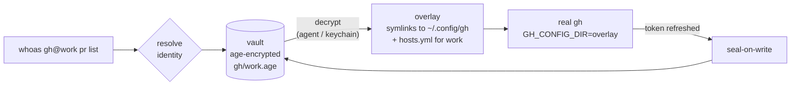

# whoas M3 Implementation Plan

> **For agentic workers:** REQUIRED SUB-SKILL: Use superpowers:subagent-driven-development (recommended) or superpowers:executing-plans to implement this plan task-by-task. Steps use checkbox (`- [ ]`) syntax for tracking.

**Goal:** Add Claude Code accounts (a built-in `claude` env-token adapter whose `login.cmd` runs `claude setup-token`) and per-project API keys for remote MCP servers in any agent: a new `mcp` adapter kind, `whoas mcp proxy` (stdio ↔ Streamable HTTP with the identity's headers) and `whoas mcp setup`, with PostHog and Linear built in.

**Architecture:** Adapters stay declarative TOML. env-token adapters may run `login.cmd` before the secret prompts. The new `mcp` kind declares a server name, a URL and header templates filled from `[[secret]]`s, which never enter an environment. `internal/mcpproxy` bridges go-sdk's IO (stdio) transport and its Streamable HTTP client transport message by message and adds the headers in an `http.RoundTripper`. whoas exports `WHOAS_CONTEXT_DIR` to every process it starts, so `whoas mcp proxy` resolves the identity for the project the agent was started in (else its cwd), decrypts agent-first without ever prompting, and exits 2/3/1. `whoas mcp setup` registers the proxy through `claude mcp add-json` / `codex mcp add`, or prints a generic stdio entry.

**Tech Stack:** Go 1.25+, existing deps (cobra, age, gjson, x/term, testscript) plus `github.com/modelcontextprotocol/go-sdk` v1.8.0 — the only new module.

**Spec:** `docs/superpowers/specs/2026-11-06-whoas-m3-design.md` (extends `2026-11-05-whoas-design.md` and `2026-11-06-whoas-m2-design.md`). Task 9 appends the spec's “Amendments after the fact checks”, which record the facts below.

## Facts this plan relies on (checked 2026-11-06)

- `github.com/modelcontextprotocol/go-sdk` v1.8.0 is the latest release. Used API: `mcp.IOTransport{Reader, Writer}` (the stdio side, on any reader/writer), `mcp.StreamableClientTransport{Endpoint, HTTPClient, DisableStandaloneSSE}`, `mcp.Connection` (`Read`, `Write`, `Close`, `SessionID`), `jsonrpc.Request`/`Response`/`Error`/`ID`; tests and helpers use `mcp.NewServer`, `mcp.AddTool`, `mcp.NewStreamableHTTPHandler`, `mcp.NewClient`, `mcp.CommandTransport`. The SDK opens the standalone SSE stream and sets `Mcp-Protocol-Version` only for its own client sessions, so the proxy adds the negotiated version itself.
- `claude mcp add-json [-s local|user|project] <name> <json>` (CLI default scope: `local`; whoas passes `user` unless told otherwise) refuses a name that exists in that scope; `claude mcp get <name>` exits 0 when it exists in any scope (and health-checks it), 1 with a message on stderr when not; `claude mcp remove [-s scope] <name>` without `-s` removes it from whichever scope holds it and refuses when several do. `claude setup-token` takes no options.
- `codex mcp add <name> -- <command>...`, `codex mcp remove <name>`, `codex mcp get <name>` (exit 1, stderr `No MCP server named '<name>' found.` when absent); no scopes. Codex starts stdio MCP servers with a fixed environment allowlist, extended only by `env_vars` in `~/.codex/config.toml`.

## Global Constraints

- The only new Go module is `github.com/modelcontextprotocol/go-sdk`, pinned at `v1.8.0` (Task 5; `go mod tidy` adds its indirect modules). No other dependency changes.
- Every M1/M2 constraint still holds: unit tests next to code, e2e in `tests/` (never `__tests__/`); never print a secret; tokens via env or files, never argv; 125/126/127 exit codes for runs; global auth files never written; env-token secrets only in the vault (`env/<NAME>` envelope files) and the child's environment; env-var names match `^[A-Za-z_][A-Za-z0-9_]*$`.
- MCP keys live only in the vault and in the `whoas mcp proxy` process's memory: never in an environment, argv, a file, a log or an error message (redact), and they are sent only to the adapter's `mcp.url` origin.
- `CLAUDE_CODE_OAUTH_TOKEN` lives only in the vault and in the Claude child's environment.
- `WHOAS_CONTEXT_DIR=<the directory whoas resolved from>` is exported to every process whoas starts or execs (runs, shims including passthrough, `whoas run`, `login.cmd`, `whoami`).
- `whoas mcp proxy` never prompts on a terminal; its exit codes are 2 (no identity), 3 (the vault needs a terminal), 1 (the remote failed).
- Tests never touch the network or real agents: fake MCP server/client on loopback and pipes, fake `claude`/`codex`, isolated `HOME`. While implementing, never run `claude mcp add|add-json|remove`, `codex mcp add|remove` or `claude setup-token` against your real configuration.
- Unix-only tests carry `//go:build unix`; `GOOS=windows go vet ./...` and `GOOS=darwin go vet ./...` must stay clean.
- Every commit ends with the trailer `Co-Authored-By: Claude Opus 5.5 <noreply@anthropic.com>`.

## Prerequisites

- [ ] Go ≥ 1.25 on PATH (`go version`).
- [ ] Network access to the Go module proxy for Task 5's `go get`.
- [ ] Run every command from the repository root on a branch off `main`.

---

### Task 1: Adapter schema: the mcp kind and login.cmd on env-token

**Files:**
- Modify (full replacement): `internal/adapter/adapter.go`
- Test (full replacement): `internal/adapter/adapter_test.go`

**Interfaces:**
- Consumes: M2 `internal/adapter` API (unchanged signatures): `Parse`, `Validate`, `LoadRegistry`, `(*Registry).Get/ByBin/Source/Names`, `Secret`, `SecretEnv`.
- Produces: `adapter.KindMCP` (`"mcp"`); `Adapter.MCP adapter.MCPSpec` (toml `mcp`); `adapter.MCPSpec{Server, URL string; Headers map[string]string; Auth string}` (toml `server`/`url`/`headers`/`auth`); `(*Adapter).RenderHeaders(values map[string]string) (map[string]string, error)`; `(*Registry).ByServer(server string) (*Adapter, bool)`; `ByBin("")` never matches. Validation: `mcp` forbids `bin`, `[dir]`, `unset_env`, `[whoami]`, `login.cmd`; `mcp.server` is a valid provider name and unique among mcp adapters; `mcp.url` is https (http only for a loopback host); ≥ 1 header, RFC 9110 token names, no CR/LF, every `{…}` names a declared secret and every secret is used; `mcp.auth` is absent or `"header"`. env-token may set `login.cmd` with `cmd[0] == bin`. A user adapter replaces a built-in with the same `name`, `bin` or `mcp.server`.

- [ ] **Step 1: Write the tests**

**`internal/adapter/adapter_test.go`**

```go
//go:build unix

package adapter

import (
	"os"
	"path/filepath"
	"strings"
	"testing"

	"github.com/stretchr/testify/require"
)

const valid = `name = "fake"
bin  = "fake"
kind = "dir-overlay"
[dir]
global     = "{home}/.fake"
inject     = { env = { FAKE_DIR = "{dir}" } }
auth_files = ["auth.json", "nested/dir"]
[login]
cmd = ["fake", "login"]
[whoami]
cmd  = ["fake", "whoami"]
json = "user.email"
`

func TestBuiltinsLoad(t *testing.T) {
	r, err := LoadRegistry(filepath.Join(t.TempDir(), "none"))
	require.NoError(t, err)
	for _, n := range []string{"codex", "docker", "gcloud", "gh", "neonctl", "railway", "vercel", "wrangler"} {
		_, ok := r.Get(n)
		require.True(t, ok, n)
		require.Equal(t, "builtin", r.Source(n), n)
	}
	gh, ok := r.ByBin("gh")
	require.True(t, ok)
	require.Equal(t, []string{"GH_CONFIG_DIR=/o"}, gh.InjectEnv("/o"))
	neon, _ := r.Get("neonctl")
	require.Equal(t, []string{"--config-dir", "/o"}, neon.InjectArgs("/o"))
}

func TestUserAdapterOverridesAndExpands(t *testing.T) {
	dir := t.TempDir()
	require.NoError(t, os.WriteFile(filepath.Join(dir, "fake.toml"), []byte(valid), 0o600))
	r, err := LoadRegistry(dir)
	require.NoError(t, err)
	a, ok := r.Get("fake")
	require.True(t, ok)
	require.Equal(t, "/h/.fake", a.GlobalDir(Vars{Home: "/h"}))
	require.Equal(t, []string{"FAKE_DIR=/run/x"}, a.InjectEnv("/run/x"))
	require.Empty(t, a.InjectArgs("/run/x"))
	require.Equal(t, "user.email", a.Whoami.JSON)
}

func TestParseRejects(t *testing.T) {
	_, err := Parse([]byte(valid), "valid")
	require.NoError(t, err)

	cases := map[string]struct {
		body      string
		errSubstr string
	}{
		"unknown key":   {valid + "colour = \"blue\"\n", "unknown keys"},
		"bad kind":      {replace(valid, `kind = "dir-overlay"`, `kind = "magic"`), "not supported"},
		"abs auth":      {replace(valid, `"auth.json", "nested/dir"`, `"/etc/passwd"`), "clean relative slash path"},
		"dotdot auth":   {replace(valid, `"auth.json", "nested/dir"`, `"../x"`), "clean relative slash path"},
		"no dir ref":    {replace(valid, `FAKE_DIR = "{dir}"`, `FAKE_DIR = "/tmp"`), "must reference {dir}"},
		"both injects":  {replace(valid, `inject     = { env = { FAKE_DIR = "{dir}" } }`, `inject     = { env = { FAKE_DIR = "{dir}" }, flag = ["--d", "{dir}"] }`), "exactly one"},
		"login bin":     {replace(valid, `cmd = ["fake", "login"]`, `cmd = ["sh", "-c", "evil"]`), "must start with"},
		"bin with path": {replace(valid, `bin  = "fake"`, `bin  = "/usr/bin/fake"`), "bare command name"},
		"reserved name": {replace(valid, `name = "fake"`, `name = "run"`), "reserved"},
		"bin -x":        {replace(valid, `bin  = "fake"`, `bin  = "-x"`), "bare command name"},
		"bin ..":        {replace(valid, `bin  = "fake"`, `bin  = ".."`), "bare command name"},
		"env not {dir}": {replace(valid, `inject     = { env = { FAKE_DIR = "{dir}" } }`, `inject     = { env = { FAKE_DIR = "{dir}", LD_PRELOAD = "/tmp/x.so" } }`), "must reference {dir}"},
		"global /etc":   {replace(valid, `global     = "{home}/.fake"`, `global     = "/etc/fake"`), "must start with"},
		"global rel":    {replace(valid, `global     = "{home}/.fake"`, `global     = "relative/x"`), "must start with"},
	}
	for name, tc := range cases {
		_, err := Parse([]byte(tc.body), name)
		require.ErrorContains(t, err, tc.errSubstr, name)
	}
}

func replace(s, old, new string) string { return strings.Replace(s, old, new, 1) }

func TestUserOverridesBuiltinByName(t *testing.T) {
	dir := t.TempDir()
	userGH := `name = "gh"
bin  = "gh"
kind = "dir-overlay"
[dir]
global     = "{xdg_config}/my-gh"
inject     = { env = { GH_CONFIG_DIR = "{dir}" } }
auth_files = ["hosts.yml"]
[login]
cmd = ["gh", "auth", "login", "--insecure-storage"]
[whoami]
cmd  = ["gh", "api", "user"]
json = "login"
`
	require.NoError(t, os.WriteFile(filepath.Join(dir, "gh.toml"), []byte(userGH), 0o600))
	r, err := LoadRegistry(dir)
	require.NoError(t, err)
	a, ok := r.Get("gh")
	require.True(t, ok)
	require.Equal(t, "{xdg_config}/my-gh", a.Dir.Global)
}

// userAdapter is a minimal user adapter named name that runs bin.
func userAdapter(name, bin string) string {
	return `name = "` + name + `"
bin  = "` + bin + `"
kind = "dir-overlay"
[dir]
global     = "{xdg_config}/` + name + `"
inject     = { env = { AAA_CONFIG = "{dir}" } }
auth_files = ["config.json"]
[login]
cmd = ["` + bin + `", "login"]
`
}

func TestDuplicateBinRejected(t *testing.T) {
	dir := t.TempDir()
	require.NoError(t, os.WriteFile(filepath.Join(dir, "aaa.toml"), []byte(userAdapter("aaa", "mytool")), 0o600))
	require.NoError(t, os.WriteFile(filepath.Join(dir, "bbb.toml"), []byte(userAdapter("bbb", "mytool")), 0o600))
	_, err := LoadRegistry(dir)
	require.ErrorContains(t, err, `adapters "aaa" and "bbb" both use bin "mytool"`)
}

func TestUserReplacesBuiltinByBin(t *testing.T) {
	dir := t.TempDir()
	require.NoError(t, os.WriteFile(filepath.Join(dir, "cloudflare.toml"), []byte(userAdapter("cloudflare", "wrangler")), 0o600))
	r, err := LoadRegistry(dir)
	require.NoError(t, err)
	_, ok := r.Get("wrangler")
	require.False(t, ok, "the built-in with the same bin is dropped")
	require.Equal(t, "", r.Source("wrangler"))
	require.Equal(t, "user", r.Source("cloudflare"))
	a, ok := r.ByBin("wrangler")
	require.True(t, ok)
	require.Equal(t, "cloudflare", a.Name)
	gh, ok := r.Get("gh")
	require.True(t, ok, "other built-ins stay")
	require.Equal(t, "builtin", r.Source(gh.Name))
}

func TestChildEnv(t *testing.T) {
	a, err := Parse([]byte(strings.Replace(valid, `kind = "dir-overlay"`, "kind = \"dir-overlay\"\nunset_env = [\"FAKE_TOKEN\"]", 1)), "t")
	require.NoError(t, err)
	got := a.ChildEnv([]string{"PATH=/bin", "FAKE_TOKEN=leak", "FAKE_DIR=/global", "FAKE_TOKENX=keep"}, "/ov")
	require.Equal(t, []string{"PATH=/bin", "FAKE_DIR=/global", "FAKE_TOKENX=keep", "FAKE_DIR=/ov"}, got)

	_, err = Parse([]byte(strings.Replace(valid, `kind = "dir-overlay"`, "kind = \"dir-overlay\"\nunset_env = [\"bad-name\"]", 1)), "t")
	require.ErrorContains(t, err, "unset_env name")
}

func TestBuiltinUnsetEnv(t *testing.T) {
	r, err := LoadRegistry(filepath.Join(t.TempDir(), "none"))
	require.NoError(t, err)
	gh, _ := r.Get("gh")
	require.Contains(t, gh.UnsetEnv, "GH_TOKEN")
	neon, _ := r.Get("neonctl")
	require.Equal(t, []string{"NEON_API_KEY"}, neon.UnsetEnv)
}

const rootHome = `name = "rh"
bin  = "rh"
kind = "dir-overlay"
experimental = true
[dir]
global      = "{home}"
inject      = { env = { HOME = "{dir}" } }
auth_files  = [".rh/config.json"]
helper_keys = ["credsStore", "credHelpers"]
[login]
cmd = ["rh", "login"]
`

const token = `name = "tok"
bin  = "tok"
kind = "env-token"
unset_env = ["TOK_LEGACY"]

[[secret]]
env   = "TOK_KEY"
label = "Tok API Key"

[[secret]]
env      = "TOK_HOST"
label    = "Tok Host"
plain    = true
optional = true

[login]
hint = "Create one at https://example.com/tokens"
`

func TestRootOverlays(t *testing.T) {
	a, err := Parse([]byte(rootHome), "rh")
	require.NoError(t, err)
	require.True(t, a.Experimental)
	require.Equal(t, []string{"credsStore", "credHelpers"}, a.Dir.HelperKeys)
	require.Equal(t, "/h", a.GlobalDir(Vars{Home: "/h"}))

	xdg := replace(replace(rootHome, `global      = "{home}"`, `global      = "{xdg_config}"`), `HOME = "{dir}"`, `XDG_CONFIG_HOME = "{dir}"`)
	_, err = Parse([]byte(xdg), "xdg")
	require.NoError(t, err)

	for name, c := range map[string]struct{ body, errSubstr string }{
		"root without its var":  {replace(rootHome, `HOME = "{dir}"`, `RH_DIR = "{dir}"`), `requires inject env HOME`},
		"root with wrong var":   {replace(rootHome, `HOME = "{dir}"`, `XDG_CONFIG_HOME = "{dir}"`), `requires inject env HOME`},
		"root var on subdir":    {replace(rootHome, `global      = "{home}"`, `global      = "{home}/.rh"`), `only allowed with dir.global = {home}`},
		"root var not plain":    {replace(rootHome, `HOME = "{dir}"`, `HOME = "{dir}/x"`), `requires inject env HOME`},
		"bad helper key":        {replace(rootHome, `"credsStore", "credHelpers"`, `"creds.Store"`), `plain top-level JSON key`},
		"secret on dir-overlay": {rootHome + "[[secret]]\nenv = \"X\"\n", `only valid for env-token`},
	} {
		_, err := Parse([]byte(c.body), name)
		require.ErrorContains(t, err, c.errSubstr, name)
	}
}

func TestEnvTokenAdapter(t *testing.T) {
	a, err := Parse([]byte(token), "tok")
	require.NoError(t, err)
	require.Equal(t, KindEnvToken, a.Kind)
	require.Equal(t, []Secret{
		{Env: "TOK_KEY", Label: "Tok API Key"},
		{Env: "TOK_HOST", Label: "Tok Host", Plain: true, Optional: true},
	}, a.Secrets)
	require.Equal(t, "Tok API Key (TOK_KEY)", a.Secrets[0].PromptLabel())
	require.Equal(t, "X", Secret{Env: "X"}.PromptLabel())

	lower := replace(token, `env   = "TOK_KEY"`, `env   = "TF_TOKEN_app_terraform_io"`)
	_, err = Parse([]byte(lower), "lowercase env")
	require.NoError(t, err, "env var names may contain lowercase")

	for name, c := range map[string]struct{ body, errSubstr string }{
		"dir section":     {token + "[dir]\nglobal = \"{home}/.t\"\n", "[dir] is not valid"},
		"login cmd bin":   {replace(token, `hint = "Create one at https://example.com/tokens"`, `cmd = ["sh", "-c", "evil"]`), `login.cmd must start with "tok"`},
		"no secrets":      {"name = \"tok\"\nbin = \"tok\"\nkind = \"env-token\"\n", "at least one [[secret]]"},
		"duplicate env":   {replace(token, `env      = "TOK_HOST"`, `env      = "TOK_KEY"`), "declared twice"},
		"bad env":         {replace(token, `env   = "TOK_KEY"`, `env   = "tok-key"`), "secret env name"},
		"secret in unset": {replace(token, `unset_env = ["TOK_LEGACY"]`, `unset_env = ["TOK_KEY"]`), "cannot also be in unset_env"},
		"only optional":   {replace(token, "label = \"Tok API Key\"\n", "label = \"Tok API Key\"\noptional = true\n"), "at least one non-optional [[secret]]"},
		"secret HOME":     {replace(token, `env   = "TOK_KEY"`, `env   = "HOME"`), "secret env HOME is a root variable"},
		"secret XDG cfg":  {replace(token, `env   = "TOK_KEY"`, `env   = "XDG_CONFIG_HOME"`), "secret env XDG_CONFIG_HOME is a root variable"},
		"secret XDG data": {replace(token, `env      = "TOK_HOST"`, `env      = "XDG_DATA_HOME"`), "secret env XDG_DATA_HOME is a root variable"},
	} {
		_, err := Parse([]byte(c.body), name)
		require.ErrorContains(t, err, c.errSubstr, name)
	}
}

func TestSecretEnv(t *testing.T) {
	a, err := Parse([]byte(token), "tok")
	require.NoError(t, err)
	base := []string{"PATH=/bin", "TOK_LEGACY=old", "TOK_KEY=inherited", "TOK_KEYX=keep"}
	got := a.SecretEnv(base, map[string]string{"TOK_KEY": "k1", "TOK_HOST": ""})
	require.Equal(t, []string{"PATH=/bin", "TOK_KEYX=keep", "TOK_KEY=k1"}, got)
}

func TestRegistrySource(t *testing.T) {
	dir := t.TempDir()
	require.NoError(t, os.WriteFile(filepath.Join(dir, "tok.toml"), []byte(token), 0o600))
	r, err := LoadRegistry(dir)
	require.NoError(t, err)
	require.Equal(t, "user", r.Source("tok"))
	require.Equal(t, "builtin", r.Source("gh"))
	require.Equal(t, "", r.Source("nope"))
}

func TestDirOverlayBuiltins(t *testing.T) {
	r, err := LoadRegistry(filepath.Join(t.TempDir(), "none"))
	require.NoError(t, err)
	v := Vars{Home: "/h", XDGConfig: "/h/.config", XDGData: "/h/.local/share"}

	vercel, _ := r.Get("vercel")
	require.Equal(t, "/h/.local/share/com.vercel.cli", vercel.GlobalDir(v))
	require.Equal(t, []string{"--global-config", "/o"}, vercel.InjectArgs("/o"))
	require.Equal(t, []string{"auth.json", "config.json"}, vercel.Dir.AuthFiles)

	wrangler, _ := r.Get("wrangler")
	require.Equal(t, "/h/.config", wrangler.GlobalDir(v))
	require.Equal(t, []string{"XDG_CONFIG_HOME=/o"}, wrangler.InjectEnv("/o"))

	railway, _ := r.Get("railway")
	require.True(t, railway.Experimental)
	require.Equal(t, "/h", railway.GlobalDir(v))
	require.Equal(t, []string{"HOME=/o"}, railway.InjectEnv("/o"))

	docker, _ := r.Get("docker")
	require.Equal(t, []string{"credsStore", "credHelpers"}, docker.Dir.HelperKeys)
	require.Equal(t, []string{"DOCKER_CONFIG=/o"}, docker.InjectEnv("/o"))
}

func TestTokenBuiltins(t *testing.T) {
	r, err := LoadRegistry(filepath.Join(t.TempDir(), "none"))
	require.NoError(t, err, "every built-in must load, validate and have a unique bin")

	tokens := 0
	for _, n := range r.Names() {
		if a, _ := r.Get(n); a.Kind == KindEnvToken {
			tokens++
		}
	}
	require.GreaterOrEqual(t, tokens, 60)

	supabase, ok := r.Get("supabase")
	require.True(t, ok)
	require.Equal(t, []Secret{{Env: "SUPABASE_ACCESS_TOKEN", Label: "Supabase Access Token"}}, supabase.Secrets)
	terraform, _ := r.Get("terraform")
	require.Equal(t, "TF_TOKEN_app_terraform_io", terraform.Secrets[0].Env)
	stripe, _ := r.Get("stripe")
	require.Equal(t, "STRIPE_API_KEY", stripe.Secrets[0].Env)
	for _, n := range []string{"claude", "agent", "psql", "forge"} {
		_, ok := r.Get(n)
		require.False(t, ok, "%s is intentionally not a built-in", n)
	}
	_, ok = r.ByBin("forge")
	require.False(t, ok, "forge is Foundry's bin too")

	// competing variables that would outrank the injected token are removed
	hf, _ := r.Get("hf")
	require.Equal(t, "HF_TOKEN", hf.Secrets[0].Env)
	require.Equal(t, []string{"HUGGING_FACE_HUB_TOKEN"}, hf.UnsetEnv)
	for _, n := range []string{"fly", "flyctl"} {
		a, _ := r.Get(n)
		require.Equal(t, []string{"FLY_API_TOKEN"}, a.UnsetEnv, n)
	}

	// hints point at a real page, without placeholders
	for _, n := range r.Names() {
		a, _ := r.Get(n)
		require.NotContains(t, a.Login.Hint, "[account]", n)
		require.NotContains(t, a.Login.Hint, "mycorp", n)
	}
	postman, _ := r.Get("postman")
	require.Equal(t, "Postman API Key", postman.Secrets[0].Label)
}

func TestConflicts(t *testing.T) {
	body := replace(valid, `auth_files = ["auth.json", "nested/dir"]`, "auth_files = [\"auth.json\", \"nested/dir\"]\nconflicts  = [\"{home}/.legacy\", \"{xdg_config}/old\"]")
	a, err := Parse([]byte(body), "conflicts")
	require.NoError(t, err)
	require.Equal(t, []string{"{home}/.legacy", "{xdg_config}/old"}, a.Dir.Conflicts)

	h := t.TempDir()
	v := Vars{Home: h, XDGConfig: filepath.Join(h, ".config"), XDGData: filepath.Join(h, ".local", "share")}
	require.NoError(t, a.CheckConflicts(v))
	old := filepath.Join(h, ".config", "old")
	require.NoError(t, os.MkdirAll(old, 0o700))
	require.EqualError(t, a.CheckConflicts(v), "fake: "+old+" exists and fake uses it instead of the isolated directory; move it (see the adapter's hint) to use identities")

	for name, c := range map[string]struct{ body, errSubstr string }{
		"conflict absolute": {replace(body, `"{xdg_config}/old"`, `"/etc/old"`), "dir.conflicts"},
		"conflict relative": {replace(body, `"{xdg_config}/old"`, `"old"`), "dir.conflicts"},
		"conflict is root":  {replace(body, `"{xdg_config}/old"`, `"{home}"`), "dir.conflicts"},
		"conflict on token": {token + "[dir]\nconflicts = [\"{home}/.tok\"]\n", "[dir] is not valid"},
	} {
		_, err := Parse([]byte(c.body), name)
		require.ErrorContains(t, err, c.errSubstr, name)
	}

	r, err := LoadRegistry(filepath.Join(t.TempDir(), "none"))
	require.NoError(t, err)
	wrangler, _ := r.Get("wrangler")
	require.Equal(t, []string{"{home}/.wrangler"}, wrangler.Dir.Conflicts)
	require.Contains(t, wrangler.Login.Hint, "~/.config/.wrangler")
}

func TestEnvTokenLoginCmd(t *testing.T) {
	body := replace(token, `hint = "Create one at https://example.com/tokens"`, "cmd  = [\"tok\", \"setup-token\"]\nhint = \"Paste the token tok prints\"")
	a, err := Parse([]byte(body), "tok login")
	require.NoError(t, err, "env-token adapters may run their own bin to obtain the token")
	require.Equal(t, []string{"tok", "setup-token"}, a.Login.Cmd)
	require.Equal(t, "Paste the token tok prints", a.Login.Hint)

	_, err = Parse([]byte(token+"[mcp]\nserver = \"tok\"\n"), "mcp on env-token")
	require.ErrorContains(t, err, "[mcp] is only valid for mcp adapters")
}

const mcpAcme = `name = "mcp-acme"
kind = "mcp"

[mcp]
server  = "acme"
url     = "https://mcp.acme.example/mcp"
headers = { Authorization = "Bearer {ACME_KEY}", X-Acme-Org = "{ACME_ORG}" }

[[secret]]
env   = "ACME_KEY"
label = "Acme API key"

[[secret]]
env      = "ACME_ORG"
label    = "Acme org"
plain    = true
optional = true

[login]
hint = "Create one at https://acme.example/keys"
`

func TestMCPAdapter(t *testing.T) {
	a, err := Parse([]byte(mcpAcme), "mcp")
	require.NoError(t, err)
	require.Equal(t, KindMCP, a.Kind)
	require.Empty(t, a.Bin)
	require.Equal(t, MCPSpec{
		Server:  "acme",
		URL:     "https://mcp.acme.example/mcp",
		Headers: map[string]string{"Authorization": "Bearer {ACME_KEY}", "X-Acme-Org": "{ACME_ORG}"},
	}, a.MCP)

	h, err := a.RenderHeaders(map[string]string{"ACME_KEY": "k1", "ACME_ORG": "org9"})
	require.NoError(t, err)
	require.Equal(t, map[string]string{"Authorization": "Bearer k1", "X-Acme-Org": "org9"}, h)

	h, err = a.RenderHeaders(map[string]string{"ACME_KEY": "k1"})
	require.NoError(t, err)
	require.Equal(t, map[string]string{"Authorization": "Bearer k1"}, h, "a header using an empty optional secret is omitted")

	_, err = a.RenderHeaders(map[string]string{"ACME_ORG": "org9"})
	require.EqualError(t, err, "mcp-acme: identity has no ACME_KEY")

	_, err = a.RenderHeaders(map[string]string{"ACME_KEY": "k1\r\nX-Evil: 1"})
	require.ErrorContains(t, err, "contains CR or LF")

	for _, u := range []string{"http://127.0.0.1:8080/mcp", "http://localhost/mcp", "http://[::1]:9/mcp"} {
		_, err := Parse([]byte(replace(mcpAcme, "https://mcp.acme.example/mcp", u)), u)
		require.NoError(t, err, "http is allowed for loopback %s", u)
	}
	_, err = Parse([]byte(replace(mcpAcme, `server  = "acme"`, "server  = \"acme\"\nauth    = \"header\"")), "auth header")
	require.NoError(t, err)
}

func TestMCPRejects(t *testing.T) {
	cases := map[string]struct{ body, errSubstr string }{
		"bin":              {replace(mcpAcme, `kind = "mcp"`, "kind = \"mcp\"\nbin = \"acme\""), "bin is not valid for mcp adapters"},
		"dir":              {mcpAcme + "[dir]\nglobal = \"{home}/.acme\"\n", "[dir] is not valid for mcp adapters"},
		"unset_env":        {replace(mcpAcme, `kind = "mcp"`, "kind = \"mcp\"\nunset_env = [\"ACME_TOKEN\"]"), "unset_env is not valid for mcp adapters"},
		"whoami":           {mcpAcme + "[whoami]\njson = \"user\"\n", "[whoami] is not valid for mcp adapters"},
		"login cmd":        {replace(mcpAcme, `hint = "Create one at https://acme.example/keys"`, `cmd = ["acme", "login"]`), "login.cmd is not valid for mcp adapters"},
		"server missing":   {replace(mcpAcme, `server  = "acme"`, ``), "mcp.server"},
		"server bad":       {replace(mcpAcme, `server  = "acme"`, `server  = "Acme Server"`), "mcp.server"},
		"server reserved":  {replace(mcpAcme, `server  = "acme"`, `server  = "run"`), "mcp.server"},
		"url http remote":  {replace(mcpAcme, "https://mcp.acme.example/mcp", "http://mcp.acme.example/mcp"), "only allowed for a loopback host"},
		"url ftp":          {replace(mcpAcme, "https://mcp.acme.example/mcp", "ftp://mcp.acme.example/mcp"), "must use https"},
		"url relative":     {replace(mcpAcme, "https://mcp.acme.example/mcp", "/mcp"), "absolute http(s) URL"},
		"url credentials":  {replace(mcpAcme, "https://mcp.acme.example/mcp", "https://u:p@mcp.acme.example/mcp"), "without credentials"},
		"no headers":       {replace(mcpAcme, `headers = { Authorization = "Bearer {ACME_KEY}", X-Acme-Org = "{ACME_ORG}" }`, ``), "mcp.headers needs at least one header"},
		"bad header name":  {replace(mcpAcme, `X-Acme-Org = "{ACME_ORG}"`, `"X Acme" = "{ACME_ORG}"`), "not a valid HTTP header name"},
		"header CRLF":      {replace(mcpAcme, `"Bearer {ACME_KEY}"`, `"Bearer {ACME_KEY}\r\nX-Evil: 1"`), "contains CR or LF"},
		"undeclared var":   {replace(mcpAcme, `"Bearer {ACME_KEY}"`, `"Bearer {ACME_KEY}{ACME_SECRET}"`), "{ACME_SECRET}, which is not a declared [[secret]]"},
		"typo var":         {replace(mcpAcme, `"Bearer {ACME_KEY}"`, `"Bearer {ACME-KEY}"`), "{ACME-KEY}, which is not a declared [[secret]]"},
		"unused secret":    {replace(mcpAcme, `X-Acme-Org = "{ACME_ORG}"`, `X-Acme-Org = "fixed"`), "secret ACME_ORG is not used"},
		"no secrets":       {"name = \"mcp-acme\"\nkind = \"mcp\"\n[mcp]\nserver = \"acme\"\nurl = \"https://a.example/mcp\"\nheaders = { X-A = \"1\" }\n", "mcp adapters need at least one [[secret]]"},
		"only optional":    {replace(mcpAcme, "label = \"Acme API key\"\n", "label = \"Acme API key\"\noptional = true\n"), "at least one non-optional [[secret]]"},
		"duplicate secret": {replace(mcpAcme, `env      = "ACME_ORG"`, `env      = "ACME_KEY"`), "declared twice"},
		"bad secret env":   {replace(mcpAcme, `env   = "ACME_KEY"`, `env   = "acme-key"`), "secret env name"},
		"auth oauth":       {replace(mcpAcme, `server  = "acme"`, "server  = \"acme\"\nauth    = \"oauth\""), `"oauth" is not supported yet`},
		"auth other":       {replace(mcpAcme, `server  = "acme"`, "server  = \"acme\"\nauth    = \"basic\""), `mcp.auth "basic" not supported`},
		"unknown mcp key":  {replace(mcpAcme, `server  = "acme"`, "server  = \"acme\"\ntransport = \"sse\""), "unknown keys"},
	}
	for name, c := range cases {
		_, err := Parse([]byte(c.body), name)
		require.ErrorContains(t, err, c.errSubstr, name)
	}
}

// mcpAdapter is a minimal user mcp adapter named name for server.
func mcpAdapter(name, server string) string {
	return `name = "` + name + `"
kind = "mcp"
[mcp]
server  = "` + server + `"
url     = "http://127.0.0.1:1/mcp"
headers = { Authorization = "Bearer {K}" }
[[secret]]
env = "K"
`
}

func TestMCPRegistry(t *testing.T) {
	dir := t.TempDir()
	require.NoError(t, os.WriteFile(filepath.Join(dir, "a.toml"), []byte(mcpAdapter("mcp-a", "alpha")), 0o600))
	require.NoError(t, os.WriteFile(filepath.Join(dir, "b.toml"), []byte(mcpAdapter("mcp-b", "beta")), 0o600))
	r, err := LoadRegistry(dir)
	require.NoError(t, err, "mcp adapters have no bin, so they never collide on it")
	a, ok := r.ByServer("beta")
	require.True(t, ok)
	require.Equal(t, "mcp-b", a.Name)
	_, ok = r.ByServer("gamma")
	require.False(t, ok)
	_, ok = r.ByServer("")
	require.False(t, ok)
	_, ok = r.ByBin("")
	require.False(t, ok, "an empty bin never matches an mcp adapter")

	require.NoError(t, os.WriteFile(filepath.Join(dir, "c.toml"), []byte(mcpAdapter("mcp-c", "alpha")), 0o600))
	_, err = LoadRegistry(dir)
	require.ErrorContains(t, err, `adapters "mcp-a" and "mcp-c" both use mcp.server "alpha"`)
}
```

- [ ] **Step 2: Run the tests to verify they fail**

```bash
go test ./internal/adapter/
```

Expected: FAIL — build errors in adapter_test.go: `undefined: KindMCP`, `undefined: MCPSpec`, `a.MCP undefined (type *Adapter has no field or method MCP)`, then `a.RenderHeaders undefined` and `r.ByServer undefined`.

- [ ] **Step 3: Write the implementation**

**`internal/adapter/adapter.go`**

```go
// Package adapter loads declarative TOML adapters that tell whoas where a
// CLI keeps its session and how to point the CLI at it (dir-overlay), which
// env vars carry its API token (env-token), or which headers carry the API
// key of a remote MCP server (mcp).
// Adapters are data, not scripts, but they choose which binary runs with which arguments: only install adapters you trust, like any script in your config dir. Project files (.whoas.yaml) can never declare adapters.
package adapter

import (
	"embed"
	"errors"
	"fmt"
	"io/fs"
	"net"
	"net/url"
	"os"
	"path"
	"path/filepath"
	"regexp"
	"slices"
	"sort"
	"strings"

	"github.com/BurntSushi/toml"

	"github.com/S-kkipie/whoas/internal/ref"
)

// Kind is the isolation mechanism.
type Kind string

const (
	// KindDirOverlay points the CLI at an overlay of its config dir.
	KindDirOverlay Kind = "dir-overlay"
	// KindEnvToken injects API tokens as env vars; no overlay.
	KindEnvToken Kind = "env-token"
	// KindMCP is a remote MCP server reached through `whoas mcp proxy`; its
	// secrets fill HTTP headers and never enter any environment.
	KindMCP Kind = "mcp"
)

// Adapter describes one CLI.
type Adapter struct {
	Name   string  `toml:"name"`
	Bin    string  `toml:"bin"`
	Kind   Kind    `toml:"kind"`
	Dir    DirSpec `toml:"dir"`
	Login  Login   `toml:"login"`
	Whoami Whoami  `toml:"whoami"`
	// UnsetEnv lists env vars removed from the CLI's environment because they
	// would override the identity (e.g. GH_TOKEN for gh).
	UnsetEnv []string `toml:"unset_env"`
	// Experimental marks adapters whose isolation has known gaps.
	Experimental bool `toml:"experimental"`
	// Secrets are the env vars an env-token adapter injects, or the
	// template variables of an mcp adapter's headers.
	Secrets []Secret `toml:"secret"`
	// MCP describes the remote server of an mcp adapter.
	MCP MCPSpec `toml:"mcp"`
}

// MCPSpec is the remote MCP server an mcp adapter connects to.
type MCPSpec struct {
	Server  string            `toml:"server"`  // default server name when registering in an agent
	URL     string            `toml:"url"`     // Streamable HTTP endpoint
	Headers map[string]string `toml:"headers"` // values may use {SECRET} placeholders
	Auth    string            `toml:"auth"`    // "" or "header"; "oauth" is reserved
}

// Secret is one env var of an env-token adapter.
type Secret struct {
	Env      string `toml:"env"`
	Label    string `toml:"label"`
	Plain    bool   `toml:"plain"`    // not secret: prompt with echo (e.g. a host name)
	Optional bool   `toml:"optional"` // may be left empty
}

// DirSpec says where the session lives and how to redirect the CLI.
type DirSpec struct {
	Global    string   `toml:"global"`     // template, e.g. "{xdg_config}/gh"
	Inject    Inject   `toml:"inject"`     // exactly one of env or flag
	AuthFiles []string `toml:"auth_files"` // slash paths relative to the dir; may be dirs
	// HelperKeys are top-level JSON keys of an auth file that delegate
	// credentials to stores outside whoas (docker: credsStore, credHelpers).
	HelperKeys []string `toml:"helper_keys"`
	// Conflicts are paths (same placeholders as Global) that, when present,
	// make the CLI ignore the injected dir (wrangler: a legacy ~/.wrangler).
	Conflicts []string `toml:"conflicts"`
}

// Inject points the CLI at {dir} through env vars or leading flags.
type Inject struct {
	Env  map[string]string `toml:"env"`
	Flag []string          `toml:"flag"`
}

// Login is the command that runs the CLI's own login flow (dir-overlay), or
// one that helps the user obtain a token before the prompts (env-token).
type Login struct {
	Cmd  []string `toml:"cmd"`
	Hint string   `toml:"hint"`
}

// Whoami prints the account; JSON is an optional gjson path into stdout.
type Whoami struct {
	Cmd  []string `toml:"cmd"`
	JSON string   `toml:"json"`
}

// Vars are the values templates expand.
type Vars struct {
	Home      string
	XDGConfig string
	XDGData   string
}

// envNameRe allows lowercase: some CLIs use host-specific names (TF_TOKEN_app_terraform_io).
var envNameRe = regexp.MustCompile(`^[A-Za-z_][A-Za-z0-9_]*$`)
var binNameRe = regexp.MustCompile(`^[A-Za-z0-9][A-Za-z0-9._-]*$`)

// Parse decodes one adapter strictly (unknown keys are errors) and validates it.
func Parse(data []byte, source string) (*Adapter, error) {
	var a Adapter
	md, err := toml.Decode(string(data), &a)
	if err != nil {
		return nil, fmt.Errorf("%s: %w", source, err)
	}
	if und := md.Undecoded(); len(und) > 0 {
		keys := make([]string, len(und))
		for i, k := range und {
			keys[i] = k.String()
		}
		return nil, fmt.Errorf("%s: unknown keys: %s", source, strings.Join(keys, ", "))
	}
	if err := a.Validate(); err != nil {
		return nil, fmt.Errorf("%s: %w", source, err)
	}
	return &a, nil
}

// rootVars maps a root global to the env var that must point at the overlay.
var rootVars = map[string]string{"{home}": "HOME", "{xdg_config}": "XDG_CONFIG_HOME", "{xdg_data}": "XDG_DATA_HOME"}

// Validate checks every invariant the rest of whoas relies on.
func (a *Adapter) Validate() error {
	if err := ref.ValidProvider(a.Name); err != nil {
		return err
	}
	if a.Kind == KindMCP {
		return a.validateMCP()
	}
	if !a.MCP.isZero() {
		return errors.New("[mcp] is only valid for mcp adapters")
	}
	if !binNameRe.MatchString(a.Bin) {
		return fmt.Errorf("bin %q must be a bare command name", a.Bin)
	}
	if len(a.Whoami.Cmd) > 0 && a.Whoami.Cmd[0] != a.Bin {
		return fmt.Errorf("whoami.cmd must start with %q", a.Bin)
	}
	for _, k := range a.UnsetEnv {
		if !envNameRe.MatchString(k) {
			return fmt.Errorf("unset_env name %q invalid", k)
		}
	}
	switch a.Kind {
	case KindDirOverlay:
		return a.validateDirOverlay()
	case KindEnvToken:
		return a.validateEnvToken()
	}
	return fmt.Errorf("kind %q not supported (supported: %s, %s, %s)", a.Kind, KindDirOverlay, KindEnvToken, KindMCP)
}

func (a *Adapter) validateDirOverlay() error {
	if len(a.Secrets) > 0 {
		return errors.New("[[secret]] is only valid for env-token adapters")
	}
	g := a.Dir.Global
	if g == "" {
		return errors.New("dir.global is required")
	}
	rootVar, isRoot := rootVars[g]
	if !isRoot && !strings.HasPrefix(g, "{home}/") && !strings.HasPrefix(g, "{xdg_config}/") && !strings.HasPrefix(g, "{xdg_data}/") {
		return errors.New("dir.global must start with {home}/, {xdg_config}/ or {xdg_data}/ (or be exactly {home}, {xdg_config} or {xdg_data})")
	}
	if len(a.Dir.AuthFiles) == 0 {
		return errors.New("dir.auth_files is required")
	}
	for _, p := range a.Dir.AuthFiles {
		c := path.Clean(p)
		if c != p || path.IsAbs(p) || c == "." || strings.HasPrefix(c, "../") || c == ".." || strings.Contains(p, `\`) {
			return fmt.Errorf("auth file %q must be a clean relative slash path", p)
		}
	}
	env, flag := len(a.Dir.Inject.Env) > 0, len(a.Dir.Inject.Flag) > 0
	if env == flag {
		return errors.New("dir.inject needs exactly one of env or flag")
	}
	if env {
		for k, v := range a.Dir.Inject.Env {
			if !envNameRe.MatchString(k) {
				return fmt.Errorf("inject env name %q invalid", k)
			}
			if !strings.Contains(v, "{dir}") {
				return fmt.Errorf("inject env %s must reference {dir}", k)
			}
		}
	} else {
		hasDir := false
		for _, f := range a.Dir.Inject.Flag {
			hasDir = hasDir || strings.Contains(f, "{dir}")
		}
		if !hasDir {
			return errors.New("dir.inject must reference {dir}")
		}
	}
	// A root overlay redirects exactly its own root variable; a root variable
	// may only be injected by the matching root overlay.
	if isRoot && a.Dir.Inject.Env[rootVar] != "{dir}" {
		return fmt.Errorf("dir.global %s requires inject env %s = \"{dir}\"", g, rootVar)
	}
	for root, v := range rootVars {
		if _, ok := a.Dir.Inject.Env[v]; ok && g != root {
			return fmt.Errorf("inject env %s is only allowed with dir.global = %s", v, root)
		}
	}
	for _, c := range a.Dir.Conflicts {
		if !strings.HasPrefix(c, "{home}/") && !strings.HasPrefix(c, "{xdg_config}/") && !strings.HasPrefix(c, "{xdg_data}/") {
			return fmt.Errorf("dir.conflicts %q must start with {home}/, {xdg_config}/ or {xdg_data}/", c)
		}
	}
	for _, k := range a.Dir.HelperKeys {
		if k == "" || strings.ContainsAny(k, ".*?|#@\\") {
			return fmt.Errorf("helper key %q must be a plain top-level JSON key", k)
		}
	}
	if len(a.Login.Cmd) == 0 || a.Login.Cmd[0] != a.Bin {
		return fmt.Errorf("login.cmd must start with %q", a.Bin)
	}
	return nil
}

func (d DirSpec) isZero() bool {
	return d.Global == "" && len(d.AuthFiles) == 0 && len(d.Inject.Env) == 0 && len(d.Inject.Flag) == 0 && len(d.HelperKeys) == 0 && len(d.Conflicts) == 0
}

func (m MCPSpec) isZero() bool {
	return m.Server == "" && m.URL == "" && len(m.Headers) == 0 && m.Auth == ""
}

func (a *Adapter) validateEnvToken() error {
	if !a.Dir.isZero() {
		return errors.New("[dir] is not valid for env-token adapters")
	}
	// login.cmd helps the user obtain the token (claude setup-token); it runs
	// before the prompts, so it must be the adapter's own binary.
	if len(a.Login.Cmd) > 0 && a.Login.Cmd[0] != a.Bin {
		return fmt.Errorf("login.cmd must start with %q", a.Bin)
	}
	if err := a.validateSecrets(); err != nil {
		return err
	}
	for _, s := range a.Secrets {
		for _, v := range rootVars {
			if s.Env == v {
				return fmt.Errorf("secret env %s is a root variable (only root overlays may set it)", s.Env)
			}
		}
		if slices.Contains(a.UnsetEnv, s.Env) {
			return fmt.Errorf("secret env %s cannot also be in unset_env", s.Env)
		}
	}
	return nil
}

// validateSecrets checks the [[secret]] rules shared by env-token and mcp
// adapters: at least one required secret, valid and unique names.
func (a *Adapter) validateSecrets() error {
	if len(a.Secrets) == 0 {
		return fmt.Errorf("%s adapters need at least one [[secret]]", a.Kind)
	}
	seen := map[string]bool{}
	required := 0
	for _, s := range a.Secrets {
		if !envNameRe.MatchString(s.Env) {
			return fmt.Errorf("secret env name %q invalid", s.Env)
		}
		if seen[s.Env] {
			return fmt.Errorf("secret env %s declared twice", s.Env)
		}
		seen[s.Env] = true
		if !s.Optional {
			required++
		}
	}
	if required == 0 {
		return fmt.Errorf("%s adapters need at least one non-optional [[secret]]", a.Kind)
	}
	return nil
}

// placeholderRe matches every {...} group of a header value; each must name
// a declared secret.
var placeholderRe = regexp.MustCompile(`\{([^{}]*)\}`)

func (a *Adapter) validateMCP() error {
	switch {
	case a.Bin != "":
		return errors.New("bin is not valid for mcp adapters")
	case !a.Dir.isZero():
		return errors.New("[dir] is not valid for mcp adapters")
	case len(a.UnsetEnv) > 0:
		return errors.New("unset_env is not valid for mcp adapters")
	case len(a.Whoami.Cmd) > 0 || a.Whoami.JSON != "":
		return errors.New("[whoami] is not valid for mcp adapters")
	case len(a.Login.Cmd) > 0:
		return errors.New("login.cmd is not valid for mcp adapters (use login.hint)")
	}
	m := a.MCP
	if err := ref.ValidProvider(m.Server); err != nil {
		return fmt.Errorf("mcp.server: %w", err)
	}
	switch m.Auth {
	case "", "header":
	case "oauth":
		return errors.New(`mcp.auth "oauth" is not supported yet (only "header")`)
	default:
		return fmt.Errorf(`mcp.auth %q not supported (only "header")`, m.Auth)
	}
	if err := validMCPURL(m.URL); err != nil {
		return err
	}
	if err := a.validateSecrets(); err != nil {
		return err
	}
	if len(m.Headers) == 0 {
		return errors.New("mcp.headers needs at least one header")
	}
	used := map[string]bool{}
	for name, v := range m.Headers {
		if !isHTTPToken(name) {
			return fmt.Errorf("mcp.headers name %q is not a valid HTTP header name", name)
		}
		if strings.ContainsAny(v, "\r\n") {
			return fmt.Errorf("mcp.headers %s contains CR or LF", name)
		}
		for _, p := range placeholderRe.FindAllStringSubmatch(v, -1) {
			if !slices.ContainsFunc(a.Secrets, func(s Secret) bool { return s.Env == p[1] }) {
				return fmt.Errorf("mcp.headers %s uses {%s}, which is not a declared [[secret]]", name, p[1])
			}
			used[p[1]] = true
		}
	}
	for _, s := range a.Secrets {
		if !used[s.Env] {
			return fmt.Errorf("secret %s is not used by any mcp.headers value", s.Env)
		}
	}
	return nil
}

// validMCPURL accepts https URLs, and http only for a loopback host.
func validMCPURL(raw string) error {
	u, err := url.Parse(raw)
	if err != nil || u.Host == "" || u.User != nil {
		return fmt.Errorf("mcp.url %q must be an absolute http(s) URL without credentials", raw)
	}
	switch u.Scheme {
	case "https":
		return nil
	case "http":
		h := u.Hostname()
		if ip := net.ParseIP(h); h == "localhost" || (ip != nil && ip.IsLoopback()) {
			return nil
		}
		return fmt.Errorf("mcp.url %q: http is only allowed for a loopback host (use https)", raw)
	}
	return fmt.Errorf("mcp.url %q must use https", raw)
}

// isHTTPToken reports whether s is an RFC 9110 token (a valid header name).
func isHTTPToken(s string) bool {
	if s == "" {
		return false
	}
	for _, c := range s {
		switch {
		case c >= 'a' && c <= 'z', c >= 'A' && c <= 'Z', c >= '0' && c <= '9':
		case strings.ContainsRune("!#$%&'*+-.^_`|~", c):
		default:
			return false
		}
	}
	return true
}

// RenderHeaders fills the mcp adapter's header templates with values
// (secret env name -> value). A header that uses an optional secret left
// empty is omitted; a missing required secret is an error. The result holds
// secrets: it must never be logged or exported.
func (a *Adapter) RenderHeaders(values map[string]string) (map[string]string, error) {
	out := make(map[string]string, len(a.MCP.Headers))
	for name, tmpl := range a.MCP.Headers {
		omit := false
		var missing error
		v := placeholderRe.ReplaceAllStringFunc(tmpl, func(m string) string {
			env := m[1 : len(m)-1]
			val := values[env]
			if val == "" {
				i := slices.IndexFunc(a.Secrets, func(s Secret) bool { return s.Env == env })
				if i >= 0 && a.Secrets[i].Optional {
					omit = true
				} else if missing == nil {
					missing = fmt.Errorf("%s: identity has no %s", a.Name, env)
				}
			}
			return val
		})
		if missing != nil {
			return nil, missing
		}
		if strings.ContainsAny(v, "\r\n") {
			return nil, fmt.Errorf("%s: the value for header %s contains CR or LF", a.Name, name)
		}
		if !omit {
			out[name] = v
		}
	}
	return out, nil
}

// Expand replaces {home}, {xdg_config}, {xdg_data} and {dir}.
func Expand(s string, v Vars, dir string) string {
	return strings.NewReplacer("{home}", v.Home, "{xdg_config}", v.XDGConfig, "{xdg_data}", v.XDGData, "{dir}", dir).Replace(s)
}

// CheckConflicts fails when one of the adapter's conflicting paths exists:
// the CLI would use it instead of the isolated directory.
func (a *Adapter) CheckConflicts(v Vars) error {
	for _, c := range a.Dir.Conflicts {
		p := filepath.Clean(Expand(c, v, ""))
		if _, err := os.Stat(p); err == nil {
			return fmt.Errorf("%s: %s exists and %s uses it instead of the isolated directory; move it (see the adapter's hint) to use identities", a.Name, p, a.Bin)
		}
	}
	return nil
}

// GlobalDir is the CLI's real config dir.
func (a *Adapter) GlobalDir(v Vars) string { return filepath.Clean(Expand(a.Dir.Global, v, "")) }

// InjectArgs are the flags to place right after the binary name.
func (a *Adapter) InjectArgs(dir string) []string {
	out := make([]string, len(a.Dir.Inject.Flag))
	for i, f := range a.Dir.Inject.Flag {
		out[i] = Expand(f, Vars{}, dir)
	}
	return out
}

// InjectEnv returns KEY=VALUE pairs, sorted by key.
func (a *Adapter) InjectEnv(dir string) []string {
	keys := make([]string, 0, len(a.Dir.Inject.Env))
	for k := range a.Dir.Inject.Env {
		keys = append(keys, k)
	}
	sort.Strings(keys)
	out := make([]string, len(keys))
	for i, k := range keys {
		out[i] = k + "=" + Expand(a.Dir.Inject.Env[k], Vars{}, dir)
	}
	return out
}

// ChildEnv is base without the adapter's UnsetEnv vars, plus InjectEnv(dir)
// (injected values win over inherited ones).
func (a *Adapter) ChildEnv(base []string, dir string) []string {
	out := make([]string, 0, len(base)+len(a.Dir.Inject.Env))
	for _, kv := range base {
		k, _, _ := strings.Cut(kv, "=")
		if !slices.Contains(a.UnsetEnv, k) {
			out = append(out, kv)
		}
	}
	return append(out, a.InjectEnv(dir)...)
}

// SecretEnv is base without the adapter's UnsetEnv vars and secret vars, plus
// each secret from values (ENV -> value) that is set.
func (a *Adapter) SecretEnv(base []string, values map[string]string) []string {
	drop := func(k string) bool {
		if slices.Contains(a.UnsetEnv, k) {
			return true
		}
		for _, s := range a.Secrets {
			if s.Env == k {
				return true
			}
		}
		return false
	}
	out := make([]string, 0, len(base)+len(a.Secrets))
	for _, kv := range base {
		k, _, _ := strings.Cut(kv, "=")
		if !drop(k) {
			out = append(out, kv)
		}
	}
	for _, s := range a.Secrets {
		if v, ok := values[s.Env]; ok && v != "" {
			out = append(out, s.Env+"="+v)
		}
	}
	return out
}

// PromptLabel is the label shown when asking for s.
func (s Secret) PromptLabel() string {
	if s.Label == "" {
		return s.Env
	}
	return s.Label + " (" + s.Env + ")"
}

//go:embed builtin/*.toml
var builtinFS embed.FS

// Registry holds every known adapter by name.
type Registry struct {
	byName map[string]*Adapter
	source map[string]string // name -> "builtin" | "user"
}

// LoadRegistry loads built-in adapters, then userDir/*.toml. A user adapter
// replaces every built-in with the same name, the same bin or the same
// mcp.server; two user adapters (or two built-ins) sharing a bin or an
// mcp.server are an error.
func LoadRegistry(userDir string) (*Registry, error) {
	r := &Registry{byName: map[string]*Adapter{}, source: map[string]string{}}
	builtins, err := fs.Glob(builtinFS, "builtin/*.toml")
	if err != nil {
		return nil, err
	}
	for _, p := range builtins {
		data, err := builtinFS.ReadFile(p)
		if err != nil {
			return nil, err
		}
		a, err := Parse(data, "builtin "+path.Base(p))
		if err != nil {
			return nil, err
		}
		r.byName[a.Name] = a
		r.source[a.Name] = "builtin"
	}
	user, err := filepath.Glob(filepath.Join(userDir, "*.toml"))
	if err != nil {
		return nil, err
	}
	users := make([]*Adapter, 0, len(user))
	for _, p := range user {
		data, err := os.ReadFile(p)
		if err != nil {
			return nil, err
		}
		a, err := Parse(data, p)
		if err != nil {
			return nil, err
		}
		users = append(users, a)
	}
	for _, u := range users {
		for name, b := range r.byName {
			sameBin := u.Bin != "" && b.Bin == u.Bin
			sameServer := u.Kind == KindMCP && b.Kind == KindMCP && b.MCP.Server == u.MCP.Server
			if r.source[name] == "builtin" && (name == u.Name || sameBin || sameServer) {
				delete(r.byName, name)
				delete(r.source, name)
			}
		}
	}
	for _, u := range users {
		r.byName[u.Name] = u
		r.source[u.Name] = "user"
	}
	// Check for duplicate bins and mcp servers
	binToName := make(map[string][]string)
	serverToName := make(map[string][]string)
	for name, adapter := range r.byName {
		if adapter.Kind == KindMCP {
			serverToName[adapter.MCP.Server] = append(serverToName[adapter.MCP.Server], name)
		} else {
			binToName[adapter.Bin] = append(binToName[adapter.Bin], name)
		}
	}
	for bin, names := range binToName {
		if len(names) > 1 {
			sort.Strings(names)
			return nil, fmt.Errorf("adapters %q and %q both use bin %q", names[0], names[1], bin)
		}
	}
	for server, names := range serverToName {
		if len(names) > 1 {
			sort.Strings(names)
			return nil, fmt.Errorf("adapters %q and %q both use mcp.server %q", names[0], names[1], server)
		}
	}
	return r, nil
}

// Get returns the adapter named name.
func (r *Registry) Get(name string) (*Adapter, bool) {
	a, ok := r.byName[name]
	return a, ok
}

// Source says where the adapter named name came from: "builtin" or "user".
func (r *Registry) Source(name string) string { return r.source[name] }

// ByBin returns the adapter whose binary is bin (never an mcp adapter).
func (r *Registry) ByBin(bin string) (*Adapter, bool) {
	if bin == "" {
		return nil, false
	}
	for _, n := range r.Names() {
		if a := r.byName[n]; a.Bin == bin {
			return a, true
		}
	}
	return nil, false
}

// ByServer returns the mcp adapter whose mcp.server is server.
func (r *Registry) ByServer(server string) (*Adapter, bool) {
	if server == "" {
		return nil, false
	}
	for _, n := range r.Names() {
		if a := r.byName[n]; a.Kind == KindMCP && a.MCP.Server == server {
			return a, true
		}
	}
	return nil, false
}

// Names returns adapter names sorted.
func (r *Registry) Names() []string {
	names := make([]string, 0, len(r.byName))
	for n := range r.byName {
		names = append(names, n)
	}
	sort.Strings(names)
	return names
}
```

- [ ] **Step 4: Run the tests to verify they pass**

```bash
test -z "$(gofmt -l .)"
go vet ./...
GOOS=windows go vet ./...
GOOS=darwin go vet ./...
go test -count=1 ./internal/adapter/
go test -count=1 ./...
```

Expected: no gofmt output, vet silent, every package `ok`.

- [ ] **Step 5: Commit**

```bash
git add internal/adapter/adapter.go internal/adapter/adapter_test.go
git commit -m "feat: mcp adapter kind and login.cmd for env-token adapters" -m "Co-Authored-By: Claude Opus 5.5 <noreply@anthropic.com>"
```

---

### Task 2: Built-ins: claude, mcp-posthog, mcp-linear

**Files:**
- Create: `internal/adapter/builtin/claude.toml`
- Create: `internal/adapter/builtin/mcp-linear.toml`
- Create: `internal/adapter/builtin/mcp-posthog.toml`
- Test (full replacement): `internal/adapter/adapter_test.go`

**Interfaces:**
- Consumes: Adapter schema (Task 1).
- Produces: Built-ins `claude` (env-token; `CLAUDE_CODE_OAUTH_TOKEN`; `unset_env` `ANTHROPIC_API_KEY`, `ANTHROPIC_AUTH_TOKEN`, `CLAUDE_CODE_USE_BEDROCK`, `CLAUDE_CODE_USE_VERTEX`; `login.cmd = ["claude", "setup-token"]`), `mcp-posthog` (server `posthog`, `https://mcp.posthog.com/mcp`, `Authorization: Bearer {POSTHOG_API_KEY}`) and `mcp-linear` (server `linear`, `https://mcp.linear.app/mcp`, `Authorization: Bearer {LINEAR_API_KEY}`).

- [ ] **Step 1: Write the tests**

**`internal/adapter/adapter_test.go`**

```go
//go:build unix

package adapter

import (
	"os"
	"path/filepath"
	"strings"
	"testing"

	"github.com/stretchr/testify/require"
)

const valid = `name = "fake"
bin  = "fake"
kind = "dir-overlay"
[dir]
global     = "{home}/.fake"
inject     = { env = { FAKE_DIR = "{dir}" } }
auth_files = ["auth.json", "nested/dir"]
[login]
cmd = ["fake", "login"]
[whoami]
cmd  = ["fake", "whoami"]
json = "user.email"
`

func TestBuiltinsLoad(t *testing.T) {
	r, err := LoadRegistry(filepath.Join(t.TempDir(), "none"))
	require.NoError(t, err)
	for _, n := range []string{"claude", "codex", "docker", "gcloud", "gh", "mcp-linear", "mcp-posthog", "neonctl", "railway", "vercel", "wrangler"} {
		_, ok := r.Get(n)
		require.True(t, ok, n)
		require.Equal(t, "builtin", r.Source(n), n)
	}
	gh, ok := r.ByBin("gh")
	require.True(t, ok)
	require.Equal(t, []string{"GH_CONFIG_DIR=/o"}, gh.InjectEnv("/o"))
	neon, _ := r.Get("neonctl")
	require.Equal(t, []string{"--config-dir", "/o"}, neon.InjectArgs("/o"))
}

func TestUserAdapterOverridesAndExpands(t *testing.T) {
	dir := t.TempDir()
	require.NoError(t, os.WriteFile(filepath.Join(dir, "fake.toml"), []byte(valid), 0o600))
	r, err := LoadRegistry(dir)
	require.NoError(t, err)
	a, ok := r.Get("fake")
	require.True(t, ok)
	require.Equal(t, "/h/.fake", a.GlobalDir(Vars{Home: "/h"}))
	require.Equal(t, []string{"FAKE_DIR=/run/x"}, a.InjectEnv("/run/x"))
	require.Empty(t, a.InjectArgs("/run/x"))
	require.Equal(t, "user.email", a.Whoami.JSON)
}

func TestParseRejects(t *testing.T) {
	_, err := Parse([]byte(valid), "valid")
	require.NoError(t, err)

	cases := map[string]struct {
		body      string
		errSubstr string
	}{
		"unknown key":   {valid + "colour = \"blue\"\n", "unknown keys"},
		"bad kind":      {replace(valid, `kind = "dir-overlay"`, `kind = "magic"`), "not supported"},
		"abs auth":      {replace(valid, `"auth.json", "nested/dir"`, `"/etc/passwd"`), "clean relative slash path"},
		"dotdot auth":   {replace(valid, `"auth.json", "nested/dir"`, `"../x"`), "clean relative slash path"},
		"no dir ref":    {replace(valid, `FAKE_DIR = "{dir}"`, `FAKE_DIR = "/tmp"`), "must reference {dir}"},
		"both injects":  {replace(valid, `inject     = { env = { FAKE_DIR = "{dir}" } }`, `inject     = { env = { FAKE_DIR = "{dir}" }, flag = ["--d", "{dir}"] }`), "exactly one"},
		"login bin":     {replace(valid, `cmd = ["fake", "login"]`, `cmd = ["sh", "-c", "evil"]`), "must start with"},
		"bin with path": {replace(valid, `bin  = "fake"`, `bin  = "/usr/bin/fake"`), "bare command name"},
		"reserved name": {replace(valid, `name = "fake"`, `name = "run"`), "reserved"},
		"bin -x":        {replace(valid, `bin  = "fake"`, `bin  = "-x"`), "bare command name"},
		"bin ..":        {replace(valid, `bin  = "fake"`, `bin  = ".."`), "bare command name"},
		"env not {dir}": {replace(valid, `inject     = { env = { FAKE_DIR = "{dir}" } }`, `inject     = { env = { FAKE_DIR = "{dir}", LD_PRELOAD = "/tmp/x.so" } }`), "must reference {dir}"},
		"global /etc":   {replace(valid, `global     = "{home}/.fake"`, `global     = "/etc/fake"`), "must start with"},
		"global rel":    {replace(valid, `global     = "{home}/.fake"`, `global     = "relative/x"`), "must start with"},
	}
	for name, tc := range cases {
		_, err := Parse([]byte(tc.body), name)
		require.ErrorContains(t, err, tc.errSubstr, name)
	}
}

func replace(s, old, new string) string { return strings.Replace(s, old, new, 1) }

func TestUserOverridesBuiltinByName(t *testing.T) {
	dir := t.TempDir()
	userGH := `name = "gh"
bin  = "gh"
kind = "dir-overlay"
[dir]
global     = "{xdg_config}/my-gh"
inject     = { env = { GH_CONFIG_DIR = "{dir}" } }
auth_files = ["hosts.yml"]
[login]
cmd = ["gh", "auth", "login", "--insecure-storage"]
[whoami]
cmd  = ["gh", "api", "user"]
json = "login"
`
	require.NoError(t, os.WriteFile(filepath.Join(dir, "gh.toml"), []byte(userGH), 0o600))
	r, err := LoadRegistry(dir)
	require.NoError(t, err)
	a, ok := r.Get("gh")
	require.True(t, ok)
	require.Equal(t, "{xdg_config}/my-gh", a.Dir.Global)
}

// userAdapter is a minimal user adapter named name that runs bin.
func userAdapter(name, bin string) string {
	return `name = "` + name + `"
bin  = "` + bin + `"
kind = "dir-overlay"
[dir]
global     = "{xdg_config}/` + name + `"
inject     = { env = { AAA_CONFIG = "{dir}" } }
auth_files = ["config.json"]
[login]
cmd = ["` + bin + `", "login"]
`
}

func TestDuplicateBinRejected(t *testing.T) {
	dir := t.TempDir()
	require.NoError(t, os.WriteFile(filepath.Join(dir, "aaa.toml"), []byte(userAdapter("aaa", "mytool")), 0o600))
	require.NoError(t, os.WriteFile(filepath.Join(dir, "bbb.toml"), []byte(userAdapter("bbb", "mytool")), 0o600))
	_, err := LoadRegistry(dir)
	require.ErrorContains(t, err, `adapters "aaa" and "bbb" both use bin "mytool"`)
}

func TestUserReplacesBuiltinByBin(t *testing.T) {
	dir := t.TempDir()
	require.NoError(t, os.WriteFile(filepath.Join(dir, "cloudflare.toml"), []byte(userAdapter("cloudflare", "wrangler")), 0o600))
	r, err := LoadRegistry(dir)
	require.NoError(t, err)
	_, ok := r.Get("wrangler")
	require.False(t, ok, "the built-in with the same bin is dropped")
	require.Equal(t, "", r.Source("wrangler"))
	require.Equal(t, "user", r.Source("cloudflare"))
	a, ok := r.ByBin("wrangler")
	require.True(t, ok)
	require.Equal(t, "cloudflare", a.Name)
	gh, ok := r.Get("gh")
	require.True(t, ok, "other built-ins stay")
	require.Equal(t, "builtin", r.Source(gh.Name))
}

func TestChildEnv(t *testing.T) {
	a, err := Parse([]byte(strings.Replace(valid, `kind = "dir-overlay"`, "kind = \"dir-overlay\"\nunset_env = [\"FAKE_TOKEN\"]", 1)), "t")
	require.NoError(t, err)
	got := a.ChildEnv([]string{"PATH=/bin", "FAKE_TOKEN=leak", "FAKE_DIR=/global", "FAKE_TOKENX=keep"}, "/ov")
	require.Equal(t, []string{"PATH=/bin", "FAKE_DIR=/global", "FAKE_TOKENX=keep", "FAKE_DIR=/ov"}, got)

	_, err = Parse([]byte(strings.Replace(valid, `kind = "dir-overlay"`, "kind = \"dir-overlay\"\nunset_env = [\"bad-name\"]", 1)), "t")
	require.ErrorContains(t, err, "unset_env name")
}

func TestBuiltinUnsetEnv(t *testing.T) {
	r, err := LoadRegistry(filepath.Join(t.TempDir(), "none"))
	require.NoError(t, err)
	gh, _ := r.Get("gh")
	require.Contains(t, gh.UnsetEnv, "GH_TOKEN")
	neon, _ := r.Get("neonctl")
	require.Equal(t, []string{"NEON_API_KEY"}, neon.UnsetEnv)
}

const rootHome = `name = "rh"
bin  = "rh"
kind = "dir-overlay"
experimental = true
[dir]
global      = "{home}"
inject      = { env = { HOME = "{dir}" } }
auth_files  = [".rh/config.json"]
helper_keys = ["credsStore", "credHelpers"]
[login]
cmd = ["rh", "login"]
`

const token = `name = "tok"
bin  = "tok"
kind = "env-token"
unset_env = ["TOK_LEGACY"]

[[secret]]
env   = "TOK_KEY"
label = "Tok API Key"

[[secret]]
env      = "TOK_HOST"
label    = "Tok Host"
plain    = true
optional = true

[login]
hint = "Create one at https://example.com/tokens"
`

func TestRootOverlays(t *testing.T) {
	a, err := Parse([]byte(rootHome), "rh")
	require.NoError(t, err)
	require.True(t, a.Experimental)
	require.Equal(t, []string{"credsStore", "credHelpers"}, a.Dir.HelperKeys)
	require.Equal(t, "/h", a.GlobalDir(Vars{Home: "/h"}))

	xdg := replace(replace(rootHome, `global      = "{home}"`, `global      = "{xdg_config}"`), `HOME = "{dir}"`, `XDG_CONFIG_HOME = "{dir}"`)
	_, err = Parse([]byte(xdg), "xdg")
	require.NoError(t, err)

	for name, c := range map[string]struct{ body, errSubstr string }{
		"root without its var":  {replace(rootHome, `HOME = "{dir}"`, `RH_DIR = "{dir}"`), `requires inject env HOME`},
		"root with wrong var":   {replace(rootHome, `HOME = "{dir}"`, `XDG_CONFIG_HOME = "{dir}"`), `requires inject env HOME`},
		"root var on subdir":    {replace(rootHome, `global      = "{home}"`, `global      = "{home}/.rh"`), `only allowed with dir.global = {home}`},
		"root var not plain":    {replace(rootHome, `HOME = "{dir}"`, `HOME = "{dir}/x"`), `requires inject env HOME`},
		"bad helper key":        {replace(rootHome, `"credsStore", "credHelpers"`, `"creds.Store"`), `plain top-level JSON key`},
		"secret on dir-overlay": {rootHome + "[[secret]]\nenv = \"X\"\n", `only valid for env-token`},
	} {
		_, err := Parse([]byte(c.body), name)
		require.ErrorContains(t, err, c.errSubstr, name)
	}
}

func TestEnvTokenAdapter(t *testing.T) {
	a, err := Parse([]byte(token), "tok")
	require.NoError(t, err)
	require.Equal(t, KindEnvToken, a.Kind)
	require.Equal(t, []Secret{
		{Env: "TOK_KEY", Label: "Tok API Key"},
		{Env: "TOK_HOST", Label: "Tok Host", Plain: true, Optional: true},
	}, a.Secrets)
	require.Equal(t, "Tok API Key (TOK_KEY)", a.Secrets[0].PromptLabel())
	require.Equal(t, "X", Secret{Env: "X"}.PromptLabel())

	lower := replace(token, `env   = "TOK_KEY"`, `env   = "TF_TOKEN_app_terraform_io"`)
	_, err = Parse([]byte(lower), "lowercase env")
	require.NoError(t, err, "env var names may contain lowercase")

	for name, c := range map[string]struct{ body, errSubstr string }{
		"dir section":     {token + "[dir]\nglobal = \"{home}/.t\"\n", "[dir] is not valid"},
		"login cmd bin":   {replace(token, `hint = "Create one at https://example.com/tokens"`, `cmd = ["sh", "-c", "evil"]`), `login.cmd must start with "tok"`},
		"no secrets":      {"name = \"tok\"\nbin = \"tok\"\nkind = \"env-token\"\n", "at least one [[secret]]"},
		"duplicate env":   {replace(token, `env      = "TOK_HOST"`, `env      = "TOK_KEY"`), "declared twice"},
		"bad env":         {replace(token, `env   = "TOK_KEY"`, `env   = "tok-key"`), "secret env name"},
		"secret in unset": {replace(token, `unset_env = ["TOK_LEGACY"]`, `unset_env = ["TOK_KEY"]`), "cannot also be in unset_env"},
		"only optional":   {replace(token, "label = \"Tok API Key\"\n", "label = \"Tok API Key\"\noptional = true\n"), "at least one non-optional [[secret]]"},
		"secret HOME":     {replace(token, `env   = "TOK_KEY"`, `env   = "HOME"`), "secret env HOME is a root variable"},
		"secret XDG cfg":  {replace(token, `env   = "TOK_KEY"`, `env   = "XDG_CONFIG_HOME"`), "secret env XDG_CONFIG_HOME is a root variable"},
		"secret XDG data": {replace(token, `env      = "TOK_HOST"`, `env      = "XDG_DATA_HOME"`), "secret env XDG_DATA_HOME is a root variable"},
	} {
		_, err := Parse([]byte(c.body), name)
		require.ErrorContains(t, err, c.errSubstr, name)
	}
}

func TestSecretEnv(t *testing.T) {
	a, err := Parse([]byte(token), "tok")
	require.NoError(t, err)
	base := []string{"PATH=/bin", "TOK_LEGACY=old", "TOK_KEY=inherited", "TOK_KEYX=keep"}
	got := a.SecretEnv(base, map[string]string{"TOK_KEY": "k1", "TOK_HOST": ""})
	require.Equal(t, []string{"PATH=/bin", "TOK_KEYX=keep", "TOK_KEY=k1"}, got)
}

func TestRegistrySource(t *testing.T) {
	dir := t.TempDir()
	require.NoError(t, os.WriteFile(filepath.Join(dir, "tok.toml"), []byte(token), 0o600))
	r, err := LoadRegistry(dir)
	require.NoError(t, err)
	require.Equal(t, "user", r.Source("tok"))
	require.Equal(t, "builtin", r.Source("gh"))
	require.Equal(t, "", r.Source("nope"))
}

func TestDirOverlayBuiltins(t *testing.T) {
	r, err := LoadRegistry(filepath.Join(t.TempDir(), "none"))
	require.NoError(t, err)
	v := Vars{Home: "/h", XDGConfig: "/h/.config", XDGData: "/h/.local/share"}

	vercel, _ := r.Get("vercel")
	require.Equal(t, "/h/.local/share/com.vercel.cli", vercel.GlobalDir(v))
	require.Equal(t, []string{"--global-config", "/o"}, vercel.InjectArgs("/o"))
	require.Equal(t, []string{"auth.json", "config.json"}, vercel.Dir.AuthFiles)

	wrangler, _ := r.Get("wrangler")
	require.Equal(t, "/h/.config", wrangler.GlobalDir(v))
	require.Equal(t, []string{"XDG_CONFIG_HOME=/o"}, wrangler.InjectEnv("/o"))

	railway, _ := r.Get("railway")
	require.True(t, railway.Experimental)
	require.Equal(t, "/h", railway.GlobalDir(v))
	require.Equal(t, []string{"HOME=/o"}, railway.InjectEnv("/o"))

	docker, _ := r.Get("docker")
	require.Equal(t, []string{"credsStore", "credHelpers"}, docker.Dir.HelperKeys)
	require.Equal(t, []string{"DOCKER_CONFIG=/o"}, docker.InjectEnv("/o"))
}

func TestTokenBuiltins(t *testing.T) {
	r, err := LoadRegistry(filepath.Join(t.TempDir(), "none"))
	require.NoError(t, err, "every built-in must load, validate and have a unique bin")

	tokens := 0
	for _, n := range r.Names() {
		if a, _ := r.Get(n); a.Kind == KindEnvToken {
			tokens++
		}
	}
	require.GreaterOrEqual(t, tokens, 60)

	supabase, ok := r.Get("supabase")
	require.True(t, ok)
	require.Equal(t, []Secret{{Env: "SUPABASE_ACCESS_TOKEN", Label: "Supabase Access Token"}}, supabase.Secrets)
	terraform, _ := r.Get("terraform")
	require.Equal(t, "TF_TOKEN_app_terraform_io", terraform.Secrets[0].Env)
	stripe, _ := r.Get("stripe")
	require.Equal(t, "STRIPE_API_KEY", stripe.Secrets[0].Env)
	for _, n := range []string{"agent", "psql", "forge"} {
		_, ok := r.Get(n)
		require.False(t, ok, "%s is intentionally not a built-in", n)
	}
	_, ok = r.ByBin("forge")
	require.False(t, ok, "forge is Foundry's bin too")

	// competing variables that would outrank the injected token are removed
	hf, _ := r.Get("hf")
	require.Equal(t, "HF_TOKEN", hf.Secrets[0].Env)
	require.Equal(t, []string{"HUGGING_FACE_HUB_TOKEN"}, hf.UnsetEnv)
	for _, n := range []string{"fly", "flyctl"} {
		a, _ := r.Get(n)
		require.Equal(t, []string{"FLY_API_TOKEN"}, a.UnsetEnv, n)
	}

	// hints point at a real page, without placeholders
	for _, n := range r.Names() {
		a, _ := r.Get(n)
		require.NotContains(t, a.Login.Hint, "[account]", n)
		require.NotContains(t, a.Login.Hint, "mycorp", n)
	}
	postman, _ := r.Get("postman")
	require.Equal(t, "Postman API Key", postman.Secrets[0].Label)
}

func TestConflicts(t *testing.T) {
	body := replace(valid, `auth_files = ["auth.json", "nested/dir"]`, "auth_files = [\"auth.json\", \"nested/dir\"]\nconflicts  = [\"{home}/.legacy\", \"{xdg_config}/old\"]")
	a, err := Parse([]byte(body), "conflicts")
	require.NoError(t, err)
	require.Equal(t, []string{"{home}/.legacy", "{xdg_config}/old"}, a.Dir.Conflicts)

	h := t.TempDir()
	v := Vars{Home: h, XDGConfig: filepath.Join(h, ".config"), XDGData: filepath.Join(h, ".local", "share")}
	require.NoError(t, a.CheckConflicts(v))
	old := filepath.Join(h, ".config", "old")
	require.NoError(t, os.MkdirAll(old, 0o700))
	require.EqualError(t, a.CheckConflicts(v), "fake: "+old+" exists and fake uses it instead of the isolated directory; move it (see the adapter's hint) to use identities")

	for name, c := range map[string]struct{ body, errSubstr string }{
		"conflict absolute": {replace(body, `"{xdg_config}/old"`, `"/etc/old"`), "dir.conflicts"},
		"conflict relative": {replace(body, `"{xdg_config}/old"`, `"old"`), "dir.conflicts"},
		"conflict is root":  {replace(body, `"{xdg_config}/old"`, `"{home}"`), "dir.conflicts"},
		"conflict on token": {token + "[dir]\nconflicts = [\"{home}/.tok\"]\n", "[dir] is not valid"},
	} {
		_, err := Parse([]byte(c.body), name)
		require.ErrorContains(t, err, c.errSubstr, name)
	}

	r, err := LoadRegistry(filepath.Join(t.TempDir(), "none"))
	require.NoError(t, err)
	wrangler, _ := r.Get("wrangler")
	require.Equal(t, []string{"{home}/.wrangler"}, wrangler.Dir.Conflicts)
	require.Contains(t, wrangler.Login.Hint, "~/.config/.wrangler")
}

func TestEnvTokenLoginCmd(t *testing.T) {
	body := replace(token, `hint = "Create one at https://example.com/tokens"`, "cmd  = [\"tok\", \"setup-token\"]\nhint = \"Paste the token tok prints\"")
	a, err := Parse([]byte(body), "tok login")
	require.NoError(t, err, "env-token adapters may run their own bin to obtain the token")
	require.Equal(t, []string{"tok", "setup-token"}, a.Login.Cmd)
	require.Equal(t, "Paste the token tok prints", a.Login.Hint)

	_, err = Parse([]byte(token+"[mcp]\nserver = \"tok\"\n"), "mcp on env-token")
	require.ErrorContains(t, err, "[mcp] is only valid for mcp adapters")
}

const mcpAcme = `name = "mcp-acme"
kind = "mcp"

[mcp]
server  = "acme"
url     = "https://mcp.acme.example/mcp"
headers = { Authorization = "Bearer {ACME_KEY}", X-Acme-Org = "{ACME_ORG}" }

[[secret]]
env   = "ACME_KEY"
label = "Acme API key"

[[secret]]
env      = "ACME_ORG"
label    = "Acme org"
plain    = true
optional = true

[login]
hint = "Create one at https://acme.example/keys"
`

func TestMCPAdapter(t *testing.T) {
	a, err := Parse([]byte(mcpAcme), "mcp")
	require.NoError(t, err)
	require.Equal(t, KindMCP, a.Kind)
	require.Empty(t, a.Bin)
	require.Equal(t, MCPSpec{
		Server:  "acme",
		URL:     "https://mcp.acme.example/mcp",
		Headers: map[string]string{"Authorization": "Bearer {ACME_KEY}", "X-Acme-Org": "{ACME_ORG}"},
	}, a.MCP)

	h, err := a.RenderHeaders(map[string]string{"ACME_KEY": "k1", "ACME_ORG": "org9"})
	require.NoError(t, err)
	require.Equal(t, map[string]string{"Authorization": "Bearer k1", "X-Acme-Org": "org9"}, h)

	h, err = a.RenderHeaders(map[string]string{"ACME_KEY": "k1"})
	require.NoError(t, err)
	require.Equal(t, map[string]string{"Authorization": "Bearer k1"}, h, "a header using an empty optional secret is omitted")

	_, err = a.RenderHeaders(map[string]string{"ACME_ORG": "org9"})
	require.EqualError(t, err, "mcp-acme: identity has no ACME_KEY")

	_, err = a.RenderHeaders(map[string]string{"ACME_KEY": "k1\r\nX-Evil: 1"})
	require.ErrorContains(t, err, "contains CR or LF")

	for _, u := range []string{"http://127.0.0.1:8080/mcp", "http://localhost/mcp", "http://[::1]:9/mcp"} {
		_, err := Parse([]byte(replace(mcpAcme, "https://mcp.acme.example/mcp", u)), u)
		require.NoError(t, err, "http is allowed for loopback %s", u)
	}
	_, err = Parse([]byte(replace(mcpAcme, `server  = "acme"`, "server  = \"acme\"\nauth    = \"header\"")), "auth header")
	require.NoError(t, err)
}

func TestMCPRejects(t *testing.T) {
	cases := map[string]struct{ body, errSubstr string }{
		"bin":              {replace(mcpAcme, `kind = "mcp"`, "kind = \"mcp\"\nbin = \"acme\""), "bin is not valid for mcp adapters"},
		"dir":              {mcpAcme + "[dir]\nglobal = \"{home}/.acme\"\n", "[dir] is not valid for mcp adapters"},
		"unset_env":        {replace(mcpAcme, `kind = "mcp"`, "kind = \"mcp\"\nunset_env = [\"ACME_TOKEN\"]"), "unset_env is not valid for mcp adapters"},
		"whoami":           {mcpAcme + "[whoami]\njson = \"user\"\n", "[whoami] is not valid for mcp adapters"},
		"login cmd":        {replace(mcpAcme, `hint = "Create one at https://acme.example/keys"`, `cmd = ["acme", "login"]`), "login.cmd is not valid for mcp adapters"},
		"server missing":   {replace(mcpAcme, `server  = "acme"`, ``), "mcp.server"},
		"server bad":       {replace(mcpAcme, `server  = "acme"`, `server  = "Acme Server"`), "mcp.server"},
		"server reserved":  {replace(mcpAcme, `server  = "acme"`, `server  = "run"`), "mcp.server"},
		"url http remote":  {replace(mcpAcme, "https://mcp.acme.example/mcp", "http://mcp.acme.example/mcp"), "only allowed for a loopback host"},
		"url ftp":          {replace(mcpAcme, "https://mcp.acme.example/mcp", "ftp://mcp.acme.example/mcp"), "must use https"},
		"url relative":     {replace(mcpAcme, "https://mcp.acme.example/mcp", "/mcp"), "absolute http(s) URL"},
		"url credentials":  {replace(mcpAcme, "https://mcp.acme.example/mcp", "https://u:p@mcp.acme.example/mcp"), "without credentials"},
		"no headers":       {replace(mcpAcme, `headers = { Authorization = "Bearer {ACME_KEY}", X-Acme-Org = "{ACME_ORG}" }`, ``), "mcp.headers needs at least one header"},
		"bad header name":  {replace(mcpAcme, `X-Acme-Org = "{ACME_ORG}"`, `"X Acme" = "{ACME_ORG}"`), "not a valid HTTP header name"},
		"header CRLF":      {replace(mcpAcme, `"Bearer {ACME_KEY}"`, `"Bearer {ACME_KEY}\r\nX-Evil: 1"`), "contains CR or LF"},
		"undeclared var":   {replace(mcpAcme, `"Bearer {ACME_KEY}"`, `"Bearer {ACME_KEY}{ACME_SECRET}"`), "{ACME_SECRET}, which is not a declared [[secret]]"},
		"typo var":         {replace(mcpAcme, `"Bearer {ACME_KEY}"`, `"Bearer {ACME-KEY}"`), "{ACME-KEY}, which is not a declared [[secret]]"},
		"unused secret":    {replace(mcpAcme, `X-Acme-Org = "{ACME_ORG}"`, `X-Acme-Org = "fixed"`), "secret ACME_ORG is not used"},
		"no secrets":       {"name = \"mcp-acme\"\nkind = \"mcp\"\n[mcp]\nserver = \"acme\"\nurl = \"https://a.example/mcp\"\nheaders = { X-A = \"1\" }\n", "mcp adapters need at least one [[secret]]"},
		"only optional":    {replace(mcpAcme, "label = \"Acme API key\"\n", "label = \"Acme API key\"\noptional = true\n"), "at least one non-optional [[secret]]"},
		"duplicate secret": {replace(mcpAcme, `env      = "ACME_ORG"`, `env      = "ACME_KEY"`), "declared twice"},
		"bad secret env":   {replace(mcpAcme, `env   = "ACME_KEY"`, `env   = "acme-key"`), "secret env name"},
		"auth oauth":       {replace(mcpAcme, `server  = "acme"`, "server  = \"acme\"\nauth    = \"oauth\""), `"oauth" is not supported yet`},
		"auth other":       {replace(mcpAcme, `server  = "acme"`, "server  = \"acme\"\nauth    = \"basic\""), `mcp.auth "basic" not supported`},
		"unknown mcp key":  {replace(mcpAcme, `server  = "acme"`, "server  = \"acme\"\ntransport = \"sse\""), "unknown keys"},
	}
	for name, c := range cases {
		_, err := Parse([]byte(c.body), name)
		require.ErrorContains(t, err, c.errSubstr, name)
	}
}

// mcpAdapter is a minimal user mcp adapter named name for server.
func mcpAdapter(name, server string) string {
	return `name = "` + name + `"
kind = "mcp"
[mcp]
server  = "` + server + `"
url     = "http://127.0.0.1:1/mcp"
headers = { Authorization = "Bearer {K}" }
[[secret]]
env = "K"
`
}

func TestMCPRegistry(t *testing.T) {
	dir := t.TempDir()
	require.NoError(t, os.WriteFile(filepath.Join(dir, "a.toml"), []byte(mcpAdapter("mcp-a", "alpha")), 0o600))
	require.NoError(t, os.WriteFile(filepath.Join(dir, "b.toml"), []byte(mcpAdapter("mcp-b", "beta")), 0o600))
	r, err := LoadRegistry(dir)
	require.NoError(t, err, "mcp adapters have no bin, so they never collide on it")
	a, ok := r.ByServer("beta")
	require.True(t, ok)
	require.Equal(t, "mcp-b", a.Name)
	_, ok = r.ByServer("gamma")
	require.False(t, ok)
	_, ok = r.ByServer("")
	require.False(t, ok)
	_, ok = r.ByBin("")
	require.False(t, ok, "an empty bin never matches an mcp adapter")

	require.NoError(t, os.WriteFile(filepath.Join(dir, "c.toml"), []byte(mcpAdapter("mcp-c", "alpha")), 0o600))
	_, err = LoadRegistry(dir)
	require.ErrorContains(t, err, `adapters "mcp-a" and "mcp-c" both use mcp.server "alpha"`)
}

func TestClaudeBuiltin(t *testing.T) {
	r, err := LoadRegistry(filepath.Join(t.TempDir(), "none"))
	require.NoError(t, err)
	c, ok := r.ByBin("claude")
	require.True(t, ok)
	require.Equal(t, "claude", c.Name)
	require.Equal(t, KindEnvToken, c.Kind)
	require.Equal(t, []string{"ANTHROPIC_API_KEY", "ANTHROPIC_AUTH_TOKEN", "CLAUDE_CODE_USE_BEDROCK", "CLAUDE_CODE_USE_VERTEX"}, c.UnsetEnv)
	require.Equal(t, []Secret{{Env: "CLAUDE_CODE_OAUTH_TOKEN", Label: "Claude subscription token"}}, c.Secrets)
	require.Equal(t, []string{"claude", "setup-token"}, c.Login.Cmd)
	require.Equal(t, "Pick the account in your browser, then paste the token claude prints.", c.Login.Hint)
	require.Empty(t, c.Whoami.Cmd, "no whoami: Claude has none that does not spend quota")

	base := []string{"PATH=/bin", "ANTHROPIC_API_KEY=api", "CLAUDE_CODE_USE_BEDROCK=1", "CLAUDE_CODE_OAUTH_TOKEN=shell"}
	require.Equal(t, []string{"PATH=/bin", "CLAUDE_CODE_OAUTH_TOKEN=sub"}, c.SecretEnv(base, map[string]string{"CLAUDE_CODE_OAUTH_TOKEN": "sub"}))
}

func TestMCPBuiltins(t *testing.T) {
	r, err := LoadRegistry(filepath.Join(t.TempDir(), "none"))
	require.NoError(t, err)
	for _, c := range []struct{ name, server, url, env, label, hint string }{
		{"mcp-posthog", "posthog", "https://mcp.posthog.com/mcp", "POSTHOG_API_KEY", "PostHog personal API key (MCP Server preset)", "https://app.posthog.com/settings/user-api-keys"},
		{"mcp-linear", "linear", "https://mcp.linear.app/mcp", "LINEAR_API_KEY", "Linear API key", "https://linear.app/settings/account/security"},
	} {
		a, ok := r.ByServer(c.server)
		require.True(t, ok, c.server)
		require.Equal(t, c.name, a.Name)
		require.Equal(t, KindMCP, a.Kind)
		require.Equal(t, MCPSpec{Server: c.server, URL: c.url, Headers: map[string]string{"Authorization": "Bearer {" + c.env + "}"}}, a.MCP)
		require.Equal(t, []Secret{{Env: c.env, Label: c.label}}, a.Secrets)
		require.Contains(t, a.Login.Hint, c.hint)
		h, err := a.RenderHeaders(map[string]string{c.env: "k"})
		require.NoError(t, err)
		require.Equal(t, map[string]string{"Authorization": "Bearer k"}, h)
	}
}

func TestUserReplacesMCPBuiltin(t *testing.T) {
	// PostHog EU: a user adapter with the same server replaces the built-in.
	dir := t.TempDir()
	eu := replace(mcpAdapter("posthog-eu", "posthog"), "http://127.0.0.1:1/mcp", "https://mcp-eu.posthog.com/mcp")
	require.NoError(t, os.WriteFile(filepath.Join(dir, "posthog-eu.toml"), []byte(eu), 0o600))
	r, err := LoadRegistry(dir)
	require.NoError(t, err)
	_, ok := r.Get("mcp-posthog")
	require.False(t, ok, "the built-in with the same mcp.server is dropped")
	a, ok := r.ByServer("posthog")
	require.True(t, ok)
	require.Equal(t, "posthog-eu", a.Name)
	require.Equal(t, "user", r.Source("posthog-eu"))
	_, ok = r.Get("mcp-linear")
	require.True(t, ok, "other built-ins stay")

	// a user adapter named like the built-in replaces it too, even with another server
	dir = t.TempDir()
	require.NoError(t, os.WriteFile(filepath.Join(dir, "mcp-posthog.toml"), []byte(mcpAdapter("mcp-posthog", "ph")), 0o600))
	r, err = LoadRegistry(dir)
	require.NoError(t, err)
	a, ok = r.Get("mcp-posthog")
	require.True(t, ok)
	require.Equal(t, "ph", a.MCP.Server)
	_, ok = r.ByServer("posthog")
	require.False(t, ok)
}
```

- [ ] **Step 2: Run the tests to verify they fail**

```bash
go test ./internal/adapter/
```

Expected: FAIL — TestBuiltinsLoad (`Should be true … Messages: claude`), TestClaudeBuiltin, TestMCPBuiltins and TestUserReplacesMCPBuiltin: `claude`, `mcp-posthog` and `mcp-linear` are not built-ins yet.

- [ ] **Step 3: Write the implementation**

**`internal/adapter/builtin/claude.toml`**

```toml
name = "claude"
bin  = "claude"
kind = "env-token"
# These outrank CLAUDE_CODE_OAUTH_TOKEN (or switch to API billing / a cloud provider).
unset_env = ["ANTHROPIC_API_KEY", "ANTHROPIC_AUTH_TOKEN", "CLAUDE_CODE_USE_BEDROCK", "CLAUDE_CODE_USE_VERTEX"]

[[secret]]
env   = "CLAUDE_CODE_OAUTH_TOKEN"
label = "Claude subscription token"

[login]
cmd  = ["claude", "setup-token"]
hint = "Pick the account in your browser, then paste the token claude prints."
```

**`internal/adapter/builtin/mcp-linear.toml`**

```toml
name = "mcp-linear"
kind = "mcp"

[mcp]
server  = "linear"
url     = "https://mcp.linear.app/mcp"
headers = { Authorization = "Bearer {LINEAR_API_KEY}" }

[[secret]]
env   = "LINEAR_API_KEY"
label = "Linear API key"

[login]
hint = "Create one at https://linear.app/settings/account/security (Personal API keys)"
```

**`internal/adapter/builtin/mcp-posthog.toml`**

```toml
name = "mcp-posthog"
kind = "mcp"

[mcp]
server  = "posthog"
url     = "https://mcp.posthog.com/mcp"
headers = { Authorization = "Bearer {POSTHOG_API_KEY}" }

[[secret]]
env   = "POSTHOG_API_KEY"
label = "PostHog personal API key (MCP Server preset)"

[login]
hint = "Create one at https://app.posthog.com/settings/user-api-keys with the MCP Server preset"
```

- [ ] **Step 4: Run the tests to verify they pass**

```bash
test -z "$(gofmt -l .)"
go vet ./...
GOOS=windows go vet ./...
GOOS=darwin go vet ./...
go test -count=1 ./internal/adapter/
go test -count=1 ./...
```

Expected: no gofmt output, vet silent, every package `ok`.

- [ ] **Step 5: Commit**

```bash
git add internal/adapter/adapter_test.go internal/adapter/builtin/claude.toml internal/adapter/builtin/mcp-linear.toml internal/adapter/builtin/mcp-posthog.toml
git commit -m "feat: add claude, mcp-posthog and mcp-linear adapters" -m "Co-Authored-By: Claude Opus 5.5 <noreply@anthropic.com>"
```

---

### Task 3: App: mcp identities, env-token login.cmd, providers, doctor apiKeyHelper

**Files:**
- Modify (full replacement): `internal/app/add.go`
- Modify (full replacement): `internal/app/doctor.go`
- Modify (full replacement): `internal/app/exec.go`
- Modify (full replacement): `internal/app/import.go`
- Modify (full replacement): `internal/app/providers.go`
- Modify (full replacement): `internal/app/secrets.go`
- Test (full replacement): `internal/app/doctor_test.go`
- Test (create): `internal/app/login_test.go`
- Test (full replacement): `internal/app/providers_test.go`
- Test (full replacement): `tests/testdata/doctor.txtar`
- Test (create): `tests/testdata/mcpadd.txtar`

**Interfaces:**
- Consumes: Tasks 1–2; M2 app helpers `readSecrets`, `askFunc`, `ttyAsk`, `(*env).saveLocked`, `whoamiWithSecrets`, `providerRows`, `(*env).realBin`.
- Produces: In package app: `obtainSecrets(a *adapter.Adapter, bin string, fromStdin bool, in io.Reader, out, errw io.Writer, ask askFunc) (map[string]string, error)` (runs `login.cmd` unless `fromStdin`, env = `a.SecretEnv(os.Environ(), nil)`; a failure stops before any prompt); `claudeKeyHelpers(home, configDir string) []string`. `whoas add` handles kind `mcp` like env-token (no whoami) and runs env-token `login.cmd`; `whoas import` refuses `mcp`; `providerRows` always lists `mcp` adapters as `{Bin: "-", Kind: "mcp", Installed: "n/a"}`; `runProvider` refuses `mcp` adapters (exit 125); `whoas doctor` prints `claude\twarning: <path> sets apiKeyHelper, …`.

- [ ] **Step 1: Write the tests**

**`internal/app/doctor_test.go`**

```go
//go:build unix

package app

import (
	"context"
	"os"
	"path/filepath"
	"testing"
	"time"

	"filippo.io/age"
	"github.com/stretchr/testify/require"

	"github.com/S-kkipie/whoas/internal/adapter"
	"github.com/S-kkipie/whoas/internal/paths"
	"github.com/S-kkipie/whoas/internal/runlock"
	"github.com/S-kkipie/whoas/internal/vault"
)

// A run dir left under an env-token adapter (e.g. by an older dir-overlay
// adapter of the same name) has no overlay to recover: doctor must not
// promote its entries anywhere.
func TestRecoverAllSkipsEnvToken(t *testing.T) {
	root := t.TempDir()
	userDir := filepath.Join(root, "adapters")
	require.NoError(t, os.MkdirAll(userDir, 0o700))
	require.NoError(t, os.WriteFile(filepath.Join(userDir, "tok.toml"), []byte(`name = "tok"
bin  = "tok"
kind = "env-token"
[[secret]]
env = "TOK_KEY"
`), 0o600))
	reg, err := adapter.LoadRegistry(userDir)
	require.NoError(t, err)
	home := filepath.Join(root, "home")
	e := &env{
		dirs:     paths.Dirs{Runtime: filepath.Join(root, "run"), Home: home, XDGConfig: filepath.Join(home, ".config"), XDGData: filepath.Join(home, ".local", "share")},
		registry: reg,
	}

	id, err := age.GenerateX25519Identity()
	require.NoError(t, err)
	recipient := filepath.Join(root, "recipient")
	require.NoError(t, os.WriteFile(recipient, []byte(id.Recipient().String()), 0o644))
	v, err := vault.Open(recipient, filepath.Join(root, "vault"))
	require.NoError(t, err)

	base := e.dirs.RunBase("tok", "work")
	require.NoError(t, os.MkdirAll(base, 0o700))
	require.NoError(t, os.WriteFile(filepath.Join(base, "leftover.txt"), []byte("x"), 0o600))
	l, err := runlock.Acquire(context.Background(), base, time.Second)
	require.NoError(t, err)
	require.NoError(t, l.Write(runlock.State{Hash: "stale"}))
	require.NoError(t, l.Release())

	cwd := t.TempDir()
	t.Chdir(cwd)
	n, err := recoverAll(e, v)
	require.NoError(t, err)
	require.Zero(t, n)
	require.NoFileExists(t, filepath.Join(cwd, "leftover.txt"), "nothing promoted into the working directory")
	require.FileExists(t, filepath.Join(base, "leftover.txt"))
}

func TestClaudeKeyHelpers(t *testing.T) {
	home := t.TempDir()
	require.Empty(t, claudeKeyHelpers(home, ""), "no settings file")

	settings := filepath.Join(home, ".claude", "settings.json")
	require.NoError(t, os.MkdirAll(filepath.Dir(settings), 0o700))
	require.NoError(t, os.WriteFile(settings, []byte(`{"model":"opus"}`), 0o600))
	require.Empty(t, claudeKeyHelpers(home, ""))

	require.NoError(t, os.WriteFile(settings, []byte(`{"apiKeyHelper":"~/bin/get-key.sh"}`), 0o600))
	require.Equal(t, []string{settings}, claudeKeyHelpers(home, ""))

	cfg := t.TempDir()
	other := filepath.Join(cfg, "settings.json")
	require.NoError(t, os.WriteFile(other, []byte(`{"apiKeyHelper":"vault read key"}`), 0o600))
	require.Equal(t, []string{other, settings}, claudeKeyHelpers(home, cfg), "$CLAUDE_CONFIG_DIR and ~/.claude are both checked")
	require.Equal(t, []string{settings}, claudeKeyHelpers(home, filepath.Join(home, ".claude")), "each file once")
}
```

**`internal/app/login_test.go`**

```go
//go:build unix

package app

import (
	"bytes"
	"io"
	"os"
	"path/filepath"
	"strings"
	"testing"

	"github.com/stretchr/testify/require"
)

// An env-token adapter's login.cmd runs before the prompts, without the
// adapter's secret or unset_env vars; --stdin skips it; a failure stops add.
func TestObtainSecretsRunsLoginCmd(t *testing.T) {
	dir := t.TempDir()
	marker := filepath.Join(dir, "ran")
	bin := filepath.Join(dir, "tok")
	script := "#!/bin/sh\n" +
		"echo \"$@\" > '" + marker + "'\n" +
		"echo \"key=${TOK_KEY:-unset} legacy=${TOK_LEGACY:-unset}\" >> '" + marker + "'\n" +
		"echo helper-out\n" +
		"exit ${TOK_EXIT:-0}\n"
	require.NoError(t, os.WriteFile(bin, []byte(script), 0o755))
	a := tokAdapter()
	a.UnsetEnv = []string{"TOK_LEGACY"}
	a.Login.Cmd = []string{"tok", "setup-token"}
	t.Setenv("TOK_KEY", "inherited")
	t.Setenv("TOK_LEGACY", "old")

	ask := func(label string, hidden bool) (string, error) {
		require.FileExists(t, marker, "login.cmd runs before the prompts")
		if strings.Contains(label, "TOK_KEY") {
			return "k1", nil
		}
		return "", nil
	}
	var out bytes.Buffer
	got, err := obtainSecrets(a, bin, false, strings.NewReader(""), &out, io.Discard, ask)
	require.NoError(t, err)
	require.Equal(t, map[string]string{"TOK_KEY": "k1", "TOK_HOST": ""}, got)
	require.Equal(t, "helper-out\n", out.String(), "login.cmd writes to the caller's stdout")
	data, err := os.ReadFile(marker)
	require.NoError(t, err)
	require.Equal(t, "setup-token\nkey=unset legacy=unset\n", string(data))

	require.NoError(t, os.Remove(marker))
	got, err = obtainSecrets(a, bin, true, strings.NewReader("k2\n"), io.Discard, io.Discard, nil)
	require.NoError(t, err)
	require.Equal(t, "k2", got["TOK_KEY"])
	require.NoFileExists(t, marker, "--stdin never runs login.cmd")

	t.Setenv("TOK_EXIT", "3")
	_, err = obtainSecrets(a, bin, false, strings.NewReader(""), io.Discard, io.Discard, func(string, bool) (string, error) {
		t.Fatal("asked after a failed login.cmd")
		return "", nil
	})
	require.EqualError(t, err, "tok setup-token failed: exit status 3; nothing saved")
}
```

**`internal/app/providers_test.go`**

```go
//go:build unix

package app

import (
	"errors"
	"os"
	"path/filepath"
	"testing"

	"github.com/stretchr/testify/require"

	"github.com/S-kkipie/whoas/internal/adapter"
)

func TestProviderRows(t *testing.T) {
	dir := t.TempDir()
	require.NoError(t, os.WriteFile(filepath.Join(dir, "tok.toml"), []byte(`name = "tok"
bin  = "tok"
kind = "env-token"
[[secret]]
env = "TOK_KEY"
`), 0o600))
	reg, err := adapter.LoadRegistry(dir)
	require.NoError(t, err)
	find := func(bin string) (string, error) {
		switch bin {
		case "gh", "tok", "railway":
			return "/usr/bin/" + bin, nil
		}
		return "", errors.New("not found")
	}

	rows, hidden := providerRows(reg, find, false)
	require.Equal(t, []providerRow{
		{Name: "gh", Bin: "gh", Kind: "dir-overlay", Source: "builtin", Installed: "/usr/bin/gh"},
		{Name: "mcp-linear", Bin: "-", Kind: "mcp", Source: "builtin", Installed: "n/a"},
		{Name: "mcp-posthog", Bin: "-", Kind: "mcp", Source: "builtin", Installed: "n/a"},
		{Name: "railway", Bin: "railway", Kind: "dir-overlay (experimental)", Source: "builtin", Installed: "/usr/bin/railway"},
		{Name: "tok", Bin: "tok", Kind: "env-token", Source: "user", Installed: "/usr/bin/tok"},
	}, rows, "mcp adapters need no binary, so they are always listed")
	require.Equal(t, len(reg.Names())-5, hidden)

	all, hidden := providerRows(reg, find, true)
	require.Len(t, all, len(reg.Names()))
	require.Zero(t, hidden)
}
```

**`tests/testdata/doctor.txtar`**

```text
# providers, doctor, agent lifecycle; AC-06: no secret ever printed.
exec whoas providers --all
stdout '^gh\s+gh\s+dir-overlay\s+builtin'
stdout '^stripe\s+stripe\s+env-token\s+builtin'
stdout '^fakecli\s+fakecli\s+dir-overlay\s+user\s+\S*fakecli$'
exec whoas providers
stdout '^fakecli\s+fakecli\s+dir-overlay\s+user\s+\S*fakecli$'
stdout 'more \(whoas providers --all\)$'

exec whoas doctor
stdout '^keystore\s+env \(WHOAS_MASTER_KEY\)$'
stdout '^vault\s+not initialized$'
stdout '^agent\s+not running$'

env FAKECLI_LOGIN_AS=work
exec whoas add fakecli work
exec whoas doctor
stdout '^vault\s+initialized$'
stdout '^recovered\s+0 stale overlay'

# an apiKeyHelper in Claude Code's settings outranks claude identities
! stdout 'apiKeyHelper'
mkdir $HOME/.claude
cp claude-settings.json $HOME/.claude/settings.json
exec whoas doctor
stdout '^claude\s+warning: \S+/home/.claude/settings.json sets apiKeyHelper'
! stdout 'get-key'
rm $HOME/.claude/settings.json

# doctor sweeps capture dirs left by add/import runs that died
mkdir run/capture/fakecli/ghost-2147483647
exec sh -c 'echo {} > run/capture/fakecli/ghost-2147483647.mirror.json'
exec whoas doctor
stdout '^captures\s+removed 1 stale capture dir'
! exists run/capture/fakecli/ghost-2147483647
! exists run/capture/fakecli/ghost-2147483647.mirror.json

# agent: start, unlock, use, lock
exec whoas agent &ag&
wait-exists $WORK/run/agent.sock
exec whoas unlock
stdout '^unlocked \(env'
exec whoas doctor
stdout '^agent\s+running \(unlocked\)$'
exec whoas fakecli@work whoami
stdout '^account=work$'

# an unlocked agent serves runs without consulting the keystore at all
# (an unusable WHOAS_KEYSTORE would fail keystore selection)
env SAVED_KEY=$WHOAS_MASTER_KEY
env WHOAS_MASTER_KEY=
env WHOAS_KEYSTORE=nope
exec whoas fakecli@work whoami
stdout '^account=work$'
env WHOAS_KEYSTORE=
env WHOAS_MASTER_KEY=$SAVED_KEY

exec whoas lock
stdout '^locked$'
exec whoas doctor
stdout '^agent\s+running \(locked\)$'
kill -INT ag
wait

# AC-06: nothing whoas prints contains a token or the master key,
# and sealed blobs are not plaintext.
exec whoas ls
! stdout 'tok-|AGE-SECRET-KEY'
exec whoas doctor
! stdout 'tok-|AGE-SECRET-KEY'
exec whoas which fakecli@work
! stdout 'tok-|AGE-SECRET-KEY'
! grep 'tok-' $WORK/data/vault/fakecli/work.age
! grep 'tok-' $WORK/data/vault/fakecli/work.meta.json

-- claude-settings.json --
{"apiKeyHelper": "~/bin/get-key.sh"}
```

**`tests/testdata/mcpadd.txtar`**

```text
# mcp adapters: keys are added like env-token secrets, never imported, and
# listed without a binary.
stdin key-acme
exec whoas add mcp-posthog acme --stdin
stdout 'saved mcp-posthog@acme$'
stderr 'hint: Create one at https://app.posthog.com/settings/user-api-keys'
! stdout 'phx-acme-secret'
! stderr 'phx-acme-secret'
grep 'age-encryption.org/v1' $WORK/data/vault/mcp-posthog/acme.age
! grep 'phx-acme-secret' $WORK/data/vault/mcp-posthog/acme.age

exec whoas ls mcp-posthog
stdout 'mcp-posthog@acme\s+-\s+-'
! stdout 'phx-acme-secret'

# there is nothing to import: these keys never live in a CLI's config
env POSTHOG_API_KEY=phx-env-secret
! exec whoas import mcp-posthog other
stderr 'nothing to import; use: whoas add mcp-posthog other'
! stderr 'phx-env-secret'
env POSTHOG_API_KEY=

# always listed, with no binary
exec whoas providers
stdout '^mcp-linear\s+-\s+mcp\s+builtin\s+n/a$'
stdout '^mcp-posthog\s+-\s+mcp\s+builtin\s+n/a$'

# not a CLI
expect-exit 125 whoas mcp-posthog@acme
stderr 'mcp-posthog is an MCP server, not a CLI; agents start it with: whoas mcp proxy posthog'

exec whoas rm mcp-posthog@acme
stdout 'removed mcp-posthog@acme'

-- key-acme --
phx-acme-secret
```

- [ ] **Step 2: Run the tests to verify they fail**

```bash
go test ./internal/app/ ./tests/
```

Expected: FAIL — `internal/app [build failed]` (`undefined: obtainSecrets`, `undefined: claudeKeyHelpers`); TestScripts/mcpadd fails at `whoas add mcp-posthog acme --stdin` (`--stdin is only for env-token adapters`); TestScripts/doctor finds no `claude  warning:` line.

- [ ] **Step 3: Write the implementation**

**`internal/app/add.go`**

```go
package app

import (
	"errors"
	"fmt"
	"os"
	"os/signal"
	"syscall"

	"github.com/spf13/cobra"

	"github.com/S-kkipie/whoas/internal/adapter"
	"github.com/S-kkipie/whoas/internal/envelope"
	"github.com/S-kkipie/whoas/internal/overlay"
	"github.com/S-kkipie/whoas/internal/ref"
)

func init() { register(newAddCmd) }

func newAddCmd() *cobra.Command {
	var fromStdin bool
	cmd := &cobra.Command{
		Use:   "add <provider> <alias>",
		Short: "Log in through the CLI (or enter its API token) and save it as provider@alias",
		Args:  cobra.ExactArgs(2),
		RunE: func(cmd *cobra.Command, args []string) error {
			e, err := loadEnv()
			if err != nil {
				return err
			}
			r, err := ref.Parse(args[0] + "@" + args[1])
			if err != nil {
				return err
			}
			a, err := e.adapter(r.Provider)
			if err != nil {
				return err
			}
			if err := a.CheckConflicts(e.vars()); err != nil {
				return err
			}
			v, err := e.initVault()
			if err != nil {
				return err
			}
			if v.Exists(r) {
				return fmt.Errorf("%s already exists (whoas rm %s first)", r, r)
			}
			if a.Kind == adapter.KindEnvToken || a.Kind == adapter.KindMCP {
				if a.Login.Hint != "" {
					fmt.Fprintln(cmd.ErrOrStderr(), "hint:", a.Login.Hint)
				}
				loginBin := ""
				if len(a.Login.Cmd) > 0 && !fromStdin {
					if loginBin, err = e.realBin(a.Bin); err != nil {
						return err
					}
				}
				values, err := obtainSecrets(a, loginBin, fromStdin, cmd.InOrStdin(), cmd.OutOrStdout(), cmd.ErrOrStderr(), ttyAsk)
				if err != nil {
					return err
				}
				account := ""
				if a.Kind == adapter.KindEnvToken {
					if bin, err := e.realBin(a.Bin); err == nil {
						account = whoamiWithSecrets(a, bin, values)
					}
				}
				return e.saveLocked(cmd.OutOrStdout(), cmd.ErrOrStderr(), v, r, envelope.FromSecrets(r.Provider, values).Files, account)
			}
			if fromStdin {
				return errors.New("--stdin is only for env-token and mcp adapters")
			}
			bin, err := e.realBin(a.Bin)
			if err != nil {
				return err
			}
			if err := e.dirs.EnsureRuntime(); err != nil {
				return err
			}
			dir := e.dirs.CaptureDir(r.Provider, r.Alias)
			defer overlay.Remove(dir)
			if err := overlay.Build(dir, a.GlobalDir(e.vars()), a.Dir.AuthFiles, nil); err != nil {
				return err
			}
			if a.Login.Hint != "" {
				fmt.Fprintln(cmd.ErrOrStderr(), "hint:", a.Login.Hint)
			}
			// whoas stays alive while the CLI's interactive login runs so the capture dir is
			// always removed; the terminal still delivers Ctrl-C to the CLI itself.
			sigs := make(chan os.Signal, 4)
			signal.Notify(sigs, os.Interrupt, syscall.SIGTERM, syscall.SIGHUP, syscall.SIGQUIT)
			err = runIn(a, bin, dir, a.Login.Cmd[1:], cmd.InOrStdin(), cmd.OutOrStdout(), cmd.ErrOrStderr())
			signal.Stop(sigs)
			if err != nil {
				return fmt.Errorf("login failed: %w", err)
			}
			files, err := overlay.Collect(dir, a.Dir.AuthFiles)
			if err != nil {
				return err
			}
			if len(files) == 0 {
				return fmt.Errorf("login produced none of %v; nothing saved", a.Dir.AuthFiles)
			}
			if err := e.saveLocked(cmd.OutOrStdout(), cmd.ErrOrStderr(), v, r, files, whoami(a, bin, dir)); err != nil {
				return err
			}
			warnHelperKeys(cmd.ErrOrStderr(), r, a, files)
			return nil
		},
	}
	cmd.Flags().BoolVar(&fromStdin, "stdin", false, "env-token and mcp adapters: read one secret per line from stdin (skips login.cmd)")
	return cmd
}
```

**`internal/app/doctor.go`**

```go
package app

import (
	"context"
	"errors"
	"fmt"
	"io/fs"
	"os"
	"path/filepath"
	"regexp"
	"strconv"
	"strings"
	"text/tabwriter"

	"github.com/spf13/cobra"
	"github.com/tidwall/gjson"

	"github.com/S-kkipie/whoas/internal/adapter"
	"github.com/S-kkipie/whoas/internal/agent"
	"github.com/S-kkipie/whoas/internal/overlay"
	"github.com/S-kkipie/whoas/internal/ref"
	"github.com/S-kkipie/whoas/internal/runlock"
	"github.com/S-kkipie/whoas/internal/supervisor"
	"github.com/S-kkipie/whoas/internal/vault"
)

func init() {
	register(newDoctorCmd)
}

func newDoctorCmd() *cobra.Command {
	return &cobra.Command{
		Use:   "doctor",
		Short: "Check setup and clean up overlays left by crashed runs (never prints secrets)",
		Args:  cobra.NoArgs,
		RunE: func(cmd *cobra.Command, _ []string) error {
			e, err := loadEnv()
			if err != nil {
				return err
			}
			tw := tabwriter.NewWriter(cmd.OutOrStdout(), 0, 4, 2, ' ', 0)
			fmt.Fprintf(tw, "config\t%s\n", e.dirs.Config)
			fmt.Fprintf(tw, "data\t%s\n", e.dirs.Data)
			fmt.Fprintf(tw, "runtime\t%s\n", e.dirs.Runtime)
			if st, err := e.store(); err != nil {
				fmt.Fprintf(tw, "keystore\terror: %v\n", err)
			} else {
				fmt.Fprintf(tw, "keystore\t%s\n", st.Name())
			}
			v, verr := e.openVault()
			switch {
			case errors.Is(verr, vault.ErrNotInitialized):
				fmt.Fprintln(tw, "vault\tnot initialized")
			case verr != nil:
				fmt.Fprintf(tw, "vault\terror: %v\n", verr)
			default:
				fmt.Fprintln(tw, "vault\tinitialized")
			}
			if locked, err := agent.NewClient(e.dirs.AgentSocket()).Status(); err != nil {
				fmt.Fprintln(tw, "agent\tnot running")
			} else if locked {
				fmt.Fprintln(tw, "agent\trunning (locked)")
			} else {
				fmt.Fprintln(tw, "agent\trunning (unlocked)")
			}
			fmt.Fprintf(tw, "shims\t%s (in PATH: %t)\n", e.dirs.ShimsDir(), inPath(e.dirs.ShimsDir()))
			for _, p := range claudeKeyHelpers(e.dirs.Home, os.Getenv("CLAUDE_CONFIG_DIR")) {
				fmt.Fprintf(tw, "claude\twarning: %s sets apiKeyHelper, which outranks the token of every claude identity and cannot be unset from the environment\n", p)
			}
			if n, err := sweepCaptures(filepath.Join(e.dirs.Runtime, "capture")); err != nil {
				fmt.Fprintf(tw, "captures\terror: %v\n", err)
			} else {
				fmt.Fprintf(tw, "captures\tremoved %d stale capture dir(s)\n", n)
			}
			if verr == nil {
				n, err := recoverAll(e, v)
				if err != nil {
					fmt.Fprintf(tw, "recovery\terror: %v\n", err)
				} else {
					fmt.Fprintf(tw, "recovered\t%d stale overlay(s)\n", n)
				}
			}
			return tw.Flush()
		},
	}
}

// claudeKeyHelpers returns the Claude Code settings files (in configDir, the
// value of $CLAUDE_CONFIG_DIR, and in ~/.claude) that set apiKeyHelper. The
// helper's command is never printed.
func claudeKeyHelpers(home, configDir string) []string {
	dirs := []string{filepath.Join(home, ".claude")}
	if configDir != "" {
		dirs = []string{configDir, dirs[0]}
	}
	var out []string
	seen := map[string]bool{}
	for _, d := range dirs {
		p := filepath.Join(d, "settings.json")
		if seen[p] {
			continue
		}
		seen[p] = true
		data, err := os.ReadFile(p)
		if err != nil {
			continue
		}
		if v := gjson.GetBytes(data, "apiKeyHelper"); v.Exists() && v.String() != "" {
			out = append(out, p)
		}
	}
	return out
}

// recoverAll seals and removes overlays whose holders all died.
func recoverAll(e *env, v *vault.Vault) (int, error) {
	root := e.dirs.IDRoot()
	n := 0
	err := filepath.WalkDir(root, func(path string, d fs.DirEntry, err error) error {
		if errors.Is(err, fs.ErrNotExist) {
			return fs.SkipAll
		}
		if err != nil || d.IsDir() || !strings.HasSuffix(path, ".state.json") {
			return err
		}
		base := strings.TrimSuffix(path, ".state.json")
		rel, err := filepath.Rel(root, base)
		if err != nil {
			return err
		}
		r := ref.Ref{Provider: filepath.ToSlash(filepath.Dir(rel)), Alias: filepath.Base(rel)}
		a, ok := e.registry.Get(r.Provider)
		if !ok || a.Kind != adapter.KindDirOverlay {
			return nil // env-token runs have no overlay to recover
		}
		found, err := supervisor.Recover(context.Background(), base, a.GlobalDir(e.vars()), a, r, v)
		if found {
			n++
		}
		return err
	})
	return n, err
}

var captureNameRe = regexp.MustCompile(`^(.+)-([0-9]+)$`)

// sweepCaptures removes capture overlays (<root>/<provider>/<alias>-<pid>)
// left behind by add/import runs whose process died.
func sweepCaptures(root string) (int, error) {
	n := 0
	err := filepath.WalkDir(root, func(path string, d fs.DirEntry, err error) error {
		if errors.Is(err, fs.ErrNotExist) {
			return fs.SkipAll
		}
		if err != nil || !d.IsDir() || path == root {
			return err
		}
		rel, err := filepath.Rel(root, filepath.Dir(path))
		if err != nil {
			return err
		}
		m := captureNameRe.FindStringSubmatch(d.Name())
		if m == nil || ref.ValidProvider(filepath.ToSlash(rel)) != nil || ref.ValidAlias(m[1]) != nil {
			return nil
		}
		pid, err := strconv.Atoi(m[2])
		if err != nil || runlock.Alive(pid) {
			return fs.SkipDir
		}
		if err := overlay.Remove(path); err != nil {
			return err
		}
		n++
		return fs.SkipDir
	})
	return n, err
}
```

**`internal/app/exec.go`**

```go
package app

import (
	"context"
	"errors"
	"fmt"
	"os"
	"strconv"

	"golang.org/x/term"

	"github.com/S-kkipie/whoas/internal/adapter"
	"github.com/S-kkipie/whoas/internal/project"
	"github.com/S-kkipie/whoas/internal/ref"
	"github.com/S-kkipie/whoas/internal/resolve"
	"github.com/S-kkipie/whoas/internal/supervisor"
	"github.com/S-kkipie/whoas/internal/trust"
	"github.com/S-kkipie/whoas/internal/vault"
)

// Exit codes for failures of whoas itself on the run path (env/docker style).
const (
	exitWhoasError = 125 // whoas failed before or around the CLI
	exitExecFailed = 126 // exec of the real binary failed
	exitNotFound   = 127 // real binary not on PATH
)

const maxDepth = 8

// errPassthrough means no identity applies; a shim should exec the global CLI.
var errPassthrough = errors.New("passthrough")

// errCLINotFound means the CLI binary was not found on PATH.
var errCLINotFound = errors.New("CLI not found")

type runRequest struct {
	provider    string
	alias       string
	profileFlag string
	args        []string
	explicit    bool // false when invoked through a shim
}

// execMain handles `whoas [-p P] provider[@alias] args...`.
func execMain(profileFlag, token string, args []string) int {
	provider, alias, _ := ref.Split(token)
	e, err := loadEnv()
	if err == nil {
		var code int
		code, err = runProvider(e, runRequest{provider: provider, alias: alias, profileFlag: profileFlag, args: args, explicit: true})
		if err == nil {
			return code
		}
	}
	fmt.Fprintln(os.Stderr, "whoas:", err)
	return exitCodeFor(err)
}

// runProvider resolves the identity and runs the CLI under the supervisor.
func runProvider(e *env, req runRequest) (int, error) {
	a, err := e.adapter(req.provider)
	if err != nil {
		return 0, err
	}
	if a.Kind == adapter.KindMCP {
		return 0, fmt.Errorf("%s is an MCP server, not a CLI; agents start it with: whoas mcp proxy %s", a.Name, a.MCP.Server)
	}
	res, err := e.resolveIdentity(req)
	if err != nil {
		return 0, err
	}
	depth, _ := strconv.Atoi(os.Getenv("WHOAS_DEPTH"))
	if depth >= maxDepth {
		return 0, errors.New("WHOAS_DEPTH limit reached (shim loop?)")
	}
	if err := a.CheckConflicts(e.vars()); err != nil {
		return 0, err
	}
	bin, err := e.realBin(a.Bin)
	if err != nil {
		return 0, fmt.Errorf("%w: %w", errCLINotFound, err)
	}
	v, err := e.openVault()
	if errors.Is(err, vault.ErrNotInitialized) {
		return 0, fmt.Errorf("identity %s not found (see: whoas ls)", res.Ref)
	}
	if err != nil {
		return 0, err
	}
	if !v.Exists(res.Ref) {
		return 0, fmt.Errorf("identity %s not found (see: whoas ls)", res.Ref)
	}
	d, err := e.decrypter()
	if err != nil {
		return 0, err
	}
	meta, _ := v.ReadMeta(res.Ref)
	banner(res.Ref, meta.Account, a.Experimental)
	childEnv := append(os.Environ(), "WHOAS_DEPTH="+strconv.Itoa(depth+1))
	var result supervisor.Result
	if a.Kind == adapter.KindEnvToken {
		result, err = supervisor.RunEnv(context.Background(), supervisor.EnvPlan{
			Ref:       res.Ref,
			Adapter:   a,
			Bin:       bin,
			Args:      req.args,
			Vault:     v,
			Decrypter: d,
			Env:       childEnv,
			Stdin:     os.Stdin,
			Stdout:    os.Stdout,
			Stderr:    os.Stderr,
		})
	} else {
		if err := e.dirs.EnsureRuntime(); err != nil {
			return 0, err
		}
		result, err = supervisor.Run(context.Background(), supervisor.Plan{
			Ref:       res.Ref,
			Adapter:   a,
			Bin:       bin,
			Args:      req.args,
			Global:    a.GlobalDir(e.vars()),
			RunBase:   e.dirs.RunBase(res.Ref.Provider, res.Ref.Alias),
			Vault:     v,
			Decrypter: d,
			Env:       childEnv,
			Stdin:     os.Stdin,
			Stdout:    os.Stdout,
			Stderr:    os.Stderr,
		})
	}
	if err != nil {
		return 0, err
	}
	if result.Signal != nil {
		supervisor.Reraise(result.Signal)
	}
	return result.Code, nil
}

// resolveIdentity applies the resolution rules, reading .whoas.yaml only
// when no explicit context is given.
func (e *env) resolveIdentity(req runRequest) (resolve.Result, error) {
	in := resolve.Input{
		Provider:    req.provider,
		Alias:       req.alias,
		ProfileFlag: req.profileFlag,
		EnvProfile:  os.Getenv("WHOAS_PROFILE"),
		Config:      e.cfg,
	}
	if in.Alias == "" && in.ProfileFlag == "" && in.EnvProfile == "" {
		pf, err := e.trustedProject(!req.explicit)
		if err != nil {
			return resolve.Result{}, err
		}
		in.Project = pf
	}
	res, err := resolve.Resolve(in)
	if err != nil && !req.explicit && errors.Is(err, resolve.ErrUnresolved) {
		return res, errPassthrough
	}
	return res, err
}

// trustedProject returns the nearest trusted .whoas.yaml. A file that cannot
// be read, is untrusted or does not parse is an error, or a warning (and the
// file is ignored) when warnOnly is set: a shim must never break on it.
func (e *env) trustedProject(warnOnly bool) (*project.File, error) {
	pf, err := e.findTrustedProject()
	if err != nil && warnOnly {
		fmt.Fprintln(os.Stderr, "whoas: warning:", err)
		return nil, nil
	}
	return pf, err
}

func (e *env) findTrustedProject() (*project.File, error) {
	wd, err := os.Getwd()
	if err != nil {
		return nil, err
	}
	path, err := project.Find(wd)
	if err != nil || path == "" {
		return nil, err
	}
	data, err := project.Read(path)
	if err != nil {
		return nil, err
	}
	ts, err := trust.Load(e.dirs.TrustFile())
	if err != nil {
		return nil, err
	}
	if !ts.IsTrusted(path, data) {
		return nil, fmt.Errorf("%s is not trusted (review it, then run: whoas trust)", path)
	}
	return project.Parse(path, data)
}

// exitCodeFor maps an error to its exit code: CLI not found → 127, exec start
// failed → 126, anything else → 125.
func exitCodeFor(err error) int {
	if errors.Is(err, errCLINotFound) {
		return exitNotFound
	}
	if errors.Is(err, supervisor.ErrStart) {
		return exitExecFailed
	}
	return exitWhoasError
}

// banner prints the identity on stderr when it is a terminal, or always /
// never per WHOAS_BANNER.
func banner(r ref.Ref, account string, experimental bool) {
	mode := os.Getenv("WHOAS_BANNER")
	if mode == "never" || (mode != "always" && !term.IsTerminal(int(os.Stderr.Fd()))) {
		return
	}
	tag := ""
	if experimental {
		tag = " [experimental]"
	}
	fmt.Fprintf(os.Stderr, "whoas: %s%s%s\n", r, accountSuffix(account), tag)
}
```

**`internal/app/import.go`**

```go
package app

import (
	"fmt"
	"os"

	"github.com/spf13/cobra"

	"github.com/S-kkipie/whoas/internal/adapter"
	"github.com/S-kkipie/whoas/internal/envelope"
	"github.com/S-kkipie/whoas/internal/overlay"
	"github.com/S-kkipie/whoas/internal/ref"
)

func init() { register(newImportCmd) }

func newImportCmd() *cobra.Command {
	return &cobra.Command{
		Use:   "import <provider> <alias>",
		Short: "Save the CLI's current session (or the API token in your environment) as provider@alias",
		Args:  cobra.ExactArgs(2),
		RunE: func(cmd *cobra.Command, args []string) error {
			e, err := loadEnv()
			if err != nil {
				return err
			}
			r, err := ref.Parse(args[0] + "@" + args[1])
			if err != nil {
				return err
			}
			a, err := e.adapter(r.Provider)
			if err != nil {
				return err
			}
			if a.Kind == adapter.KindMCP {
				return fmt.Errorf("%s keys never live in a CLI's config, so there is nothing to import; use: whoas add %s %s", a.Name, a.Name, r.Alias)
			}
			if err := a.CheckConflicts(e.vars()); err != nil {
				return err
			}
			v, err := e.initVault()
			if err != nil {
				return err
			}
			if v.Exists(r) {
				return fmt.Errorf("%s already exists (whoas rm %s first)", r, r)
			}
			if a.Kind == adapter.KindEnvToken {
				values, err := secretsFromEnv(a, os.Getenv)
				if err != nil {
					return err
				}
				account := ""
				if bin, err := e.realBin(a.Bin); err == nil {
					account = whoamiWithSecrets(a, bin, values)
				}
				return e.saveLocked(cmd.OutOrStdout(), cmd.ErrOrStderr(), v, r, envelope.FromSecrets(r.Provider, values).Files, account)
			}
			global := a.GlobalDir(e.vars())
			files, err := overlay.Collect(global, a.Dir.AuthFiles)
			if err != nil {
				return err
			}
			if len(files) == 0 {
				return fmt.Errorf("no session found in %s (expected %v)", global, a.Dir.AuthFiles)
			}
			if err := e.dirs.EnsureRuntime(); err != nil {
				return err
			}
			dir := e.dirs.CaptureDir(r.Provider, r.Alias)
			defer overlay.Remove(dir)
			if err := overlay.Build(dir, global, a.Dir.AuthFiles, files); err != nil {
				return err
			}
			account := ""
			if bin, err := e.realBin(a.Bin); err == nil {
				account = whoami(a, bin, dir)
			}
			files, err = overlay.Collect(dir, a.Dir.AuthFiles)
			if err != nil {
				return err
			}
			if err := e.saveLocked(cmd.OutOrStdout(), cmd.ErrOrStderr(), v, r, files, account); err != nil {
				return err
			}
			warnHelperKeys(cmd.ErrOrStderr(), r, a, files)
			return nil
		},
	}
}
```

**`internal/app/providers.go`**

```go
package app

import (
	"fmt"
	"text/tabwriter"

	"github.com/spf13/cobra"

	"github.com/S-kkipie/whoas/internal/adapter"
)

func init() { register(newProvidersCmd) }

// providerRow is one line of `whoas providers`.
type providerRow struct {
	Name, Bin, Kind, Source, Installed string
}

// providerRows lists adapters; unless all is set, only installed CLIs (and
// mcp adapters, which need no binary) are kept and hidden counts the rest.
func providerRows(reg *adapter.Registry, find func(bin string) (string, error), all bool) (rows []providerRow, hidden int) {
	for _, n := range reg.Names() {
		a, _ := reg.Get(n)
		if a.Kind == adapter.KindMCP {
			rows = append(rows, providerRow{Name: a.Name, Bin: "-", Kind: string(a.Kind), Source: reg.Source(n), Installed: "n/a"})
			continue
		}
		installed := "-"
		if p, err := find(a.Bin); err == nil {
			installed = p
		}
		if installed == "-" && !all {
			hidden++
			continue
		}
		kind := string(a.Kind)
		if a.Experimental {
			kind += " (experimental)"
		}
		rows = append(rows, providerRow{Name: a.Name, Bin: a.Bin, Kind: kind, Source: reg.Source(n), Installed: installed})
	}
	return rows, hidden
}

func newProvidersCmd() *cobra.Command {
	var all bool
	cmd := &cobra.Command{
		Use:   "providers",
		Short: "List the adapters for installed CLIs and MCP servers (--all for every adapter)",
		Args:  cobra.NoArgs,
		RunE: func(cmd *cobra.Command, _ []string) error {
			e, err := loadEnv()
			if err != nil {
				return err
			}
			rows, hidden := providerRows(e.registry, e.binIndex().Find, all)
			tw := tabwriter.NewWriter(cmd.OutOrStdout(), 0, 4, 2, ' ', 0)
			fmt.Fprintln(tw, "PROVIDER\tBIN\tKIND\tSOURCE\tINSTALLED")
			for _, r := range rows {
				fmt.Fprintf(tw, "%s\t%s\t%s\t%s\t%s\n", r.Name, r.Bin, r.Kind, r.Source, r.Installed)
			}
			if err := tw.Flush(); err != nil {
				return err
			}
			if hidden > 0 {
				fmt.Fprintf(cmd.OutOrStdout(), "+%d more (whoas providers --all)\n", hidden)
			}
			return nil
		},
	}
	cmd.Flags().BoolVar(&all, "all", false, "list every adapter, installed or not")
	return cmd
}
```

**`internal/app/secrets.go`**

```go
package app

import (
	"bufio"
	"bytes"
	"fmt"
	"io"
	"os"
	"os/exec"
	"sort"
	"strings"

	"github.com/tidwall/gjson"
	"golang.org/x/term"

	"github.com/S-kkipie/whoas/internal/adapter"
	"github.com/S-kkipie/whoas/internal/envelope"
	"github.com/S-kkipie/whoas/internal/ref"
)

// askFunc asks for one value; hidden disables echo.
type askFunc func(label string, hidden bool) (string, error)

// readSecrets collects a value for each of a's secrets: one line per secret,
// in declaration order, from in when fromStdin is set; otherwise by asking.
func readSecrets(a *adapter.Adapter, fromStdin bool, in io.Reader, ask askFunc) (map[string]string, error) {
	values := map[string]string{}
	var sc *bufio.Scanner
	if fromStdin {
		sc = bufio.NewScanner(in)
	}
	for _, s := range a.Secrets {
		var v string
		if fromStdin {
			if sc.Scan() {
				v = sc.Text()
			} else if err := sc.Err(); err != nil {
				return nil, err
			}
		} else {
			var err error
			if v, err = ask(s.PromptLabel()+": ", !s.Plain); err != nil {
				return nil, err
			}
		}
		v = strings.TrimSpace(v)
		if v == "" && !s.Optional {
			return nil, fmt.Errorf("%s is required", s.Env)
		}
		values[s.Env] = v
	}
	return values, nil
}

// obtainSecrets runs a's login.cmd (bin is its resolved binary) unless the
// secrets come from stdin, then collects the secrets. The command gets the
// caller's stdio and an environment without the adapter's secret and
// unset_env vars; if it fails, nothing is asked.
func obtainSecrets(a *adapter.Adapter, bin string, fromStdin bool, in io.Reader, out, errw io.Writer, ask askFunc) (map[string]string, error) {
	if len(a.Login.Cmd) > 0 && !fromStdin {
		c := exec.Command(bin, a.Login.Cmd[1:]...)
		c.Env = a.SecretEnv(os.Environ(), nil)
		c.Stdin, c.Stdout, c.Stderr = in, out, errw
		if err := c.Run(); err != nil {
			return nil, fmt.Errorf("%s failed: %w; nothing saved", strings.Join(a.Login.Cmd, " "), err)
		}
	}
	return readSecrets(a, fromStdin, in, ask)
}

// secretsFromEnv reads a's secrets from the environment (whoas import).
func secretsFromEnv(a *adapter.Adapter, getenv func(string) string) (map[string]string, error) {
	values := map[string]string{}
	var missing []string
	for _, s := range a.Secrets {
		v := getenv(s.Env)
		if v == "" && !s.Optional {
			missing = append(missing, "$"+s.Env)
		}
		values[s.Env] = v
	}
	if len(missing) > 0 {
		return nil, fmt.Errorf("not set in the environment: %s", strings.Join(missing, ", "))
	}
	return values, nil
}

// ttyAsk prompts on the controlling terminal, so it works with stdin piped.
func ttyAsk(label string, hidden bool) (string, error) {
	tty, err := os.OpenFile("/dev/tty", os.O_RDWR, 0)
	if err != nil {
		return "", fmt.Errorf("no terminal to ask for secrets (use --stdin): %w", err)
	}
	defer tty.Close()
	fmt.Fprint(tty, label)
	if hidden {
		b, err := term.ReadPassword(int(tty.Fd()))
		fmt.Fprintln(tty)
		return string(b), err
	}
	line, err := bufio.NewReader(tty).ReadString('\n')
	if err != nil && line == "" {
		return "", err
	}
	return strings.TrimRight(line, "\r\n"), nil
}

// whoamiWithSecrets returns the account label of an env-token identity, or
// "" when the adapter has no whoami, it fails, or its output would put a
// (non-plain) secret in the label.
func whoamiWithSecrets(a *adapter.Adapter, bin string, values map[string]string) string {
	if len(a.Whoami.Cmd) == 0 {
		return ""
	}
	var out bytes.Buffer
	c := exec.Command(bin, a.Whoami.Cmd[1:]...)
	c.Env = a.SecretEnv(os.Environ(), values)
	c.Stdout, c.Stderr = &out, io.Discard
	if err := c.Run(); err != nil {
		return ""
	}
	field := accountField(out.Bytes(), a.Whoami.JSON)
	for _, s := range a.Secrets {
		if v := values[s.Env]; !s.Plain && v != "" && strings.Contains(field, v) {
			return ""
		}
	}
	return shortLabel(field)
}

// warnHelperKeys reports credentials that a captured auth file delegates to
// stores outside whoas (docker credential helpers).
func warnHelperKeys(w io.Writer, r ref.Ref, a *adapter.Adapter, files map[string]envelope.File) {
	if len(a.Dir.HelperKeys) == 0 {
		return
	}
	paths := make([]string, 0, len(files))
	for p := range files {
		paths = append(paths, p)
	}
	sort.Strings(paths)
	for _, p := range paths {
		data := files[p].Data
		if !gjson.ValidBytes(data) {
			continue
		}
		var found []string
		for _, k := range a.Dir.HelperKeys {
			res := gjson.GetBytes(data, k)
			if res.IsObject() {
				var names []string
				res.ForEach(func(key, _ gjson.Result) bool {
					names = append(names, key.String())
					return true
				})
				if len(names) > 0 {
					found = append(found, k+": "+strings.Join(names, ", "))
				}
			} else if res.Exists() && res.String() != "" {
				found = append(found, k+": "+res.String())
			}
		}
		if len(found) > 0 {
			fmt.Fprintf(w, "warning: %s: %s delegates credentials to helpers (%s); those stay in the helper's own store and are not isolated by whoas\n", r, p, strings.Join(found, "; "))
		}
	}
}
```

- [ ] **Step 4: Run the tests to verify they pass**

```bash
test -z "$(gofmt -l .)"
go vet ./...
GOOS=windows go vet ./...
GOOS=darwin go vet ./...
go test -count=1 ./internal/app/ ./tests/
go test -count=1 ./...
```

Expected: no gofmt output, vet silent, every package `ok`.

- [ ] **Step 5: Commit**

```bash
git add internal/app/add.go internal/app/doctor.go internal/app/doctor_test.go internal/app/exec.go internal/app/import.go internal/app/login_test.go internal/app/providers.go internal/app/providers_test.go internal/app/secrets.go tests/testdata/doctor.txtar tests/testdata/mcpadd.txtar
git commit -m "feat: add mcp identities, run login.cmd and warn about apiKeyHelper" -m "Co-Authored-By: Claude Opus 5.5 <noreply@anthropic.com>"
```

---

### Task 4: Resolution context: WHOAS_CONTEXT_DIR

**Files:**
- Modify (full replacement): `internal/app/capture.go`
- Create: `internal/app/context.go`
- Modify (full replacement): `internal/app/exec.go`
- Modify (full replacement): `internal/app/run.go`
- Modify (full replacement): `internal/app/secrets.go`
- Modify (full replacement): `internal/app/shim.go`
- Test (create): `internal/app/context_test.go`
- Test (full replacement): `tests/fakecli/main.go`
- Test (create): `tests/testdata/contextdir.txtar`

**Interfaces:**
- Consumes: M2 `setEnv`, `(*env).resolveIdentity`, `(*env).trustedProject`, `(*env).findTrustedProject`; Task 3 `obtainSecrets`.
- Produces: In package app: `contextEnv() []string` (`["WHOAS_CONTEXT_DIR=<cwd>"]`); `withContext(env []string) []string`; `mcpContextDir() (string, error)` (`$WHOAS_CONTEXT_DIR`, else the cwd); `runRequest.contextDir string` ("" = cwd); `(*env).trustedProject(dir string, warnOnly bool)`; `(*env).findTrustedProject(dir string)`. Every child (runs, shim passthrough, `whoas run`, `login.cmd`, `whoami`, dir-overlay login) gets `WHOAS_CONTEXT_DIR`. fakecli op `env NAME`.

- [ ] **Step 1: Write the tests**

**`internal/app/context_test.go`**

```go
//go:build unix

package app

import (
	"os"
	"path/filepath"
	"testing"

	"github.com/stretchr/testify/require"

	"github.com/S-kkipie/whoas/internal/config"
	"github.com/S-kkipie/whoas/internal/paths"
	"github.com/S-kkipie/whoas/internal/trust"
)

func TestContextEnv(t *testing.T) {
	t.Chdir(t.TempDir())
	wd, err := os.Getwd()
	require.NoError(t, err)
	require.Equal(t, []string{"WHOAS_CONTEXT_DIR=" + wd}, contextEnv())
	require.Equal(t, []string{"PATH=/bin", "WHOAS_CONTEXT_DIR=" + wd},
		withContext([]string{"WHOAS_CONTEXT_DIR=/parent", "PATH=/bin"}), "a nested whoas overwrites its parent's context")
}

func TestMCPContextDir(t *testing.T) {
	t.Chdir(t.TempDir())
	wd, err := os.Getwd()
	require.NoError(t, err)
	t.Setenv("WHOAS_CONTEXT_DIR", "")
	got, err := mcpContextDir()
	require.NoError(t, err)
	require.Equal(t, wd, got, "without WHOAS_CONTEXT_DIR the proxy resolves from its working directory")
	t.Setenv("WHOAS_CONTEXT_DIR", "/code/repo")
	got, err = mcpContextDir()
	require.NoError(t, err)
	require.Equal(t, "/code/repo", got)
}

// Resolution reads .whoas.yaml from the context dir when one is given, else
// from the working directory.
func TestResolveFromContextDir(t *testing.T) {
	root := t.TempDir()
	e := &env{dirs: paths.Dirs{Data: filepath.Join(root, "data")}, cfg: &config.Config{}}
	require.NoError(t, os.MkdirAll(e.dirs.Data, 0o700))
	ts, err := trust.Load(e.dirs.TrustFile())
	require.NoError(t, err)
	repos := map[string]string{"a": "tok: work\n", "b": "tok: personal\n"}
	for name, body := range repos {
		dir := filepath.Join(root, name)
		require.NoError(t, os.MkdirAll(filepath.Join(dir, "sub"), 0o700))
		p := filepath.Join(dir, ".whoas.yaml")
		require.NoError(t, os.WriteFile(p, []byte(body), 0o600))
		ts.Trust(p, []byte(body))
	}
	require.NoError(t, ts.Save())
	t.Setenv("WHOAS_PROFILE", "")
	t.Chdir(filepath.Join(root, "a"))

	res, err := e.resolveIdentity(runRequest{provider: "tok"})
	require.NoError(t, err)
	require.Equal(t, "tok@work", res.Ref.String())

	res, err = e.resolveIdentity(runRequest{provider: "tok", contextDir: filepath.Join(root, "b", "sub")})
	require.NoError(t, err)
	require.Equal(t, "tok@personal", res.Ref.String())
	require.Equal(t, "project "+filepath.Join(root, "b", ".whoas.yaml"), res.Source)
}
```

**`tests/fakecli/main.go`**

```go
// Command fakecli imitates a CLI that keeps an OAuth session in a config dir.
// It is used only by the e2e tests.
//
// Config dir: $FAKECLI_CONFIG_DIR, else $HOME/.fakecli.
// Arguments are a sequence of operations, run left to right:
//
//	login          write auth.json for account $FAKECLI_LOGIN_AS (default "default")
//	whoami         print "account=<name>"; exit 3 when not logged in
//	               ($FAKECLI_TOKEN set → "account=envtoken", like GH_TOKEN overriding gh)
//	token          print "token=<token>"
//	refresh        rotate the token (gen+1) via write-to-temp + rename
//	dir            print "dir=<config dir>"
//	setting K V    write settings/K.txt = V (non-auth shared state)
//	renamewrite P V  write $HOME/P.tmp = V, then rename it over $HOME/P
//	sleep MS       sleep MS milliseconds
//	trap           wait for SIGTERM or SIGINT, print "trapped=TERM|INT", exit 42
//	exit N         exit with code N
//	envkey NAME    print "NAME=set" or "NAME=unset" (never the value)
//	env NAME       print "NAME=<value>" (only for non-secret variables)
//	tokwho         print "account=<part of $FAKETOK_KEY before '-'>"; exit 3 without it
package main

import (
	"encoding/json"
	"fmt"
	"os"
	"os/signal"
	"path/filepath"
	"strconv"
	"strings"
	"syscall"
	"time"
)

type auth struct {
	Account string `json:"account"`
	Gen     int    `json:"gen"`
	Token   string `json:"token"`
}

func configDir() string {
	if d := os.Getenv("FAKECLI_CONFIG_DIR"); d != "" {
		return d
	}
	return filepath.Join(os.Getenv("HOME"), ".fakecli")
}

func authPath() string { return filepath.Join(configDir(), "auth.json") }

func fail(format string, args ...any) {
	fmt.Fprintf(os.Stderr, "fakecli: "+format+"\n", args...)
	os.Exit(2)
}

func readAuth() (auth, bool) {
	var a auth
	data, err := os.ReadFile(authPath())
	if err != nil {
		return a, false
	}
	if err := json.Unmarshal(data, &a); err != nil {
		fail("corrupt auth.json: %v", err)
	}
	return a, true
}

func mustAuth() auth {
	a, ok := readAuth()
	if !ok {
		fmt.Fprintln(os.Stderr, "fakecli: not logged in")
		os.Exit(3)
	}
	return a
}

func writeAuth(a auth) {
	a.Token = fmt.Sprintf("tok-%s-%d", a.Account, a.Gen)
	data, err := json.Marshal(a)
	if err != nil {
		fail("%v", err)
	}
	if err := os.MkdirAll(configDir(), 0o700); err != nil {
		fail("%v", err)
	}
	tmp := authPath() + ".tmp"
	if err := os.WriteFile(tmp, data, 0o600); err != nil {
		fail("%v", err)
	}
	if err := os.Rename(tmp, authPath()); err != nil {
		fail("%v", err)
	}
}

func intArg(args []string, op string) (int, []string) {
	if len(args) < 1 {
		fail("%s needs a number", op)
	}
	n, err := strconv.Atoi(args[0])
	if err != nil {
		fail("%s: %v", op, err)
	}
	return n, args[1:]
}

func main() {
	args := os.Args[1:]
	for len(args) > 0 {
		op := args[0]
		args = args[1:]
		switch op {
		case "login":
			name := os.Getenv("FAKECLI_LOGIN_AS")
			if name == "" {
				name = "default"
			}
			writeAuth(auth{Account: name})
		case "whoami":
			if os.Getenv("FAKECLI_TOKEN") != "" {
				fmt.Println("account=envtoken")
				continue
			}
			fmt.Printf("account=%s\n", mustAuth().Account)
		case "token":
			fmt.Printf("token=%s\n", mustAuth().Token)
		case "refresh":
			a := mustAuth()
			a.Gen++
			writeAuth(a)
		case "dir":
			fmt.Printf("dir=%s\n", configDir())
		case "setting":
			if len(args) < 2 {
				fail("setting needs K V")
			}
			p := filepath.Join(configDir(), "settings", args[0]+".txt")
			if err := os.MkdirAll(filepath.Dir(p), 0o700); err != nil {
				fail("%v", err)
			}
			if err := os.WriteFile(p, []byte(args[1]), 0o600); err != nil {
				fail("%v", err)
			}
			args = args[2:]
		case "renamewrite":
			if len(args) < 2 {
				fail("renamewrite needs PATH VALUE")
			}
			p := filepath.Join(os.Getenv("HOME"), filepath.FromSlash(args[0]))
			if err := os.WriteFile(p+".tmp", []byte(args[1]), 0o600); err != nil {
				fail("%v", err)
			}
			if err := os.Rename(p+".tmp", p); err != nil {
				fail("%v", err)
			}
			args = args[2:]
		case "sleep":
			var ms int
			ms, args = intArg(args, op)
			time.Sleep(time.Duration(ms) * time.Millisecond)
		case "trap":
			ch := make(chan os.Signal, 1)
			signal.Notify(ch, syscall.SIGTERM, syscall.SIGINT)
			if <-ch == syscall.SIGINT {
				fmt.Println("trapped=INT")
			} else {
				fmt.Println("trapped=TERM")
			}
			os.Exit(42)
		case "envkey":
			if len(args) < 1 {
				fail("envkey needs NAME")
			}
			state := "unset"
			if os.Getenv(args[0]) != "" {
				state = "set"
			}
			fmt.Printf("%s=%s\n", args[0], state)
			args = args[1:]
		case "env":
			if len(args) < 1 {
				fail("env needs NAME")
			}
			fmt.Printf("%s=%s\n", args[0], os.Getenv(args[0]))
			args = args[1:]
		case "tokwho":
			key := os.Getenv("FAKETOK_KEY")
			if key == "" {
				fmt.Fprintln(os.Stderr, "fakecli: no key")
				os.Exit(3)
			}
			account, _, _ := strings.Cut(key, "-")
			fmt.Printf("account=%s\n", account)
		case "exit":
			var n int
			n, _ = intArg(args, op)
			os.Exit(n)
		default:
			fail("unknown op %q", op)
		}
	}
}
```

**`tests/testdata/contextdir.txtar`**

```text
# Every process whoas starts or execs gets WHOAS_CONTEXT_DIR, the directory
# whoas resolved from, so MCP proxies an agent spawns resolve for its project.
stdin key-work
exec whoas add faketok work --stdin
exec whoas profile set work faketok@work
mkdir repo/sub
cd repo/sub

# explicit runs
exec whoas faketok@work env WHOAS_CONTEXT_DIR
stdout '^WHOAS_CONTEXT_DIR=/.*/repo/sub$'

# a nested whoas overwrites its parent's context
env WHOAS_CONTEXT_DIR=/elsewhere
exec whoas faketok@work env WHOAS_CONTEXT_DIR
stdout '^WHOAS_CONTEXT_DIR=/.*/repo/sub$'
env WHOAS_CONTEXT_DIR=

# shims, with an identity and passing through
exec whoas shims install
env PATH=$WORK/data/shims:$PATH
exec fakecli env WHOAS_CONTEXT_DIR
stdout '^WHOAS_CONTEXT_DIR=/.*/repo/sub$'
env WHOAS_PROFILE=work
exec faketok env WHOAS_CONTEXT_DIR
stdout '^WHOAS_CONTEXT_DIR=/.*/repo/sub$'
env WHOAS_PROFILE=

# whoas run
exec whoas run -- sh -c 'echo "ctx=$WHOAS_CONTEXT_DIR"'
stdout '^ctx=/.*/repo/sub$'

-- key-work --
work-secret
```

- [ ] **Step 2: Run the tests to verify they fail**

```bash
go test ./internal/app/ ./tests/
```

Expected: FAIL — `internal/app [build failed]` (`undefined: contextEnv`, `undefined: withContext`, `undefined: mcpContextDir`, `unknown field contextDir in struct literal of type runRequest`); TestScripts/contextdir fails at `# explicit runs`: `WHOAS_CONTEXT_DIR=` is empty.

- [ ] **Step 3: Write the implementation**

**`internal/app/capture.go`**

```go
package app

import (
	"bytes"
	"context"
	"fmt"
	"io"
	"os"
	"os/exec"
	"strings"
	"time"

	"github.com/tidwall/gjson"

	"github.com/S-kkipie/whoas/internal/adapter"
	"github.com/S-kkipie/whoas/internal/envelope"
	"github.com/S-kkipie/whoas/internal/overlay"
	"github.com/S-kkipie/whoas/internal/ref"
	"github.com/S-kkipie/whoas/internal/runlock"
	"github.com/S-kkipie/whoas/internal/vault"
)

// runIn runs bin with the adapter's injection pointing at dir.
func runIn(a *adapter.Adapter, bin, dir string, args []string, stdin io.Reader, stdout, stderr io.Writer) error {
	c := exec.Command(bin, append(a.InjectArgs(dir), args...)...)
	c.Env = withContext(a.ChildEnv(os.Environ(), dir))
	c.Stdin, c.Stdout, c.Stderr = stdin, stdout, stderr
	return c.Run()
}

// whoami returns the account label, or "" when unknown.
func whoami(a *adapter.Adapter, bin, dir string) string {
	if len(a.Whoami.Cmd) == 0 {
		return ""
	}
	var out bytes.Buffer
	if err := runIn(a, bin, dir, a.Whoami.Cmd[1:], nil, &out, io.Discard); err != nil {
		return ""
	}
	return parseAccount(out.Bytes(), a.Whoami.JSON)
}

func parseAccount(out []byte, jsonPath string) string { return shortLabel(accountField(out, jsonPath)) }

// accountField is the whoami JSON field, or the first non-empty line.
func accountField(out []byte, jsonPath string) string {
	if jsonPath != "" {
		return gjson.GetBytes(out, jsonPath).String()
	}
	for _, line := range strings.Split(string(out), "\n") {
		if s := strings.TrimSpace(line); s != "" {
			return s
		}
	}
	return ""
}

func shortLabel(s string) string {
	if len(s) > 80 {
		s = s[:80]
	}
	return s
}

func accountSuffix(account string) string {
	if account == "" {
		return ""
	}
	return " (" + account + ")"
}

// saveLocked saves r under its run lock: it refuses while a process holds r,
// and drops any overlay a crashed run left so that it can never be sealed
// over (or run instead of) the new session. The lock is not held during login.
func (e *env) saveLocked(w io.Writer, errw io.Writer, v *vault.Vault, r ref.Ref, files map[string]envelope.File, account string) error {
	base := e.dirs.RunBase(r.Provider, r.Alias)
	l, err := runlock.Acquire(context.Background(), base, 10*time.Second)
	if err != nil {
		return err
	}
	defer l.Release()
	st, err := l.Read()
	if err != nil {
		return fmt.Errorf("check whether %s is in use: %w", r, err)
	}
	if live := st.Live(); len(live) > 0 {
		return fmt.Errorf("%s is in use by pid %v", r, live)
	}
	if err := overlay.Remove(base); err != nil {
		return err
	}
	if err := l.Write(runlock.State{}); err != nil {
		return err
	}
	return save(w, errw, v, r, files, account)
}

// save seals files as r, records metadata and warns about duplicate accounts.
func save(w io.Writer, errw io.Writer, v *vault.Vault, r ref.Ref, files map[string]envelope.File, account string) error {
	if err := v.Seal(r, envelope.New(r.Provider, files)); err != nil {
		return err
	}
	if err := v.WriteMeta(r, vault.Meta{Account: account, Created: time.Now().UTC()}); err != nil {
		return err
	}
	if account != "" {
		entries, err := v.List()
		if err != nil {
			return err
		}
		for _, en := range entries {
			if en.Ref.Provider == r.Provider && en.Ref != r && en.Meta.Account == account {
				fmt.Fprintf(errw, "warning: %s has the same account as %s (did the browser reuse a signed-in session?)\n", r, en.Ref)
			}
		}
	}
	fmt.Fprintf(w, "saved %s%s\n", r, accountSuffix(account))
	return nil
}
```

**`internal/app/context.go`**

```go
package app

import "os"

// contextEnv is the WHOAS_CONTEXT_DIR entry every process whoas starts or
// execs gets: the directory whoas resolved from (its working directory). An
// agent started through whoas passes it on to the MCP proxies it spawns, so
// they resolve identities for the same project. Nested shims overwrite it
// with their own working directory.
func contextEnv() []string {
	wd, err := os.Getwd()
	if err != nil {
		return nil
	}
	return []string{"WHOAS_CONTEXT_DIR=" + wd}
}

// withContext returns env with WHOAS_CONTEXT_DIR set as by contextEnv.
func withContext(env []string) []string { return setEnv(env, contextEnv()...) }

// mcpContextDir is the directory `whoas mcp proxy` resolves .whoas.yaml from:
// the WHOAS_CONTEXT_DIR inherited from a whoas parent, else the working
// directory (an agent started without whoas).
func mcpContextDir() (string, error) {
	if d := os.Getenv("WHOAS_CONTEXT_DIR"); d != "" {
		return d, nil
	}
	return os.Getwd()
}
```

**`internal/app/exec.go`**

```go
package app

import (
	"context"
	"errors"
	"fmt"
	"os"
	"strconv"

	"golang.org/x/term"

	"github.com/S-kkipie/whoas/internal/adapter"
	"github.com/S-kkipie/whoas/internal/project"
	"github.com/S-kkipie/whoas/internal/ref"
	"github.com/S-kkipie/whoas/internal/resolve"
	"github.com/S-kkipie/whoas/internal/supervisor"
	"github.com/S-kkipie/whoas/internal/trust"
	"github.com/S-kkipie/whoas/internal/vault"
)

// Exit codes for failures of whoas itself on the run path (env/docker style).
const (
	exitWhoasError = 125 // whoas failed before or around the CLI
	exitExecFailed = 126 // exec of the real binary failed
	exitNotFound   = 127 // real binary not on PATH
)

const maxDepth = 8

// errPassthrough means no identity applies; a shim should exec the global CLI.
var errPassthrough = errors.New("passthrough")

// errCLINotFound means the CLI binary was not found on PATH.
var errCLINotFound = errors.New("CLI not found")

type runRequest struct {
	provider    string
	alias       string
	profileFlag string
	args        []string
	explicit    bool   // false when invoked through a shim
	contextDir  string // where .whoas.yaml is looked up; "" = the working directory
}

// execMain handles `whoas [-p P] provider[@alias] args...`.
func execMain(profileFlag, token string, args []string) int {
	provider, alias, _ := ref.Split(token)
	e, err := loadEnv()
	if err == nil {
		var code int
		code, err = runProvider(e, runRequest{provider: provider, alias: alias, profileFlag: profileFlag, args: args, explicit: true})
		if err == nil {
			return code
		}
	}
	fmt.Fprintln(os.Stderr, "whoas:", err)
	return exitCodeFor(err)
}

// runProvider resolves the identity and runs the CLI under the supervisor.
func runProvider(e *env, req runRequest) (int, error) {
	a, err := e.adapter(req.provider)
	if err != nil {
		return 0, err
	}
	if a.Kind == adapter.KindMCP {
		return 0, fmt.Errorf("%s is an MCP server, not a CLI; agents start it with: whoas mcp proxy %s", a.Name, a.MCP.Server)
	}
	res, err := e.resolveIdentity(req)
	if err != nil {
		return 0, err
	}
	depth, _ := strconv.Atoi(os.Getenv("WHOAS_DEPTH"))
	if depth >= maxDepth {
		return 0, errors.New("WHOAS_DEPTH limit reached (shim loop?)")
	}
	if err := a.CheckConflicts(e.vars()); err != nil {
		return 0, err
	}
	bin, err := e.realBin(a.Bin)
	if err != nil {
		return 0, fmt.Errorf("%w: %w", errCLINotFound, err)
	}
	v, err := e.openVault()
	if errors.Is(err, vault.ErrNotInitialized) {
		return 0, fmt.Errorf("identity %s not found (see: whoas ls)", res.Ref)
	}
	if err != nil {
		return 0, err
	}
	if !v.Exists(res.Ref) {
		return 0, fmt.Errorf("identity %s not found (see: whoas ls)", res.Ref)
	}
	d, err := e.decrypter()
	if err != nil {
		return 0, err
	}
	meta, _ := v.ReadMeta(res.Ref)
	banner(res.Ref, meta.Account, a.Experimental)
	childEnv := setEnv(os.Environ(), append(contextEnv(), "WHOAS_DEPTH="+strconv.Itoa(depth+1))...)
	var result supervisor.Result
	if a.Kind == adapter.KindEnvToken {
		result, err = supervisor.RunEnv(context.Background(), supervisor.EnvPlan{
			Ref:       res.Ref,
			Adapter:   a,
			Bin:       bin,
			Args:      req.args,
			Vault:     v,
			Decrypter: d,
			Env:       childEnv,
			Stdin:     os.Stdin,
			Stdout:    os.Stdout,
			Stderr:    os.Stderr,
		})
	} else {
		if err := e.dirs.EnsureRuntime(); err != nil {
			return 0, err
		}
		result, err = supervisor.Run(context.Background(), supervisor.Plan{
			Ref:       res.Ref,
			Adapter:   a,
			Bin:       bin,
			Args:      req.args,
			Global:    a.GlobalDir(e.vars()),
			RunBase:   e.dirs.RunBase(res.Ref.Provider, res.Ref.Alias),
			Vault:     v,
			Decrypter: d,
			Env:       childEnv,
			Stdin:     os.Stdin,
			Stdout:    os.Stdout,
			Stderr:    os.Stderr,
		})
	}
	if err != nil {
		return 0, err
	}
	if result.Signal != nil {
		supervisor.Reraise(result.Signal)
	}
	return result.Code, nil
}

// resolveIdentity applies the resolution rules, reading .whoas.yaml only
// when no explicit context is given.
func (e *env) resolveIdentity(req runRequest) (resolve.Result, error) {
	in := resolve.Input{
		Provider:    req.provider,
		Alias:       req.alias,
		ProfileFlag: req.profileFlag,
		EnvProfile:  os.Getenv("WHOAS_PROFILE"),
		Config:      e.cfg,
	}
	if in.Alias == "" && in.ProfileFlag == "" && in.EnvProfile == "" {
		pf, err := e.trustedProject(req.contextDir, !req.explicit)
		if err != nil {
			return resolve.Result{}, err
		}
		in.Project = pf
	}
	res, err := resolve.Resolve(in)
	if err != nil && !req.explicit && errors.Is(err, resolve.ErrUnresolved) {
		return res, errPassthrough
	}
	return res, err
}

// trustedProject returns the nearest trusted .whoas.yaml walking up from dir
// ("" = the working directory). A file that cannot be read, is untrusted or
// does not parse is an error, or a warning (and the file is ignored) when
// warnOnly is set: a shim must never break on it.
func (e *env) trustedProject(dir string, warnOnly bool) (*project.File, error) {
	pf, err := e.findTrustedProject(dir)
	if err != nil && warnOnly {
		fmt.Fprintln(os.Stderr, "whoas: warning:", err)
		return nil, nil
	}
	return pf, err
}

func (e *env) findTrustedProject(dir string) (*project.File, error) {
	if dir == "" {
		wd, err := os.Getwd()
		if err != nil {
			return nil, err
		}
		dir = wd
	}
	path, err := project.Find(dir)
	if err != nil || path == "" {
		return nil, err
	}
	data, err := project.Read(path)
	if err != nil {
		return nil, err
	}
	ts, err := trust.Load(e.dirs.TrustFile())
	if err != nil {
		return nil, err
	}
	if !ts.IsTrusted(path, data) {
		return nil, fmt.Errorf("%s is not trusted (review it, then run: whoas trust)", path)
	}
	return project.Parse(path, data)
}

// exitCodeFor maps an error to its exit code: CLI not found → 127, exec start
// failed → 126, anything else → 125.
func exitCodeFor(err error) int {
	if errors.Is(err, errCLINotFound) {
		return exitNotFound
	}
	if errors.Is(err, supervisor.ErrStart) {
		return exitExecFailed
	}
	return exitWhoasError
}

// banner prints the identity on stderr when it is a terminal, or always /
// never per WHOAS_BANNER.
func banner(r ref.Ref, account string, experimental bool) {
	mode := os.Getenv("WHOAS_BANNER")
	if mode == "never" || (mode != "always" && !term.IsTerminal(int(os.Stderr.Fd()))) {
		return
	}
	tag := ""
	if experimental {
		tag = " [experimental]"
	}
	fmt.Fprintf(os.Stderr, "whoas: %s%s%s\n", r, accountSuffix(account), tag)
}
```

**`internal/app/run.go`**

```go
package app

import (
	"fmt"
	"os"
	"strings"

	"github.com/spf13/cobra"

	"github.com/S-kkipie/whoas/internal/binpath"
)

func init() { register(newRunCmd) }

func newRunCmd() *cobra.Command {
	var profile string
	cmd := &cobra.Command{
		Use:   "run [-p profile] -- <command> [args...]",
		Short: "Run a command whose nested CLI calls go through whoas shims",
		Args:  cobra.MinimumNArgs(1),
		RunE: func(cmd *cobra.Command, args []string) error {
			e, err := loadEnv()
			if err != nil {
				return &exitError{code: exitWhoasError, err: err}
			}
			if profile != "" {
				if _, ok := e.cfg.Profile(profile); !ok {
					return &exitError{code: exitWhoasError, err: fmt.Errorf("unknown profile %q", profile)}
				}
			}
			pathList := e.dirs.ShimsDir() + string(os.PathListSeparator) + os.Getenv("PATH")
			bin := args[0]
			if !strings.ContainsRune(bin, '/') && !strings.ContainsRune(bin, os.PathSeparator) {
				if bin, err = binpath.Find(args[0], pathList, "", ""); err != nil {
					return &exitError{code: exitNotFound, err: err}
				}
			} else if _, err := os.Stat(bin); err != nil {
				return &exitError{code: exitNotFound, err: err}
			}
			env := setEnv(os.Environ(), append([]string{"PATH=" + pathList}, contextEnv()...)...)
			if profile != "" {
				env = setEnv(env, "WHOAS_PROFILE="+profile)
			}
			return &exitError{code: execReplace(bin, args, env)}
		},
	}
	cmd.Flags().StringVarP(&profile, "profile", "p", "", "profile for every nested CLI")
	cmd.Flags().SetInterspersed(false)
	return cmd
}
```

**`internal/app/secrets.go`**

```go
package app

import (
	"bufio"
	"bytes"
	"fmt"
	"io"
	"os"
	"os/exec"
	"sort"
	"strings"

	"github.com/tidwall/gjson"
	"golang.org/x/term"

	"github.com/S-kkipie/whoas/internal/adapter"
	"github.com/S-kkipie/whoas/internal/envelope"
	"github.com/S-kkipie/whoas/internal/ref"
)

// askFunc asks for one value; hidden disables echo.
type askFunc func(label string, hidden bool) (string, error)

// readSecrets collects a value for each of a's secrets: one line per secret,
// in declaration order, from in when fromStdin is set; otherwise by asking.
func readSecrets(a *adapter.Adapter, fromStdin bool, in io.Reader, ask askFunc) (map[string]string, error) {
	values := map[string]string{}
	var sc *bufio.Scanner
	if fromStdin {
		sc = bufio.NewScanner(in)
	}
	for _, s := range a.Secrets {
		var v string
		if fromStdin {
			if sc.Scan() {
				v = sc.Text()
			} else if err := sc.Err(); err != nil {
				return nil, err
			}
		} else {
			var err error
			if v, err = ask(s.PromptLabel()+": ", !s.Plain); err != nil {
				return nil, err
			}
		}
		v = strings.TrimSpace(v)
		if v == "" && !s.Optional {
			return nil, fmt.Errorf("%s is required", s.Env)
		}
		values[s.Env] = v
	}
	return values, nil
}

// obtainSecrets runs a's login.cmd (bin is its resolved binary) unless the
// secrets come from stdin, then collects the secrets. The command gets the
// caller's stdio and an environment without the adapter's secret and
// unset_env vars (plus WHOAS_CONTEXT_DIR); if it fails, nothing is asked.
func obtainSecrets(a *adapter.Adapter, bin string, fromStdin bool, in io.Reader, out, errw io.Writer, ask askFunc) (map[string]string, error) {
	if len(a.Login.Cmd) > 0 && !fromStdin {
		c := exec.Command(bin, a.Login.Cmd[1:]...)
		c.Env = withContext(a.SecretEnv(os.Environ(), nil))
		c.Stdin, c.Stdout, c.Stderr = in, out, errw
		if err := c.Run(); err != nil {
			return nil, fmt.Errorf("%s failed: %w; nothing saved", strings.Join(a.Login.Cmd, " "), err)
		}
	}
	return readSecrets(a, fromStdin, in, ask)
}

// secretsFromEnv reads a's secrets from the environment (whoas import).
func secretsFromEnv(a *adapter.Adapter, getenv func(string) string) (map[string]string, error) {
	values := map[string]string{}
	var missing []string
	for _, s := range a.Secrets {
		v := getenv(s.Env)
		if v == "" && !s.Optional {
			missing = append(missing, "$"+s.Env)
		}
		values[s.Env] = v
	}
	if len(missing) > 0 {
		return nil, fmt.Errorf("not set in the environment: %s", strings.Join(missing, ", "))
	}
	return values, nil
}

// ttyAsk prompts on the controlling terminal, so it works with stdin piped.
func ttyAsk(label string, hidden bool) (string, error) {
	tty, err := os.OpenFile("/dev/tty", os.O_RDWR, 0)
	if err != nil {
		return "", fmt.Errorf("no terminal to ask for secrets (use --stdin): %w", err)
	}
	defer tty.Close()
	fmt.Fprint(tty, label)
	if hidden {
		b, err := term.ReadPassword(int(tty.Fd()))
		fmt.Fprintln(tty)
		return string(b), err
	}
	line, err := bufio.NewReader(tty).ReadString('\n')
	if err != nil && line == "" {
		return "", err
	}
	return strings.TrimRight(line, "\r\n"), nil
}

// whoamiWithSecrets returns the account label of an env-token identity, or
// "" when the adapter has no whoami, it fails, or its output would put a
// (non-plain) secret in the label.
func whoamiWithSecrets(a *adapter.Adapter, bin string, values map[string]string) string {
	if len(a.Whoami.Cmd) == 0 {
		return ""
	}
	var out bytes.Buffer
	c := exec.Command(bin, a.Whoami.Cmd[1:]...)
	c.Env = withContext(a.SecretEnv(os.Environ(), values))
	c.Stdout, c.Stderr = &out, io.Discard
	if err := c.Run(); err != nil {
		return ""
	}
	field := accountField(out.Bytes(), a.Whoami.JSON)
	for _, s := range a.Secrets {
		if v := values[s.Env]; !s.Plain && v != "" && strings.Contains(field, v) {
			return ""
		}
	}
	return shortLabel(field)
}

// warnHelperKeys reports credentials that a captured auth file delegates to
// stores outside whoas (docker credential helpers).
func warnHelperKeys(w io.Writer, r ref.Ref, a *adapter.Adapter, files map[string]envelope.File) {
	if len(a.Dir.HelperKeys) == 0 {
		return
	}
	paths := make([]string, 0, len(files))
	for p := range files {
		paths = append(paths, p)
	}
	sort.Strings(paths)
	for _, p := range paths {
		data := files[p].Data
		if !gjson.ValidBytes(data) {
			continue
		}
		var found []string
		for _, k := range a.Dir.HelperKeys {
			res := gjson.GetBytes(data, k)
			if res.IsObject() {
				var names []string
				res.ForEach(func(key, _ gjson.Result) bool {
					names = append(names, key.String())
					return true
				})
				if len(names) > 0 {
					found = append(found, k+": "+strings.Join(names, ", "))
				}
			} else if res.Exists() && res.String() != "" {
				found = append(found, k+": "+res.String())
			}
		}
		if len(found) > 0 {
			fmt.Fprintf(w, "warning: %s: %s delegates credentials to helpers (%s); those stay in the helper's own store and are not isolated by whoas\n", r, p, strings.Join(found, "; "))
		}
	}
}
```

**`internal/app/shim.go`**

```go
package app

import (
	"errors"
	"fmt"
	"os"
)

// shimMain runs when whoas is invoked through a shim named after a CLI.
// With an identity it supervises; without one it becomes the real CLI.
func shimMain(bin string, args []string) int {
	e, err := loadEnv()
	if err != nil {
		fmt.Fprintln(os.Stderr, "whoas:", err)
		return exitWhoasError
	}
	if a, ok := e.registry.ByBin(bin); ok {
		code, err := runProvider(e, runRequest{provider: a.Name, args: args})
		if err == nil {
			return code
		}
		if !errors.Is(err, errPassthrough) {
			fmt.Fprintln(os.Stderr, "whoas:", err)
			return exitCodeFor(err)
		}
	}
	real, err := e.realBin(bin)
	if err != nil {
		fmt.Fprintln(os.Stderr, "whoas:", err)
		return exitNotFound
	}
	return execReplace(real, append([]string{bin}, args...), withContext(os.Environ()))
}
```

- [ ] **Step 4: Run the tests to verify they pass**

```bash
test -z "$(gofmt -l .)"
go vet ./...
GOOS=windows go vet ./...
GOOS=darwin go vet ./...
go test -count=1 ./internal/app/ ./tests/
go test -count=1 ./...
```

Expected: no gofmt output, vet silent, every package `ok`.

- [ ] **Step 5: Commit**

```bash
git add internal/app/capture.go internal/app/context.go internal/app/context_test.go internal/app/exec.go internal/app/run.go internal/app/secrets.go internal/app/shim.go tests/fakecli/main.go tests/testdata/contextdir.txtar
git commit -m "feat: pass WHOAS_CONTEXT_DIR to every process whoas starts" -m "Co-Authored-By: Claude Opus 5.5 <noreply@anthropic.com>"
```

---

### Task 5: internal/mcpproxy: stdio ↔ Streamable HTTP bridge

**Files:**
- Modify (full replacement): `go.mod`
- Modify (generated by `go mod tidy`): `go.sum`
- Create: `internal/mcpproxy/mcpproxy.go`
- Test (create): `internal/mcpproxy/mcpproxy_test.go`

**Interfaces:**
- Consumes: `github.com/modelcontextprotocol/go-sdk` v1.8.0: `mcp.StreamableClientTransport{Endpoint string; HTTPClient *http.Client; DisableStandaloneSSE bool}`, `mcp.IOTransport{Reader io.ReadCloser; Writer io.WriteCloser}`, `mcp.Connection` (`Read(ctx) (jsonrpc.Message, error)`, `Write(ctx, jsonrpc.Message) error`, `Close() error`, `SessionID() string`), `jsonrpc.Request{ID, Method, Params}`, `jsonrpc.Response{ID, Result, Error}`, `jsonrpc.Error{Code, Message, Data}`, `jsonrpc.MakeID`; tests: `mcp.NewServer`, `mcp.AddTool`, `mcp.NewStreamableHTTPHandler`, `mcp.NewClient`, `(*mcp.Client).Connect`, `mcp.ClientSessionOptions{ProtocolVersion}`.
- Produces: `mcpproxy.Options{URL string; Headers map[string]string; Stdin io.Reader; Stdout io.Writer; Version string}`; `mcpproxy.Run(ctx context.Context, o mcpproxy.Options) error` (nil when the agent closes stdin or ctx ends; a redacted error when the remote fails or `initialize` cannot be delivered). Internals: `headerTransport` (`http.RoundTripper`: headers + `User-Agent: whoas/<version>` + negotiated `Mcp-Protocol-Version`, only for `mcp.url`'s origin); `bridge(ctx context.Context, local, remote mcp.Connection, s *session, secrets []string) error` (closes both sides when either ends; calls concurrent after `notifications/initialized`; undeliverable calls get a JSON-RPC error response); `secretsOf(headers map[string]string) []string`; `redact(s string, secrets []string) string`; `redactErr(err error, headers map[string]string) error`.

- [ ] **Step 1: Write the tests**

**`internal/mcpproxy/mcpproxy_test.go`**

```go
package mcpproxy

import (
	"bytes"
	"context"
	"encoding/json"
	"errors"
	"io"
	"log"
	"log/slog"
	"net/http"
	"net/http/httptest"
	"strings"
	"sync"
	"testing"
	"time"

	"github.com/modelcontextprotocol/go-sdk/jsonrpc"
	"github.com/modelcontextprotocol/go-sdk/mcp"
	"github.com/stretchr/testify/require"
)

// seen is what the test server recorded about one POST.
type seen struct{ method, agent, version string }

type recorder struct {
	mu   sync.Mutex
	list []seen
}

func (r *recorder) all() []seen {
	r.mu.Lock()
	defer r.mu.Unlock()
	return append([]seen(nil), r.list...)
}

// testServer is a Streamable HTTP MCP server that only accepts
// "Authorization: Bearer <key>"; its whoami tool returns the key it got and
// its wait tool blocks until gate is closed.
func testServer(t *testing.T, key string, opts *mcp.StreamableHTTPOptions, gate chan struct{}) (*httptest.Server, *recorder) {
	t.Helper()
	srv := mcp.NewServer(&mcp.Implementation{Name: "fake", Version: "1"}, nil)
	mcp.AddTool(srv, &mcp.Tool{Name: "whoami", Description: "the key this server received"},
		func(_ context.Context, req *mcp.CallToolRequest, _ struct{}) (*mcp.CallToolResult, any, error) {
			got := strings.TrimPrefix(req.Extra.Header.Get("Authorization"), "Bearer ")
			return &mcp.CallToolResult{Content: []mcp.Content{&mcp.TextContent{Text: "key=" + got}}}, nil, nil
		})
	mcp.AddTool(srv, &mcp.Tool{Name: "wait", Description: "blocks until the test releases it"},
		func(ctx context.Context, _ *mcp.CallToolRequest, _ struct{}) (*mcp.CallToolResult, any, error) {
			select {
			case <-gate:
			case <-ctx.Done():
			}
			return &mcp.CallToolResult{Content: []mcp.Content{&mcp.TextContent{Text: "released"}}}, nil, nil
		})
	h := mcp.NewStreamableHTTPHandler(func(*http.Request) *mcp.Server { return srv }, opts)
	rec := &recorder{}
	ts := httptest.NewServer(http.HandlerFunc(func(w http.ResponseWriter, r *http.Request) {
		if r.Header.Get("Authorization") != "Bearer "+key {
			http.Error(w, "invalid API key", http.StatusUnauthorized)
			return
		}
		if r.Method == http.MethodPost {
			body, _ := io.ReadAll(r.Body)
			r.Body = io.NopCloser(bytes.NewReader(body))
			var m struct {
				Method string `json:"method"`
			}
			_ = json.Unmarshal(body, &m)
			rec.mu.Lock()
			rec.list = append(rec.list, seen{m.Method, r.Header.Get("User-Agent"), r.Header.Get("Mcp-Protocol-Version")})
			rec.mu.Unlock()
		}
		h.ServeHTTP(w, r)
	}))
	t.Cleanup(ts.Close)
	return ts, rec
}

// agent starts Run on pipes and connects a go-sdk client to it, as an agent
// does over stdio. done receives Run's result.
func agent(t *testing.T, ctx context.Context, o Options, opts *mcp.ClientSessionOptions) (cs *mcp.ClientSession, done chan error, err error) {
	t.Helper()
	toProxyR, toProxyW := io.Pipe()
	fromProxyR, fromProxyW := io.Pipe()
	o.Stdin, o.Stdout = toProxyR, fromProxyW
	done = make(chan error, 1)
	go func() {
		done <- Run(ctx, o)
		fromProxyW.Close() // the agent sees the server exit
	}()
	c := mcp.NewClient(&mcp.Implementation{Name: "agent", Version: "1"}, nil)
	cs, err = c.Connect(ctx, &mcp.IOTransport{Reader: fromProxyR, Writer: toProxyW}, opts)
	return cs, done, err
}

func wait(t *testing.T, done chan error) error {
	t.Helper()
	select {
	case err := <-done:
		return err
	case <-time.After(10 * time.Second):
		t.Fatal("proxy did not stop")
		return nil
	}
}

func TestRunInjectsHeaders(t *testing.T) {
	for name, opts := range map[string]*mcp.ClientSessionOptions{
		"initialize":     {ProtocolVersion: "2025-11-25"},
		"latest version": nil,
	} {
		t.Run(name, func(t *testing.T) {
			ctx, cancel := context.WithTimeout(context.Background(), 20*time.Second)
			defer cancel()
			ts, rec := testServer(t, "k1-secret-value", nil, nil)
			cs, done, err := agent(t, ctx, Options{URL: ts.URL + "/mcp", Headers: map[string]string{"Authorization": "Bearer k1-secret-value"}, Version: "v9"}, opts)
			require.NoError(t, err)
			res, err := cs.CallTool(ctx, &mcp.CallToolParams{Name: "whoami"})
			require.NoError(t, err)
			require.Equal(t, "key=k1-secret-value", res.Content[0].(*mcp.TextContent).Text)
			require.NoError(t, cs.Close())
			require.NoError(t, wait(t, done), "the agent closing stdin ends the proxy cleanly")

			calls := 0
			for _, s := range rec.all() {
				require.Equal(t, "whoas/v9", s.agent, s.method)
				if s.method == "tools/call" {
					calls++
					require.NotEmpty(t, s.version, "the negotiated protocol version is sent")
				}
			}
			require.Equal(t, 1, calls)
		})
	}
}

// After initialization, calls are sent concurrently: a server that answers
// with plain JSON holds each POST open until its result is ready, and a slow
// call must not hold back the others.
func TestRunConcurrentCalls(t *testing.T) {
	ctx, cancel := context.WithTimeout(context.Background(), 20*time.Second)
	defer cancel()
	gate := make(chan struct{})
	ts, _ := testServer(t, "k1-secret-value", &mcp.StreamableHTTPOptions{JSONResponse: true}, gate)
	cs, done, err := agent(t, ctx, Options{URL: ts.URL, Headers: map[string]string{"Authorization": "Bearer k1-secret-value"}, Version: "v9"}, &mcp.ClientSessionOptions{ProtocolVersion: "2025-11-25"})
	require.NoError(t, err)
	slow := make(chan string, 1)
	go func() {
		res, err := cs.CallTool(ctx, &mcp.CallToolParams{Name: "wait"})
		if err != nil {
			slow <- err.Error()
			return
		}
		slow <- res.Content[0].(*mcp.TextContent).Text
	}()
	time.Sleep(100 * time.Millisecond) // let the slow call reach the server first
	res, err := cs.CallTool(ctx, &mcp.CallToolParams{Name: "whoami"})
	require.NoError(t, err)
	require.Equal(t, "key=k1-secret-value", res.Content[0].(*mcp.TextContent).Text)
	close(gate)
	require.Equal(t, "released", <-slow)
	require.NoError(t, cs.Close())
	require.NoError(t, wait(t, done))
}

func TestRunRemoteRejectsKey(t *testing.T) {
	var logs bytes.Buffer
	log.SetOutput(&logs)
	defer log.SetOutput(io.Discard)
	prev := slog.Default()
	slog.SetDefault(slog.New(slog.NewTextHandler(&logs, &slog.HandlerOptions{Level: slog.LevelDebug})))
	defer slog.SetDefault(prev)

	ctx, cancel := context.WithTimeout(context.Background(), 20*time.Second)
	defer cancel()
	ts, _ := testServer(t, "right-key-value", nil, nil)
	_, done, err := agent(t, ctx, Options{URL: ts.URL + "/mcp", Headers: map[string]string{"Authorization": "Bearer wrong-key-value"}, Version: "v9"}, &mcp.ClientSessionOptions{ProtocolVersion: "2025-11-25"})
	require.Error(t, err, "the agent gets an error for its initialize call")
	require.NotContains(t, err.Error(), "wrong-key-value")
	perr := wait(t, done)
	require.ErrorContains(t, perr, "initialize")
	require.ErrorContains(t, perr, "Unauthorized")
	require.NotContains(t, perr.Error(), "wrong-key-value")
	require.NotContains(t, logs.String(), "wrong-key-value", "nothing logs the key")
}

func TestHeaderTransport(t *testing.T) {
	var got []*http.Request
	base := roundTripFunc(func(r *http.Request) (*http.Response, error) {
		got = append(got, r)
		return &http.Response{StatusCode: 204, Body: http.NoBody}, nil
	})
	s := &session{}
	rt := &headerTransport{base: base, origin: "https://mcp.example.com", headers: map[string]string{"Authorization": "Bearer k"}, userAgent: "whoas/v1", session: s}

	req, _ := http.NewRequest(http.MethodPost, "https://mcp.example.com/mcp", nil)
	_, err := rt.RoundTrip(req)
	require.NoError(t, err)
	require.Equal(t, "Bearer k", got[0].Header.Get("Authorization"))
	require.Equal(t, "whoas/v1", got[0].Header.Get("User-Agent"))
	require.Empty(t, got[0].Header.Get("Mcp-Protocol-Version"), "unknown before initialize")
	require.Empty(t, req.Header.Get("Authorization"), "the caller's request is not modified")

	s.version = "2025-06-18"
	req, _ = http.NewRequest(http.MethodPost, "https://mcp.example.com/mcp", nil)
	_, _ = rt.RoundTrip(req)
	require.Equal(t, "2025-06-18", got[1].Header.Get("Mcp-Protocol-Version"))
	req.Header.Set("Mcp-Protocol-Version", "2026-07-28")
	_, _ = rt.RoundTrip(req)
	require.Equal(t, "2026-07-28", got[2].Header.Get("Mcp-Protocol-Version"), "a version set by the SDK wins")

	req, _ = http.NewRequest(http.MethodGet, "https://elsewhere.example.com/x", nil)
	_, _ = rt.RoundTrip(req)
	require.Empty(t, got[3].Header.Get("Authorization"), "headers never go to another origin")
}

type roundTripFunc func(*http.Request) (*http.Response, error)

func (f roundTripFunc) RoundTrip(r *http.Request) (*http.Response, error) { return f(r) }

// fakeConn is an in-memory mcp.Connection.
type fakeConn struct {
	in       chan jsonrpc.Message
	readErr  error // returned once in is closed
	writeErr func(jsonrpc.Message) error

	mu      sync.Mutex
	written []jsonrpc.Message
	closed  chan struct{}
	once    sync.Once
}

func newFakeConn() *fakeConn {
	return &fakeConn{in: make(chan jsonrpc.Message, 8), readErr: io.EOF, closed: make(chan struct{})}
}

func (c *fakeConn) Read(ctx context.Context) (jsonrpc.Message, error) {
	select {
	case m, ok := <-c.in:
		if !ok {
			return nil, c.readErr
		}
		return m, nil
	case <-ctx.Done():
		return nil, ctx.Err()
	case <-c.closed:
		return nil, io.EOF
	}
}

func (c *fakeConn) Write(_ context.Context, m jsonrpc.Message) error {
	if c.writeErr != nil {
		if err := c.writeErr(m); err != nil {
			return err
		}
	}
	c.mu.Lock()
	defer c.mu.Unlock()
	c.written = append(c.written, m)
	return nil
}

func (c *fakeConn) Close() error {
	c.once.Do(func() { close(c.closed) })
	return nil
}

func (c *fakeConn) SessionID() string { return "" }

func (c *fakeConn) isClosed() bool {
	select {
	case <-c.closed:
		return true
	default:
		return false
	}
}

func (c *fakeConn) messages() []jsonrpc.Message {
	c.mu.Lock()
	defer c.mu.Unlock()
	return append([]jsonrpc.Message(nil), c.written...)
}

func call(id int64, method string) *jsonrpc.Request {
	jid, _ := jsonrpc.MakeID(float64(id))
	return &jsonrpc.Request{ID: jid, Method: method, Params: json.RawMessage(`{}`)}
}

func TestBridgeClosesBothSides(t *testing.T) {
	// the agent closes stdin: a clean end
	local, remote := newFakeConn(), newFakeConn()
	local.in <- call(1, "tools/list")
	close(local.in)
	require.NoError(t, bridge(context.Background(), local, remote, &session{}, nil))
	require.True(t, local.isClosed())
	require.True(t, remote.isClosed())
	require.Len(t, remote.messages(), 1, "messages read before the end are forwarded")

	// the remote fails: an error
	local, remote = newFakeConn(), newFakeConn()
	remote.readErr = errors.New("session terminated by the server")
	close(remote.in)
	require.EqualError(t, bridge(context.Background(), local, remote, &session{}, nil), "session terminated by the server")
	require.True(t, local.isClosed())
	require.True(t, remote.isClosed())
}

// A call the remote cannot take gets an error response (secrets redacted);
// a failed initialize also ends the session.
func TestBridgeFailedCalls(t *testing.T) {
	local, remote := newFakeConn(), newFakeConn()
	local.in <- call(7, "tools/list")
	local.in <- call(8, "initialize")
	remote.writeErr = func(m jsonrpc.Message) error {
		if r, ok := m.(*jsonrpc.Request); ok {
			return errors.New(`sending "` + r.Method + `": Bad Gateway for Bearer secret-token-1`)
		}
		return nil
	}
	err := bridge(context.Background(), local, remote, &session{}, secretsOf(map[string]string{"Authorization": "Bearer secret-token-1"}))
	require.EqualError(t, err, `initialize: sending "initialize": Bad Gateway for Bearer secret-token-1`, "bridge returns the raw error; Run redacts it")
	msgs := local.messages()
	require.Len(t, msgs, 2, "each undelivered call gets an error response")
	for i, id := range []int64{7, 8} {
		resp := msgs[i].(*jsonrpc.Response)
		want, _ := jsonrpc.MakeID(float64(id))
		require.Equal(t, want, resp.ID)
		require.ErrorContains(t, resp.Error, "Bad Gateway for [redacted]")
		require.NotContains(t, resp.Error.Error(), "secret-token-1")
	}
}

func TestRedact(t *testing.T) {
	s := secretsOf(map[string]string{"Authorization": "Bearer phx_abcdef123456", "X-Org": "42"})
	require.Equal(t, "got [redacted] and [redacted] and [redacted]", redact("got Bearer phx_abcdef123456 and phx_abcdef123456 and 42", s))
	require.NoError(t, redactErr(nil, nil))
	require.EqualError(t, redactErr(errors.New("bad Bearer phx_abcdef123456"), map[string]string{"Authorization": "Bearer phx_abcdef123456"}), "bad [redacted]")
}
```

- [ ] **Step 2: Run the tests to verify they fail**

```bash
go test ./internal/mcpproxy/
```

Expected: FAIL — `internal/mcpproxy [setup failed]`: `no required module provides package github.com/modelcontextprotocol/go-sdk/jsonrpc` (once the module is added: `undefined: Run`, `undefined: Options`, `undefined: headerTransport`, `undefined: bridge`).

- [ ] **Step 3: Write the implementation**

**`go.mod`**

```text
module github.com/S-kkipie/whoas

go 1.25.0

require (
	filippo.io/age v1.3.2
	github.com/BurntSushi/toml v1.6.0
	github.com/adrg/xdg v0.5.3
	github.com/awnumar/memguard v0.23.0
	github.com/fsnotify/fsnotify v1.10.1
	github.com/goccy/go-yaml v1.19.2
	github.com/gofrs/flock v0.13.1
	github.com/modelcontextprotocol/go-sdk v1.8.0
	github.com/rogpeppe/go-internal v1.16.0
	github.com/spf13/cobra v1.10.2
	github.com/stretchr/testify v1.12.1
	github.com/tidwall/gjson v1.20.0
	github.com/zalando/go-keyring v0.2.8
	golang.org/x/sys v0.47.0
	golang.org/x/term v0.45.0
)

require (
	filippo.io/hpke v0.4.0 // indirect
	github.com/awnumar/memcall v0.4.0 // indirect
	github.com/danieljoos/wincred v1.2.3 // indirect
	github.com/godbus/dbus/v5 v5.2.2 // indirect
	github.com/google/jsonschema-go v0.4.3 // indirect
	github.com/inconshreveable/mousetrap v1.1.0 // indirect
	github.com/segmentio/asm v1.1.3 // indirect
	github.com/segmentio/encoding v0.5.4 // indirect
	github.com/spf13/pflag v1.0.9 // indirect
	github.com/tidwall/match v1.1.1 // indirect
	github.com/tidwall/pretty v1.2.0 // indirect
	github.com/yosida95/uritemplate/v3 v3.0.2 // indirect
	go.yaml.in/yaml/v3 v3.0.5 // indirect
	golang.org/x/crypto v0.55.0 // indirect
	golang.org/x/oauth2 v0.35.0 // indirect
	golang.org/x/sync v0.22.0 // indirect
	golang.org/x/time v0.15.0 // indirect
	golang.org/x/tools v0.49.0 // indirect
)
```

**`internal/mcpproxy/mcpproxy.go`**

```go
// Package mcpproxy is the stdio MCP server behind `whoas mcp proxy`: it
// bridges JSON-RPC messages between an agent (newline-delimited JSON on
// stdin/stdout) and a remote Streamable HTTP MCP server, adding the
// identity's headers to every request it sends to that server. The headers
// hold secrets: they live only in this process's memory and never reach a
// log, an error message or another process.
package mcpproxy

import (
	"context"
	"encoding/json"
	"errors"
	"fmt"
	"io"
	"net/http"
	"net/url"
	"sort"
	"strings"
	"sync"

	"github.com/modelcontextprotocol/go-sdk/jsonrpc"
	"github.com/modelcontextprotocol/go-sdk/mcp"
)

// Options configures Run.
type Options struct {
	URL     string            // the remote Streamable HTTP endpoint
	Headers map[string]string // rendered headers (secrets); added to every request to URL's origin
	Stdin   io.Reader         // messages from the agent
	Stdout  io.Writer         // messages to the agent
	Version string            // whoas version, sent as "User-Agent: whoas/<version>"
}

// Run proxies until the agent closes stdin or ctx ends (nil), or until the
// remote fails, including a failed initialize (an error, with every secret
// redacted from its text).
func Run(ctx context.Context, o Options) error {
	u, err := url.Parse(o.URL)
	if err != nil || u.Host == "" {
		return fmt.Errorf("invalid MCP URL %q", o.URL)
	}
	s := &session{}
	rt := &headerTransport{base: http.DefaultTransport, origin: origin(u), headers: o.Headers, userAgent: "whoas/" + o.Version, session: s}
	client := &http.Client{
		Transport: rt,
		CheckRedirect: func(req *http.Request, _ []*http.Request) error {
			if origin(req.URL) != rt.origin {
				return fmt.Errorf("refusing to follow a redirect to another origin (%s)", origin(req.URL))
			}
			return nil
		},
	}
	// The standalone SSE stream needs the SDK's own client session; the
	// bridge forwards raw messages, so the server reaches the agent only
	// through the responses to its requests.
	remote, err := (&mcp.StreamableClientTransport{Endpoint: o.URL, HTTPClient: client, DisableStandaloneSSE: true}).Connect(ctx)
	if err != nil {
		return redactErr(err, o.Headers)
	}
	local, err := (&mcp.IOTransport{Reader: io.NopCloser(o.Stdin), Writer: nopWriteCloser{o.Stdout}}).Connect(ctx)
	if err != nil {
		remote.Close()
		return err
	}
	return redactErr(bridge(ctx, local, remote, s, secretsOf(o.Headers)), o.Headers)
}

type nopWriteCloser struct{ io.Writer }

func (nopWriteCloser) Close() error { return nil }

func origin(u *url.URL) string { return u.Scheme + "://" + u.Host }

// headerTransport adds the identity's headers and whoas's User-Agent to
// requests for the remote's origin (never to another host), plus the
// protocol version negotiated during initialize when the request lacks it.
// It never logs anything.
type headerTransport struct {
	base      http.RoundTripper
	origin    string
	headers   map[string]string
	userAgent string
	session   *session
}

func (t *headerTransport) RoundTrip(req *http.Request) (*http.Response, error) {
	if origin(req.URL) != t.origin {
		return t.base.RoundTrip(req)
	}
	r := req.Clone(req.Context())
	for k, v := range t.headers {
		r.Header.Set(k, v)
	}
	r.Header.Set("User-Agent", t.userAgent)
	if v := t.session.protocolVersion(); v != "" && r.Header.Get("Mcp-Protocol-Version") == "" {
		r.Header.Set("Mcp-Protocol-Version", v)
	}
	return t.base.RoundTrip(r)
}

// session is what the bridge learns from the messages it forwards.
type session struct {
	mu      sync.Mutex
	initID  *jsonrpc.ID // the agent's initialize call
	version string      // protocol version from the initialize result
	ready   bool        // the agent sent notifications/initialized
}

func (s *session) protocolVersion() string {
	s.mu.Lock()
	defer s.mu.Unlock()
	return s.version
}

// bridge forwards messages between local (the agent) and remote (the
// server) until either side ends, then closes both. It returns nil when the
// agent ended the session, and an error when the remote failed (or the
// initialize call could not be delivered).
func bridge(ctx context.Context, local, remote mcp.Connection, s *session, secrets []string) error {
	ctx, cancel := context.WithCancel(ctx)
	b := &bridger{local: local, remote: remote, s: s, secrets: secrets}
	up, down := make(chan error, 1), make(chan error, 1)
	go func() { up <- b.up(ctx) }()
	go func() { down <- b.down(ctx) }()
	var err error
	select {
	case err = <-up:
		cancel()
		<-down
	case err = <-down:
		cancel()
		<-up
	}
	b.calls.Wait()
	local.Close()
	remote.Close()
	return err
}

type bridger struct {
	local, remote mcp.Connection
	s             *session
	secrets       []string
	calls         sync.WaitGroup // calls being sent concurrently
}

// up forwards the agent's messages to the remote. Until the agent has sent
// notifications/initialized every message is sent in order; after that,
// calls are sent concurrently so a slow call does not hold back the others.
func (b *bridger) up(ctx context.Context) error {
	for {
		msg, err := b.local.Read(ctx)
		if err != nil {
			if errors.Is(err, io.EOF) || ctx.Err() != nil {
				return nil
			}
			return fmt.Errorf("reading from the agent: %w", err)
		}
		req, isReq := msg.(*jsonrpc.Request)
		if isReq && req.IsCall() && req.Method == "initialize" {
			id := req.ID
			b.s.mu.Lock()
			b.s.initID = &id
			b.s.mu.Unlock()
		}
		b.s.mu.Lock()
		async := isReq && req.IsCall() && b.s.ready
		b.s.mu.Unlock()
		if async {
			b.calls.Add(1)
			go func() {
				defer b.calls.Done()
				b.send(ctx, req)
			}()
			continue
		}
		if err := b.send(ctx, msg); err != nil {
			return err
		}
		if isReq && req.Method == "notifications/initialized" {
			b.s.mu.Lock()
			b.s.ready = true
			b.s.mu.Unlock()
		}
	}
}

// send writes msg to the remote. When a call cannot be delivered, the agent
// gets an error response for it; a failed initialize ends the session.
func (b *bridger) send(ctx context.Context, msg jsonrpc.Message) error {
	err := b.remote.Write(ctx, msg)
	if err == nil || ctx.Err() != nil {
		return nil
	}
	req, ok := msg.(*jsonrpc.Request)
	if !ok || !req.IsCall() {
		return nil
	}
	werr := &jsonrpc.Error{Code: jsonrpc.CodeInternalError, Message: "whoas: " + redact(err.Error(), b.secrets)}
	var remoteErr *jsonrpc.Error
	if errors.As(err, &remoteErr) {
		werr = &jsonrpc.Error{Code: remoteErr.Code, Message: redact(remoteErr.Message, b.secrets), Data: remoteErr.Data}
	}
	_ = b.local.Write(context.WithoutCancel(ctx), &jsonrpc.Response{ID: req.ID, Error: werr})
	if req.Method == "initialize" {
		return fmt.Errorf("initialize: %w", err)
	}
	return nil
}

// down forwards the remote's messages to the agent and records the protocol
// version from the initialize result.
func (b *bridger) down(ctx context.Context) error {
	for {
		msg, err := b.remote.Read(ctx)
		if err != nil {
			if ctx.Err() != nil {
				return nil
			}
			return err
		}
		if resp, ok := msg.(*jsonrpc.Response); ok && resp.Error == nil {
			b.s.mu.Lock()
			if b.s.initID != nil && *b.s.initID == resp.ID {
				var r struct {
					ProtocolVersion string `json:"protocolVersion"`
				}
				if json.Unmarshal(resp.Result, &r) == nil {
					b.s.version = r.ProtocolVersion
				}
			}
			b.s.mu.Unlock()
		}
		if err := b.local.Write(ctx, msg); err != nil {
			return nil // the agent is gone
		}
	}
}

// secretsOf lists the strings to redact: every header value and each of its
// longer words (the bare token of "Bearer <token>"), longest first.
func secretsOf(headers map[string]string) []string {
	var out []string
	for _, v := range headers {
		out = append(out, v)
		for _, f := range strings.Fields(v) {
			if len(f) >= 8 && f != v {
				out = append(out, f)
			}
		}
	}
	sort.Slice(out, func(i, j int) bool { return len(out[i]) > len(out[j]) })
	return out
}

func redact(s string, secrets []string) string {
	for _, v := range secrets {
		if v != "" {
			s = strings.ReplaceAll(s, v, "[redacted]")
		}
	}
	return s
}

func redactErr(err error, headers map[string]string) error {
	if err == nil {
		return nil
	}
	return errors.New(redact(err.Error(), secretsOf(headers)))
}
```

- [ ] **Step 4: Add the module**

Add the module (the only new one), pinned, and let `go mod tidy` record its indirect modules and `go.sum`:

```bash
go get github.com/modelcontextprotocol/go-sdk@v1.8.0
go mod tidy
go mod verify
```

`go.mod` must now read exactly as shown above.

- [ ] **Step 5: Run the tests to verify they pass**

```bash
test -z "$(gofmt -l .)"
go vet ./...
GOOS=windows go vet ./...
GOOS=darwin go vet ./...
go test -count=1 ./internal/mcpproxy/
go test -count=1 ./...
```

Expected: no gofmt output, vet silent, every package `ok`.

- [ ] **Step 6: Commit**

```bash
git add go.mod go.sum internal/mcpproxy/mcpproxy.go internal/mcpproxy/mcpproxy_test.go
git commit -m "feat: add the MCP proxy bridge with header injection" -m "Co-Authored-By: Claude Opus 5.5 <noreply@anthropic.com>"
```

---

### Task 6: whoas mcp proxy

**Files:**
- Create: `internal/app/mcp.go`
- Modify (full replacement): `internal/app/which.go`
- Modify (full replacement): `internal/keystore/keystore.go`
- Modify (full replacement): `internal/ref/ref.go`
- Test (create): `internal/app/mcp_test.go`
- Test (full replacement): `internal/keystore/keystore_test.go`
- Test (full replacement): `internal/ref/ref_test.go`

**Interfaces:**
- Consumes: Task 1 `RenderHeaders`/`ByServer`; Task 4 `mcpContextDir`, `runRequest.contextDir`, `findTrustedProject(dir)`; Task 5 `mcpproxy.Run`; M1 `keysource.Decrypter`, `agent.NewClient`, `(*env).store`, `(*env).openVault`.
- Produces: `keystore.ErrNeedsTerminal`; `keystore.NoPrompt(s keystore.Store) keystore.Store`; `"mcp"` in `ref.Reserved`; `whoas mcp proxy <server | provider | provider@alias>`; in package app: `mcpProxy(ctx context.Context, arg string, stdin io.Reader, stdout, stderr io.Writer) int` (exit 2: no identity / missing identity / usage; 3: `keystore.ErrNeedsTerminal`; 1: remote or other failure), `(*env).mcpAdapter(arg string) (*adapter.Adapter, string, error)`, `(*env).contextLabel(dir string) string`, `(*env).mcpDecrypter() (vault.Decrypter, error)`, `newMCPCmd() *cobra.Command`; `whoas which` resolves `mcp` adapters from `mcpContextDir()`.

- [ ] **Step 1: Write the tests**

**`internal/app/mcp_test.go`**

```go
//go:build unix

package app

import (
	"bytes"
	"context"
	"io"
	"net/http"
	"net/http/httptest"
	"os"
	"path/filepath"
	"strings"
	"testing"
	"time"

	"filippo.io/age"
	"github.com/modelcontextprotocol/go-sdk/mcp"
	"github.com/stretchr/testify/require"

	"github.com/S-kkipie/whoas/internal/envelope"
	"github.com/S-kkipie/whoas/internal/ref"
	"github.com/S-kkipie/whoas/internal/trust"
)

// proxyEnv points whoas at fresh directories (master key in the env store)
// and returns the root.
func proxyEnv(t *testing.T) string {
	root := t.TempDir()
	rt, err := os.MkdirTemp("", "wr") // short: unix socket paths are limited
	require.NoError(t, err)
	t.Cleanup(func() { os.RemoveAll(rt) })
	home := filepath.Join(root, "home")
	for k, v := range map[string]string{
		"HOME": home, "XDG_CONFIG_HOME": filepath.Join(home, ".config"), "XDG_DATA_HOME": filepath.Join(home, ".local", "share"),
		"WHOAS_CONFIG_DIR": filepath.Join(root, "cfg"), "WHOAS_DATA_DIR": filepath.Join(root, "data"), "WHOAS_RUNTIME_DIR": rt,
		"WHOAS_PROFILE": "", "WHOAS_CONTEXT_DIR": "", "WHOAS_KEYSTORE": "", "WHOAS_PASSPHRASE": "",
	} {
		t.Setenv(k, v)
	}
	id, err := age.GenerateX25519Identity()
	require.NoError(t, err)
	t.Setenv("WHOAS_MASTER_KEY", id.String())
	require.NoError(t, os.MkdirAll(filepath.Join(root, "cfg", "adapters"), 0o700))
	t.Chdir(root)
	return root
}

func seal(t *testing.T, r ref.Ref, values map[string]string) {
	e, err := loadEnv()
	require.NoError(t, err)
	v, err := e.initVault()
	require.NoError(t, err)
	require.NoError(t, v.Seal(r, envelope.FromSecrets(r.Provider, values)))
}

func proxy(arg string) (int, string) {
	var stderr bytes.Buffer
	code := mcpProxy(context.Background(), arg, strings.NewReader(""), io.Discard, &stderr)
	return code, stderr.String()
}

func TestMCPAdapterArg(t *testing.T) {
	proxyEnv(t)
	e, err := loadEnv()
	require.NoError(t, err)
	for arg, want := range map[string][2]string{
		"posthog":          {"mcp-posthog", ""},
		"mcp-posthog":      {"mcp-posthog", ""},
		"mcp-linear@team":  {"mcp-linear", "team"},
		"posthog@acme":     {"mcp-posthog", "acme"},
		"linear@personal":  {"mcp-linear", "personal"},
		"mcp-posthog@acme": {"mcp-posthog", "acme"},
	} {
		a, alias, err := e.mcpAdapter(arg)
		require.NoError(t, err, arg)
		require.Equal(t, want, [2]string{a.Name, alias}, arg)
	}
	for _, arg := range []string{"gh", "claude@max", "nope", "Bad Name"} {
		_, _, err := e.mcpAdapter(arg)
		require.Error(t, err, arg)
	}
}

func TestMCPProxyNoIdentity(t *testing.T) {
	root := proxyEnv(t)
	code, stderr := proxy("posthog")
	require.Equal(t, 2, code)
	require.Equal(t, "whoas: mcp proxy posthog: no identity for mcp-posthog here (no profile); add one with whoas add mcp-posthog <alias>\n", stderr)

	require.NoError(t, os.WriteFile(filepath.Join(root, "cfg", "config.yaml"), []byte("default_profile: personal\nprofiles:\n  personal:\n    gh: me\n  work:\n    gh: corp\n"), 0o600))
	code, stderr = proxy("posthog")
	require.Equal(t, 2, code)
	require.Contains(t, stderr, "no identity for mcp-posthog here (profile personal);")
	t.Setenv("WHOAS_PROFILE", "work")
	code, stderr = proxy("mcp-posthog")
	require.Equal(t, 2, code)
	require.Equal(t, "whoas: mcp proxy mcp-posthog: no identity for mcp-posthog here (profile work); add one with whoas add mcp-posthog <alias>\n", stderr)

	code, stderr = proxy("posthog@acme")
	require.Equal(t, 2, code)
	require.Equal(t, "whoas: mcp proxy posthog@acme: identity mcp-posthog@acme (explicit) not found; add it with whoas add mcp-posthog acme\n", stderr)

	code, stderr = proxy("gh")
	require.Equal(t, 2, code, "a word that names no mcp adapter is a usage error")
	require.Contains(t, stderr, `"gh" is not an MCP server or mcp adapter`)
}

func TestMCPProxyLockedVault(t *testing.T) {
	root := proxyEnv(t)
	seal(t, ref.Ref{Provider: "mcp-posthog", Alias: "acme"}, map[string]string{"POSTHOG_API_KEY": "phx-secret"})
	// the master key now sits in a passphrase store and nobody gave the passphrase
	t.Setenv("WHOAS_MASTER_KEY", "")
	t.Setenv("WHOAS_KEYSTORE", "passphrase")
	require.NoError(t, os.WriteFile(filepath.Join(root, "data", "master.age"), []byte("sealed"), 0o600))
	code, stderr := proxy("mcp-posthog@acme")
	require.Equal(t, 3, code)
	require.Equal(t, "whoas: mcp proxy mcp-posthog@acme: the vault is locked and its key needs a terminal; run whoas unlock\n", stderr)
}

// fakeMCP is a Streamable HTTP MCP server that accepts only "Bearer <key>"
// and returns the key it got from its whoami tool.
func fakeMCP(t *testing.T, key string) string {
	srv := mcp.NewServer(&mcp.Implementation{Name: "fake", Version: "1"}, nil)
	mcp.AddTool(srv, &mcp.Tool{Name: "whoami"}, func(_ context.Context, req *mcp.CallToolRequest, _ struct{}) (*mcp.CallToolResult, any, error) {
		got := strings.TrimPrefix(req.Extra.Header.Get("Authorization"), "Bearer ")
		return &mcp.CallToolResult{Content: []mcp.Content{&mcp.TextContent{Text: "key=" + got}}}, nil, nil
	})
	h := mcp.NewStreamableHTTPHandler(func(*http.Request) *mcp.Server { return srv }, nil)
	ts := httptest.NewServer(http.HandlerFunc(func(w http.ResponseWriter, r *http.Request) {
		if r.Header.Get("Authorization") != "Bearer "+key {
			http.Error(w, "invalid API key", http.StatusUnauthorized)
			return
		}
		h.ServeHTTP(w, r)
	}))
	t.Cleanup(ts.Close)
	return ts.URL + "/mcp"
}

// callWhoami runs the proxy for arg on pipes, calls whoami through it as an
// agent would, and returns the tool's text, the exit code and stderr.
func callWhoami(t *testing.T, arg string) (string, int, string) {
	ctx, cancel := context.WithTimeout(context.Background(), 20*time.Second)
	defer cancel()
	toProxyR, toProxyW := io.Pipe()
	fromProxyR, fromProxyW := io.Pipe()
	var stderr bytes.Buffer
	done := make(chan int, 1)
	go func() {
		done <- mcpProxy(ctx, arg, toProxyR, fromProxyW, &stderr)
		fromProxyW.Close()
	}()
	text := ""
	c := mcp.NewClient(&mcp.Implementation{Name: "agent", Version: "1"}, nil)
	cs, err := c.Connect(ctx, &mcp.IOTransport{Reader: fromProxyR, Writer: toProxyW}, nil)
	if err == nil {
		res, err := cs.CallTool(ctx, &mcp.CallToolParams{Name: "whoami"})
		require.NoError(t, err)
		text = res.Content[0].(*mcp.TextContent).Text
		require.NoError(t, cs.Close())
	} else {
		toProxyW.Close()
	}
	select {
	case code := <-done:
		return text, code, stderr.String()
	case <-ctx.Done():
		t.Fatal("proxy did not stop")
		return "", 0, ""
	}
}

func TestMCPProxyRuns(t *testing.T) {
	root := proxyEnv(t)
	url := fakeMCP(t, "acme-secret-key")
	require.NoError(t, os.WriteFile(filepath.Join(root, "cfg", "adapters", "fake.toml"), []byte(`name = "mcp-fake"
kind = "mcp"
[mcp]
server  = "fake"
url     = "`+url+`"
headers = { Authorization = "Bearer {FAKE_KEY}" }
[[secret]]
env = "FAKE_KEY"
`), 0o600))
	seal(t, ref.Ref{Provider: "mcp-fake", Alias: "acme"}, map[string]string{"FAKE_KEY": "acme-secret-key"})
	seal(t, ref.Ref{Provider: "mcp-fake", Alias: "other"}, map[string]string{"FAKE_KEY": "other-secret-key"})

	text, code, stderr := callWhoami(t, "fake@acme")
	require.Equal(t, 0, code, stderr)
	require.Equal(t, "key=acme-secret-key", text)
	require.Empty(t, stderr)

	// the project the agent was started in (WHOAS_CONTEXT_DIR) decides
	repo := filepath.Join(root, "repo")
	require.NoError(t, os.MkdirAll(repo, 0o700))
	pf := filepath.Join(repo, ".whoas.yaml")
	body := []byte("mcp-fake: acme\n")
	require.NoError(t, os.WriteFile(pf, body, 0o600))
	ts, err := trust.Load(filepath.Join(root, "data", "trust.json"))
	require.NoError(t, err)
	ts.Trust(pf, body)
	require.NoError(t, ts.Save())
	t.Setenv("WHOAS_CONTEXT_DIR", repo)
	text, code, _ = callWhoami(t, "fake")
	require.Equal(t, 0, code)
	require.Equal(t, "key=acme-secret-key", text)

	// the remote rejects the key: exit 1, the reason on stderr, no secret
	_, code, stderr = callWhoami(t, "fake@other")
	require.Equal(t, 1, code)
	require.Contains(t, stderr, "whoas: mcp proxy fake@other: "+url+": ")
	require.Contains(t, stderr, `"initialize"`)
	require.Contains(t, stderr, "Unauthorized")
	require.NotContains(t, stderr, "other-secret-key")
}
```

**`internal/keystore/keystore_test.go`**

```go
//go:build unix

package keystore

import (
	"errors"
	"os"
	"path/filepath"
	"testing"

	"github.com/stretchr/testify/require"
	"github.com/zalando/go-keyring"
)

func getenvFrom(m map[string]string) func(string) string {
	return func(k string) string { return m[k] }
}

func TestSelect(t *testing.T) {
	dir := t.TempDir()

	s, err := Select(dir, getenvFrom(map[string]string{"WHOAS_MASTER_KEY": "AGE-SECRET-KEY-1X"}))
	require.NoError(t, err)
	require.Equal(t, "env (WHOAS_MASTER_KEY)", s.Name())

	s, err = Select(dir, getenvFrom(map[string]string{"WHOAS_KEYSTORE": "passphrase"}))
	require.NoError(t, err)
	require.Contains(t, s.Name(), "passphrase")

	s, err = Select(dir, getenvFrom(map[string]string{"WHOAS_KEYSTORE": "os"}))
	require.NoError(t, err)
	require.Equal(t, "os keyring", s.Name())

	_, err = Select(dir, getenvFrom(map[string]string{"WHOAS_KEYSTORE": "nope"}))
	require.ErrorContains(t, err, "unknown WHOAS_KEYSTORE")
}

func TestRememberWritesKind(t *testing.T) {
	for want, s := range map[string]Store{
		"os":         osStore{},
		"wsl":        newWSLStore("/x/whoas.exe"),
		"passphrase": newPassphraseStore(t.TempDir(), getenvFrom(nil)),
	} {
		dir := t.TempDir()
		require.NoError(t, Remember(dir, s))
		data, err := os.ReadFile(filepath.Join(dir, "keystore"))
		require.NoError(t, err)
		require.Equal(t, want+"\n", string(data))
		fi, err := os.Stat(filepath.Join(dir, "keystore"))
		require.NoError(t, err)
		require.Equal(t, os.FileMode(0o600), fi.Mode().Perm())
	}
}

func TestRememberSkipsEnvStore(t *testing.T) {
	dir := t.TempDir()
	require.NoError(t, Remember(dir, envStore{key: "k"}))
	_, err := os.Stat(filepath.Join(dir, "keystore"))
	require.ErrorIs(t, err, os.ErrNotExist)
}

func TestSelectHonoursRemembered(t *testing.T) {
	remember := func(t *testing.T, kind string) string {
		dir := t.TempDir()
		require.NoError(t, os.WriteFile(filepath.Join(dir, "keystore"), []byte(kind+"\n"), 0o600))
		return dir
	}
	// Auto-detect would pick the WSL bridge here; the remembered backend wins.
	wslEnv := map[string]string{"WSL_DISTRO_NAME": "Ubuntu", "WHOAS_WIN_EXE": "/x/whoas.exe"}

	s, err := Select(remember(t, "os"), getenvFrom(wslEnv))
	require.NoError(t, err)
	require.Equal(t, "os keyring", s.Name())

	s, err = Select(remember(t, "passphrase"), getenvFrom(wslEnv))
	require.NoError(t, err)
	require.Contains(t, s.Name(), "passphrase")

	s, err = Select(remember(t, "wsl"), getenvFrom(map[string]string{"WHOAS_WIN_EXE": "/x/whoas.exe"}))
	require.NoError(t, err)
	require.Contains(t, s.Name(), "wsl")

	_, err = Select(remember(t, "wsl"), getenvFrom(nil))
	require.EqualError(t, err, `keystore is "wsl" but whoas.exe was not found (set WHOAS_WIN_EXE)`)

	// WHOAS_KEYSTORE and WHOAS_MASTER_KEY still override it.
	s, err = Select(remember(t, "passphrase"), getenvFrom(map[string]string{"WHOAS_KEYSTORE": "os"}))
	require.NoError(t, err)
	require.Equal(t, "os keyring", s.Name())
	s, err = Select(remember(t, "passphrase"), getenvFrom(map[string]string{"WHOAS_MASTER_KEY": "AGE-SECRET-KEY-1X"}))
	require.NoError(t, err)
	require.Equal(t, "env (WHOAS_MASTER_KEY)", s.Name())

	for _, bad := range []string{"keychain", ""} {
		_, err = Select(remember(t, bad), getenvFrom(wslEnv))
		require.ErrorContains(t, err, "unknown keystore", "content %q", bad)
	}
}

func TestEnvStore(t *testing.T) {
	s := envStore{key: "k"}
	got, err := s.Get()
	require.NoError(t, err)
	require.Equal(t, "k", got)
	require.Error(t, s.Set("x"))
}

func TestOSStoreWithMock(t *testing.T) {
	keyring.MockInit()
	s := OS()
	_, err := s.Get()
	require.ErrorIs(t, err, ErrNotFound)
	require.NoError(t, s.Set("secret"))
	got, err := s.Get()
	require.NoError(t, err)
	require.Equal(t, "secret", got)
}

func TestPassphraseStore(t *testing.T) {
	scryptWorkFactor = 10
	env := map[string]string{"WHOAS_PASSPHRASE": "correct horse"}
	s := newPassphraseStore(t.TempDir(), getenvFrom(env))
	s.prompt = func(string) (string, error) { return "", errors.New("no tty in tests") }

	_, err := s.Get()
	require.ErrorIs(t, err, ErrNotFound)
	require.NoError(t, s.Set("AGE-SECRET-KEY-1ABC"))
	got, err := s.Get()
	require.NoError(t, err)
	require.Equal(t, "AGE-SECRET-KEY-1ABC", got)

	env["WHOAS_PASSPHRASE"] = "wrong"
	_, err = s.Get()
	require.ErrorContains(t, err, "wrong passphrase")
}

func TestWSLStore(t *testing.T) {
	stored := ""
	s := &wslStore{exe: filepath.Join("C:", "whoas.exe"), run: func(args []string, stdin string) (string, int, error) {
		switch args[1] {
		case "get":
			if stored == "" {
				return "", 2, nil
			}
			return stored + "\r\n", 0, nil
		case "set":
			stored = stdin
			return "", 0, nil
		}
		return "", 1, nil
	}}
	_, err := s.Get()
	require.ErrorIs(t, err, ErrNotFound)
	require.NoError(t, s.Set("AGE-SECRET-KEY-1W"))
	got, err := s.Get()
	require.NoError(t, err)
	require.Equal(t, "AGE-SECRET-KEY-1W", got)
}

func TestNoPrompt(t *testing.T) {
	scryptWorkFactor = 10
	env := map[string]string{"WHOAS_PASSPHRASE": "correct horse"}
	s := newPassphraseStore(t.TempDir(), getenvFrom(env))
	require.NoError(t, s.Set("AGE-SECRET-KEY-1ABC"))
	s.prompt = func(string) (string, error) {
		t.Fatal("NoPrompt must never ask")
		return "", nil
	}
	quiet := NoPrompt(s)
	got, err := quiet.Get()
	require.NoError(t, err, "WHOAS_PASSPHRASE needs no terminal")
	require.Equal(t, "AGE-SECRET-KEY-1ABC", got)

	delete(env, "WHOAS_PASSPHRASE")
	_, err = quiet.Get()
	require.ErrorIs(t, err, ErrNeedsTerminal)

	e := envStore{key: "k"}
	require.Equal(t, Store(e), NoPrompt(e), "stores that never prompt are unchanged")
}
```

**`internal/ref/ref_test.go`**

```go
package ref

import (
	"testing"

	"github.com/stretchr/testify/require"
)

func TestSplit(t *testing.T) {
	cases := []struct {
		in, provider, alias string
		ok                  bool
	}{
		{"gh", "gh", "", true},
		{"vercel@work", "vercel", "work", true},
		{"mcp/posthog@acme", "mcp/posthog", "acme", true},
		{"gh@", "", "", false},
		{"GH@work", "", "", false},
		{"run", "", "", false},
		{"add@x", "", "", false},
		{"../etc@x", "", "", false},
		{"gh@../x", "", "", false},
		{"__complete", "", "", false},
		{"mcp", "", "", false},
		{"mcp-posthog@acme", "mcp-posthog", "acme", true},
	}
	for _, c := range cases {
		p, a, err := Split(c.in)
		if !c.ok {
			require.Error(t, err, c.in)
			continue
		}
		require.NoError(t, err, c.in)
		require.Equal(t, c.provider, p, c.in)
		require.Equal(t, c.alias, a, c.in)
	}
}

func TestParse(t *testing.T) {
	r, err := Parse("gcloud@acme")
	require.NoError(t, err)
	require.Equal(t, Ref{Provider: "gcloud", Alias: "acme"}, r)
	require.Equal(t, "gcloud@acme", r.String())

	_, err = Parse("gcloud")
	require.ErrorContains(t, err, "expected provider@alias")
}
```

- [ ] **Step 2: Run the tests to verify they fail**

```bash
go test ./internal/app/ ./internal/keystore/ ./internal/ref/
```

Expected: FAIL — `internal/app [build failed]` (`undefined: mcpProxy`, `e.mcpAdapter undefined`, …), `internal/keystore [build failed]` (`undefined: NoPrompt`, `undefined: ErrNeedsTerminal`), and TestSplit: `An error is expected but got nil` for `mcp`.

- [ ] **Step 3: Write the implementation**

**`internal/app/mcp.go`**

```go
package app

import (
	"context"
	"errors"
	"fmt"
	"io"
	"os"
	"os/signal"
	"syscall"

	"github.com/spf13/cobra"

	"github.com/S-kkipie/whoas/internal/adapter"
	"github.com/S-kkipie/whoas/internal/agent"
	"github.com/S-kkipie/whoas/internal/keysource"
	"github.com/S-kkipie/whoas/internal/keystore"
	"github.com/S-kkipie/whoas/internal/mcpproxy"
	"github.com/S-kkipie/whoas/internal/ref"
	"github.com/S-kkipie/whoas/internal/vault"
)

// Exit codes of `whoas mcp proxy` (agents log its stderr).
const (
	exitProxyRemote     = 1 // the remote failed before or during the session
	exitProxyNoIdentity = 2 // no identity resolves (or a usage error)
	exitProxyLocked     = 3 // the vault cannot be read without a terminal
)

func init() { register(newMCPCmd) }

func newMCPCmd() *cobra.Command {
	cmd := &cobra.Command{Use: "mcp", Short: "Use remote MCP servers as a chosen identity, from any AI agent"}
	cmd.AddCommand(&cobra.Command{
		Use:   "proxy <server | provider | provider@alias>",
		Short: "Run a stdio MCP server that forwards to the remote server with the identity's API key",
		Args:  cobra.ExactArgs(1),
		RunE: func(cmd *cobra.Command, args []string) error {
			ctx, stop := signal.NotifyContext(context.Background(), os.Interrupt, syscall.SIGTERM)
			defer stop()
			if code := mcpProxy(ctx, args[0], cmd.InOrStdin(), cmd.OutOrStdout(), cmd.ErrOrStderr()); code != 0 {
				return &exitError{code: code}
			}
			return nil
		},
	})
	return cmd
}

// mcpProxy runs `whoas mcp proxy arg` and returns its exit code. It
// resolves the identity from the agent's project (WHOAS_CONTEXT_DIR, else
// the working directory), decrypts it without ever prompting, renders the
// headers and bridges stdin/stdout to the remote server. Errors go to
// stderr, never with a secret.
func mcpProxy(ctx context.Context, arg string, stdin io.Reader, stdout, stderr io.Writer) int {
	fail := func(code int, err error) int {
		fmt.Fprintf(stderr, "whoas: mcp proxy %s: %v\n", arg, err)
		return code
	}
	e, err := loadEnv()
	if err != nil {
		return fail(exitProxyRemote, err)
	}
	a, alias, err := e.mcpAdapter(arg)
	if err != nil {
		return fail(exitProxyNoIdentity, err)
	}
	dir, err := mcpContextDir()
	if err != nil {
		return fail(exitProxyRemote, err)
	}
	res, err := e.resolveIdentity(runRequest{provider: a.Name, alias: alias, contextDir: dir})
	if errors.Is(err, errPassthrough) {
		return fail(exitProxyNoIdentity, fmt.Errorf("no identity for %s here (%s); add one with whoas add %s <alias>", a.Name, e.contextLabel(dir), a.Name))
	}
	if err != nil {
		return fail(exitProxyNoIdentity, err)
	}
	v, err := e.openVault()
	if errors.Is(err, vault.ErrNotInitialized) || (err == nil && !v.Exists(res.Ref)) {
		return fail(exitProxyNoIdentity, fmt.Errorf("identity %s (%s) not found; add it with whoas add %s %s", res.Ref, res.Source, a.Name, res.Ref.Alias))
	}
	if err != nil {
		return fail(exitProxyRemote, err)
	}
	d, err := e.mcpDecrypter()
	if err != nil {
		return fail(lockedOr(err), lockedErr(err))
	}
	env, err := v.Load(res.Ref, d)
	if err != nil {
		return fail(lockedOr(err), lockedErr(err))
	}
	headers, err := a.RenderHeaders(env.Secrets())
	if err != nil {
		return fail(exitProxyNoIdentity, fmt.Errorf("%w; remove and re-add it: whoas rm %s && whoas add %s %s", err, res.Ref, a.Name, res.Ref.Alias))
	}
	err = mcpproxy.Run(ctx, mcpproxy.Options{URL: a.MCP.URL, Headers: headers, Stdin: stdin, Stdout: stdout, Version: Version})
	if err != nil {
		return fail(exitProxyRemote, fmt.Errorf("%s: %w", a.MCP.URL, err))
	}
	return 0
}

func lockedOr(err error) int {
	if errors.Is(err, keystore.ErrNeedsTerminal) {
		return exitProxyLocked
	}
	return exitProxyRemote
}

func lockedErr(err error) error {
	if errors.Is(err, keystore.ErrNeedsTerminal) {
		return errors.New("the vault is locked and its key needs a terminal; run whoas unlock")
	}
	return err
}

// mcpAdapter maps the proxy argument to an mcp adapter: the word before any
// "@alias" names an mcp adapter, else an mcp.server. Other adapters never
// match.
func (e *env) mcpAdapter(arg string) (*adapter.Adapter, string, error) {
	name, alias, err := ref.Split(arg)
	if err != nil {
		return nil, "", err
	}
	if a, ok := e.registry.Get(name); ok && a.Kind == adapter.KindMCP {
		return a, alias, nil
	}
	if a, ok := e.registry.ByServer(name); ok {
		return a, alias, nil
	}
	return nil, "", fmt.Errorf("%q is not an MCP server or mcp adapter (see: whoas providers)", name)
}

// contextLabel names what resolution looked at from dir, for "no identity"
// errors: the profile in effect, else the project file, else none.
func (e *env) contextLabel(dir string) string {
	if p := os.Getenv("WHOAS_PROFILE"); p != "" {
		return "profile " + p
	}
	if pf, err := e.findTrustedProject(dir); err == nil && pf != nil {
		if pf.Profile != "" {
			return "profile " + pf.Profile
		}
		return "project " + pf.Path
	}
	if p := e.cfg.DefaultProfile; p != "" {
		return "profile " + p
	}
	return "no profile"
}

// mcpDecrypter is decrypter for the proxy: an unlocked agent first, else the
// keystore, which must not prompt (the terminal belongs to the agent).
func (e *env) mcpDecrypter() (vault.Decrypter, error) {
	c := agent.NewClient(e.dirs.AgentSocket())
	if locked, err := c.Status(); err == nil && !locked {
		return c, nil
	}
	st, err := e.store()
	if err != nil {
		return nil, err
	}
	return keysource.Decrypter(e.dirs.AgentSocket(), keystore.NoPrompt(st), self())
}
```

**`internal/app/which.go`**

```go
package app

import (
	"errors"
	"fmt"

	"github.com/spf13/cobra"

	"github.com/S-kkipie/whoas/internal/adapter"
	"github.com/S-kkipie/whoas/internal/ref"
	"github.com/S-kkipie/whoas/internal/resolve"
)

func init() { register(newWhichCmd) }

func newWhichCmd() *cobra.Command {
	var profile string
	cmd := &cobra.Command{
		Use:   "which <provider>",
		Short: "Show which identity a provider would run as, and why",
		Args:  cobra.ExactArgs(1),
		RunE: func(cmd *cobra.Command, args []string) error {
			e, err := loadEnv()
			if err != nil {
				return err
			}
			provider, alias, err := ref.Split(args[0])
			if err != nil {
				return err
			}
			a, err := e.adapter(provider)
			if err != nil {
				return err
			}
			req := runRequest{provider: provider, alias: alias, profileFlag: profile, explicit: true}
			if a.Kind == adapter.KindMCP {
				// as `whoas mcp proxy` would resolve it here
				if req.contextDir, err = mcpContextDir(); err != nil {
					return err
				}
			}
			res, err := e.resolveIdentity(req)
			if errors.Is(err, resolve.ErrUnresolved) {
				if a.Kind == adapter.KindMCP {
					fmt.Fprintf(cmd.OutOrStdout(), "%s: no identity (whoas mcp proxy exits 2)\n", provider)
				} else {
					fmt.Fprintf(cmd.OutOrStdout(), "%s: no identity (shims pass through to the global CLI)\n", provider)
				}
				return &exitError{code: 1}
			}
			if err != nil {
				return err
			}
			fmt.Fprintf(cmd.OutOrStdout(), "%s  via %s\n", res.Ref, res.Source)
			return nil
		},
	}
	cmd.Flags().StringVarP(&profile, "profile", "p", "", "resolve as if -p were given")
	return cmd
}
```

**`internal/keystore/keystore.go`**

```go
// Package keystore stores the vault master key (an age X25519 identity).
package keystore

import (
	"errors"
	"fmt"
	"io/fs"
	"os"
	"path/filepath"
	"strings"
	"time"

	"github.com/S-kkipie/whoas/internal/fsutil"
)

// service is a var so integration tests can use a throwaway keyring entry.
var service = "whoas"

const account = "master"

// ErrNotFound means the backend holds no master key yet.
var ErrNotFound = errors.New("master key not found")

// ErrNeedsTerminal means reading the master key would ask on a terminal,
// and the store was made not to (NoPrompt).
var ErrNeedsTerminal = errors.New("reading the master key needs a terminal")

// Store is one place the master key can live.
type Store interface {
	Name() string
	Get() (string, error) // AGE-SECRET-KEY-1...; ErrNotFound when absent
	Set(secret string) error
	Slow() bool         // true when Get is slow or interactive; an agent should cache the key
	TTL() time.Duration // agent idle TTL for this store; 0 = no expiry
}

// NoPrompt returns s made to fail with ErrNeedsTerminal instead of asking
// for a passphrase: for processes whose terminal belongs to someone else,
// like an MCP proxy started by an agent.
func NoPrompt(s Store) Store {
	if p, ok := s.(*passphraseStore); ok {
		c := *p
		c.prompt = func(string) (string, error) { return "", ErrNeedsTerminal }
		return &c
	}
	return s
}

// rememberFile names the file in the data dir that records the backend.
const rememberFile = "keystore"

// Select picks the backend. Order: WHOAS_MASTER_KEY, WHOAS_KEYSTORE override,
// the backend remembered in <dataDir>/keystore, then auto-detection: WSL
// bridge to Windows Credential Manager, OS keyring, passphrase file.
func Select(dataDir string, getenv func(string) string) (Store, error) {
	if k := getenv("WHOAS_MASTER_KEY"); k != "" {
		return envStore{key: k}, nil
	}
	switch v := getenv("WHOAS_KEYSTORE"); v {
	case "":
	case "os":
		return osStore{}, nil
	case "passphrase":
		return newPassphraseStore(dataDir, getenv), nil
	case "wsl":
		exe, err := findWinExe(getenv)
		if err != nil {
			return nil, err
		}
		return newWSLStore(exe), nil
	default:
		return nil, fmt.Errorf("unknown WHOAS_KEYSTORE %q (os|wsl|passphrase)", v)
	}
	if s, err := remembered(dataDir, getenv); s != nil || err != nil {
		return s, err
	}
	if isWSL(getenv) {
		if exe, err := findWinExe(getenv); err == nil {
			return newWSLStore(exe), nil
		}
	}
	if osAvailable() {
		return osStore{}, nil
	}
	return newPassphraseStore(dataDir, getenv), nil
}

// remembered returns the backend recorded by Remember, or nil when none is.
func remembered(dataDir string, getenv func(string) string) (Store, error) {
	path := filepath.Join(dataDir, rememberFile)
	data, err := os.ReadFile(path)
	if errors.Is(err, fs.ErrNotExist) {
		return nil, nil
	}
	if err != nil {
		return nil, err
	}
	switch kind := strings.TrimSpace(string(data)); kind {
	case "os":
		return osStore{}, nil
	case "passphrase":
		return newPassphraseStore(dataDir, getenv), nil
	case "wsl":
		exe, err := findWinExe(getenv)
		if err != nil {
			return nil, errors.New(`keystore is "wsl" but whoas.exe was not found (set WHOAS_WIN_EXE)`)
		}
		return newWSLStore(exe), nil
	default:
		return nil, fmt.Errorf("%s: unknown keystore %q (os|wsl|passphrase)", path, kind)
	}
}

// Remember records s as the backend in <dataDir>/keystore so later runs use
// it without probing (a probe of a locked keyring can block or prompt). The
// env store (WHOAS_MASTER_KEY) is never remembered.
func Remember(dataDir string, s Store) error {
	var kind string
	switch s.(type) {
	case osStore:
		kind = "os"
	case *wslStore:
		kind = "wsl"
	case *passphraseStore:
		kind = "passphrase"
	default:
		return nil
	}
	return fsutil.WriteFileAtomic(filepath.Join(dataDir, rememberFile), []byte(kind+"\n"), 0o600)
}
```

**`internal/ref/ref.go`**

```go
// Package ref parses and validates identity references (provider@alias).
package ref

import (
	"fmt"
	"regexp"
	"strings"
)

// Ref names one captured identity.
type Ref struct {
	Provider string
	Alias    string
}

func (r Ref) String() string { return r.Provider + "@" + r.Alias }

var (
	providerRe = regexp.MustCompile(`^[a-z0-9][a-z0-9-]*(/[a-z0-9][a-z0-9._-]*)?$`)
	aliasRe    = regexp.MustCompile(`^[a-z0-9][a-z0-9._-]{0,63}$`)
)

// Reserved lists subcommand names; no provider may use them.
var Reserved = map[string]bool{
	"add": true, "import": true, "ls": true, "rm": true, "run": true,
	"profile": true, "which": true, "trust": true, "untrust": true,
	"shims": true, "agent": true, "unlock": true, "lock": true,
	"doctor": true, "providers": true, "version": true, "help": true,
	"completion": true, "keystore-helper": true, "mcp": true,
}

// ValidProvider checks a provider name ("gh", "mcp/posthog").
func ValidProvider(p string) error {
	if !providerRe.MatchString(p) {
		return fmt.Errorf("invalid provider name %q", p)
	}
	if Reserved[p] {
		return fmt.Errorf("provider name %q is reserved", p)
	}
	return nil
}

// ValidAlias checks an alias or profile name.
func ValidAlias(a string) error {
	if !aliasRe.MatchString(a) {
		return fmt.Errorf("invalid name %q (use a-z 0-9 . _ -, max 64)", a)
	}
	return nil
}

// Split parses "provider" or "provider@alias"; alias is "" when absent.
func Split(s string) (provider, alias string, err error) {
	provider, alias, found := strings.Cut(s, "@")
	if err := ValidProvider(provider); err != nil {
		return "", "", err
	}
	if found {
		if err := ValidAlias(alias); err != nil {
			return "", "", err
		}
	}
	return provider, alias, nil
}

// Parse requires the full "provider@alias" form.
func Parse(s string) (Ref, error) {
	p, a, err := Split(s)
	if err != nil {
		return Ref{}, err
	}
	if a == "" {
		return Ref{}, fmt.Errorf("%q: expected provider@alias", s)
	}
	return Ref{Provider: p, Alias: a}, nil
}
```

- [ ] **Step 4: Run the tests to verify they pass**

```bash
test -z "$(gofmt -l .)"
go vet ./...
GOOS=windows go vet ./...
GOOS=darwin go vet ./...
go test -count=1 ./internal/app/ ./internal/keystore/ ./internal/ref/
go test -count=1 ./...
```

Expected: no gofmt output, vet silent, every package `ok`.

- [ ] **Step 5: Commit**

```bash
git add internal/app/mcp.go internal/app/mcp_test.go internal/app/which.go internal/keystore/keystore.go internal/keystore/keystore_test.go internal/ref/ref.go internal/ref/ref_test.go
git commit -m "feat: add whoas mcp proxy" -m "Co-Authored-By: Claude Opus 5.5 <noreply@anthropic.com>"
```

---

### Task 7: whoas mcp setup

**Files:**
- Modify (full replacement): `internal/app/mcp.go`
- Create: `internal/app/mcpsetup.go`
- Test (create): `internal/app/mcpsetup_test.go`

**Interfaces:**
- Consumes: Task 6 `(*env).mcpAdapter`, `newMCPCmd`; M1 `(*env).realBin`, `newRoot`.
- Produces: `whoas mcp setup <server> (--agent claude|codex [--scope user|local|project] [--replace] | --print) [--alias <alias>]`; in package app: `stdioEntry{Type, Command string; Args []string}`; `mcpSetup{agent, scope, server, command string; args []string}` with `getCmd()`, `removeCmd()`, `addCmd() []string` (`claude mcp add-json --scope <s> <server> <json>`, `codex mcp add <server> -- <whoas> mcp proxy <arg>`); `jsonText(v any) string`; `printEntry(w io.Writer, server, command string, args []string) error`; `shellQuote(argv []string) string`; `whoasPath() (string, error)`; `newMCPSetupCmd() *cobra.Command`.

- [ ] **Step 1: Write the tests**

**`internal/app/mcpsetup_test.go`**

```go
//go:build unix

package app

import (
	"bytes"
	"os"
	"path/filepath"
	"strings"
	"testing"

	"github.com/stretchr/testify/require"
)

func TestMCPSetupCommands(t *testing.T) {
	s := mcpSetup{agent: "claude", scope: "user", server: "posthog", command: "/opt/whoas", args: []string{"mcp", "proxy", "posthog"}}
	require.Equal(t, []string{"claude", "mcp", "get", "posthog"}, s.getCmd())
	require.Equal(t, []string{"claude", "mcp", "remove", "posthog"}, s.removeCmd())
	require.Equal(t, []string{"claude", "mcp", "add-json", "--scope", "user", "posthog", `{"type":"stdio","command":"/opt/whoas","args":["mcp","proxy","posthog"]}`}, s.addCmd())

	s = mcpSetup{agent: "codex", server: "linear", command: "/opt/whoas", args: []string{"mcp", "proxy", "mcp-linear@team"}}
	require.Equal(t, []string{"codex", "mcp", "add", "linear", "--", "/opt/whoas", "mcp", "proxy", "mcp-linear@team"}, s.addCmd())
	require.Equal(t, []string{"codex", "mcp", "remove", "linear"}, s.removeCmd())

	require.Equal(t, `claude mcp add-json --scope user posthog '{"type":"stdio","command":"/opt/whoas","args":["mcp","proxy","posthog"]}'`,
		shellQuote([]string{"claude", "mcp", "add-json", "--scope", "user", "posthog", `{"type":"stdio","command":"/opt/whoas","args":["mcp","proxy","posthog"]}`}))
	require.Equal(t, `a 'it'\''s' ''`, shellQuote([]string{"a", "it's", ""}))
}

func TestPrintEntry(t *testing.T) {
	var out bytes.Buffer
	require.NoError(t, printEntry(&out, "posthog", "/opt/whoas", []string{"mcp", "proxy", "posthog"}))
	require.Equal(t, `{
  "mcpServers": {
    "posthog": {
      "command": "/opt/whoas",
      "args": [
        "mcp",
        "proxy",
        "posthog"
      ]
    }
  }
}
`, out.String())
}

// fakeAgents puts shell-script claude and codex on PATH; they log their
// argv to the returned file and keep "registered" servers as files.
func fakeAgents(t *testing.T) string {
	dir := t.TempDir()
	log := filepath.Join(dir, "argv.log")
	script := `#!/bin/sh
name=$(basename "$0")
echo "$name $*" >> '` + log + `'
reg='` + dir + `'/"$name"-
case "$2" in
get) test -e "$reg$3" ;;
remove) rm "$reg$3" ;;
add-json) echo "$6" > "$reg$5" ;;
add) echo "$*" > "$reg$3" ;;
esac
`
	for _, name := range []string{"claude", "codex"} {
		require.NoError(t, os.WriteFile(filepath.Join(dir, name), []byte(script), 0o755))
	}
	t.Setenv("PATH", dir+string(os.PathListSeparator)+os.Getenv("PATH"))
	return log
}

func setup(args ...string) (string, error) {
	var out bytes.Buffer
	root := newRoot()
	root.SetArgs(append([]string{"mcp", "setup"}, args...))
	root.SetOut(&out)
	root.SetErr(&out)
	err := root.Execute()
	return out.String(), err
}

func TestMCPSetup(t *testing.T) {
	proxyEnv(t)
	log := fakeAgents(t)
	self, err := whoasPath()
	require.NoError(t, err)
	entry := `{"type":"stdio","command":"` + self + `","args":["mcp","proxy","posthog"]}`

	out, err := setup("posthog", "--agent", "claude")
	require.NoError(t, err)
	require.Equal(t, shellQuote([]string{"claude", "mcp", "add-json", "--scope", "user", "posthog", entry})+"\n", out)

	_, err = setup("mcp-posthog", "--agent", "claude", "--scope", "project")
	require.EqualError(t, err, `claude already has an MCP server named "posthog" (see: claude mcp get posthog); use --replace to replace it`)

	out, err = setup("mcp-posthog", "--agent", "claude", "--scope", "project", "--replace", "--alias", "acme")
	require.NoError(t, err)
	require.Equal(t, "claude mcp remove posthog\n"+
		shellQuote([]string{"claude", "mcp", "add-json", "--scope", "project", "posthog", `{"type":"stdio","command":"` + self + `","args":["mcp","proxy","mcp-posthog@acme"]}`})+"\n", out)

	out, err = setup("linear", "--agent", "codex")
	require.NoError(t, err)
	require.Equal(t, shellQuote([]string{"codex", "mcp", "add", "linear", "--", self, "mcp", "proxy", "linear"})+"\n", out)
	_, err = setup("linear", "--agent", "codex")
	require.ErrorContains(t, err, `codex already has an MCP server named "linear"`)

	data, err := os.ReadFile(log)
	require.NoError(t, err)
	require.Equal(t, []string{
		"claude mcp get posthog",
		"claude mcp add-json --scope user posthog " + entry,
		"claude mcp get posthog",
		"claude mcp get posthog",
		"claude mcp remove posthog",
		"claude mcp add-json --scope project posthog " + `{"type":"stdio","command":"` + self + `","args":["mcp","proxy","mcp-posthog@acme"]}`,
		"codex mcp get linear",
		"codex mcp add linear -- " + self + " mcp proxy linear",
		"codex mcp get linear",
	}, strings.Split(strings.TrimSpace(string(data)), "\n"))

	out, err = setup("posthog", "--print", "--alias", "acme")
	require.NoError(t, err)
	require.Contains(t, out, `"command": "`+self+`"`)
	require.Contains(t, out, `"mcp-posthog@acme"`)
}

func TestMCPSetupRejects(t *testing.T) {
	proxyEnv(t)
	fakeAgents(t)
	for _, c := range []struct {
		args []string
		err  string
	}{
		{[]string{"posthog"}, "--agent claude|codex (or --print) is required"},
		{[]string{"posthog", "--agent", "cursor"}, `unknown agent "cursor" (claude|codex; --print for others)`},
		{[]string{"posthog", "--agent", "codex", "--scope", "user"}, "codex has no scopes; --scope is only for --agent claude"},
		{[]string{"posthog", "--agent", "claude", "--scope", "global"}, `unknown scope "global" (user|local|project)`},
		{[]string{"posthog", "--print", "--agent", "claude"}, "--print cannot be combined with --agent, --scope or --replace"},
		{[]string{"posthog@acme", "--agent", "claude"}, "pass the alias with --alias, not server@alias"},
		{[]string{"posthog", "--agent", "claude", "--alias", "Bad Alias"}, "invalid name"},
		{[]string{"gh", "--agent", "claude"}, `"gh" is not an MCP server or mcp adapter`},
	} {
		_, err := setup(c.args...)
		require.ErrorContains(t, err, c.err, c.args)
	}
}
```

- [ ] **Step 2: Run the tests to verify they fail**

```bash
go test ./internal/app/
```

Expected: FAIL — `internal/app [build failed]`: `undefined: mcpSetup`, `undefined: shellQuote`, `undefined: printEntry`, `undefined: whoasPath`.

- [ ] **Step 3: Write the implementation**

**`internal/app/mcp.go`**

```go
package app

import (
	"context"
	"errors"
	"fmt"
	"io"
	"os"
	"os/signal"
	"syscall"

	"github.com/spf13/cobra"

	"github.com/S-kkipie/whoas/internal/adapter"
	"github.com/S-kkipie/whoas/internal/agent"
	"github.com/S-kkipie/whoas/internal/keysource"
	"github.com/S-kkipie/whoas/internal/keystore"
	"github.com/S-kkipie/whoas/internal/mcpproxy"
	"github.com/S-kkipie/whoas/internal/ref"
	"github.com/S-kkipie/whoas/internal/vault"
)

// Exit codes of `whoas mcp proxy` (agents log its stderr).
const (
	exitProxyRemote     = 1 // the remote failed before or during the session
	exitProxyNoIdentity = 2 // no identity resolves (or a usage error)
	exitProxyLocked     = 3 // the vault cannot be read without a terminal
)

func init() { register(newMCPCmd) }

func newMCPCmd() *cobra.Command {
	cmd := &cobra.Command{Use: "mcp", Short: "Use remote MCP servers as a chosen identity, from any AI agent"}
	cmd.AddCommand(newMCPSetupCmd(), &cobra.Command{
		Use:   "proxy <server | provider | provider@alias>",
		Short: "Run a stdio MCP server that forwards to the remote server with the identity's API key",
		Args:  cobra.ExactArgs(1),
		RunE: func(cmd *cobra.Command, args []string) error {
			ctx, stop := signal.NotifyContext(context.Background(), os.Interrupt, syscall.SIGTERM)
			defer stop()
			if code := mcpProxy(ctx, args[0], cmd.InOrStdin(), cmd.OutOrStdout(), cmd.ErrOrStderr()); code != 0 {
				return &exitError{code: code}
			}
			return nil
		},
	})
	return cmd
}

// mcpProxy runs `whoas mcp proxy arg` and returns its exit code. It
// resolves the identity from the agent's project (WHOAS_CONTEXT_DIR, else
// the working directory), decrypts it without ever prompting, renders the
// headers and bridges stdin/stdout to the remote server. Errors go to
// stderr, never with a secret.
func mcpProxy(ctx context.Context, arg string, stdin io.Reader, stdout, stderr io.Writer) int {
	fail := func(code int, err error) int {
		fmt.Fprintf(stderr, "whoas: mcp proxy %s: %v\n", arg, err)
		return code
	}
	e, err := loadEnv()
	if err != nil {
		return fail(exitProxyRemote, err)
	}
	a, alias, err := e.mcpAdapter(arg)
	if err != nil {
		return fail(exitProxyNoIdentity, err)
	}
	dir, err := mcpContextDir()
	if err != nil {
		return fail(exitProxyRemote, err)
	}
	res, err := e.resolveIdentity(runRequest{provider: a.Name, alias: alias, contextDir: dir})
	if errors.Is(err, errPassthrough) {
		return fail(exitProxyNoIdentity, fmt.Errorf("no identity for %s here (%s); add one with whoas add %s <alias>", a.Name, e.contextLabel(dir), a.Name))
	}
	if err != nil {
		return fail(exitProxyNoIdentity, err)
	}
	v, err := e.openVault()
	if errors.Is(err, vault.ErrNotInitialized) || (err == nil && !v.Exists(res.Ref)) {
		return fail(exitProxyNoIdentity, fmt.Errorf("identity %s (%s) not found; add it with whoas add %s %s", res.Ref, res.Source, a.Name, res.Ref.Alias))
	}
	if err != nil {
		return fail(exitProxyRemote, err)
	}
	d, err := e.mcpDecrypter()
	if err != nil {
		return fail(lockedOr(err), lockedErr(err))
	}
	env, err := v.Load(res.Ref, d)
	if err != nil {
		return fail(lockedOr(err), lockedErr(err))
	}
	headers, err := a.RenderHeaders(env.Secrets())
	if err != nil {
		return fail(exitProxyNoIdentity, fmt.Errorf("%w; remove and re-add it: whoas rm %s && whoas add %s %s", err, res.Ref, a.Name, res.Ref.Alias))
	}
	err = mcpproxy.Run(ctx, mcpproxy.Options{URL: a.MCP.URL, Headers: headers, Stdin: stdin, Stdout: stdout, Version: Version})
	if err != nil {
		return fail(exitProxyRemote, fmt.Errorf("%s: %w", a.MCP.URL, err))
	}
	return 0
}

func lockedOr(err error) int {
	if errors.Is(err, keystore.ErrNeedsTerminal) {
		return exitProxyLocked
	}
	return exitProxyRemote
}

func lockedErr(err error) error {
	if errors.Is(err, keystore.ErrNeedsTerminal) {
		return errors.New("the vault is locked and its key needs a terminal; run whoas unlock")
	}
	return err
}

// mcpAdapter maps the proxy argument to an mcp adapter: the word before any
// "@alias" names an mcp adapter, else an mcp.server. Other adapters never
// match.
func (e *env) mcpAdapter(arg string) (*adapter.Adapter, string, error) {
	name, alias, err := ref.Split(arg)
	if err != nil {
		return nil, "", err
	}
	if a, ok := e.registry.Get(name); ok && a.Kind == adapter.KindMCP {
		return a, alias, nil
	}
	if a, ok := e.registry.ByServer(name); ok {
		return a, alias, nil
	}
	return nil, "", fmt.Errorf("%q is not an MCP server or mcp adapter (see: whoas providers)", name)
}

// contextLabel names what resolution looked at from dir, for "no identity"
// errors: the profile in effect, else the project file, else none.
func (e *env) contextLabel(dir string) string {
	if p := os.Getenv("WHOAS_PROFILE"); p != "" {
		return "profile " + p
	}
	if pf, err := e.findTrustedProject(dir); err == nil && pf != nil {
		if pf.Profile != "" {
			return "profile " + pf.Profile
		}
		return "project " + pf.Path
	}
	if p := e.cfg.DefaultProfile; p != "" {
		return "profile " + p
	}
	return "no profile"
}

// mcpDecrypter is decrypter for the proxy: an unlocked agent first, else the
// keystore, which must not prompt (the terminal belongs to the agent).
func (e *env) mcpDecrypter() (vault.Decrypter, error) {
	c := agent.NewClient(e.dirs.AgentSocket())
	if locked, err := c.Status(); err == nil && !locked {
		return c, nil
	}
	st, err := e.store()
	if err != nil {
		return nil, err
	}
	return keysource.Decrypter(e.dirs.AgentSocket(), keystore.NoPrompt(st), self())
}
```

**`internal/app/mcpsetup.go`**

```go
package app

import (
	"bytes"
	"encoding/json"
	"errors"
	"fmt"
	"io"
	"os"
	"os/exec"
	"path/filepath"
	"regexp"
	"strings"

	"github.com/spf13/cobra"

	"github.com/S-kkipie/whoas/internal/ref"
)

// stdioEntry is an agent's config entry for a stdio MCP server.
type stdioEntry struct {
	Type    string   `json:"type,omitempty"`
	Command string   `json:"command"`
	Args    []string `json:"args"`
}

// mcpSetup is one registration of `whoas mcp proxy` in an agent.
type mcpSetup struct {
	agent   string   // claude | codex
	scope   string   // claude only
	server  string   // name the agent knows the server by
	command string   // absolute path of whoas
	args    []string // mcp proxy <server | provider@alias>
}

func (s mcpSetup) getCmd() []string    { return []string{s.agent, "mcp", "get", s.server} }
func (s mcpSetup) removeCmd() []string { return []string{s.agent, "mcp", "remove", s.server} }

func (s mcpSetup) addCmd() []string {
	if s.agent == "codex" {
		return append([]string{"codex", "mcp", "add", s.server, "--", s.command}, s.args...)
	}
	return []string{"claude", "mcp", "add-json", "--scope", s.scope, s.server, jsonText(stdioEntry{Type: "stdio", Command: s.command, Args: s.args})}
}

// jsonText marshals v without HTML escaping.
func jsonText(v any) string {
	var b bytes.Buffer
	enc := json.NewEncoder(&b)
	enc.SetEscapeHTML(false)
	_ = enc.Encode(v)
	return strings.TrimSuffix(b.String(), "\n")
}

// printEntry is the generic stdio entry for agents set up by hand.
func printEntry(w io.Writer, server, command string, args []string) error {
	var b bytes.Buffer
	enc := json.NewEncoder(&b)
	enc.SetEscapeHTML(false)
	enc.SetIndent("", "  ")
	if err := enc.Encode(map[string]map[string]stdioEntry{"mcpServers": {server: {Command: command, Args: args}}}); err != nil {
		return err
	}
	_, err := w.Write(b.Bytes())
	return err
}

var shellSafeRe = regexp.MustCompile(`^[A-Za-z0-9_./:=@%+,-]+$`)

// shellQuote renders argv as a POSIX shell command line.
func shellQuote(argv []string) string {
	out := make([]string, len(argv))
	for i, a := range argv {
		if shellSafeRe.MatchString(a) {
			out[i] = a
		} else {
			out[i] = "'" + strings.ReplaceAll(a, "'", `'\''`) + "'"
		}
	}
	return strings.Join(out, " ")
}

// whoasPath is the command agents should start: the PATH entry the user ran
// when it is this executable (stable across package upgrades), else the
// executable itself.
func whoasPath() (string, error) {
	exe, err := os.Executable()
	if err != nil {
		return "", err
	}
	if p, err := exec.LookPath(os.Args[0]); err == nil {
		if abs, err := filepath.Abs(p); err == nil {
			a, errA := os.Stat(abs)
			b, errB := os.Stat(exe)
			if errA == nil && errB == nil && os.SameFile(a, b) {
				return abs, nil
			}
		}
	}
	return exe, nil
}

func newMCPSetupCmd() *cobra.Command {
	var agentName, scope, alias string
	var replace, printOnly bool
	cmd := &cobra.Command{
		Use:   "setup <server> (--agent claude|codex [--scope user|local|project] [--replace] | --print) [--alias <alias>]",
		Short: "Register whoas mcp proxy for a server in an agent (or print the entry for other agents)",
		Args:  cobra.ExactArgs(1),
		RunE: func(cmd *cobra.Command, args []string) error {
			if strings.Contains(args[0], "@") {
				return errors.New("pass the alias with --alias, not server@alias")
			}
			switch {
			case printOnly && (agentName != "" || replace || cmd.Flags().Changed("scope")):
				return errors.New("--print cannot be combined with --agent, --scope or --replace")
			case !printOnly && agentName == "":
				return errors.New("--agent claude|codex (or --print) is required")
			case !printOnly && agentName != "claude" && agentName != "codex":
				return fmt.Errorf("unknown agent %q (claude|codex; --print for others)", agentName)
			case agentName == "codex" && cmd.Flags().Changed("scope"):
				return errors.New("codex has no scopes; --scope is only for --agent claude")
			case scope != "user" && scope != "local" && scope != "project":
				return fmt.Errorf("unknown scope %q (user|local|project)", scope)
			}
			if alias != "" {
				if err := ref.ValidAlias(alias); err != nil {
					return err
				}
			}
			e, err := loadEnv()
			if err != nil {
				return err
			}
			a, _, err := e.mcpAdapter(args[0])
			if err != nil {
				return err
			}
			command, err := whoasPath()
			if err != nil {
				return err
			}
			proxyArgs := []string{"mcp", "proxy", a.MCP.Server}
			if alias != "" {
				proxyArgs[2] = a.Name + "@" + alias
			}
			if printOnly {
				return printEntry(cmd.OutOrStdout(), a.MCP.Server, command, proxyArgs)
			}
			s := mcpSetup{agent: agentName, scope: scope, server: a.MCP.Server, command: command, args: proxyArgs}
			bin, err := e.realBin(agentName)
			if err != nil {
				return err
			}
			run := func(argv []string) error {
				fmt.Fprintln(cmd.OutOrStdout(), shellQuote(argv))
				c := exec.Command(bin, argv[1:]...)
				c.Stdin, c.Stdout, c.Stderr = cmd.InOrStdin(), cmd.OutOrStdout(), cmd.ErrOrStderr()
				if err := c.Run(); err != nil {
					return fmt.Errorf("%s mcp %s failed: %w", agentName, argv[2], err)
				}
				return nil
			}
			get := s.getCmd()
			exists := exec.Command(bin, get[1:]...).Run() == nil
			if exists && !replace {
				return fmt.Errorf("%s already has an MCP server named %q (see: %s); use --replace to replace it", agentName, s.server, shellQuote(get))
			}
			if exists {
				if err := run(s.removeCmd()); err != nil {
					return err
				}
			}
			return run(s.addCmd())
		},
	}
	cmd.Flags().StringVar(&agentName, "agent", "", "agent to register the server in: claude or codex")
	cmd.Flags().StringVar(&scope, "scope", "user", "claude config scope: user, local or project")
	cmd.Flags().BoolVar(&replace, "replace", false, "replace an existing server with the same name")
	cmd.Flags().StringVar(&alias, "alias", "", "pin an identity: the proxy runs as <provider>@<alias> everywhere")
	cmd.Flags().BoolVar(&printOnly, "print", false, "print the stdio entry for other agents instead")
	return cmd
}
```

- [ ] **Step 4: Run the tests to verify they pass**

```bash
test -z "$(gofmt -l .)"
go vet ./...
GOOS=windows go vet ./...
GOOS=darwin go vet ./...
go test -count=1 ./internal/app/
go test -count=1 ./...
```

Expected: no gofmt output, vet silent, every package `ok`.

- [ ] **Step 5: Commit**

```bash
git add internal/app/mcp.go internal/app/mcpsetup.go internal/app/mcpsetup_test.go
git commit -m "feat: add whoas mcp setup" -m "Co-Authored-By: Claude Opus 5.5 <noreply@anthropic.com>"
```

---

### Task 8: End-to-end coverage for M3

**Files:**
- Test (full replacement): `tests/cmds_test.go`
- Test (full replacement): `tests/e2e_test.go`
- Test (full replacement): `tests/fakecli/main.go`
- Test (create): `tests/fakemcp/main.go`
- Test (create): `tests/mcpcall/main.go`
- Test (create): `tests/testdata/claude.txtar`
- Test (create): `tests/testdata/mcpproxy.txtar`
- Test (create): `tests/testdata/mcpsetup.txtar`

**Interfaces:**
- Consumes: Tasks 1–7 (behaviour under test).
- Produces: Helper binaries `tests/fakemcp` (go-sdk Streamable HTTP server on 127.0.0.1:0 that writes its own user adapter `mcp-fake`; bearer required, keys containing `revoked` get 401; tool `whoami`) and `tests/mcpcall` (go-sdk client over `mcp.CommandTransport`, protocol 2025-11-25); fakecli agent mode when named `claude`/`codex` (argv log + server files), ops `prefix NAME` and `setup-token`; user adapter `fakeclaude`; `$FAKEAGENTS`; scripts claude.txtar, mcpproxy.txtar, mcpsetup.txtar.

- [ ] **Step 1: Write the tests**

**`tests/cmds_test.go`**

```go
//go:build unix

package tests

import (
	"crypto/sha256"
	"encoding/hex"
	"errors"
	"os"
	"os/exec"
	"strconv"
	"sync"
	"syscall"
	"time"

	"github.com/rogpeppe/go-internal/testscript"
)

// fakeAdapter is installed as a user adapter in every script.
const fakeAdapter = `name = "fakecli"
bin  = "fakecli"
kind = "dir-overlay"
unset_env = ["FAKECLI_TOKEN"]

[dir]
global     = "{home}/.fakecli"
inject     = { env = { FAKECLI_CONFIG_DIR = "{dir}" } }
auth_files = ["auth.json"]

[login]
cmd  = ["fakecli", "login"]
hint = "fake hint"

[whoami]
cmd = ["fakecli", "whoami"]
`

// fakeAdapters are installed as user adapters in every script: the plain
// fake CLI, a root overlay of $HOME (with a conflicting legacy dir), an
// env-token CLI, one with helper keys and a Claude-like env-token CLI whose
// login.cmd runs before the prompts.
var fakeAdapters = map[string]string{
	"fakecli.toml": fakeAdapter,
	"fakehome.toml": `name = "fakehome"
bin  = "fakehome"
kind = "dir-overlay"
experimental = true

[dir]
global     = "{home}"
inject     = { env = { HOME = "{dir}" } }
auth_files = [".fakecli/auth.json"]
conflicts  = ["{home}/.legacy"]

[login]
cmd = ["fakehome", "login"]

[whoami]
cmd = ["fakehome", "whoami"]
`,
	"faketok.toml": `name = "faketok"
bin  = "faketok"
kind = "env-token"
unset_env = ["FAKETOK_LEGACY"]

[[secret]]
env   = "FAKETOK_KEY"
label = "Fake Token"

[[secret]]
env      = "FAKETOK_HOST"
label    = "Fake Host"
plain    = true
optional = true

[login]
hint = "fake token hint"

[whoami]
cmd = ["faketok", "tokwho"]
`,
	"fakeclaude.toml": `name = "fakeclaude"
bin  = "fakeclaude"
kind = "env-token"
unset_env = ["ANTHROPIC_API_KEY", "ANTHROPIC_AUTH_TOKEN"]

[[secret]]
env   = "CLAUDE_CODE_OAUTH_TOKEN"
label = "Claude subscription token"

[login]
cmd  = ["fakeclaude", "envkey", "ANTHROPIC_API_KEY", "env", "WHOAS_CONTEXT_DIR", "setup-token"]
hint = "fake claude hint"
`,
	"fakedock.toml": `name = "fakedock"
bin  = "fakedock"
kind = "dir-overlay"

[dir]
global      = "{home}/.fakedock"
inject      = { env = { FAKECLI_CONFIG_DIR = "{dir}" } }
auth_files  = ["auth.json"]
helper_keys = ["credHelpers"]

[login]
cmd = ["fakedock", "login"]

[whoami]
cmd = ["fakedock", "whoami"]
`,
}

var (
	snapMu    sync.Mutex
	snapshots = map[string]string{}
)

func fileHash(ts *testscript.TestScript, path string) string {
	data, err := os.ReadFile(ts.MkAbs(path))
	ts.Check(err)
	sum := sha256.Sum256(data)
	return hex.EncodeToString(sum[:])
}

var customCmds = map[string]func(ts *testscript.TestScript, neg bool, args []string){
	// sleep DURATION — pause the script (e.g. 500ms, 1s).
	"sleep": func(ts *testscript.TestScript, neg bool, args []string) {
		if neg || len(args) != 1 {
			ts.Fatalf("usage: sleep DURATION")
		}
		d, err := time.ParseDuration(args[0])
		ts.Check(err)
		time.Sleep(d)
	},
	// wait-exists PATH [TIMEOUT] — poll every 20ms until PATH exists; fail
	// after TIMEOUT (default 5s).
	"wait-exists": func(ts *testscript.TestScript, neg bool, args []string) {
		if neg || len(args) < 1 || len(args) > 2 {
			ts.Fatalf("usage: wait-exists PATH [TIMEOUT]")
		}
		timeout := 5 * time.Second
		if len(args) == 2 {
			d, err := time.ParseDuration(args[1])
			ts.Check(err)
			timeout = d
		}
		path := ts.MkAbs(args[0])
		for deadline := time.Now().Add(timeout); ; time.Sleep(20 * time.Millisecond) {
			if _, err := os.Stat(path); err == nil {
				return
			}
			if time.Now().After(deadline) {
				ts.Fatalf("%s did not appear within %s", args[0], timeout)
			}
		}
	},
	// sigterm-bg — send SIGTERM to every background command of the script.
	"sigterm-bg": func(ts *testscript.TestScript, neg bool, args []string) {
		if neg || len(args) != 0 {
			ts.Fatalf("usage: sigterm-bg")
		}
		for _, c := range ts.BackgroundCmds() {
			if c.Process != nil {
				ts.Check(c.Process.Signal(syscall.SIGTERM))
			}
		}
	},
	// expect-exit N cmd args... — run cmd and require exit code N.
	"expect-exit": func(ts *testscript.TestScript, neg bool, args []string) {
		if neg || len(args) < 2 {
			ts.Fatalf("usage: expect-exit N cmd args...")
		}
		want, err := strconv.Atoi(args[0])
		ts.Check(err)
		got := 0
		if err := ts.Exec(args[1], args[2:]...); err != nil {
			var ee *exec.ExitError
			if !errors.As(err, &ee) {
				ts.Fatalf("%v", err)
			}
			got = ee.ExitCode()
		}
		if got != want {
			ts.Fatalf("exit code %d, want %d", got, want)
		}
	},
	// snapshot FILE KEY — remember the sha256 of FILE under KEY.
	"snapshot": func(ts *testscript.TestScript, neg bool, args []string) {
		if neg || len(args) != 2 {
			ts.Fatalf("usage: snapshot FILE KEY")
		}
		snapMu.Lock()
		defer snapMu.Unlock()
		snapshots[ts.Getenv("WORK")+"/"+args[1]] = fileHash(ts, args[0])
	},
	// unchanged FILE KEY — require FILE to still match the snapshot KEY.
	"unchanged": func(ts *testscript.TestScript, neg bool, args []string) {
		if neg || len(args) != 2 {
			ts.Fatalf("usage: unchanged FILE KEY")
		}
		snapMu.Lock()
		want, ok := snapshots[ts.Getenv("WORK")+"/"+args[1]]
		snapMu.Unlock()
		if !ok {
			ts.Fatalf("no snapshot %q", args[1])
		}
		if got := fileHash(ts, args[0]); got != want {
			ts.Fatalf("%s changed", args[0])
		}
	},
}
```

**`tests/e2e_test.go`**

```go
//go:build unix

package tests

import (
	"os"
	"os/exec"
	"path/filepath"
	"testing"

	"filippo.io/age"
	"github.com/rogpeppe/go-internal/testscript"
)

var (
	binDir    string
	masterKey string
)

// TestMain builds the real whoas binary and the test helpers (fake CLI, fake
// agents, fake MCP server, MCP client) once per test run.
func TestMain(m *testing.M) {
	dir, err := os.MkdirTemp("", "whoas-e2e-bin-")
	if err != nil {
		panic(err)
	}
	binDir = dir
	if err := os.MkdirAll(filepath.Join(dir, "agents"), 0o700); err != nil {
		panic(err)
	}
	for _, b := range []struct{ out, pkg string }{
		{"whoas", "github.com/S-kkipie/whoas/cmd/whoas"},
		{"fakecli", "github.com/S-kkipie/whoas/tests/fakecli"},
		// the same fake CLI under other names, one per fake adapter (bins are unique)
		{"fakehome", "github.com/S-kkipie/whoas/tests/fakecli"},
		{"faketok", "github.com/S-kkipie/whoas/tests/fakecli"},
		{"fakedock", "github.com/S-kkipie/whoas/tests/fakecli"},
		{"fakeclaude", "github.com/S-kkipie/whoas/tests/fakecli"},
		// fake claude and codex agents, only on PATH where a script adds $FAKEAGENTS
		{filepath.Join("agents", "claude"), "github.com/S-kkipie/whoas/tests/fakecli"},
		{filepath.Join("agents", "codex"), "github.com/S-kkipie/whoas/tests/fakecli"},
		// a Streamable HTTP MCP server and an MCP client
		{"fakemcp", "github.com/S-kkipie/whoas/tests/fakemcp"},
		{"mcpcall", "github.com/S-kkipie/whoas/tests/mcpcall"},
	} {
		cmd := exec.Command("go", "build", "-o", filepath.Join(dir, b.out), b.pkg)
		cmd.Stdout, cmd.Stderr = os.Stdout, os.Stderr
		if err := cmd.Run(); err != nil {
			panic(err)
		}
	}
	id, err := age.GenerateX25519Identity()
	if err != nil {
		panic(err)
	}
	masterKey = id.String()
	code := m.Run()
	os.RemoveAll(dir)
	os.Exit(code)
}

func TestScripts(t *testing.T) {
	testscript.Run(t, testscript.Params{
		Dir: "testdata",
		Setup: func(env *testscript.Env) error {
			home := filepath.Join(env.WorkDir, "home")
			cfg := filepath.Join(env.WorkDir, "cfg")
			if err := os.MkdirAll(filepath.Join(cfg, "adapters"), 0o700); err != nil {
				return err
			}
			for name, body := range fakeAdapters {
				if err := os.WriteFile(filepath.Join(cfg, "adapters", name), []byte(body), 0o600); err != nil {
					return err
				}
			}
			env.Setenv("PATH", binDir+string(os.PathListSeparator)+env.Getenv("PATH"))
			env.Setenv("FAKEAGENTS", filepath.Join(binDir, "agents"))
			env.Setenv("HOME", home)
			env.Setenv("XDG_CONFIG_HOME", filepath.Join(home, ".config"))
			env.Setenv("XDG_DATA_HOME", filepath.Join(home, ".local", "share"))
			env.Setenv("WHOAS_CONFIG_DIR", cfg)
			env.Setenv("WHOAS_DATA_DIR", filepath.Join(env.WorkDir, "data"))
			// $WORK can be too deep for a unix socket path (macOS: 104 bytes),
			// so the runtime dir lives in a short temp dir; $WORK/run links to
			// it so scripts can keep using $WORK/run.
			rt, err := os.MkdirTemp("", "wr")
			if err != nil {
				return err
			}
			env.Defer(func() { os.RemoveAll(rt) })
			if err := os.Symlink(rt, filepath.Join(env.WorkDir, "run")); err != nil {
				return err
			}
			env.Setenv("WHOAS_RUNTIME_DIR", rt)
			env.Setenv("WHOAS_MASTER_KEY", masterKey)
			return os.MkdirAll(home, 0o700)
		},
		Cmds: customCmds,
	})
}
```

**`tests/fakecli/main.go`**

```go
// Command fakecli imitates a CLI that keeps an OAuth session in a config dir.
// It is used only by the e2e tests.
//
// Config dir: $FAKECLI_CONFIG_DIR, else $HOME/.fakecli.
// Arguments are a sequence of operations, run left to right:
//
//	login          write auth.json for account $FAKECLI_LOGIN_AS (default "default")
//	whoami         print "account=<name>"; exit 3 when not logged in
//	               ($FAKECLI_TOKEN set → "account=envtoken", like GH_TOKEN overriding gh)
//	token          print "token=<token>"
//	refresh        rotate the token (gen+1) via write-to-temp + rename
//	dir            print "dir=<config dir>"
//	setting K V    write settings/K.txt = V (non-auth shared state)
//	renamewrite P V  write $HOME/P.tmp = V, then rename it over $HOME/P
//	sleep MS       sleep MS milliseconds
//	trap           wait for SIGTERM or SIGINT, print "trapped=TERM|INT", exit 42
//	exit N         exit with code N
//	envkey NAME    print "NAME=set" or "NAME=unset" (never the value)
//	env NAME       print "NAME=<value>" (only for non-secret variables)
//	prefix NAME    print "NAME=<value up to its first '-'>" or "NAME=unset"
//	setup-token    create $HOME/setup-token-ran, print "setup-token ran", exit
//	               $FAKECLI_SETUP_EXIT (default 0), like claude setup-token
//	tokwho         print "account=<part of $FAKETOK_KEY before '-'>"; exit 3 without it
//
// Named claude or codex, it is a fake agent instead: it appends its argv to
// $HOME/agent-argv.log and keeps MCP servers as files in $HOME/.fake-<name>
// ("mcp get|remove NAME", claude "mcp add-json [--scope S] NAME JSON",
// codex "mcp add NAME -- CMD...").
package main

import (
	"encoding/json"
	"fmt"
	"os"
	"os/signal"
	"path/filepath"
	"strconv"
	"strings"
	"syscall"
	"time"
)

type auth struct {
	Account string `json:"account"`
	Gen     int    `json:"gen"`
	Token   string `json:"token"`
}

func configDir() string {
	if d := os.Getenv("FAKECLI_CONFIG_DIR"); d != "" {
		return d
	}
	return filepath.Join(os.Getenv("HOME"), ".fakecli")
}

func authPath() string { return filepath.Join(configDir(), "auth.json") }

func fail(format string, args ...any) {
	fmt.Fprintf(os.Stderr, "fakecli: "+format+"\n", args...)
	os.Exit(2)
}

func readAuth() (auth, bool) {
	var a auth
	data, err := os.ReadFile(authPath())
	if err != nil {
		return a, false
	}
	if err := json.Unmarshal(data, &a); err != nil {
		fail("corrupt auth.json: %v", err)
	}
	return a, true
}

func mustAuth() auth {
	a, ok := readAuth()
	if !ok {
		fmt.Fprintln(os.Stderr, "fakecli: not logged in")
		os.Exit(3)
	}
	return a
}

func writeAuth(a auth) {
	a.Token = fmt.Sprintf("tok-%s-%d", a.Account, a.Gen)
	data, err := json.Marshal(a)
	if err != nil {
		fail("%v", err)
	}
	if err := os.MkdirAll(configDir(), 0o700); err != nil {
		fail("%v", err)
	}
	tmp := authPath() + ".tmp"
	if err := os.WriteFile(tmp, data, 0o600); err != nil {
		fail("%v", err)
	}
	if err := os.Rename(tmp, authPath()); err != nil {
		fail("%v", err)
	}
}

func intArg(args []string, op string) (int, []string) {
	if len(args) < 1 {
		fail("%s needs a number", op)
	}
	n, err := strconv.Atoi(args[0])
	if err != nil {
		fail("%s: %v", op, err)
	}
	return n, args[1:]
}

// agentMain imitates the MCP commands of claude and codex.
func agentMain(name string, args []string) {
	home := os.Getenv("HOME")
	f, err := os.OpenFile(filepath.Join(home, "agent-argv.log"), os.O_APPEND|os.O_CREATE|os.O_WRONLY, 0o600)
	if err != nil {
		fail("%v", err)
	}
	fmt.Fprintln(f, name+" "+strings.Join(args, " "))
	f.Close()
	if len(args) < 3 || args[0] != "mcp" {
		fail("%s: unsupported arguments %q", name, args)
	}
	dir := filepath.Join(home, ".fake-"+name)
	if err := os.MkdirAll(dir, 0o700); err != nil {
		fail("%v", err)
	}
	var server, entry string
	switch args[1] {
	case "get", "remove":
		server = args[len(args)-1]
		if _, err := os.Stat(filepath.Join(dir, server)); err != nil {
			fmt.Fprintf(os.Stderr, "No MCP server named %q\n", server)
			os.Exit(1)
		}
		if args[1] == "remove" {
			if err := os.Remove(filepath.Join(dir, server)); err != nil {
				fail("%v", err)
			}
		}
		return
	case "add-json":
		server, entry = args[len(args)-2], args[len(args)-1]
	case "add":
		server = args[2]
		if len(args) < 5 || args[3] != "--" {
			fail("codex mcp add NAME -- CMD...")
		}
		entry = strings.Join(args[4:], " ")
	default:
		fail("%s: unsupported mcp command %q", name, args[1])
	}
	p := filepath.Join(dir, server)
	if _, err := os.Stat(p); err == nil {
		fmt.Fprintf(os.Stderr, "MCP server %s already exists\n", server)
		os.Exit(1)
	}
	if err := os.WriteFile(p, []byte(entry+"\n"), 0o600); err != nil {
		fail("%v", err)
	}
}

func main() {
	if name := filepath.Base(os.Args[0]); name == "claude" || name == "codex" {
		agentMain(name, os.Args[1:])
		return
	}
	args := os.Args[1:]
	for len(args) > 0 {
		op := args[0]
		args = args[1:]
		switch op {
		case "login":
			name := os.Getenv("FAKECLI_LOGIN_AS")
			if name == "" {
				name = "default"
			}
			writeAuth(auth{Account: name})
		case "whoami":
			if os.Getenv("FAKECLI_TOKEN") != "" {
				fmt.Println("account=envtoken")
				continue
			}
			fmt.Printf("account=%s\n", mustAuth().Account)
		case "token":
			fmt.Printf("token=%s\n", mustAuth().Token)
		case "refresh":
			a := mustAuth()
			a.Gen++
			writeAuth(a)
		case "dir":
			fmt.Printf("dir=%s\n", configDir())
		case "setting":
			if len(args) < 2 {
				fail("setting needs K V")
			}
			p := filepath.Join(configDir(), "settings", args[0]+".txt")
			if err := os.MkdirAll(filepath.Dir(p), 0o700); err != nil {
				fail("%v", err)
			}
			if err := os.WriteFile(p, []byte(args[1]), 0o600); err != nil {
				fail("%v", err)
			}
			args = args[2:]
		case "renamewrite":
			if len(args) < 2 {
				fail("renamewrite needs PATH VALUE")
			}
			p := filepath.Join(os.Getenv("HOME"), filepath.FromSlash(args[0]))
			if err := os.WriteFile(p+".tmp", []byte(args[1]), 0o600); err != nil {
				fail("%v", err)
			}
			if err := os.Rename(p+".tmp", p); err != nil {
				fail("%v", err)
			}
			args = args[2:]
		case "sleep":
			var ms int
			ms, args = intArg(args, op)
			time.Sleep(time.Duration(ms) * time.Millisecond)
		case "trap":
			ch := make(chan os.Signal, 1)
			signal.Notify(ch, syscall.SIGTERM, syscall.SIGINT)
			if <-ch == syscall.SIGINT {
				fmt.Println("trapped=INT")
			} else {
				fmt.Println("trapped=TERM")
			}
			os.Exit(42)
		case "envkey":
			if len(args) < 1 {
				fail("envkey needs NAME")
			}
			state := "unset"
			if os.Getenv(args[0]) != "" {
				state = "set"
			}
			fmt.Printf("%s=%s\n", args[0], state)
			args = args[1:]
		case "env":
			if len(args) < 1 {
				fail("env needs NAME")
			}
			fmt.Printf("%s=%s\n", args[0], os.Getenv(args[0]))
			args = args[1:]
		case "prefix":
			if len(args) < 1 {
				fail("prefix needs NAME")
			}
			v, _, _ := strings.Cut(os.Getenv(args[0]), "-")
			if v == "" {
				v = "unset"
			}
			fmt.Printf("%s=%s\n", args[0], v)
			args = args[1:]
		case "setup-token":
			if err := os.WriteFile(filepath.Join(os.Getenv("HOME"), "setup-token-ran"), nil, 0o600); err != nil {
				fail("%v", err)
			}
			fmt.Println("setup-token ran")
			code, _ := strconv.Atoi(os.Getenv("FAKECLI_SETUP_EXIT"))
			os.Exit(code)
		case "tokwho":
			key := os.Getenv("FAKETOK_KEY")
			if key == "" {
				fmt.Fprintln(os.Stderr, "fakecli: no key")
				os.Exit(3)
			}
			account, _, _ := strings.Cut(key, "-")
			fmt.Printf("account=%s\n", account)
		case "exit":
			var n int
			n, _ = intArg(args, op)
			os.Exit(n)
		default:
			fail("unknown op %q", op)
		}
	}
}
```

**`tests/fakemcp/main.go`**

```go
// Command fakemcp is a Streamable HTTP MCP server for the e2e tests. It
// listens on a loopback port, writes a whoas user adapter for itself
// (mcp-fake, server "fake") to the path given as its only argument, and
// requires "Authorization: Bearer <key>": keys containing "revoked" get 401.
// Its whoami tool returns the key it received. SIGINT/SIGTERM stop it.
package main

import (
	"context"
	"fmt"
	"net"
	"net/http"
	"os"
	"os/signal"
	"strings"
	"syscall"

	"github.com/modelcontextprotocol/go-sdk/mcp"
)

const adapter = `name = "mcp-fake"
kind = "mcp"

[mcp]
server  = "fake"
url     = "%s"
headers = { Authorization = "Bearer {FAKE_MCP_KEY}" }

[[secret]]
env   = "FAKE_MCP_KEY"
label = "Fake MCP key"

[login]
hint = "fake mcp hint"
`

func main() {
	if len(os.Args) != 2 {
		fmt.Fprintln(os.Stderr, "usage: fakemcp ADAPTER-PATH")
		os.Exit(2)
	}
	srv := mcp.NewServer(&mcp.Implementation{Name: "fakemcp", Version: "1"}, nil)
	mcp.AddTool(srv, &mcp.Tool{Name: "whoami", Description: "the API key this server received"},
		func(_ context.Context, req *mcp.CallToolRequest, _ struct{}) (*mcp.CallToolResult, any, error) {
			key := strings.TrimPrefix(req.Extra.Header.Get("Authorization"), "Bearer ")
			return &mcp.CallToolResult{Content: []mcp.Content{&mcp.TextContent{Text: "key=" + key}}}, nil, nil
		})
	h := mcp.NewStreamableHTTPHandler(func(*http.Request) *mcp.Server { return srv }, nil)
	auth := http.HandlerFunc(func(w http.ResponseWriter, r *http.Request) {
		key, ok := strings.CutPrefix(r.Header.Get("Authorization"), "Bearer ")
		if !ok || key == "" || strings.Contains(key, "revoked") {
			http.Error(w, "invalid API key", http.StatusUnauthorized)
			return
		}
		h.ServeHTTP(w, r)
	})
	ln, err := net.Listen("tcp", "127.0.0.1:0")
	if err != nil {
		fmt.Fprintln(os.Stderr, "fakemcp:", err)
		os.Exit(1)
	}
	body := fmt.Sprintf(adapter, "http://"+ln.Addr().String()+"/mcp")
	tmp := os.Args[1] + ".tmp"
	if err := os.WriteFile(tmp, []byte(body), 0o600); err != nil {
		fmt.Fprintln(os.Stderr, "fakemcp:", err)
		os.Exit(1)
	}
	if err := os.Rename(tmp, os.Args[1]); err != nil {
		fmt.Fprintln(os.Stderr, "fakemcp:", err)
		os.Exit(1)
	}
	hs := &http.Server{Handler: auth}
	go func() {
		ch := make(chan os.Signal, 1)
		signal.Notify(ch, os.Interrupt, syscall.SIGTERM)
		<-ch
		hs.Close()
	}()
	if err := hs.Serve(ln); err != nil && err != http.ErrServerClosed {
		fmt.Fprintln(os.Stderr, "fakemcp:", err)
		os.Exit(1)
	}
}
```

**`tests/mcpcall/main.go`**

```go
// Command mcpcall is an MCP client for the e2e tests: it starts its
// arguments as a stdio MCP server (as an agent does), calls the whoami tool
// and prints its text. The server's stderr passes through to mcpcall's.
package main

import (
	"context"
	"fmt"
	"os"
	"os/exec"
	"time"

	"github.com/modelcontextprotocol/go-sdk/mcp"
)

func main() {
	if len(os.Args) < 2 {
		fmt.Fprintln(os.Stderr, "usage: mcpcall COMMAND [ARGS...]")
		os.Exit(2)
	}
	ctx, cancel := context.WithTimeout(context.Background(), 20*time.Second)
	defer cancel()
	cmd := exec.Command(os.Args[1], os.Args[2:]...)
	cmd.Stderr = os.Stderr
	c := mcp.NewClient(&mcp.Implementation{Name: "mcpcall", Version: "1"}, nil)
	// the protocol version today's agents negotiate through initialize
	cs, err := c.Connect(ctx, &mcp.CommandTransport{Command: cmd}, &mcp.ClientSessionOptions{ProtocolVersion: "2025-11-25"})
	if err != nil {
		fmt.Fprintln(os.Stderr, "mcpcall: connect:", err)
		os.Exit(1)
	}
	defer cs.Close()
	res, err := cs.CallTool(ctx, &mcp.CallToolParams{Name: "whoami"})
	if err != nil {
		fmt.Fprintln(os.Stderr, "mcpcall: whoami:", err)
		os.Exit(1)
	}
	for _, ct := range res.Content {
		if t, ok := ct.(*mcp.TextContent); ok {
			fmt.Println(t.Text)
		}
	}
}
```

**`tests/testdata/claude.txtar`**

```text
# A Claude-like env-token CLI: login.cmd helps obtain the token before the
# prompt, and runs inject it with ANTHROPIC_API_KEY removed.

# with --stdin, login.cmd does not run
stdin token-max
exec whoas add fakeclaude max --stdin
stdout 'saved fakeclaude@max$'
stderr 'hint: fake claude hint'
! exists $HOME/setup-token-ran
! stdout 'oat01-secret'
! stderr 'oat01-secret'

# without --stdin it runs first, without the variables that would outrank the
# token and with WHOAS_CONTEXT_DIR; its failure stops add before any prompt
env ANTHROPIC_API_KEY=sk-ant-api03-shell
env FAKECLI_SETUP_EXIT=1
! exec whoas add fakeclaude pro
stdout '^ANTHROPIC_API_KEY=unset$'
stdout '^WHOAS_CONTEXT_DIR=/'
stdout '^setup-token ran$'
stderr 'fakeclaude envkey ANTHROPIC_API_KEY env WHOAS_CONTEXT_DIR setup-token failed: exit status 1; nothing saved'
exists $HOME/setup-token-ran
! exists $WORK/data/vault/fakeclaude/pro.age
env FAKECLI_SETUP_EXIT=

# the run injects the token, removes ANTHROPIC_API_KEY, sets WHOAS_CONTEXT_DIR
exec whoas fakeclaude@max prefix CLAUDE_CODE_OAUTH_TOKEN envkey ANTHROPIC_API_KEY env WHOAS_CONTEXT_DIR
stdout '^CLAUDE_CODE_OAUTH_TOKEN=max$'
stdout '^ANTHROPIC_API_KEY=unset$'
stdout '^WHOAS_CONTEXT_DIR=/'
! stdout 'oat01-secret'
! stderr 'oat01-secret'
env ANTHROPIC_API_KEY=

# no identity for it here: the shim passes through to the normal login
exec whoas shims install
env PATH=$WORK/data/shims:$PATH
exec fakeclaude prefix CLAUDE_CODE_OAUTH_TOKEN
stdout '^CLAUDE_CODE_OAUTH_TOKEN=unset$'

-- token-max --
max-sk-ant-oat01-secret
```

**`tests/testdata/mcpproxy.txtar`**

```text
# whoas mcp proxy: the identity chosen for the agent's project fills the API
# key; keys never appear in whoas's output.
exec fakemcp $WHOAS_CONFIG_DIR/adapters/fakemcp.toml &srv&
wait-exists $WHOAS_CONFIG_DIR/adapters/fakemcp.toml

stdin key-acme
exec whoas add mcp-fake acme --stdin
stdin key-beta
exec whoas add mcp-fake beta --stdin
exec whoas profile set work mcp-fake@acme
exec whoas profile set home mcp-fake@beta

# no identity resolves: exit 2
expect-exit 2 whoas mcp proxy fake
stderr '^whoas: mcp proxy fake: no identity for mcp-fake here \(no profile\); add one with whoas add mcp-fake <alias>$'

# two projects, two keys: the agent's WHOAS_CONTEXT_DIR decides
cd repo-a
exec whoas trust
cd ../repo-b
exec whoas trust
cd $WORK
env WHOAS_CONTEXT_DIR=$WORK/repo-a
exec mcpcall whoas mcp proxy fake
stdout '^key=acme-mcp-secret$'
! stderr 'mcp-secret'
exec whoas which mcp-fake
stdout '^mcp-fake@acme  via project .*repo-a/\.whoas\.yaml \(profile work\)$'
env WHOAS_CONTEXT_DIR=$WORK/repo-b
exec mcpcall whoas mcp proxy fake
stdout '^key=beta-mcp-secret$'
! stderr 'mcp-secret'

# an explicit alias wins
exec mcpcall whoas mcp proxy mcp-fake@acme
stdout '^key=acme-mcp-secret$'

# without WHOAS_CONTEXT_DIR the working directory decides, and WHOAS_PROFILE beats it
env WHOAS_CONTEXT_DIR=
cd repo-a
exec mcpcall whoas mcp proxy fake
stdout '^key=acme-mcp-secret$'
env WHOAS_PROFILE=home
exec mcpcall whoas mcp proxy fake
stdout '^key=beta-mcp-secret$'
env WHOAS_PROFILE=
cd $WORK

# the remote rejects the key: the proxy fails (exit 1) and says why, without the key
stdin key-revoked
exec whoas add mcp-fake old --stdin
! exec mcpcall whoas mcp proxy mcp-fake@old
stderr 'whoas: mcp proxy mcp-fake@old: http://127.0.0.1:[0-9]+/mcp: .*Unauthorized'
! stderr 'revoked-mcp-secret'

# the vault needs a terminal to unlock: exit 3, never a prompt
env SAVED_KEY=$WHOAS_MASTER_KEY
env WHOAS_MASTER_KEY=
env WHOAS_KEYSTORE=passphrase
cp sealed-key $WORK/data/master.age
expect-exit 3 whoas mcp proxy mcp-fake@acme
stderr '^whoas: mcp proxy mcp-fake@acme: the vault is locked and its key needs a terminal; run whoas unlock$'
env WHOAS_KEYSTORE=
env WHOAS_MASTER_KEY=$SAVED_KEY
rm $WORK/data/master.age

kill -INT srv
wait

-- key-acme --
acme-mcp-secret
-- key-beta --
beta-mcp-secret
-- key-revoked --
revoked-mcp-secret
-- repo-a/.whoas.yaml --
profile: work
-- repo-b/.whoas.yaml --
mcp-fake: beta
-- sealed-key --
not really an age file
```

**`tests/testdata/mcpsetup.txtar`**

```text
# whoas mcp setup registers the proxy through the agent's own CLI (fake
# claude and codex record their argv) or prints the entry for other agents.
env PATH=$FAKEAGENTS:$PATH

exec whoas mcp setup posthog --agent claude
stdout '^claude mcp add-json --scope user posthog ''\{"type":"stdio","command":"/\S+/whoas","args":\["mcp","proxy","posthog"\]\}''$'
grep '^\{"type":"stdio","command":"/\S+/whoas","args":\["mcp","proxy","posthog"\]\}$' $HOME/.fake-claude/posthog

# an existing entry is never overwritten silently
! exec whoas mcp setup posthog --agent claude
stderr 'claude already has an MCP server named "posthog" \(see: claude mcp get posthog\); use --replace to replace it'

# --replace removes it, then adds; --alias pins the identity
exec whoas mcp setup mcp-posthog --agent claude --scope local --replace --alias acme
stdout '^claude mcp remove posthog$'
stdout '^claude mcp add-json --scope local posthog ''\{.*"args":\["mcp","proxy","mcp-posthog@acme"\]\}''$'
grep '"args":\["mcp","proxy","mcp-posthog@acme"\]' $HOME/.fake-claude/posthog

# codex has no scopes
exec whoas mcp setup linear --agent codex
stdout '^codex mcp add linear -- /\S+/whoas mcp proxy linear$'
grep '^/\S+/whoas mcp proxy linear$' $HOME/.fake-codex/linear
! exec whoas mcp setup linear --agent codex --scope user
stderr 'codex has no scopes'
exec whoas mcp setup linear --agent codex --replace
stdout '^codex mcp remove linear$'

grep '^claude mcp get posthog$' $HOME/agent-argv.log
grep '^claude mcp remove posthog$' $HOME/agent-argv.log
grep '^codex mcp add linear -- /\S+/whoas mcp proxy linear$' $HOME/agent-argv.log

# --print: the generic stdio entry for any other agent
exec whoas mcp setup posthog --print
stdout '^    "posthog": \{$'
stdout '^      "command": "/\S+/whoas",$'
stdout '^        "proxy",$'
```

- [ ] **Step 2: Run the tests to verify they pass**

```bash
test -z "$(gofmt -l .)"
go vet ./...
GOOS=windows go vet ./...
GOOS=darwin go vet ./...
go test -count=1 ./tests/
go test -count=1 ./...
```

Expected: no gofmt output, vet silent, every package `ok` (these tests cover behaviour added in Tasks 1–7, so they pass on the first run).

- [ ] **Step 3: Commit**

```bash
git add tests/cmds_test.go tests/e2e_test.go tests/fakecli/main.go tests/fakemcp/main.go tests/mcpcall/main.go tests/testdata/claude.txtar tests/testdata/mcpproxy.txtar tests/testdata/mcpsetup.txtar
git commit -m "test: cover Claude accounts, the MCP proxy and setup end to end" -m "Co-Authored-By: Claude Opus 5.5 <noreply@anthropic.com>"
```

---

### Task 9: Docs: README and M3 spec amendments

**Files:**
- Modify (full replacement): `README.md`
- Modify (full replacement): `docs/superpowers/specs/2026-11-06-whoas-m3-design.md`

**Interfaces:**
- Consumes: All previous tasks.
- Produces: README sections “Claude Code accounts” and “MCP servers (any agent)” (Claude, Codex, Cursor, Gemini CLI, opencode, PostHog EU), updated supported list, commands, exit codes, adapters, security, env vars, FAQ, roadmap; the M3 spec's “Amendments after the fact checks”.

- [ ] **Step 1: Write the implementation**

**`README.md`**

````markdown
<h1 align="center">whoas</h1>

<p align="center">
  <b>Run any CLI as the account you meant to use.</b><br>
  Capture every OAuth login once. Switch per command, per project, or per AI agent —<br>
  without logging out, and without ever touching the CLI's own session.
</p>

<p align="center">
  <a href="https://github.com/S-kkipie/whoas/actions/workflows/ci.yml"></a>
  
  <a href="LICENSE"></a>
  
</p>

```console
$ whoas add gh work               # log in once, through gh's own browser flow
$ whoas add gh personal

$ whoas gh@work repo list         # the real gh, as "work"
$ whoas gh@personal repo list     # at the same time, in another terminal, as "personal"

$ cd ~/code/client && whoas gh pr create   # picks "work" from the project's .whoas.yaml
```

---

## Why

You have two GitHub accounts, three Vercel teams, a personal and a company GCP
login, a couple of Neon orgs. Every one of those CLIs keeps **one global session**.
Switching means `logout` → browser → `login`, every single time — and the day
you forget, you deploy to the wrong account.

AI agents make it worse: Claude Code, Codex & co. run `gh`, `gcloud` or `vercel`
unattended and inherit **whatever session happens to be active**.

whoas keeps each login as a named, encrypted **identity** and runs the real CLI
against it — one process at a time, side by side, never mutating the CLI's own
config.

## Features

- 🔐 **Encrypted, local, open source.** Sessions are sealed with [age](https://age-encryption.org);
  the master key lives in your OS keychain (or Windows Credential Manager from WSL).
- 🌐 **Real OAuth sessions, not just API tokens.** whoas captures what the CLI's
  own login writes, so browser logins, refresh tokens and SSO keep working.
- 🔁 **Refreshed tokens are kept.** When the CLI rotates a token, whoas re-seals
  it within ~200 ms — even if the process later crashes.
- 🧭 **Context-aware.** Explicit `gh@work`, a profile (`-p work`), a session
  variable, or a trusted per-project `.whoas.yaml`.
- 🤖 **Built for agents.** Shims make `gh`, `gcloud`, … resolve the identity
  themselves, so an agent that has never heard of whoas still uses the right account.
- 🧠 **Claude Code and MCP servers.** Several Claude subscriptions side by side,
  and per-project API keys for remote MCP servers (PostHog, Linear, yours) in any agent.
- 🧱 **Global session untouched.** Your `~/.config/gh/hosts.yml` (and friends)
  is never written. Non-auth state — history, settings — stays shared.
- ⚡ **Concurrent and crash-safe.** Same identity in many terminals shares one
  workspace; different identities never collide; crashed runs are recovered.
- 🧩 **Declarative adapters.** Add a CLI with a small TOML file — no code.

## Supported CLIs

| CLI | Isolation | Session files captured | Env vars removed (they'd override the identity) |
|---|---|---|---|
| `gh` | `GH_CONFIG_DIR` | `hosts.yml` | `GH_TOKEN`, `GITHUB_TOKEN`, `GH_ENTERPRISE_TOKEN`, `GITHUB_ENTERPRISE_TOKEN` |
| `gcloud` | `CLOUDSDK_CONFIG` | `credentials.db`, `access_tokens.db`, `legacy_credentials/`, `configurations/`, `active_config`, `application_default_credentials.json` | `CLOUDSDK_CORE_ACCOUNT`, `CLOUDSDK_AUTH_ACCESS_TOKEN_FILE`, `CLOUDSDK_AUTH_CREDENTIAL_FILE_OVERRIDE` |
| `codex` | `CODEX_HOME` | `auth.json` | — |
| `neonctl` | `--config-dir` flag | `credentials.json` | `NEON_API_KEY` |
| `vercel` | `--global-config` flag | `auth.json`, `config.json` (keeps the selected team per identity) | `VERCEL_TOKEN` |
| `wrangler` | `XDG_CONFIG_HOME` (overlay of `~/.config`) | `.wrangler/config/` (every wrangler auth profile) | `CLOUDFLARE_API_TOKEN`, `CLOUDFLARE_API_KEY` |
| `railway` ⚗️ | `HOME` (overlay of `~`) | `.railway/config.json` | `RAILWAY_TOKEN`, `RAILWAY_API_TOKEN` |
| `docker` | `DOCKER_CONFIG` | `config.json` (inline `auths`; see [docker](#docker)) | — |

⚗️ **experimental:** works, with a known gap — commands started by `railway run`
also see the overlay `HOME`. The banner and `whoas providers` mark it.

**Root overlays** (`railway`: all of `~`; `wrangler`: all of `~/.config`): tools
that save a dotfile by writing a new file and renaming it (`git config --global`,
some shells' history) replace the mirrored symlink inside the overlay. whoas copies
such an edit back to the real file when that file did not change during the run; it
warns, and keeps the global copy, only when both changed
(`whoas: warning: railway@work: .gitconfig was replaced during the run, but <path> changed too (or is not a plain file); kept the global copy`).

**wrangler:** a legacy `~/.wrangler` directory wins over `$XDG_CONFIG_HOME` in
wrangler and would bypass the overlay, so whoas refuses to add or run wrangler
identities while it exists. Move it once: `mv ~/.wrangler ~/.config/.wrangler`.
On macOS wrangler keeps its session under `~/Library/Preferences/.wrangler`, so
`whoas import wrangler` may find nothing there (`add` and runs still isolate).

### API-token CLIs

CLIs that authenticate with an API token instead of a login get an
**`env-token`** adapter: whoas stores the token in the vault and injects it as an
env var for that one process. Built in: `supabase`, `terraform` (HCP Terraform),
`stripe`, `openai`, `netlify`, `fly`/`flyctl`, `glab`, `doppler`, `snyk`,
`sentry-cli`, `pulumi`, `hcloud`, `vultr-cli`, `linode-cli`, `twilio`,
`upstash`, `vault`, `gemini`, `grok`, `cargo`, `brew`, [`claude`](#claude-code-accounts)
and 42 more (65 in all) — `whoas providers --all` lists them all.

```console
$ whoas add stripe work            # asks for the key; typing is not echoed
hint: Create one at https://dashboard.stripe.com/apikeys
Stripe Secret Key (STRIPE_API_KEY):
saved stripe@work
$ export STRIPE_API_KEY=sk_test_…  # or take the one already in your shell
$ whoas import stripe personal
$ printf '%s\n' "$TOKEN" | whoas add supabase ci --stdin    # scripts / CI
```

Isolation holds when the CLI prefers that env var over its own stored login (and
over other variables it reads). Check each CLI once with a command that prints
the account (`whoas <cli>@work <whoami-like command>`) before relying on it.

Remote MCP servers get an **`mcp`** adapter instead: built in are PostHog and
Linear, used from any agent through [`whoas mcp proxy`](#mcp-servers-any-agent).

You can [add your own](#adding-a-cli) adapter for any CLI or MCP server.

| Platform | Status |
|---|---|
| Linux | ✅ Secret Service keychain, or passphrase fallback |
| WSL | ✅ master key in Windows Credential Manager via `whoas.exe` |
| macOS | ✅ Keychain |
| Native Windows | ❌ not yet — the Windows build only ships the keystore helper WSL uses |

> **Status:** early (M3). The core is complete and heavily tested; expect
> rough edges and breaking changes before 1.0.

## Install

Requires Go ≥ 1.25.

```sh
go install github.com/S-kkipie/whoas/cmd/whoas@latest
```

Make sure `$(go env GOPATH)/bin` is on your `PATH`, then check your setup:

```sh
whoas doctor
whoas providers     # which supported CLIs are installed
```

<details>
<summary><b>WSL: keep the master key in Windows Credential Manager</b></summary>

Build the Windows helper next to the Linux binary **before your first
`whoas add`**:

```sh
git clone https://github.com/S-kkipie/whoas && cd whoas
GOOS=windows go build -o "$(dirname "$(command -v whoas)")/whoas.exe" ./cmd/whoas
```

whoas remembers the keystore it picks the first time (in
`~/.local/share/whoas/keystore`). `WHOAS_KEYSTORE=os|wsl|passphrase` overrides it
for a single run.
</details>

<details>
<summary><b>From source</b></summary>

```sh
git clone https://github.com/S-kkipie/whoas && cd whoas
go build -o ~/.local/bin/whoas ./cmd/whoas
```
</details>

## Quick start

**1. Capture your accounts.** `add` runs the CLI's own login in a sandbox and
seals the result; `import` takes the session you're already logged into.

```console
$ whoas import gh personal        # the account gh is logged into right now
saved gh@personal (octocat)
$ whoas add gh work               # opens gh's login; pick the other account
hint: If your browser is signed in to another GitHub account, switch accounts there first.
...
saved gh@work (octo-corp)
$ whoas ls
IDENTITY     ACCOUNT    ACTIVE
gh@personal  octocat    -
gh@work      octo-corp  -
```

**2. Run as an identity.** Everything after `provider@alias` goes to the CLI untouched.

```sh
whoas gh@work pr list --state open
whoas gh@personal api user --jq .login
```

**3. Group identities into profiles.**

```sh
whoas profile set work gh@work gcloud@acme neonctl@acme
whoas profile set personal gh@personal gcloud@me
whoas profile default personal          # used when nothing else applies

whoas -p work gcloud projects list       # -p goes before the provider
```

**4. Pin a profile to a project.**

```sh
cd ~/code/client
echo 'profile: work' > .whoas.yaml
whoas trust                              # project files must be approved first
whoas gh repo view                       # → gh@work
whoas which gh
# gh@work  via project /home/you/code/client/.whoas.yaml (profile work)
```

**5. Make it transparent with shims** (optional, but this is where it shines):

```sh
whoas shims install
# add to your shell rc:
#   export PATH="$HOME/.local/share/whoas/shims:$PATH"

cd ~/code/client && gh repo view         # plain `gh`, still gh@work
```

## Choosing the identity

For each run, the **first source that is present decides** — there is no
fallthrough, so a present-but-incomplete context never silently picks
something else:

| # | Source | Example |
|---|---|---|
| 1 | Explicit alias | `whoas gh@work …` |
| 2 | `-p` flag | `whoas -p work gh …`, `whoas run -p work -- …` |
| 3 | `WHOAS_PROFILE` | `export WHOAS_PROFILE=work` |
| 4 | Nearest trusted `.whoas.yaml` (walking up from the cwd) | `profile: work` — a `gh: other` line overrides it for `gh` |
| 5 | Default profile | `whoas profile default personal` |

If the chosen source has no identity for that CLI, an explicit `whoas gh …`
fails with a clear error, while a **shim passes through** to the CLI's normal
global session (whoas never breaks a CLI you call directly).

`whoas which <provider>` shows what would be used and why. When stderr is a
terminal, each run prints a one-line banner such as `whoas: gh@work (octo-corp)`
(`WHOAS_BANNER=always|never` to force it).

### Project files

```yaml
# .whoas.yaml — commit it, it holds no secrets
profile: work
gcloud: acme-staging     # per-CLI override
```

A cloned repo is untrusted input, so `.whoas.yaml` is **ignored until you run
`whoas trust`** — approval is recorded by content hash, and any edit revokes it.
The format is a strict whitelist: only `profile` and `provider: alias` strings,
at most 64 KiB, no YAML anchors or aliases. It can never declare commands,
paths, env vars or adapters.

## AI agents

Start the agent through `whoas run`. Every CLI it launches — however deeply
nested — goes through the shims and resolves to that profile:

```sh
whoas run -p work -- claude
whoas run -p personal -- codex
```

`run` puts the shims dir first on `PATH`, sets `WHOAS_PROFILE`, and `exec`s the
command. The agent doesn't need any whoas-specific instructions.

Working across several repos? Leave out `-p` (`whoas run -- claude`, or just
keep the shims on your `PATH`). Each repository's trusted `.whoas.yaml` then
picks the account as the agent moves between them.

Every process whoas starts gets `WHOAS_CONTEXT_DIR`, the directory it resolved
from, so the [MCP servers](#mcp-servers-any-agent) an agent spawns use the
identities of the project the agent was started in.

## Claude Code accounts

Several Claude subscriptions (Pro, Max, Team), chosen per project like any
other CLI. whoas stores the one-year token that `claude setup-token` prints and
hands it to Claude Code as `CLAUDE_CODE_OAUTH_TOKEN`:

```console
$ whoas add claude max             # runs `claude setup-token`, then asks for the token
hint: Pick the account in your browser, then paste the token claude prints.
...
Claude subscription token (CLAUDE_CODE_OAUTH_TOKEN):
saved claude@max
$ whoas add claude team
$ whoas claude@max                 # one terminal
$ whoas claude@team                # another, at the same time
$ printf '%s\n' "$TOKEN" | whoas add claude ci --stdin   # scripts: no setup-token
```

With shims (or `whoas run`), a plain `claude` in a repo whose `.whoas.yaml` says
`claude: team` runs as `claude@team`; where no identity applies it passes
through to your normal `/login`, which whoas never touches.

- `ANTHROPIC_API_KEY`, `ANTHROPIC_AUTH_TOKEN`, `CLAUDE_CODE_USE_BEDROCK` and
  `CLAUDE_CODE_USE_VERTEX` are removed from the session: they outrank the token.
  An `apiKeyHelper` in `settings.json` outranks it too and cannot be removed from
  the environment; `whoas doctor` warns when one is set.
- A token session can only make model requests: no Remote Control and no
  claude.ai connectors (locally configured MCP servers work). Running `/login`
  inside it switches that session to the login.
- No whoami: Claude has none that doesn't spend quota, so `whoas ls` shows no
  account for these identities.
- The token is in Claude's environment, so commands Claude runs can read it.

## MCP servers (any agent)

`whoas mcp proxy` is a stdio MCP server that forwards to a remote MCP server
with the API key of the identity chosen for the project. Every agent supports
stdio servers, so the same entry works in Claude Code, Codex, Cursor, Gemini
CLI, opencode or Hermes. Built in: PostHog (`mcp-posthog`, server `posthog`)
and Linear (`mcp-linear`, server `linear`).

```console
$ whoas add mcp-posthog acme       # a personal API key with the "MCP Server" preset
$ whoas add mcp-posthog side
$ whoas mcp setup posthog --agent claude     # once, for every project
claude mcp add-json --scope user posthog '{"type":"stdio","command":"/home/you/go/bin/whoas","args":["mcp","proxy","posthog"]}'
$ echo 'mcp-posthog: acme' >> ~/code/client/.whoas.yaml   # then: whoas trust
```

The proxy resolves the identity when the agent starts it, with the usual rules
and the adapter's name (`mcp-posthog: acme` in a profile or `.whoas.yaml`):
a `provider@alias` argument, then `WHOAS_PROFILE`, then the nearest trusted
`.whoas.yaml` walking up from `WHOAS_CONTEXT_DIR` (or from the proxy's working
directory when the agent wasn't started through whoas), then the default
profile. `whoas which mcp-posthog` explains the choice.

The key never enters an environment, an argument list or a file: only the proxy
process holds it, and sends it only to the adapter's URL. When something is
wrong the proxy writes the reason to stderr (agents log it) and exits **2** (no
identity here), **3** (the vault is locked and needs a terminal: run
`whoas unlock`) or **1** (the server refused the key or failed).

**Registering the proxy**

| Agent | How |
|---|---|
| Claude Code | `whoas mcp setup posthog --agent claude [--scope user\|local\|project]` (default `user`) |
| Codex | `whoas mcp setup posthog --agent codex` |
| Cursor | the `--print` entry in `~/.cursor/mcp.json` (or a project's `.cursor/mcp.json`) |
| Gemini CLI | the `--print` entry in `~/.gemini/settings.json` |
| opencode | a `local` entry in `opencode.json`, below |

`setup` runs the agent's own CLI and prints the command it ran; it refuses to
overwrite an existing server of the same name unless you pass `--replace`.
`--alias acme` pins `mcp-posthog@acme` wherever the agent runs. For other
agents, `whoas mcp setup posthog --print` prints the generic entry:

```json
{
  "mcpServers": {
    "posthog": {
      "command": "/home/you/go/bin/whoas",
      "args": ["mcp", "proxy", "posthog"]
    }
  }
}
```

```json
{
  "$schema": "https://opencode.ai/config.json",
  "mcp": {
    "posthog": {
      "type": "local",
      "command": ["/home/you/go/bin/whoas", "mcp", "proxy", "posthog"]
    }
  }
}
```

**Codex** starts MCP servers with only a fixed set of environment variables, so
`WHOAS_PROFILE` and `WHOAS_CONTEXT_DIR` don't reach the proxy unless you list
them in its entry in `~/.codex/config.toml` (`codex mcp add` cannot set this);
without them the proxy resolves from the directory Codex starts it in:

```toml
[mcp_servers.posthog]
command  = "/home/you/go/bin/whoas"
args     = ["mcp", "proxy", "posthog"]
env_vars = ["WHOAS_CONTEXT_DIR", "WHOAS_PROFILE"]
```

**PostHog EU** (or another region): replace the built-in with a user adapter of
the same name, pointing at your region's MCP URL (see PostHog's MCP docs):

```toml
# ~/.config/whoas/adapters/mcp-posthog.toml
name = "mcp-posthog"
kind = "mcp"

[mcp]
server  = "posthog"
url     = "https://mcp-eu.posthog.com/mcp"
headers = { Authorization = "Bearer {POSTHOG_API_KEY}" }

[[secret]]
env   = "POSTHOG_API_KEY"
label = "PostHog personal API key (MCP Server preset)"
```

An agent with a shell can use any identity its profile grants, by starting
`whoas mcp proxy` itself (as it can run `whoas <cli>@alias`). A repository's
`.mcp.json` can only name an alias, never a key, and agents ask before
trusting it. MCP servers that only support OAuth are not supported yet.

## How it works



1. **Overlay.** whoas mirrors the CLI's config dir into a private runtime dir
   (`$XDG_RUNTIME_DIR/whoas`, tmpfs on Linux; `$TMPDIR/whoas` on macOS): every
   entry is a symlink to your real one, **except the auth files**, which are
   decrypted from the vault. History, settings and caches stay shared.
2. **Run.** The real binary starts with its config pointed at the overlay
   (env var or flag, per adapter) and with identity-overriding env vars such as
   `GH_TOKEN` removed. Arguments, stdin/stdout/stderr and the TTY pass through.
3. **Seal-on-write.** An fsnotify watcher re-encrypts the auth files shortly
   after the CLI rewrites them, so refreshed tokens survive crashes.
4. **Share and clean up.** Processes using the same identity share one overlay,
   coordinated with a file lock and a holder list. When the last one exits, the
   final state is sealed and the overlay is deleted. Overlays left by a crash
   are recovered by the next run or by `whoas doctor`.

Sealing only needs the vault's **public** key, so saving a refreshed token
never requires unlocking anything.

### The master key

The vault's private key (an age X25519 identity) is read from, in order:

1. `WHOAS_MASTER_KEY` — for CI and containers.
2. `WHOAS_KEYSTORE=os|wsl|passphrase` — force a backend.
3. The backend remembered when the vault was created.
4. Auto-detect: WSL bridge (`whoas.exe` → Windows Credential Manager), then the
   OS keychain (macOS Keychain / Linux Secret Service), then a passphrase-encrypted
   file (`WHOAS_PASSPHRASE` or a `/dev/tty` prompt).

When reading the key is slow or interactive (WSL bridge, passphrase), whoas
starts **`whoas agent`**, which caches it in locked memory (memguard) behind a
0600 unix socket. Clients send ciphertext and get plaintext back — the key never
leaves the agent. The passphrase cache expires after 8 h idle; `whoas lock`
drops it, `whoas unlock` loads it.

## Commands

| Command | What it does |
|---|---|
| `whoas <provider>[@alias] [args…]` | Run the CLI as an identity (args passed verbatim) |
| `whoas add <provider> <alias> [--stdin]` | Log in through the CLI (or enter its API token) and save it |
| `whoas import <provider> <alias>` | Save the CLI's current session, or the API token in your environment |
| `whoas ls [provider]` | List identities, their account and live processes |
| `whoas rm <provider>@<alias>` | Delete an identity (refused while in use) |
| `whoas which <provider> [-p profile]` | Show which identity would be used, and why |
| `whoas profile set\|ls\|show\|default` | Manage profiles |
| `whoas trust [file]` / `untrust [file]` | Approve or revoke a `.whoas.yaml` |
| `whoas run [-p profile] -- <cmd…>` | Run any command with shims and a profile for nested CLIs |
| `whoas shims install\|uninstall\|ls` | Manage shims (only ever touches whoas's own links) |
| `whoas agent` / `unlock` / `lock` | Key agent control |
| `whoas doctor` | Check setup; recover overlays and captures left by crashed runs |
| `whoas providers [--all]` | List the adapters of installed CLIs and MCP servers (`--all`: every adapter) |
| `whoas mcp proxy <server \| provider[@alias]>` | Stdio MCP server that forwards with the identity's API key (started by agents) |
| `whoas mcp setup <server> --agent claude\|codex` | Register the proxy in an agent (`--scope`, `--replace`, `--alias`; `--print` for others) |
| `whoas completion <shell>` | Shell completion script |

### Exit codes and signals

| Code | Meaning |
|---|---|
| CLI's own | passed through unchanged |
| `125` | whoas itself failed (unknown identity, untrusted project file, locked vault, …) |
| `126` | the CLI was found but could not be executed |
| `127` | the CLI is not on `PATH` |
| `2` | usage error (e.g. a dangling `-p`) |
| `128+n` | the CLI died from signal *n* (HUP/INT/TERM are re-raised as real signals) |

`whoas mcp proxy` has its own: `1` the remote failed, `2` no identity (or a usage
error), `3` the vault needs a terminal.

SIGTERM and SIGHUP are always forwarded to the CLI. SIGINT and SIGQUIT are
forwarded only when whoas is not in the terminal's foreground process group
(agents, CI) — in a terminal, Ctrl-C already reaches the CLI. Signals ignored by
whoas's parent (e.g. under `nohup`) stay ignored.

## Adding a CLI

Drop a TOML file in `~/.config/whoas/adapters/`:

```toml
# ~/.config/whoas/adapters/mycli.toml
name      = "mycli"
bin       = "mycli"
kind      = "dir-overlay"
unset_env = ["MYCLI_TOKEN"]          # env vars that would override the identity

[dir]
global     = "{xdg_config}/mycli"    # the CLI's real config dir: {home} {xdg_config} {xdg_data}
inject     = { env = { MYCLI_CONFIG_DIR = "{dir}" } }   # or: flag = ["--config-dir", "{dir}"]
auth_files = ["credentials.json"]    # files or dirs that hold the session

[login]
cmd  = ["mycli", "login"]
hint = "Pick the right account in the browser."   # optional

[whoami]                             # optional: shows the account in `whoas ls`
cmd  = ["mycli", "whoami", "--json"]
json = "email"                       # optional gjson path into stdout
```

Optional `[dir]` keys: `helper_keys = ["credsStore"]` lists top-level JSON keys of an
auth file that delegate credentials to external helpers (whoas warns about them);
`conflicts = ["{home}/.mycli"]` lists paths that make the CLI ignore the injected
dir (whoas refuses to add or run while one exists).
`experimental = true` (top level) marks an adapter with known gaps.

**A whole root as the overlay.** If the CLI only honours `$HOME` or `$XDG_*`, set
`global` to exactly `{home}`, `{xdg_config}` or `{xdg_data}` and inject the
matching variable — `HOME`, `XDG_CONFIG_HOME` or `XDG_DATA_HOME` — as `"{dir}"`.
Changes made by renaming a new file over an existing entry stay in the overlay
and are lost (whoas warns), so prefer a sub-directory overlay when the CLI allows it.

**API-token CLIs** use `kind = "env-token"` and declare their env vars instead of a `[dir]`:

```toml
name = "mycli"
bin  = "mycli"
kind = "env-token"

[[secret]]
env   = "MYCLI_TOKEN"
label = "MyCLI API Token"            # shown in the hidden prompt

[[secret]]
env      = "MYCLI_HOST"
label    = "MyCLI Host"
plain    = true                      # not secret: prompt with echo
optional = true

[login]
hint = "Create one at https://example.com/tokens"   # optional
# cmd = ["mycli", "token", "create"]   # optional: runs before the prompts (not with --stdin)
```

**Remote MCP servers** use `kind = "mcp"`: no `bin`, and the secrets fill the
headers of every request `whoas mcp proxy` sends (they are never exported):

```toml
name = "mcp-acme"
kind = "mcp"

[mcp]
server  = "acme"                     # the name agents know it by
url     = "https://mcp.acme.example/mcp"   # https (http only for localhost)
headers = { Authorization = "Bearer {ACME_API_KEY}" }

[[secret]]
env   = "ACME_API_KEY"               # a template variable, not an env var
label = "Acme API key"

[login]
hint = "Create one at https://acme.example/settings/keys"
```

Rules, enforced on load: unknown keys are errors; `bin` is a bare command name;
every `inject.env` value contains `{dir}`; `global` starts with `{home}/`,
`{xdg_config}/` or `{xdg_data}/` (or is exactly one of those roots, with its
variable injected); `auth_files` are clean relative paths; an `env-token` adapter
has at least one non-optional `[[secret]]` (never `HOME` or `XDG_*_HOME`), no
`[dir]`, and a `login.cmd` (if any) that starts with its `bin`; an `mcp` adapter
has no `bin`, `[dir]`, `unset_env`, `[whoami]` or `login.cmd`, at least one
header, only `{NAME}` placeholders of declared secrets, and uses every secret; no
two adapters share a `bin` or an `mcp.server`. A user adapter with the same
`name`, `bin` or `mcp.server` replaces that built-in.

> Adapters are data, not scripts — but an adapter decides which binary runs, so
> only install adapters you trust. Project files can never declare one.

### docker

whoas isolates the credentials docker keeps **inline** in `config.json`
(`auths`). Registries listed under `credsStore` / `credHelpers` delegate to an
external helper (a keychain, `gcloud`, `ecr-login`…) whose store is global;
whoas warns when an identity contains them. Anything docker writes during a run
is captured, so you can add a registry to an identity with
`whoas docker@work login ghcr.io`. Because `config.json` is per identity, it also
carries docker's `currentContext`, proxies and plugin settings per identity (like
vercel's selected team).

## Security

**whoas protects against**

- Running against the wrong account — explicit resolution, banner, `which`, and
  the trust gate for project files.
- Sessions leaking at rest through backups, dotfile repos, cloud sync or a lost
  disk — the vault is encrypted; plaintext exists only in the runtime dir while
  a CLI is using it.
- whoas leaking secrets — `ls`, `doctor` and errors never print them; tokens are
  injected through files and env, never argv. MCP keys never even reach an
  environment: only the proxy process holds them, and agent configs written by
  `whoas mcp setup` contain just the whoas path and arguments.
- Malicious repositories — `.whoas.yaml` needs `whoas trust` (by hash) and is a
  strict whitelist; a hostile file (directory, FIFO, huge, YAML bomb) is ignored
  with a warning by shims.
- Other local users — 0700/0600 permissions, plus a peer-uid check on the agent
  socket on Linux and macOS.

**whoas does not protect against**

- Malware running as your own user. It can read live overlays,
  `/proc/<pid>/environ`, or ask the agent to decrypt — the same boundary as
  aws-vault and the 1Password CLI.
- The CLI's own child processes — they inherit the identity by design (for
  Claude Code, `CLAUDE_CODE_OAUTH_TOKEN` is readable by the commands it runs).
- An agent with a shell using another identity its profile grants, by running
  `whoas <cli>@alias` or `whoas mcp proxy` itself.
- `WHOAS_MASTER_KEY` / `WHOAS_PASSPHRASE` set in the environment (CI,
  containers): every process whoas starts inherits them. On workstations, prefer
  the OS keychain or the agent.
- A compromised CLI binary.

Found a vulnerability? Please open a [private security advisory](https://github.com/S-kkipie/whoas/security/advisories/new)
instead of a public issue.

## Configuration reference

<details>
<summary><b>Environment variables</b></summary>

| Variable | Purpose |
|---|---|
| `WHOAS_PROFILE` | Profile for this session (resolution step 3); set by `whoas run -p` |
| `WHOAS_CONTEXT_DIR` | Set by whoas on every process it starts: the directory it resolved from. `whoas mcp proxy` looks for `.whoas.yaml` there |
| `WHOAS_KEYSTORE` | Force the key backend: `os`, `wsl`, `passphrase` |
| `WHOAS_MASTER_KEY` | The age identity itself (CI/containers; read-only backend) |
| `WHOAS_PASSPHRASE` | Passphrase for the passphrase backend (non-interactive) |
| `WHOAS_WIN_EXE` | Path to `whoas.exe` for the WSL bridge |
| `WHOAS_BANNER` | `always` / `never` show the identity banner |
| `WHOAS_CONFIG_DIR` | Override `~/.config/whoas` |
| `WHOAS_DATA_DIR` | Override `~/.local/share/whoas` |
| `WHOAS_RUNTIME_DIR` | Override the runtime dir |
</details>

<details>
<summary><b>Files</b></summary>

| Path | Contents |
|---|---|
| `~/.config/whoas/config.yaml` | Profiles and default profile (0600, no secrets) |
| `~/.config/whoas/adapters/*.toml` | Your adapters |
| `~/.local/share/whoas/vault/<provider>/<alias>.age` | Sealed sessions (0600) |
| `~/.local/share/whoas/vault/<provider>/<alias>.meta.json` | Account label and dates (no secrets) |
| `~/.local/share/whoas/recipient` | Vault public key |
| `~/.local/share/whoas/keystore` | Remembered key backend |
| `~/.local/share/whoas/master.age` | Master key, passphrase-encrypted (passphrase backend only) |
| `~/.local/share/whoas/trust.json` | Approved project files (path → hash) |
| `~/.local/share/whoas/shims/` | Shims |
| `$XDG_RUNTIME_DIR/whoas/` | Live overlays, locks, agent socket (0700; falls back to `~/.cache/whoas/run`) |
</details>

## How it compares

| | whoas | 1Password Shell Plugins | aws-vault | `gh auth switch` | direnv |
|---|---|---|---|---|---|
| Many CLIs | ✅ adapters | ✅ | AWS only | gh only | any (env only) |
| Browser/OAuth sessions | ✅ | API tokens | AWS SSO | ✅ | ❌ |
| Concurrent identities | ✅ | ✅ | ✅ | ❌ global switch | ✅ |
| Per-project identity | ✅ trusted file | ✅ per directory | ❌ | ❌ | ✅ |
| Works for unattended agents | ✅ | desktop app unlock or a service account | ✅ | — | ✅ |
| Secrets encrypted at rest | ✅ age + keychain | ✅ | ✅ | keyring / file | ❌ plaintext |
| Free, open source, local | ✅ | requires subscription | ✅ | ✅ | ✅ |

## FAQ

<details>
<summary><b><code>whoas add</code> saved the same account twice</b></summary>

The browser reused the account it was already signed in to. whoas warns when
two identities report the same account. Remove it (`whoas rm gh@work`), switch
accounts in the browser (or use a private window), and `add` again.
</details>

<details>
<summary><b>"master key not found"</b></summary>

whoas is looking in a different keystore than the one that holds the key. Run
`whoas doctor` to see which backend is in use. Point it at the right one with
`WHOAS_KEYSTORE=os|wsl|passphrase`. To change it permanently, edit
`~/.local/share/whoas/keystore`.
</details>

<details>
<summary><b>"identity busy" / an identity looks stuck</b></summary>

Another process held the identity's lock for more than 10 s. If a run was
killed, `whoas doctor` recovers its overlay. `whoas ls` shows how many
processes are using each identity.
</details>

<details>
<summary><b>Does whoas send my tokens anywhere?</b></summary>

Only an MCP key, only to its own server: `whoas mcp proxy` connects to the
adapter's `mcp.url` and sends the key in the declared headers (never to another
host, even on a redirect). Everything else is local: whoas reads and writes
local files and runs the CLIs you ask it to run.
</details>

<details>
<summary><b>What happens if I run the CLI directly, without whoas?</b></summary>

Exactly what happened before installing whoas: the CLI uses its own global
session, which whoas never modifies. With shims installed, a direct call picks
an identity only when a profile, `WHOAS_PROFILE` or a trusted `.whoas.yaml`
applies. Otherwise it passes straight through.
</details>

## Roadmap

- ✅ **M2:** `vercel`, `wrangler`, `railway`, `docker`, and `env-token` adapters for
  API-token CLIs.
- ✅ **M3:** Claude Code accounts (`claude setup-token`) and per-project API keys
  for remote MCP servers in any agent (`whoas mcp proxy`; PostHog and Linear built in).
- **M4:** MCP servers that only support OAuth (OAuth inside the proxy).
- **Later:** Claude accounts with Remote Control and claude.ai connectors, native
  Windows, git identities (SSH keys, commit email), a local audit log.

Design docs: [`whoas`](docs/superpowers/specs/2026-11-05-whoas-design.md),
[M2](docs/superpowers/specs/2026-11-06-whoas-m2-design.md) and
[M3](docs/superpowers/specs/2026-11-06-whoas-m3-design.md).

## Development

```sh
go test ./...              # unit + end-to-end
go test -race ./...        # what CI runs
```

End-to-end tests ([`tests/`](tests)) build the real `whoas` binary and drive it
with [testscript](https://pkg.go.dev/github.com/rogpeppe/go-internal/testscript)
against a fake CLI that behaves like an OAuth CLI: it logs in, rotates tokens,
traps signals and fails on demand. They cover concurrency, crash recovery,
signals, exit codes, trust, shims and the guarantee that the global session is
never touched. MCP tests run a fake Streamable HTTP server and an MCP client
built with the official Go SDK; fake `claude` and `codex` record what
`whoas mcp setup` runs. No test touches the network or your real agents. Real-keyring round trips run in CI on Linux, macOS and Windows.

Contributions are welcome — especially adapters for new CLIs. Please open an
issue first for anything larger than an adapter.

## Credits

Built on [age](https://github.com/FiloSottile/age), [cobra](https://github.com/spf13/cobra),
the [MCP Go SDK](https://github.com/modelcontextprotocol/go-sdk),
[go-keyring](https://github.com/zalando/go-keyring), [flock](https://github.com/gofrs/flock),
[fsnotify](https://github.com/fsnotify/fsnotify), [memguard](https://github.com/awnumar/memguard)
and [testscript](https://github.com/rogpeppe/go-internal). The ideas come from
[direnv](https://direnv.net) (trust), [mise](https://mise.jdx.dev) (shims),
[aws-vault](https://github.com/99designs/aws-vault) (exec + keyring) and
[1Password Shell Plugins](https://github.com/1Password/shell-plugins), whose
catalogue was the reference for the env-var names of the API-token adapters.

## License

[MIT](LICENSE) © Adrian Issac
````

**`docs/superpowers/specs/2026-11-06-whoas-m3-design.md`**

````markdown
# whoas M3 — Design Addendum

**Date:** 2026-11-06
**Status:** Approved (design); implementation plan [`2026-11-06-whoas-m3.md`](../plans/2026-11-06-whoas-m3.md). Facts checked during planning are folded in under [Amendments](#amendments-after-the-fact-checks).
**Author:** Adrian Issac (GitHub: S-kkipie)
**Extends:** [`2026-11-05-whoas-design.md`](2026-11-05-whoas-design.md) (M1) and [`2026-11-06-whoas-m2-design.md`](2026-11-06-whoas-m2-design.md) (M2). Everything not stated here stays as in M1/M2.

## Scope

M3 adds:

- **Claude Code accounts.** Several Claude subscriptions (Pro/Max), chosen per project like any other CLI.
- **MCP servers with several accounts, for any AI agent.** A stdio proxy, `whoas mcp proxy`, injects the API key of the identity chosen for the project. Built in: PostHog and Linear.

Out of M3:
- MCP servers that only support OAuth (M4: OAuth inside the proxy).
- Claude accounts that need Remote Control or claude.ai connectors (they need a `CLAUDE_CONFIG_DIR` overlay; possible later milestone).
- The Claude desktop app.
- File-based CLIs from the M2 review (aws, npm, heroku…; separate M2.5).

This replaces the M1 plan for Claude/MCP (`json-slice` overlays of `.credentials.json`). That plan needed Spike 0a, and Anthropic's refresh-token rotation makes copied sessions fragile. M3 uses long-lived tokens and API keys instead, so it needs no overlay, no lock and no refresh.

## Findings that shaped the design (official Claude Code docs, 2026-11-06)

- `claude setup-token` prints a **one-year** OAuth token for a Pro/Max/Team/Enterprise subscription (subscription billing). It does not save it.
- `CLAUDE_CODE_OAUTH_TOKEN` ranks above the saved `/login` credentials, below cloud providers, `ANTHROPIC_AUTH_TOKEN`, `ANTHROPIC_API_KEY` and `apiKeyHelper`.
  - A session using it can only make model requests: **no Remote Control, no claude.ai connectors**.
  - Locally configured MCP servers still work.
  - Running `/login` inside the session switches that session to the login.
- `headersHelper` exists only in Claude Code. For servers configured at user scope it runs in `~/.claude`, not in the project. Every agent supports **stdio** MCP servers, so the proxy is the one mechanism that works everywhere.
- **PostHog MCP** (`https://mcp.posthog.com/mcp`) accepts `Authorization: Bearer <personal API key>`, created with the "MCP Server" preset.
- **Linear MCP** (`https://mcp.linear.app/mcp`) accepts `Authorization: Bearer <API key>`.

## Claude Code accounts

### Built-in adapter `claude` (kind `env-token`)
```toml
name = "claude"
bin  = "claude"
kind = "env-token"
# These outrank CLAUDE_CODE_OAUTH_TOKEN (or switch to API billing / a cloud provider).
unset_env = ["ANTHROPIC_API_KEY", "ANTHROPIC_AUTH_TOKEN", "CLAUDE_CODE_USE_BEDROCK", "CLAUDE_CODE_USE_VERTEX"]

[[secret]]
env   = "CLAUDE_CODE_OAUTH_TOKEN"
label = "Claude subscription token"

[login]
cmd  = ["claude", "setup-token"]
hint = "Pick the account in your browser, then paste the token claude prints."
```

### Schema change: `login.cmd` on `env-token`
M2 forbade `login.cmd` on `env-token` adapters. M3 allows it.
- **Meaning:** a command run interactively before the secret prompts. It gets whoas's stdin/stdout/stderr and the injection-free environment (`base − unset_env − secret envs`). Its job is to help the user obtain the token.
- **Rule:** `login.cmd[0] == bin`, as for `whoami`.
- **Failure:** if the command exits non-zero, `add` stops before prompting.
- **`--stdin`:** with `whoas add <p> <alias> --stdin`, `login.cmd` is **not** run. That form is for scripts.

### Behaviour
- **`whoas add claude max`:** shows the hint, runs `claude setup-token`, then prompts `Claude subscription token (CLAUDE_CODE_OAUTH_TOKEN): ` with echo off, and seals.
  - No whoami: Claude has none that doesn't spend quota, so the account label is empty.
  - Generating a token does not touch the user's saved `/login` or running sessions.
- **Run** (explicit `whoas claude@max`, a `claude` shim with a profile or `.whoas.yaml`, `whoas run`): the M2 env-token path (`RunEnv`). Concurrent sessions with different accounts work, since there is no lock.
- **No identity for `claude` in the chosen source:** the shim passes through to the user's normal login (M1 rule).
- **`whoas doctor`:** warns when `settings.json` (in `$CLAUDE_CONFIG_DIR` or `~/.claude`) sets `apiKeyHelper`. An `apiKeyHelper` outranks the token and cannot be cleared from the environment.

## MCP servers (any agent)

### New adapter kind `mcp`
```toml
name = "mcp-posthog"
kind = "mcp"

[mcp]
server  = "posthog"                              # default server name when registering
url     = "https://mcp.posthog.com/mcp"
headers = { Authorization = "Bearer {POSTHOG_API_KEY}" }

[[secret]]
env   = "POSTHOG_API_KEY"                        # template variable; never exported
label = "PostHog personal API key (MCP Server preset)"

[login]
hint = "Create one at https://app.posthog.com/settings/user-api-keys with the MCP Server preset"
```

Validation (load error otherwise):
- **Forbidden:** `bin`, `[dir]`, `unset_env`, `[whoami]`, `login.cmd`.
- **`mcp.server`:** matches the provider-name regex and is unique among `mcp` adapters. A user adapter replaces a built-in with the same `name` or the same `mcp.server` (the M2 replace-by-bin rule, applied to `server`).
- **`mcp.url`:** `https://`, or `http://` only for a loopback host (tests and local servers).
- **`mcp.headers`:** ≥ 1 entry.
  - Every header name is a valid HTTP token.
  - Every `{NAME}` in a value is a declared `[[secret]]`, and every secret is used by some header.
  - Values may not contain CR or LF.
- **`[[secret]]`:** the M2 rules (≥ 1 required secret; env-name regex; unique).
- **`mcp.auth`:** reserved for M4 (`"oauth"`). Only absent or `"header"` is accepted.

Built-ins:

| Adapter | Server | URL | Header | Secret |
|---|---|---|---|---|
| `mcp-posthog` | `posthog` | `https://mcp.posthog.com/mcp` | `Authorization: Bearer {POSTHOG_API_KEY}` | PostHog personal API key (MCP Server preset) |
| `mcp-linear` | `linear` | `https://mcp.linear.app/mcp` | `Authorization: Bearer {LINEAR_API_KEY}` | Linear API key |

PostHog EU users override `mcp-posthog` with a user adapter pointing at their region's URL. The README shows how.

### Commands
- **`whoas add mcp-posthog acme`:** the M2 secret prompt (hidden; `--stdin` supported) and seal. `ls` and `rm` behave as for `env-token`. There is no `import`: these keys never live in a CLI's config.
- **`whoas mcp proxy <server | provider | provider@alias>`:** a stdio MCP server.
  1. Resolve the identity (see Resolution).
  2. Decrypt, agent first.
  3. Render the headers.
  4. Connect to `mcp.url` with the Streamable HTTP client transport.
  5. Forward JSON-RPC messages both ways until either side closes.

  Details:
  - **Argument:** `provider@alias` is explicit. A bare word is matched first against adapter names, then against `mcp.server`. A word that matches no `mcp` adapter is a usage error.
  - **Implementation:** the official `github.com/modelcontextprotocol/go-sdk`. Stdio server transport ↔ Streamable HTTP client transport, bridged at message level. Headers are added by an `http.RoundTripper`, along with `User-Agent: whoas/<version>`. This is M3's only new Go module.
  - **Secrets:** they exist only in the proxy's memory, never in env, argv, files or logs.
  - **Errors:** written to stderr, which agents log. Exit codes:
    - 2 — no identity resolves: `whoas: mcp proxy posthog: no identity for mcp-posthog here (profile work); add one with whoas add mcp-posthog <alias>`.
    - 3 — the vault cannot be read without a terminal: `…; run whoas unlock`.
    - 1 — the remote fails before or during the session.
- **`whoas mcp setup <server> --agent claude|codex [--scope user|local|project] [--replace] [--alias <a>]`:** registers the proxy in an agent through that agent's own CLI.
  - **Config:** command = absolute path of the running whoas; args = `["mcp","proxy","<server>"]`, or `["mcp","proxy","<provider>@<alias>"]` with `--alias`.
  - **claude:** `claude mcp add-json --scope <scope> <server> '{"type":"stdio","command":…,"args":[…]}'`. Default scope: `user`.
  - **codex:** `codex mcp add <server> -- <whoas> mcp proxy <server>`. Codex has no scopes, so `--scope` is an error there.
  - **Existing entry:** if the agent already has a server with that name (`<agent> mcp get <server>` exits 0), setup fails and names it, unless `--replace` is given (remove, then add; for claude the removal has no `--scope`, see Amendments).
  - **Output:** prints the agent command it ran. The argv holds no secret.
- **`whoas mcp setup <server> --print`:** prints the generic stdio JSON entry (`{"mcpServers": {"<server>": {"command": …, "args": […]}}}`), to paste into other agents (Cursor, Gemini CLI, opencode, Hermes). The README has a snippet per agent.

### `whoas providers`
`mcp` adapters show the kind `mcp` and `n/a` in INSTALLED. They are always listed in the default view, since they need no binary.

## Resolution context

The proxy runs wherever the agent spawns it. To know the project it belongs to:

- **Context variable:** every process whoas starts or execs gets `WHOAS_CONTEXT_DIR=<the directory whoas resolved from>`. That covers explicit runs, shims (including passthrough), `whoas run` and `login.cmd`. Nested shims overwrite it with their own cwd. So `claude` or `codex` started through a shim in a repo carries that repo to every MCP proxy it spawns.
- **Proxy order** (the M1 chain):
  1. explicit `provider@alias` argument
  2. `WHOAS_PROFILE`
  3. the nearest trusted `.whoas.yaml`, walking up from `WHOAS_CONTEXT_DIR`, or from the cwd when unset
  4. the default profile

  Profile keys and `.whoas.yaml` lines use the adapter name (`mcp-posthog: acme`).
- **Pinning:** the identity is fixed when the proxy starts. A reconnect starts a new proxy and resolves again.
- **`whoas which mcp-posthog`:** explains the choice, as for CLIs.

## Security

- **Claude token:** `CLAUDE_CODE_OAUTH_TOKEN` must be in Claude's environment. Commands the agent runs can read it. Documented.
- **MCP keys:** they never enter any environment. Only the proxy process holds them.
- **Agents with a shell:** they can use any identity their profile grants, by starting `whoas mcp proxy` or `whoas <cli>@x` (as in M1). Documented.
- **Untrusted repos:** an untrusted `.whoas.yaml` is ignored (M1). A repo's `.mcp.json` can only name an alias, never a secret, and agents ask before trusting a project's `.mcp.json`.
- **Agent configs:** `mcp setup` writes only the whoas path and arguments.

## Testing

Unit:
- `mcp` kind validation (every rule above).
- `env-token` with `login.cmd` (allowed; `cmd[0] == bin`).
- Header rendering.
- The RoundTripper adds headers and never logs them.
- The message bridge closes both sides when one ends.
- Resolution with and without `WHOAS_CONTEXT_DIR`.
- Proxy exit codes 2 and 3.
- The doctor `apiKeyHelper` warning.

e2e (testscript; helper binaries built in `TestMain`):
- **`fakemcp`:** a Streamable HTTP MCP server built with go-sdk. It requires a bearer and exposes a `whoami` tool that returns which key it received.
- **`mcpcall`:** an MCP client built with go-sdk. It starts `whoas mcp proxy …` over stdio, calls `whoami` and prints the result.
- Scripts check:
  - two identities in two directories and profiles get different keys;
  - an explicit `@alias` argument wins;
  - no identity → exit 2;
  - a locked vault → exit 3;
  - no secret appears in stderr;
  - `mcp setup` with fake `claude` and `codex` (copies of fakecli that record argv) runs the expected commands, with `--replace` and `--print`;
  - `whoas add fakeclaude` with a `login.cmd` and `--stdin`, and the run injects the token, removes `ANTHROPIC_API_KEY` and sets `WHOAS_CONTEXT_DIR`.

Manual, on the author's machine:
- Two Claude accounts via `setup-token`; `whoas claude@a` and `whoas claude@b` in parallel.
- A real PostHog key: `whoas mcp setup posthog --agent claude --replace`, then `claude mcp list` shows it connected; two repos with different `.whoas.yaml` see different PostHog projects.
- The same with `--agent codex`.

## Risks

| Risk | Mitigation |
|---|---|
| `claude setup-token` output or flow changes | whoas only runs it and prompts; the user pastes whatever it prints |
| Token sessions lack Remote Control/connectors | documented; the user's normal login is untouched and used whenever no identity applies |
| go-sdk transport API changes | pin a released version; the bridge is a small, isolated package with its own tests |
| An agent spawns stdio servers outside the project and without `WHOAS_CONTEXT_DIR` | falls back to the default profile; `--alias` in a project `.mcp.json` pins it |
| An MCP server changes how it accepts API keys | data-only adapter; the user overrides it with a user adapter |

## Amendments after the fact checks

Checked on 2026-11-06 against `github.com/modelcontextprotocol/go-sdk` v1.8.0, Claude Code 2.1.291 and codex-cli 0.147.0 (`--help` output; `mcp get` only in a throw-away `HOME`/`CLAUDE_CONFIG_DIR`/`CODEX_HOME`). Each item is the smallest change that keeps the design's intent.

1. **go-sdk v1.8.0** is the pinned module. It brings its own indirect modules (`google/jsonschema-go`, `yosida95/uritemplate`, `segmentio/encoding`, `golang.org/x/oauth2`, …); "the only new module" means the only new direct dependency.
2. **Message-level bridge limits.** The SDK opens the standalone SSE stream and sets `Mcp-Protocol-Version` only for its own client sessions. The proxy therefore adds the protocol version negotiated by `initialize` itself (in the RoundTripper), and server-initiated messages reach the agent only inside responses to its requests. After the agent's `notifications/initialized`, calls are sent concurrently, so a server that answers with plain JSON cannot hold back the others. A call the remote cannot take gets a JSON-RPC error response; a failed `initialize` ends the session (exit 1).
3. **Headers go only to `mcp.url`'s origin.** Requests to another origin get no headers and cross-origin redirects are refused.
4. **The proxy never prompts.** The terminal belongs to the agent, so a keystore that would ask for a passphrase fails instead (`keystore.NoPrompt`) and the proxy exits 3. Exit 2 also covers an identity that resolves but is missing from the vault, and an argument that names no `mcp` adapter (a usage error, as elsewhere in whoas). The argument may also be `<server>@<alias>`; adapters of other kinds never match.
5. **`claude mcp get <name>`** exits 0 when the server exists in any scope and 1 (message on stderr) when it does not; for an existing server it also runs Claude's health check. `codex mcp get <name>` behaves the same, without a health check. `claude mcp add-json` refuses a name that exists in the same scope.
6. **`--replace` for claude** runs `claude mcp remove <server>` without `--scope`: Claude removes it from whichever scope holds it and refuses (naming the scopes) when several do. Then `claude mcp add-json --scope <scope> …`.
7. **Codex passes only a fixed set of environment variables** (`HOME`, `PATH`, `USER`, `LOGNAME`, `SHELL`, `LANG`, `LC_ALL`, `TERM`, `TMPDIR`, `TZ`, …) to stdio MCP servers. `WHOAS_CONTEXT_DIR` and `WHOAS_PROFILE` reach the proxy only when listed in the server's `env_vars` in `~/.codex/config.toml`, which `codex mcp add` cannot set; otherwise the proxy resolves from its working directory. The README documents it.
8. **`mcp` is a reserved provider name** (it is a subcommand), and running an `mcp` adapter as a CLI (`whoas mcp-posthog@acme`) fails with exit 125 and points at the proxy.
9. **The command `mcp setup` registers** is the `PATH` entry that was run when it is the same file as the running executable (so a package-manager upgrade keeps it valid), else the executable itself.
10. **Header templates:** every `{…}` group must name a declared secret, and a header that uses an optional secret left empty is omitted.
11. **`WHOAS_CONTEXT_DIR`** is also set for the `login.cmd` and `whoami` commands of `add`; `whoas which` resolves `mcp` adapters from it, as the proxy does. `whoas doctor` checks both `$CLAUDE_CONFIG_DIR/settings.json` and `~/.claude/settings.json`.
````

- [ ] **Step 2: Run the tests to verify they pass**

```bash
test -z "$(gofmt -l .)"
go vet ./...
GOOS=windows go vet ./...
GOOS=darwin go vet ./...
go test -count=1 ./...
```

Expected: no gofmt output, vet silent, every package `ok`.

- [ ] **Step 3: Commit**

```bash
git add README.md docs/superpowers/specs/2026-11-06-whoas-m3-design.md
git commit -m "docs: document Claude Code accounts and MCP servers" -m "Co-Authored-By: Claude Opus 5.5 <noreply@anthropic.com>"
```

---

## Final verification

```bash
go mod tidy && git diff --exit-code go.mod go.sum
grep -q 'github.com/modelcontextprotocol/go-sdk v1.8.0' go.mod
test -z "$(gofmt -l .)"
go vet ./... && GOOS=windows go vet ./... && GOOS=darwin go vet ./...
go test -race -count=1 ./...
```

Then the manual checks from the spec, on the author's machine (they touch real accounts and agent configs, so only there):

- [ ] Two Claude accounts via `whoas add claude a` / `whoas add claude b` (each runs `claude setup-token`); `whoas claude@a` and `whoas claude@b` in parallel.
- [ ] A real PostHog key: `whoas add mcp-posthog <alias>`, `whoas mcp setup posthog --agent claude --replace`, then `claude mcp list` shows it connected; two repos with different `.whoas.yaml` see different PostHog projects.
- [ ] The same with `--agent codex` (add `env_vars = ["WHOAS_CONTEXT_DIR", "WHOAS_PROFILE"]` to the entry in `~/.codex/config.toml` to test profile/context passing; without it the proxy resolves from the directory Codex starts it in). If the vault key lives in the Linux Secret Service, check that the proxy can reach it under Codex (Codex does not pass `DBUS_SESSION_BUS_ADDRESS`); `whoas unlock` first is the fallback.
